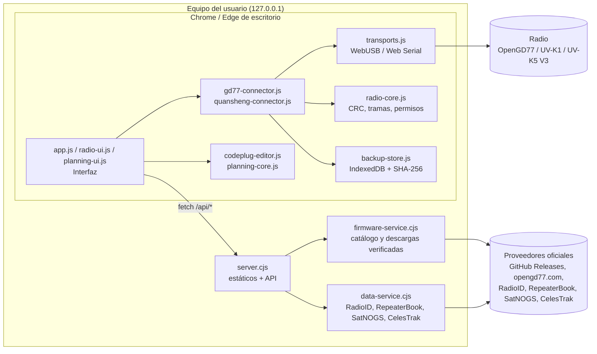
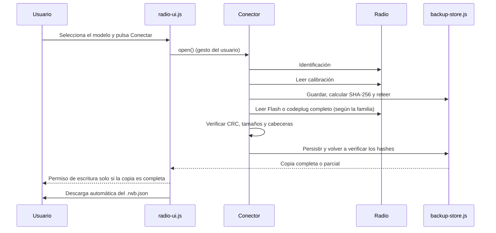
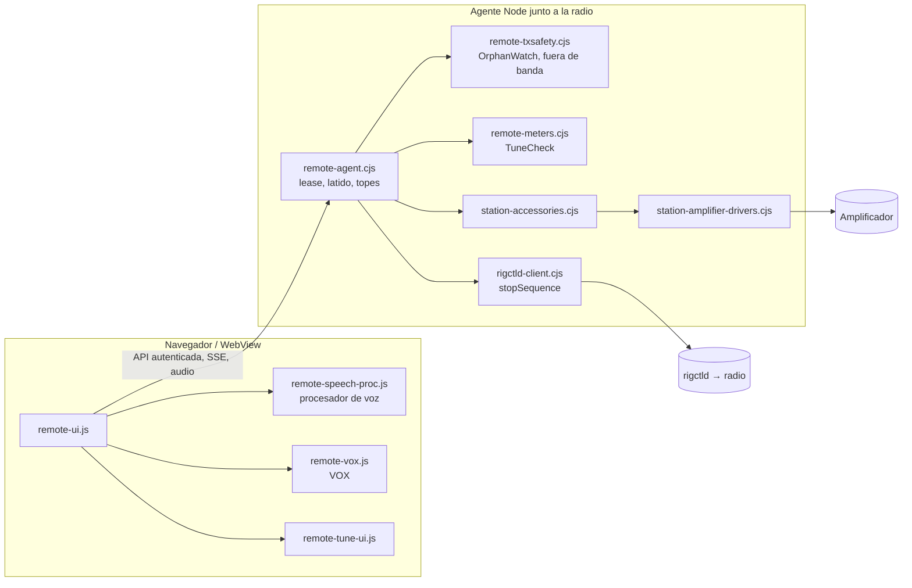

# Arquitectura de Bricohams Radio Workspace

Bricohams Radio Workspace es una aplicación web **local**. Un pequeño servidor Node.js sirve una lista cerrada de archivos estáticos y unas pocas API de solo lectura. La comunicación con la radio de los conectores de firmware, codeplug y copias ocurre en el navegador mediante WebUSB o Web Serial. El control remoto por CAT es un componente aparte (ver [Estación remota](#estación-remota-y-seguridad-de-tx)): un agente junto a la radio y una consola que se conecta a él.

## Modos de ejecución

Al arrancar, `runtime-mode.js` pide `runtime.json` (ruta relativa, sin caché). Solo `{"mode":"local"}` activa el modo local; si falta, da 404, no es JSON o la página se abre como `file://`, la aplicación arranca en **modo web** sin errores. `server.cjs` lo sirve como `{"mode":"local"}` y `scripts/build-pages.cjs` genera `{"mode":"web"}` en `dist/`. La insignia superior indica «Web · GitHub Pages» o «Local · instalado».

| Aspecto | Web (Pages) | Local |
| --- | --- | --- |
| Servidor | Ninguno, solo estáticos | `server.cjs` en `127.0.0.1:8787` |
| Firmware F4HWN / ARDF K1-K5 V3 | Historial estable desde `api.github.com` de Armel y reald; el usuario carga el archivo y se verifica tamaño y SHA-256 publicado | Descarga verificada por el servidor; ARDF, versiones anteriores a v6 y SA818 solo descarga |
| Firmware OpenGD77 | Carga manual del ZIP (nombre y firma ZIP; sin hash del editor) | Descarga por el servidor |
| RadioID | Carga de `user.csv` (100 MiB, filtrado, 5 000 filas mostradas) y perfil opcional en `localStorage` | API vía servidor |
| RepeaterBook | No disponible | Token aprobado, solo en el servidor |
| Satélites | `data/satellites.json` diario (`scripts/fetch-satellites.cjs`) | TLE en directo |

Las rutas del cliente son siempre relativas. La CSP de cada HTML se declara en `<meta>`, y como un `<meta>` no admite `frame-ancestors`, `app.js` se detiene si la página está enmarcada. El origen de la web es propio (ver ADR-013).

## Vista de componentes

## Módulos

| Archivo | Lado | Responsabilidad |
| --- | --- | --- |
| `index.html`, `opengd77.html`, `quansheng.html`, `ayuda.html` | Navegador | Esqueletos de página con `body[data-page]`, sin scripts en línea. |
| `app.js` | Navegador | Interfaz común (marca, navegación, pie), guías y página de ayuda con buscador. |
| `radio-ui.js` | Navegador | Panel de conexión, copias automáticas, historial, exportación y acciones protegidas. |
| `transports.js` | Navegador | `USBTransport` (CDC sobre WebUSB, `1FC9:0094`) y `SerialTransport` (Web Serial), con lectura exacta y tiempo límite. |
| `radio-core.js` | Navegador / Node | CRC-16/CRC-32, utilidades binarias, permisos de escritura y SHA-256. |
| `gd77-connector.js` | Navegador | Protocolo OpenGD77 CPS (`C`/`R`/`W`/`X`) y mapas MK22, STM32 y SERIAL. |
| `quansheng-connector.js` | Navegador | Protocolo UART F4HWN (ofuscación XOR, CRC), lectura de calibración y Flash, slots Multiboot. |
| `backup-store.js` | Navegador | Persistencia en IndexedDB, relectura verificada y exportación `.rwb.json`. |
| `codeplug-editor.js` | Navegador / Node | Lectura y escritura binaria del codeplug OpenGD77: canales, contactos y bloque SAT tipo 3. |
| `planning-core.js` | Navegador / Node | Filtros, deduplicación, CSV, validación de TLE y pases SGP4 con `satellite.js`. |
| `planning-ui.js` | Navegador | Panel «Codeplug: contactos, repetidores y SAT». |
| `firmware-catalog.js` | Navegador / Node | Modelos y fuentes de firmware permitidas. |
| `server.cjs` | Node | Servidor HTTP en `127.0.0.1:8787`, lista de archivos permitidos, cabeceras de seguridad y enrutado de `/api/*`. |
| `firmware-service.cjs` | Node | Consulta a GitHub Releases y opengd77.com con redirecciones controladas, límites de tamaño y caché. |
| `runtime-mode.js` | Navegador | Detecta el modo (`runtime.json`; web si falta). |
| `radioid-csv.js` | Navegador / Node | Lectura filtrada de `user.csv` y perfil local opcional. |
| `scripts/build-pages.cjs`, `scripts/fetch-satellites.cjs` | Node | Generan `dist/` y `data/satellites.json` para Pages. |
| `data-service.cjs` | Node | Proxy de solo lectura hacia RadioID, RepeaterBook (credenciales solo en el servidor), SatNOGS y CelesTrak. |
| `remote-station.cjs`, `remote-agent.cjs` | Node | Supervisor de `rigctld`/`rotctld` (lo usa `server.cjs` para `/api/remote/*` y el modo headless) y agente del Remote shack. Ver la sección siguiente. |
| `remote-txsafety.cjs`, `remote-meters.cjs`, `station-amplifier-drivers.cjs` | Node | Guardas de TX (`OrphanWatch`, bloqueo fuera de banda), `TuneCheck` y drivers de amplificador. |
| `remote-speech-proc.js`, `remote-vox.js` | Navegador / Node | Procesador de voz y VOX de la ruta TX remota (scripts clásicos que también exportan en CommonJS). |

## Flujo de conexión y copia automática

Antes de cualquier escritura se relee la copia y se compara con los hashes del permiso. Desconectar la radio, cambiarla por otra o borrar la copia revoca el permiso.

## Estación remota y seguridad de TX

El **Remote shack** (`remote-agent.cjs`, consola `remote.html` / `remoto.html`) controla una radio por Hamlib `rigctld` y es independiente de la estación Python de `remote-station/` (ver [REMOTE_STATION.md](REMOTE_STATION.md)). `server.cjs` no cambia: sigue escuchando solo en `127.0.0.1` y delega `/api/remote/*` en `remote-station.cjs`. El mapa completo de módulos está en el [mapa técnico](MAPA-TECNICO-PROYECTO.md#mapa-de-módulos-diagrama-de-dependencias).

La consola React de la estación Python reutiliza los mismos `remote-speech-proc.js` y `remote-vox.js` a través de `remote-station/apps/web-console/src/txProcessing.ts`; el agente Python tiene su propio bloqueo fuera de banda en `remote-station/bricoham_station_agent/txsafety.py`.

### Garantías de TX

El software nunca transmite por sí mismo: toda puesta en TX es una orden explícita del operador. Las guardas del agente, comprobadas en `remote-agent.cjs`:

| Guarda | Comportamiento |
| --- | --- |
| PTT off | `pttOff()` tiene prioridad sobre todo: termina una sintonía en curso, detiene el CW y ejecuta `stopSequence` (parada del sintonizador, `txOff` crudo y `T 0` de Hamlib, con prioridad en la cola). |
| Latido | Sin latido durante `HEARTBEAT_TIMEOUT_MS` (1000 ms) el agente suelta PTT y pone el amplificador en STANDBY. |
| Topes de tiempo | Límite de TX (`txLimitSeconds`, 180 s por defecto) y de sintonía (`TUNE_MAX_SECONDS`: interno 20 s por defecto y 30 s máximo; ATAS 45 s y 60 s). |
| ROE | Disparo por ROE sostenida sobre `swrLimit` (3 por defecto) o el límite en bruto del perfil CAT; durante la sintonía se usa `TUNE_SWR_MS`. |
| Amplificador | `accessories.standby("lease")` en cada pérdida de lease o latido; arranca en STANDBY y no pasa a OPERATE sin condiciones seguras. |
| Fuera de banda | `remote-txsafety.cjs`: solo con `txRanges` configurados; frecuencia o modo desconocidos también bloquean una nueva puesta en TX. Un fallo de lectura aislado no corta una emisión en curso. |
| TX huérfano | `OrphanWatch`: una emisión del agente sin titular del lease se libera tras dos observaciones consecutivas. |
| Bloqueo del operador | Un solo operador a la vez (lease); en la consola, `view.locked` impide acciones y desarma VOX. |

VOX (`remote-vox.js`) no añade ningún camino de TX: usa el mismo `pttDown`/`pttUp` que el botón, nunca se persiste y se desarma ante rechazo, corte del agente, pérdida de control o de enlace, bloqueo y página oculta. El procesador de voz (`remote-speech-proc.js`) está apagado por defecto y limita la salida a un techo fijo de −1 dBFS.

### Comprobación de sintonía y parada al cerrar

- `TuneCheck` (`remote-meters.cjs`; espejo Python en `remote-station/bricoham_remote_station/tune_check.py`) recorre `requested → confirming → tuning → reading → stopping → verifying → done` con resultados `success`, `fail`, `timeout` y **`unverified`**. En una sintonía ATAS, si `evidence(false)` indica que la radio no mostró que el sintonizador trabajara y la ROE no es alta, el resultado es `unverified` con razón `no-tune-evidence` (en la consola: «Sintonía sin verificar»); si TX0 no se confirma por lectura, pasa a `fail` (`tx-stuck`). Un `cut()` nunca produce `unverified`.
- `close()` del agente apaga PTT primero y llama a `settleStopBeforeClose`: espera (con tope `stopStepMs * 5 + 500` ms) a que termine una parada en vuelo y, si no se confirmó, repite `stopSequence` una vez antes de soltar el cliente `rigctld`. Después detiene el CW, ejecuta `accessories.emergencyStop("close")`, cierra el driver del amplificador y pone a salvo los dispositivos de estación.

Las pruebas deterministas (relojes y transportes simulados) están en `tests/remote-txsafety.test.cjs`, `tests/remote-txaudio.test.cjs`, `tests/remote-amplifier-drivers.test.cjs`, `tests/remote-meters.test.cjs`, `tests/remote-agent.test.cjs` y, en Python, `remote-station/tests/test_tx_inhibit.py` y `test_tune_check.py`. Los drivers de amplificador están «implementados desde fuente, sin probar en hardware»: no existe captura de un amplificador real en el repositorio.

## Capas de seguridad

1. **Red:** el servidor solo escucha en `127.0.0.1`, exige `Host: 127.0.0.1:<puerto>` y sirve una lista fija de archivos.
2. **Navegador:** CSP `default-src 'self'; script-src 'self'; style-src 'self'`, `Permissions-Policy`, `nosniff`, `no-referrer` y `no-store`. No se usa `eval` ni se construye HTML con datos de la radio.
3. **Equipo:** las escrituras usan un permiso *fail-closed* ligado a una copia verificada. Main nunca es destino. Borrar o restablecer exige confirmación escrita.
4. **Fuentes externas:** solo proveedores oficiales, redirecciones a hosts permitidos, límites de tamaño y SHA-256 visible. Las credenciales de RepeaterBook nunca se envían al navegador.
5. **Datos:** sin telemetría ni subidas. Las copias quedan en el IndexedDB del perfil local y se exportan a archivos del usuario.
6. **Transmisión remota:** TX desactivado por defecto, solo por orden explícita del operador, con las guardas de [Garantías de TX](#garantías-de-tx). Las credenciales del relé se guardan en el agente (`~/.radicodex/remote-agent.json`, 0600) y no se imprimen; el token de acceso viaja solo en el fragmento de la URL y la consola lo retira de la barra de direcciones. Las guardas por software no sustituyen enclavamientos físicos.

## Documentación del código

La documentación detallada del código y de las pruebas se mantiene en archivos aparte:

- [Node: agente y escritorio][codigo-node]: servidor local, agente Remote shack y consolas de la raíz.
- [Python: estación remota][codigo-python]: host coordinador y agente de `remote-station/`.
- [Android y consola web][codigo-android]: aplicaciones nativas y consola React/Capacitor.
- [Pruebas y resultados][pruebas]: qué cubre cada suite y los resultados registrados.

Estos cuatro documentos se redactan en paralelo; si un enlace no resuelve en una copia concreta del repositorio, el documento aún no se ha incorporado a esa rama.

[codigo-node]: codigo/NODE-AGENTE-Y-ESCRITORIO.md
[codigo-python]: codigo/PYTHON-ESTACION-REMOTA.md
[codigo-android]: codigo/ANDROID-Y-CONSOLA-WEB.md
[pruebas]: PRUEBAS-Y-RESULTADOS.md

## Limitaciones conocidas

- **OpenGD77:** no existe aquí un protocolo verificado para extraer el firmware completo del MCU. La copia se marca como **parcial** y la escritura en la radio queda bloqueada.
- **Quansheng:** la copia física completa de la Flash requiere las capacidades de lectura y CRC de F4HWN Labs v6.1+. La web implementa escritura Beta de configuración/canales con respaldo y relectura, y las imágenes Bricohams SAT incorporan CAT RX experimental. Eso no demuestra escritura persistente ni funcionamiento CAT en una radio concreta; consulta la [matriz de validación](VALIDACION-INTEGRAL-V3-ANDROID.md).
- **RepeaterBook:** requiere un token aprobado por RepeaterBook y solo está en la versión local.
- **Web:** los datos de satélites pueden tener hasta un día de antigüedad (se avisa a partir de 7 días) y firmware/RadioID se cargan a mano.
- **Hardware:** existen lecturas previas de una unidad Quansheng, pero no certifican las escrituras, el residente independiente ni la combinación actual de APK, slot SAT y teléfono. Las pruebas físicas de esta revisión están pendientes.

## Security review (SonarQube 2026-11-13)

### Corregido

**xml:S6358 – Android application backup should be disabled or restricted** (MEDIUM) — `android/app/src/fdroid/AndroidManifest.xml:6`.
- *Por qué era un fallo:* con la copia de seguridad habilitada, los datos locales (preferencias, ficheros, bases de datos) pueden exportarse a Google Cloud o por `adb backup`, o restaurarse desde una copia manipulada (CWE-922, OWASP M9/A1). El overlay `<application>` del flavor F-Droid no declaraba el atributo, así que el análisis lo veía implícito (por defecto `true`).
- *Cambio:* se añade `android:allowBackup="false"` al overlay.
- *Sin pérdida de funcionalidad:* el manifiesto principal ya declara `allowBackup="false"`, `fullBackupContent="false"` y `dataExtractionRules`; el valor fusionado no cambia. Comprobación: `manifest merger report` del flavor fdroid (`processFdroidReleaseMainManifest`) muestra `allowBackup=false`.

**xml:S5332 – Clear-text protocols should not be used** (LOW) — mismo fichero, línea 6.
- *Por qué era un fallo:* en Android < 9 `usesCleartextTraffic` es `true` implícitamente, lo que permite http sin cifrar (interceptación y manipulación, CWE-319, CWE-200).
- *Cambio:* se añade `android:usesCleartextTraffic="false"` al overlay.
- *Sin pérdida de funcionalidad:* el manifiesto principal ya lo fija a `false` y define `networkSecurityConfig`; el resultado fusionado es idéntico. Comprobación: mismo informe de fusión; el comportamiento del rotor/radios no cambia.

**kotlin:S2245 – Pseudorandom number generators (PRNGs) should not be used in security contexts** (MEDIUM) — `android/app/src/main/java/org/bricohams/radio/Rt950Protocol.kt:156`.
- *Por qué era un fallo:* `Random()` no es un generador criptográficamente seguro; si un atacante conoce o adivina su estado interno puede predecir los siguientes valores (CWE-338, CWE-330, OWASP A2 Cryptographic Failures). El valor por defecto de `Rt950Session.random` usaba `Random()`.
- *Cambio:* el valor por defecto pasa a `SecureRandom()` (`java.security.SecureRandom`, subclase de `java.util.Random`). El tipo del parámetro sigue siendo `Random`, así que los tests pueden inyectar una instancia con semilla.
- *Sin pérdida de funcionalidad:* `buildKeyFrame` sigue usando los mismos rangos (`nextInt(2)+1`, `nextInt(5)`, `nextInt(KEYS.size)`), por lo que los bytes del protocolo RT-950 no cambian de formato. Comprobación: (`Rt950ProtocolTest`: `headersAndKeySelection`, `readAllSkipsUnknownRegions`).

**kotlin:S2245 (MEDIUM)** — `android/app/src/test/java/org/bricohams/radio/Rt950ProtocolTest.kt:93` (y líneas 67, 175, 309). No modificado.
- *Por qué lo marca Sonar:* mismo motivo que arriba (PRNG no criptográfico, CWE-338/CWE-330).
- *Decisión:* es un test unitario que usa `Random(it.toLong())` con semilla fija para generar tramas de clave reproducibles; no es un contexto de seguridad (no genera secretos) y `SecureRandom` haría el test no determinista. Se deja sin cambios.
- *Sin pérdida de funcionalidad:* no se toca nada. Comprobación: `Rt950ProtocolTest` sigue pasando; la clase de producción acepta cualquier `Random` inyectado.

### Not changed - requires decision

- **Sonar javascript S4036 (LOW, CWE-426/427)** — `scripts/build-platform-app.cjs:16,20,27,30`, `scripts/build-platform-resident.cjs:55,73,82,85,87,89`, `scripts/export-project.cjs:48,94,177,178,181,230`. Los scripts invocan `arm-none-eabi-*`, `git` y `zip` por nombre. No hay una ruta absoluta fija válida para todos los equipos (la toolchain ARM y git se instalan en ubicaciones distintas); inventarla o exigir una variable de entorno nueva cambiaría el uso. Decisión: aceptar el riesgo (herramientas de desarrollo ejecutadas por el propio desarrollador) o definir una variable de entorno para la ruta de la toolchain. (La invocación de `tar.exe` en línea 228 ya usa ruta absoluta.)
- **kotlin:S1313 (LOW)** — `android/app/src/main/java/org/bricohams/radio/RotorProtocol.kt:14`. `AP_HOST = "192.168.4.1"` es la dirección de fábrica del punto de acceso del rotor ESP32; moverla a configuración rompería la conexión por defecto.
- **kotlin:S2245 (MEDIUM)** — `android/app/src/test/java/org/bricohams/radio/FtxEnhancedDecoderTest.kt:59`. Es un test unitario con `Random(7)` de semilla fija para reproducir el patrón de errores; no es un contexto de seguridad y `SecureRandom` haría el test no determinista.
- **kotlin:S7204 (HIGH)** — `android/app/build.gradle.kts:52`. Activar `isMinifyEnabled` requiere reglas ProGuard/R8 (no existe ningún `proguard-rules.pro`) y validar en dispositivo que la reflexión/JSON/BLE siguen funcionando; no se puede garantizar sin pruebas físicas. Decisión: crear las reglas keep y probar un APK release minificado.

### Corregido (SonarQube 2026-11-14)

- **kotlin:S1143:** se elimina el `throw` dentro de `finally` en `RigActivity` y `SstvTransmit`.
- **kotlin:S899:** se comprueba el resultado de `delete` en `OtaPlatform` y `SatelliteCatalog`.
- **java:S3034 / java:S2184:** aritmética de `byte`/`long` corregida (conversión explícita y máscaras antes de operar) en `Osd174`, `FtxFrames`, `FtxReceiver`, `Unpack77` y `Ldpc174`.
- **JS S2871:** los comparadores de `sort` ahora son explícitos.
- **JS S9383:** las promesas flotantes se esperan o se gestionan.
- **JS S6324:** se eliminan los caracteres de control de las expresiones regulares.
- **JS S6544:** se corrige el uso indebido de promesas.
- **JS S1143:** se elimina el `throw` dentro de `finally` en `quansheng-factory`.
- **JS S7727:** se corrigen los callbacks de `map`.
- **xml:S6358 / xml:S5332:** el manifiesto del flavor fdroid declara `android:allowBackup="false"` y `android:usesCleartextTraffic="false"`.
- **JS S4036:** el `PATH` de compilación es de confianza; se marca con `NOSONAR`.
- **kotlin:S2245:** el RNG con semilla de los tests es determinista a propósito; se marca con `NOSONAR`.
- **kotlin:S7204:** R8 se deja como `TODO` (pendiente de reglas keep y pruebas en dispositivo).
