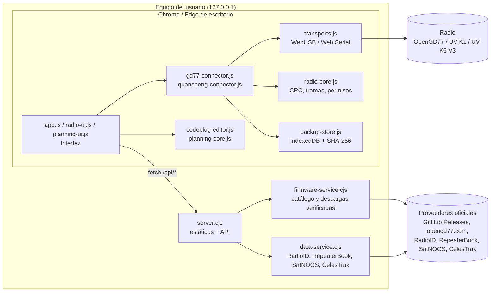
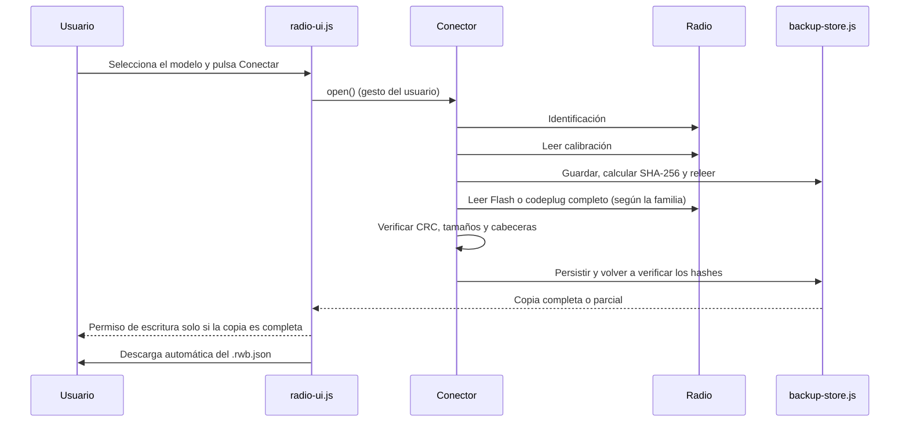

# Arquitectura de Bricohams Radio Workspace

Bricohams Radio Workspace es una aplicación web **local**. Un pequeño servidor Node.js sirve una lista cerrada de archivos estáticos y unas pocas API de solo lectura. Toda la comunicación con la radio ocurre en el navegador mediante WebUSB o Web Serial.

## Modos de ejecución

Al arrancar, `runtime-mode.js` pide `runtime.json` (ruta relativa, sin caché). Solo `{"mode":"local"}` activa el modo local; si falta, da 404, no es JSON o la página se abre como `file://`, la aplicación arranca en **modo web** sin errores. `server.cjs` lo sirve como `{"mode":"local"}` y `scripts/build-pages.cjs` genera `{"mode":"web"}` en `dist/`. La insignia superior indica «Web · GitHub Pages» o «Local · instalado».

| Aspecto | Web (Pages) | Local |
| --- | --- | --- |
| Servidor | Ninguno, solo estáticos | `server.cjs` en `127.0.0.1:8787` |
| Firmware F4HWN / ARDF K1-K5 V3 | Historial estable desde `api.github.com` de Armel y reald; el usuario carga el archivo y se verifica tamaño y SHA-256 publicado | Descarga verificada por el servidor; ARDF, versiones anteriores a v6 y SA818 solo descarga |
| Firmware OpenGD77 | Carga manual del ZIP (nombre y firma ZIP; sin hash del editor) | Descarga por el servidor |
| RadioID | Carga de `user.csv` (100 MiB, filtrado, 5 000 filas mostradas) y perfil opcional en `localStorage` | API vía servidor |
| RepeaterBook | No disponible | Token aprobado, solo en el servidor |
| Satélites | `data/satellites.json` diario (`scripts/fetch-satellites.cjs`) | TLE en directo |

Las rutas del cliente son siempre relativas. La CSP de cada HTML se declara en `<meta>`, y como un `<meta>` no admite `frame-ancestors`, `app.js` se detiene si la página está enmarcada. El origen de la web es propio (ver ADR-013).

## Vista de componentes

## Módulos

| Archivo | Lado | Responsabilidad |
| --- | --- | --- |
| `index.html`, `opengd77.html`, `quansheng.html`, `ayuda.html` | Navegador | Esqueletos de página con `body[data-page]`, sin scripts en línea. |
| `app.js` | Navegador | Interfaz común (marca, navegación, pie), guías y página de ayuda con buscador. |
| `radio-ui.js` | Navegador | Panel de conexión, copias automáticas, historial, exportación y acciones protegidas. |
| `transports.js` | Navegador | `USBTransport` (CDC sobre WebUSB, `1FC9:0094`) y `SerialTransport` (Web Serial), con lectura exacta y tiempo límite. |
| `radio-core.js` | Navegador / Node | CRC-16/CRC-32, utilidades binarias, permisos de escritura y SHA-256. |
| `gd77-connector.js` | Navegador | Protocolo OpenGD77 CPS (`C`/`R`/`W`/`X`) y mapas MK22, STM32 y SERIAL. |
| `quansheng-connector.js` | Navegador | Protocolo UART F4HWN (ofuscación XOR, CRC), lectura de calibración y Flash, slots Multiboot. |
| `backup-store.js` | Navegador | Persistencia en IndexedDB, relectura verificada y exportación `.rwb.json`. |
| `codeplug-editor.js` | Navegador / Node | Lectura y escritura binaria del codeplug OpenGD77: canales, contactos y bloque SAT tipo 3. |
| `planning-core.js` | Navegador / Node | Filtros, deduplicación, CSV, validación de TLE y pases SGP4 con `satellite.js`. |
| `planning-ui.js` | Navegador | Panel «Codeplug: contactos, repetidores y SAT». |
| `firmware-catalog.js` | Navegador / Node | Modelos y fuentes de firmware permitidas. |
| `server.cjs` | Node | Servidor HTTP en `127.0.0.1:8787`, lista de archivos permitidos, cabeceras de seguridad y enrutado de `/api/*`. |
| `firmware-service.cjs` | Node | Consulta a GitHub Releases y opengd77.com con redirecciones controladas, límites de tamaño y caché. |
| `runtime-mode.js` | Navegador | Detecta el modo (`runtime.json`; web si falta). |
| `radioid-csv.js` | Navegador / Node | Lectura filtrada de `user.csv` y perfil local opcional. |
| `scripts/build-pages.cjs`, `scripts/fetch-satellites.cjs` | Node | Generan `dist/` y `data/satellites.json` para Pages. |
| `data-service.cjs` | Node | Proxy de solo lectura hacia RadioID, RepeaterBook (credenciales solo en el servidor), SatNOGS y CelesTrak. |

## Flujo de conexión y copia automática

Antes de cualquier escritura se relee la copia y se compara con los hashes del permiso. Desconectar la radio, cambiarla por otra o borrar la copia revoca el permiso.

## Capas de seguridad

1. **Red:** el servidor solo escucha en `127.0.0.1`, exige `Host: 127.0.0.1:<puerto>` y sirve una lista fija de archivos.
2. **Navegador:** CSP `default-src 'self'; script-src 'self'; style-src 'self'`, `Permissions-Policy`, `nosniff`, `no-referrer` y `no-store`. No se usa `eval` ni se construye HTML con datos de la radio.
3. **Equipo:** las escrituras usan un permiso *fail-closed* ligado a una copia verificada. Main nunca es destino. Borrar o restablecer exige confirmación escrita.
4. **Fuentes externas:** solo proveedores oficiales, redirecciones a hosts permitidos, límites de tamaño y SHA-256 visible. Las credenciales de RepeaterBook nunca se envían al navegador.
5. **Datos:** sin telemetría ni subidas. Las copias quedan en el IndexedDB del perfil local y se exportan a archivos del usuario.

## Limitaciones conocidas

- **OpenGD77:** no existe aquí un protocolo verificado para extraer el firmware completo del MCU. La copia se marca como **parcial** y la escritura en la radio queda bloqueada.
- **Quansheng:** la copia física completa de la Flash requiere las capacidades de lectura y CRC de F4HWN Labs v6.1+. La web implementa escritura Beta de configuración/canales con respaldo y relectura, y las imágenes Bricohams SAT incorporan CAT RX experimental. Eso no demuestra escritura persistente ni funcionamiento CAT en una radio concreta; consulta la [matriz de validación](VALIDACION-INTEGRAL-V3-ANDROID.md).
- **RepeaterBook:** requiere un token aprobado por RepeaterBook y solo está en la versión local.
- **Web:** los datos de satélites pueden tener hasta un día de antigüedad (se avisa a partir de 7 días) y firmware/RadioID se cargan a mano.
- **Hardware:** existen lecturas previas de una unidad Quansheng, pero no certifican las escrituras, el residente independiente ni la combinación actual de APK, slot SAT y teléfono. Las pruebas físicas de esta revisión están pendientes.
