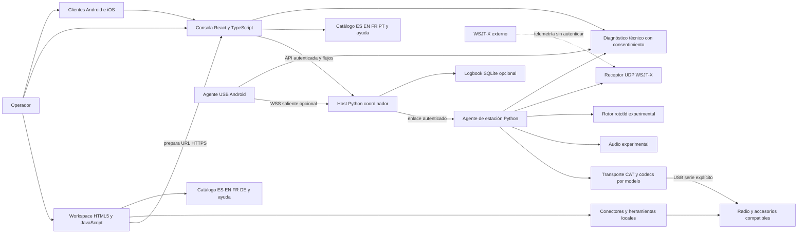

# Mapa técnico y guía de desarrollo

Este documento describe la organización de Bricohams Radio Workspace y su
estación remota. Es un mapa de dependencias, no una red neuronal de inteligencia
artificial. Los enlaces conducen a la documentación y al código de referencia;
la presencia de un módulo no implica que esté validado en todas las plataformas.

## Mapa visual de componentes



Las flechas son relaciones funcionales, no garantías de compatibilidad. La
consola del host y el Workspace son aplicaciones distintas: la página de
estación del Workspace prepara la dirección del host y no abre el puerto CAT.
El agente Android tiene capacidades distintas de las del agente Python.

## Organización del repositorio

| Área | Código y responsabilidad |
|---|---|
| Workspace | [Raíz](../): páginas HTML, `app.js`, interfaces `*-ui.js`, lógica `*-core.js`, `transports.js` y conectores por radio; `server.cjs` sirve funciones locales, no es el host remoto. |
| Datos y herramientas | [data](../data), [templates](../templates), [scripts](../scripts), [tools](../tools), [tests](../tests): catálogos, plantillas, generación, herramientas y pruebas del Workspace. |
| Firmware y hardware | [firmware](../firmware), [hardware](../hardware), [precompiled](../precompiled), [third_party](../third_party): fuentes, datos, binarios y referencias de terceros con sus licencias propias. No asumir que todos son código original. |
| Android | [android/app](../android/app) es RadiCodex; [station-core](../android/station-core) comparte diagnóstico y validación; [station-agent](../android/station-agent) es el agente USB independiente. |
| Integración remota | [remote-station](../remote-station): host, agente, controladores, consola, pruebas, distribución y documentos. |
| Distribución y automatización | [installers](../installers), [fdroid](../fdroid), [fastlane](../fastlane), [.github/workflows](../.github/workflows): instaladores, metadatos de tienda y CI. |
| Documentación | [docs](.), [ayuda remota](../remote-station/docs/help/README.md) y [manual de estación](../remote-station/README.md): fuentes y límites específicos. |

Para obtener el índice completo de archivos versionados, desde la raíz usa
`git ls-files`. `git status --short` también muestra los cambios de trabajo
no confirmados. Los directorios de dependencias, cachés y compilación no son
el código fuente: se regeneran según los manifiestos.

En la copia `D:\Git\Radio-Web-install`, Git puede rechazar el repositorio
porque el sistema de archivos de la unidad no registra propietarios. Para esa
copia confiable, usa una excepción limitada a cada comando, por ejemplo:

```powershell
git -c 'safe.directory=D:\Git\Radio-Web-install' status --short
git -c 'safe.directory=D:\Git\Radio-Web-install' ls-files
```

La excepción no cambia la configuración global. No se debe aplicar a rutas
desconocidas ni sustituir por una excepción para todos los repositorios.

## Despiece de la estación remota

| Ruta | Función y puntos de entrada |
|---|---|
| [bricoham_remote_station](../remote-station/bricoham_remote_station) | `server.py` expone el coordinador; `security.py`, `secure_http.py`, `transport_security.py` y `websocket_transport.py` gestionan las fronteras de acceso y transporte. `contracts.py` define contratos; `capabilities.py` y `radio_candidates.py` describen capacidades y candidatos. |
| [drivers](../remote-station/bricoham_remote_station/drivers) | Encoders y decoders por protocolo/modelo. `ftx1_cat.py` contiene el perfil FTX-1; `cat_diagnostics.py` lo presenta offline sin abrir un puerto. No reutilizar un perfil de otro modelo sin evidencia. |
| [Agente Python](../remote-station/bricoham_station_agent) | `server.py` publica sus rutas; `inventory.py` enumera; `cat.py` serializa consultas; `radio_settings.py` configura ajustes; `ptt.py`, `audio.py`, `audio_tx.py` y `rotor.py` implementan rutas experimentales separadas. `wsjtx.py` recibe telemetría UDP del programa externo. |
| [Consola web](../remote-station/apps/web-console/src) | `main.tsx` monta `App.tsx`; `api.ts` comunica con el host; los paneles CAT, audio, PTT, rotor, ajustes, logbook y diagnóstico están separados. `i18n.ts` y `LanguageProvider.tsx` gestionan idioma. |
| [Clientes móviles](../remote-station/apps/web-console) | Capacitor contiene proyectos `android` e `ios` y reutiliza la consola. iOS requiere Xcode y firma; una carpeta de proyecto no acredita compilación o validación. |
| [Tests Python](../remote-station/tests) y [tests web](../remote-station/apps/web-console/src) | Cubren protocolos, errores y controles mediante pruebas y simulaciones; no reemplazan aceptación física. |
| [Scripts remotos](../remote-station/scripts) y [deploy](../remote-station/deploy) | Generación de ayuda, contrato diagnóstico y paquetes; ejemplos de despliegue. Los resultados deben verificarse por plataforma. |

## Flujo y decisiones de seguridad

1. El operador selecciona explícitamente modelo y puerto en el agente; la
   enumeración USB no identifica por sí sola el CAT.
2. El cliente se autentica ante el host. El host accede al agente mediante el
   enlace configurado; los controles tienen autorizaciones y opt-ins propios.
3. La consulta CAT permitida pasa por el perfil del modelo, el transporte y
   su decoder. Errores y respuestas desconocidas no se sustituyen por datos
   simulados. Las operaciones que cambian estado son rutas distintas.
4. El logbook es manual y opcional; los mensajes UDP de WSJT-X no están
   autenticados y no autorizan RF. El envío diagnóstico requiere consentimiento;
   consulta [privacidad](DIAGNOSTICS.md).

La FTX-1 respondió por USB en lectura limitada, pero `IF` se rechaza en la
unidad observada. No hay aceptación completa de RF ni datos de espectro nativo
verificados. PTT, audio TX y rotor son experimentales y pueden operar hardware
real si se habilitan: sus guardas software no sustituyen enclavamientos físicos.
Véanse [evidencia FTX-1](../remote-station/docs/hardware/ftx1-spa1.md),
[PTT](../remote-station/docs/ptt-ftx1.md) y
[despliegue seguro](../remote-station/docs/despliegue-seguro.md).

## Cómo programar en varios idiomas

Hay varios sistemas de localización; no comparten automáticamente catálogos.
Conserva iguales en todos los idiomas los avisos RF, los límites y el carácter
experimental; no traduzcas comandos CAT, IDs, claves de API, datos importados
ni valores de protocolo.

### Consola de estación y clientes Capacitor

1. Añade una clave descriptiva al objeto español `es` de
   [i18n.ts](../remote-station/apps/web-console/src/i18n.ts) y la misma clave
   a `en`, `fr` y `pt`. `Message` se deriva de `es` y los otros catálogos se
   tipan como `Record<Message, string>`.
2. En un componente bajo `LanguageProvider`, usa `const { t } = useLanguage()`
   y `{t('nombreDeLaClave')}`; usa la traducción también para etiquetas
   accesibles y mensajes de error. No construyas frases a partir de fragmentos
   cuyo orden dependa del idioma.
3. El selector y la persistencia del idioma están en
   [LanguageProvider.tsx](../remote-station/apps/web-console/src/LanguageProvider.tsx);
   se guarda la preferencia, no el token. Cambiar de idioma no debe reiniciar
   una sesión ni activar controles.
4. La ayuda tiene como fuente `help-content.json`. Sigue
   [la guía de ayuda](../remote-station/docs/help/README.md), genera con
   `py -3.12 scripts\build_help.py` desde `remote-station` y verifica con
   `py -3.12 scripts\build_help.py --check`. No edites a mano los manuales
   generados.
5. Ejecuta las pruebas de componentes relevantes en los cuatro idiomas;
   comprueba texto visible, `aria-label`, advertencias y que cambiar idioma no
   envíe órdenes ni pierda una sesión.

### Workspace HTML5 y Android nativo

- En el Workspace, [ui-translations.js](../ui-translations.js) registra texto
  español exacto seguido por inglés estadounidense, francés y alemán;
  [ui-i18n.js](../ui-i18n.js) gestiona selección, atributos y enlaces. Añade
  las cuatro entradas y prueba `node --test tests\ui-i18n.test.cjs` desde la
  raíz. La ayuda estática tiene sus propios archivos y generadores.
- En Android, usa recursos `strings.xml` en `res/values*` y `getString` o
  recursos de interfaz, no cadenas incrustadas. RadiCodex y el agente USB
  tienen recursos independientes; comprueba sus carpetas de idioma y recursos
  por defecto antes de añadir o modificar una traducción.
- No atribuyas a todos los componentes los mismos idiomas: la consola remota
  usa ES/EN/FR/PT; el selector principal del Workspace usa ES/EN-US/FR/DE.
  Los manuales y recursos nativos tienen coberturas propias.

## Procedencia de código y conocimiento de terceros

Todo código adaptado de terceros se registra en [THIRD-PARTY-REUSE.md](THIRD-PARTY-REUSE.md),
que fija la política de licencias (REUSE o solo hechos), la lista de repositorios de la
colección y el método para radios nuevas: perfil de placa por modelo y revisión, señales
clasificadas como documentadas, medidas, inferidas o pendientes (solo las dos primeras pueden
actuar sobre hardware), procedimiento de portado con pruebas en host antes de TX y un
coordinador de seguridad para los periféricos de estación. `data/third-party/` no se publica.

## Compilación, pruebas y continuación

Consulta los requisitos y comandos actualizados de [integración](REMOTE_STATION.md)
y [README remoto](../remote-station/README.md). Ejemplos desde la raíz, tras
instalar dependencias según esas guías:

```powershell
node --test tests\ui-i18n.test.cjs tests\remote-station.test.cjs
Set-Location remote-station
py -3.12 -m unittest discover -s tests
py -3.12 scripts\build_help.py --check
npm --prefix apps\web-console test
npm --prefix apps\web-console run lint
npm --prefix apps\web-console run build
```

Para cambios funcionales, empieza por las pruebas del módulo afectado, conserva
las licencias y revisa los contratos de seguridad antes de usar hardware.
No guardes credenciales ni datos personales en código, documentación o commits.
