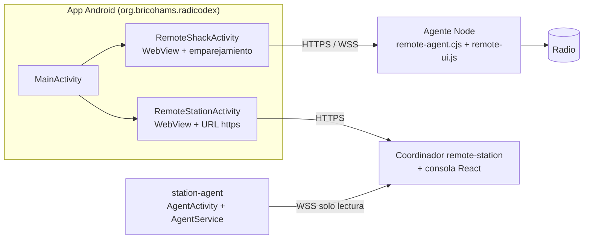
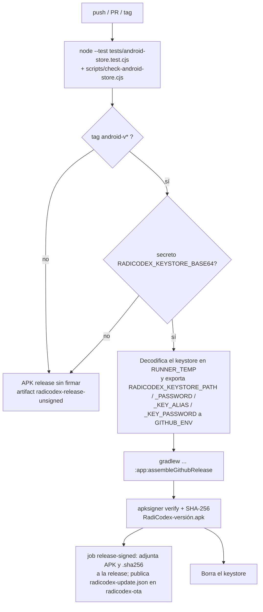
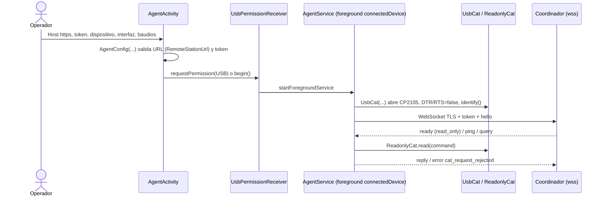
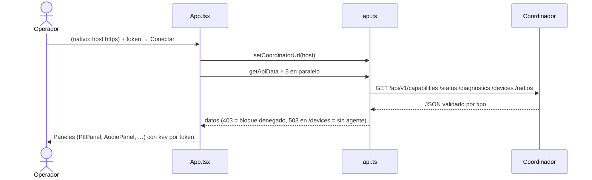
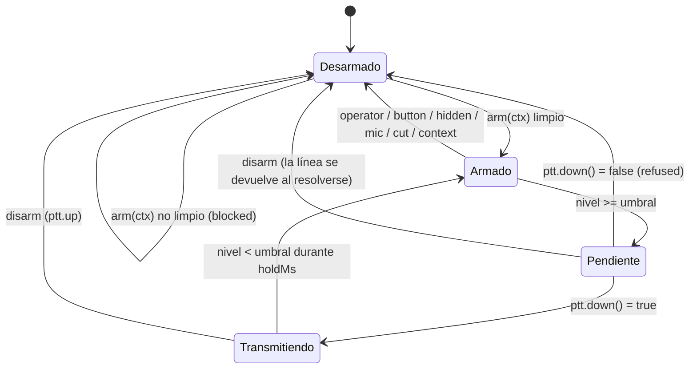

# App Android y consola web React: guía paso a paso

Esta guía explica cómo funcionan los dos clientes de la estación remota:

1. **La app Android** (`android/`, módulos `app`, `station-core` y `station-agent`).
2. **La consola web React** (`remote-station/apps/web-console/src`).

Todo lo descrito sale de leer el código; las rutas y los nombres de función son reales. Lo que no se ha podido comprobar se marca como *pendiente de verificar*. No se citan cifras que no estén en el código.

## 0. Mapa general: tres piezas que se confunden

| Pieza | Qué es | Dónde está |
| --- | --- | --- |
| Agente de escritorio (Node) | Habla con la radio, sirve su propia consola (`remote-ui.js`) y aplica la seguridad de TX | `remote-agent.cjs`, `remote-station.cjs`, `remote-txsafety.cjs` |
| Consola React | Cliente web del coordinador `remote-station` (Python) | `remote-station/apps/web-console/src` |
| App Android | Lanzador nativo con *WebViews* acotados y un agente USB de solo lectura | `android/` |

Punto clave: **`RemoteShackActivity` no carga la consola React.** Carga la URL `consoleUrl` del agente Node (`https://host:puerto/#token=…`, o `…/s/<estación>/#token=…` con relé). Esa página la sirve `remote-agent.cjs` (tabla de rutas con `/remote-ui.js`, `/remote-speech-proc.js` y `/remote-vox.js`). La consola React se usa desde un navegador o desde el envoltorio Capacitor (sección 7.1) y, en Android nativo, posiblemente también desde `RemoteStationActivity` (*pendiente de verificar* qué servidor concreto se escribe ahí: el código solo exige una URL `https` sin ruta).



## 1. Android: módulos y sabores

### 1.1 Módulos (`android/settings.gradle.kts`)

| Módulo | Tipo | Contenido relevante |
| --- | --- | --- |
| `:app` | `com.android.application`, `applicationId = "org.bricohams.radicodex"`, `namespace = "org.bricohams.radio"` | La app principal (todas las actividades) |
| `:station-core` | `com.android.library` | `RemoteStationUrl.kt` (validación de URL) y `AnonymousDiagnostics.kt`; `:app` y `:station-agent` dependen de él |
| `:station-agent` | `com.android.application`, `applicationId = "org.bricohams.stationagent"` | App independiente que lee la radio por USB y la expone, **solo lectura**, al coordinador |

`:app` y `:station-agent` comparten `station-core`, por eso `AgentConfig` (`station-agent/.../AgentApplication.kt`) reutiliza `RemoteStationUrl.parse`.

### 1.2 Sabores `github` y `fdroid` (`android/app/build.gradle.kts`)

La dimensión `distribution` define dos sabores con el campo `BuildConfig.OTA_ENABLED`:

| Sabor | `OTA_ENABLED` | Efecto |
| --- | --- | --- |
| `github` | `true` | APK con el actualizador OTA (`OtaConfig.enabled` lee `BuildConfig.OTA_ENABLED` en `Ota.kt`). Detalles en `android/OTA.md` |
| `fdroid` | `false` | Sin actualizador. `android/app/src/fdroid/AndroidManifest.xml` elimina con `tools:node="remove"` el permiso `REQUEST_INSTALL_PACKAGES`, `OtaActivity` y `OtaInstallReceiver` |

`MainActivity` solo muestra el botón de actualizaciones si `OtaConfig.enabled` (`home_open_updates`) y lanza `OtaAutoCheck.run` al crearse sin estado guardado.

Otras opciones del build (todas en `build.gradle.kts`):

- `minSdk = 26`, `targetSdk = 35`, `compileSdk = 35`.
- `dependenciesInfo { includeInApk = false }` y `vcsInfo.include = false`: builds reproducibles.
- `isMinifyEnabled` sigue sin activarse (hay un `TODO` por falta de reglas *keep*).
- Las tareas `syncChannelTemplates`, `syncAntennaAssets` y `syncRepeaterTemplates` copian datos del repositorio a `build/generated/…` en tiempo de build; no se versionan dentro de `assets`.

### 1.3 Firma en CI (`.github/workflows/android.yml`)



Cómo se engancha con Gradle: `build.gradle.kts` lee esas cuatro variables de entorno; solo si **las cuatro** son no vacías crea `signingConfigs.release` y la asigna al `buildType` `release`. Sin ellas el APK sale sin firmar (no falla el build). El workflow detecta el caso «hay keystore pero falta una contraseña o alias» y falla con error explícito. Las credenciales nunca se escriben en el repositorio.

El mismo job compila y prueba todo en una sola orden Gradle: pruebas unitarias de `station-core`, `station-agent`, `:app:testGithubDebugUnitTest` y `:app:testFdroidDebugUnitTest`, lint de ambos sabores y `assembleGithubRelease` / `assembleFdroidRelease`. En tags `v*` el job `release` adjunta los APK *debug* (no el firmado) a la release del workspace. El repositorio F-Droid propio lo construye `.github/workflows/fdroid.yml` a partir de los APK ya firmados.

## 2. Android: actividades

Todas heredan de `LocalizedActivity` (idioma y tema: `AppLanguage` guarda `es`, `en-US`, `fr`, `de` o vacío = sistema; `AppTheme` guarda `system|light|dark`).

### 2.1 `MainActivity` (`app/src/main/java/org/bricohams/radio/MainActivity.kt`)

Es la actividad `LAUNCHER`. Construye la interfaz por código (`render()`, `home()`, `tools()`) y desde ahí lanza las demás con `startActivity`. En lo que toca a esta guía:

- `tool_remote_shack` → `RemoteShackActivity` (la entrada «Shack remoto»).
- La sección `remote_title` → `RemoteStationActivity` (botón `remote_connect`).
- `AnonymousDiagnosticsActivity`, `ProfileActivity`, `SatelliteActivity`, `FtxActivity`, `NetControlActivity`, etc.
- Si `ProfileStore.isConfigured` es falso y es el primer arranque, abre `ProfileActivity`.

### 2.2 `RemoteShackActivity` (exportada, `singleTop`)

Es la actividad de emparejamiento y consola del agente Node. Tiene un *intent-filter* `VIEW` con esquema `radicodex-remote` y host `pair`, así que un enlace de emparejamiento puede abrir la app directamente. Ver secciones 3 y 4.

### 2.3 `RemoteStationActivity` (no exportada)

Cliente más simple: un campo de URL, `RemoteStationUrl.parse` y un `WebView`. No guarda la URL ni credenciales, y `onPause` descarta la sesión (sección 5).

### 2.4 Otras actividades declaradas en `AndroidManifest.xml`

`CatActivity`, `RigActivity`, `Rt950Activity`, `RtS10Activity`, `AprsChatActivity`, `DiagnosticsActivity`, `TemplateActivity`, `NetControlActivity`, `OpenGd77Activity`, `ChannelActivity`, `SstvActivity`, `LiveAudioActivity`, `FtxActivity`, `SatelliteActivity`, `RotorActivity`, `ToolsActivity`, `AntennaActivity`, `ProfileActivity`, `OtaActivity` (solo `github`), `AnonymousDiagnosticsActivity`. No forman parte del flujo remoto. Casi todas declaran `configChanges` para no recrearse al girar la pantalla.

### 2.5 Aplicación y manifiesto

- `RadioWorkspaceApplication` inicializa `AnonymousDiagnostics` y un `UncaughtExceptionHandler` que registra el fallo y delega en el manejador anterior.
- `allowBackup="false"` y `data_extraction_rules.xml` excluyen `sharedpref` y el resto de dominios de la copia en la nube y de la transferencia entre dispositivos: el emparejamiento guardado no sale del teléfono.
- `usesCleartextTraffic="false"`; `network_security_config.xml` solo permite texto claro hacia `192.168.4.1` (punto de acceso del rotor, autenticado con `X-Control-Token`). Para el shack todo es HTTPS.
- Permisos relevantes: `INTERNET`, `RECORD_AUDIO` (micrófono remoto), `ACCESS_NETWORK_STATE`.

## 3. Emparejamiento y credenciales guardadas

Archivo: `android/app/src/main/java/org/bricohams/radio/RemoteShack.kt`.

### 3.1 De dónde sale el enlace

El agente Node lo imprime o lo muestra:

- Directo: `radicodex-remote://pair?host=<ip>&port=<puerto>#token=<token>[&fp=<huella>]` (`remote-agent.cjs` ≈ línea 2112; `remote-station.cjs` ≈ línea 548). `fp` solo se añade si el agente usa TLS (`agent.tls`).
- Relé: `radicodex-remote://pair?relay=<url>&station=<id>#token=<token>` (`remote-agent.cjs` ≈ línea 1936) o la URL de consola `https://host/s/<id>/#token=…`.

El token va en el **fragmento** (`#`), que no se envía al servidor en la petición HTTP.

### 3.2 Tipos

| Tipo | Modo | Campos |
| --- | --- | --- |
| `RemotePairing` | Directo (LAN / Tailscale) | `host`, `port`, `token`, `fingerprint` (SHA-256 del certificado) |
| `RemoteRelay` | Relé BricoHams | `baseUrl`, `station`, `token` |

Ambos sobrescriben `toString()` para que el token salga como `***`. `consoleUrl` es lo que cargará el `WebView`.

### 3.3 Validación (`RemoteShack.parseAny`: primero `parseRelay`, después `parse`)

- Token: regex `^[A-Za-z0-9_-]{43}$`. Estación: `^[a-z0-9-]{3,32}$`. Huella: 32 pares hexadecimales en mayúsculas separados por `:`.
- Relé: debe ser `https`, sin `@`, `?`, `#`, `[`, `\` ni espacios; host DNS válido; puerto 1–65535; sin huella (`fp` en un enlace de relé se rechaza); si trae `host` o `port` se rechaza.
- Directo: exige `fp`; el host solo puede ser IPv4 privada (`10.x`, `172.16–31.x`, `192.168.x`, `100.64–127.x`) o un nombre `*.ts.net` / `*.local` (`allowedHost`). Una IP pública se rechaza.

### 3.4 Almacenamiento (`RemoteShackStore`)

`SharedPreferences` privadas llamadas `remote-shack` (clave `mode` ausente = directo, por compatibilidad). `save` hace `clear()` y `commit()`; `load` revalida y devuelve `null` si algo no cumple; `clear` borra todo. **El token se guarda en claro** en esas preferencias privadas: el propio comentario del código indica que `EncryptedSharedPreferences` no es una dependencia del proyecto. Mitigaciones reales: no hay copia en la nube (ver 2.5) y el token nunca se muestra ni se registra (`toString()`).

### 3.5 Flujo paso a paso

```mermaid
sequenceDiagram
  actor Op as Operador
  participant A as RemoteShackActivity
  participant S as RemoteShackStore
  Op->>A: Abre radicodex-remote://… o pega el enlace
  A->>A: stageLink() → RemoteShack.parseAny()
  alt enlace inválido
    A-->>Op: Toast remote_pair_invalid
  else válido
    A-->>Op: pairingScreen: «Modo detectado» (describe(target))
    Op->>A: Confirmar (remote_pair_confirm)
    A->>S: save(target) (commit)
    A->>A: pairing = target; render() → consoleScreen()
  end
  Note over A: Nada se guarda hasta confirmar. Cancelar descarta pending
```

1. `onCreate` carga el emparejamiento guardado (`RemoteShackStore.load`) y, si el intent trae datos, los *prepara* con `stageLink` (variable `pending`). `onNewIntent` hace lo mismo con la actividad ya abierta (`singleTop`).
2. `render()`: si hay `pending` o no hay emparejamiento, muestra `pairingScreen()`; si no, `consoleScreen()`.
3. La pantalla de emparejamiento enseña el modo detectado (directo: host y puerto; relé: relé y estación) y pide confirmar. El botón «Pegar» lee el portapapeles (`paste`).
4. `confirmPending` guarda y pasa a la consola. Si `save` falla, muestra `remote_pair_invalid`.
5. Menú «⋮» → «Recargar» (`web.reload()`) u «Olvidar» (`confirmForget` → `RemoteShackStore.clear` y vuelta al emparejamiento).

## 4. Puente con el WebView

**No hay `addJavascriptInterface` en `RemoteShackActivity` ni en `RemoteStationActivity`** (solo `AntennaActivity` lo usa, para su propia página local). El «puente» con la consola es mínimo:

| Dirección | Mecanismo | Quién |
| --- | --- | --- |
| Actividad → página | `evaluateJavascript("window.dispatchEvent(new Event('radicodex-release'))")` y `'pagehide'` | `RemoteShackActivity.onPause` |
| Actividad → página | `evaluateJavascript("… new Event('blur')")` | `RemoteStationActivity.stopSession` |
| Página → actividad | Permisos web (`onPermissionRequest`), errores TLS (`onReceivedSslError`), navegación (`shouldOverrideUrlLoading`) | `WebViewClient` / `WebChromeClient` |

La página reacciona a esos eventos: `remote-ui.js` escucha `radicodex-release` y `pagehide` (≈ líneas 765–768 y 1144–1146) para soltar PTT, desarmar VOX y cerrar el micrófono.

### 4.1 Endurecimiento de `RemoteShackActivity.configure`

- JavaScript y `domStorage` activos (la consola los necesita); `allowFileAccess`, `allowContentAccess`, acceso desde `file://` y geolocalización desactivados; `MIXED_CONTENT_NEVER_ALLOW`; sin ventanas múltiples.
- **TLS directo**: `onReceivedSslError` solo hace `proceed()` si el modo es `RemotePairing`, el host y puerto coinciden y la huella SHA-256 del certificado presentado (`RemoteShack.fingerprintOf`) es igual a la guardada (comparación con `MessageDigest.isEqual`). En cualquier otro caso `cancel()` y mensaje (`remote_cert_mismatch`). **Relé**: nunca se ignora un error (`remote_cert_invalid`); manda la validación de CA del sistema.
- **Navegación**: `shouldOverrideUrlLoading` solo deja pasar `allowed(url)` (mismo host y puerto para directo; para relé, `RemoteRelay.allows`: `https`, mismo host y puerto, ruta bajo `/s/<estación>/` y sin segmentos `.` ni `..`). Lo demás `http(s)` se abre en el navegador externo; el resto se bloquea.
- **Micrófono**: `onPermissionRequest` solo concede `RESOURCE_AUDIO_CAPTURE` si `RemoteShack.originMatches` coincide con el origen emparejado. Si falta el permiso Android `RECORD_AUDIO`, lo pide (`MIC_REQUEST = 72`) y concede o deniega en `onRequestPermissionsResult`.

### 4.2 `RemoteStationActivity`

- `RemoteStationUrl.parse`: `https`, host presente, sin credenciales, ruta vacía o `/`, sin consulta ni fragmento, longitud ≤ 2048; normaliza quitando el puerto 443.
- `RemoteStationUrl.sameOrigin` se usa para `shouldOverrideUrlLoading`, `onPageFinished` y para el permiso de micrófono (que además exige que el recurso pedido sea exactamente `AUDIO_CAPTURE` y que la actividad esté en primer plano).
- Cualquier error TLS, de carga o HTTP en el marco principal llama a `stopSession()` (carga `about:blank` y limpia el historial). Cookies de terceros desactivadas, `LOAD_NO_CACHE`, sin guardar formularios.
- Aquí **no hay** fijación de huella: un certificado no válido simplemente corta la sesión.

## 5. Segundo plano y liberación

| Situación | Qué hace el código |
| --- | --- |
| `RemoteShackActivity.onResume` | Activa `FLAG_KEEP_SCREEN_ON` y `web.onResume()` |
| `RemoteShackActivity.onPause` (segundo plano, bloqueo de pantalla, cambio de app) | Envía `radicodex-release` y `pagehide` a la página, `web.onPause()` y quita `KEEP_SCREEN_ON`. El comentario del código fija la red de seguridad: el latido del agente (`HEARTBEAT_TIMEOUT_MS = 1000` en `remote-agent.cjs`) |
| `RemoteShackActivity.onDestroy` | `web.destroy()` |
| `RemoteStationActivity.onPause` | `foreground = false`, `stopSession()` (evento `blur`, `about:blank`), estado «detenido». Al volver hay que pulsar Conectar otra vez |
| Botón atrás en `RemoteShackActivity` | `goBack()` si el WebView puede; si no, cierra |
| Giro de pantalla en `RemoteShackActivity` | Declara `configChanges`: no se recrea |

La app principal **no** usa servicio en primer plano. Solo `station-agent` lo hace (sección 6).

## 6. Módulo `station-agent`

Aplicación independiente que lleva un puente USB↔red de **solo lectura**.



- `AgentActivity`: formulario; `FLAG_SECURE`; los campos no se guardan (`isSaveEnabled = false`, sin autocompletado). El token se valida con `AgentConfig.validateToken` (32–256 caracteres ASCII imprimibles). Solo acepta un CP2105 (`vid 0x10c4`, `pid 0xea70`, 2 interfaces), interfaz `0` y `38400`.
- `AgentApplication`: estado compartido (`pending`, `status`, `running`).
- `UsbPermissionReceiver`: tras el permiso USB, lanza `AgentService`.
- `AgentService`: notificación persistente, `FOREGROUND_SERVICE_TYPE_CONNECTED_DEVICE`; abre el WebSocket (`AgentProtocol.PATH`, subprotocolo `AgentProtocol.PROTOCOL`), con TLS 1.2/1.3 y verificación de nombre de host. Cualquier fallo, cierre o desconexión USB llama a `fail()`, que detiene el servicio. `START_NOT_STICKY`: no se relanza solo.
- `AgentProtocol.parse`: mensajes ≤ 4096 bytes, claves exactas, solo `ping`, `ready` (`read_only: true`) y `query`. `AgentDraft` limita fragmentos (32) y tramas de control (16).
- `ReadonlyCat.commands`: lista blanca fija en el código (`ID, FA, FB, MD0, MD1, PC, AC, TX, FT, ST, IF, VX, KS, KP, KR, BI`). Se envía el comando con `;`, solo se acepta la respuesta de ese comando y la identidad esperada es `ID0840;`. Son consultas de lectura (no hay valor tras el comando); este módulo **no transmite**. El significado de cada comando CAT está en `docs/FTX1-KNOWLEDGE.md` y no se reproduce aquí.

## 7. Consola web React

Carpeta: `remote-station/apps/web-console` (Vite + React 19, TypeScript, Vitest). Scripts de `package.json`: `dev`, `build` (`tsc -b && vite build`), `lint` (`oxlint`), `test` (`vitest run`).

### 7.1 Estructura de `src`

| Archivo | Función |
| --- | --- |
| `main.tsx` | Arranca `<App/>` en `StrictMode`; instala `installDiagnosticHooks()`; registra `/sw.js` solo en producción y con `http(s)` |
| `App.tsx` | Componente raíz: conexión, páginas `console|settings|help`, tarjetas y paneles |
| `api.ts` | Cliente de la API, validadores de tipo y errores (`ApiError`) |
| `i18n.ts`, `LanguageProvider.tsx` | Traducciones y selector de idioma |
| `PttPanel.tsx`, `RemoteMicrophone.ts`, `txProcessing.ts` | PTT, micrófono remoto, voz y VOX |
| `AgentLivePanel`, `RadioOperatingPanel`, `AudioPanel`, `RotorPanel`, `AccessoriesPanel`, `MetersPanel`, `FlexPanel`, `RadioSettingsPanel`, `OperationPanels` (logbook y protocolos), `FeatureParityPanel`, `HelpPanel`, `DiagnosticPanel` | Paneles de la consola |
| `public/tx-audio-worklet.js`, `public/rx-audio-worklet.js` | *AudioWorklets* de captura y reproducción |

Envoltorio nativo: `capacitor.config.ts` (`appId: 'org.bricohams.remotestation'`, `webDir: 'dist'`, `allowMixedContent: false`) y la carpeta `android/` de Capacitor dentro de `apps/web-console`. Es un proyecto distinto del de la sección 1. Su pipeline de publicación: *pendiente de verificar*.

### 7.2 `App.tsx`: conexión

- Estado: `activeToken`, `serverInput`, `tokenInput`, `snapshot`, `catalog`, etc. El token solo vive en estado de React (`useState`), sin `localStorage` ni `sessionStorage` en `App.tsx` (el README de la consola lo confirma: «se mantiene en memoria»).
- `Capacitor.isNativePlatform()`: si es nativo, el formulario pide además la URL del host (`setCoordinatorUrl` exige `https`, sin credenciales, ruta ni parámetros); en navegador el origen es el del propio sitio (se pasa cadena vacía).
- `handleConnect`: exige token (y host en nativo) y llama a `loadConsole(token)`.
- `loadConsole`: lanza en paralelo `GET /capabilities`, `/status`, `/diagnostics`, `/devices` y `/radios` (`Promise.all`); una respuesta `403` marca ese bloque como «acceso denegado»; `503` en `/devices` significa «agente no disponible». Un contador `connectionGeneration` descarta respuestas de intentos obsoletos. Un `401` borra token y datos.
- `disconnect()` incrementa el contador y limpia todo el estado.
- Con `activeToken` y catálogo se montan los paneles con `key` ligada al token (`PttPanel`, `AudioPanel`, `RotorPanel`…): al cambiar de token se reinician.

### 7.3 `api.ts`: cliente de la API

- `apiUrl(path)` = `<coordinatorUrl>/api/v1<path>`.
- `getApiData(token, endpoint, validate)`: `GET` con `Authorization: Bearer`, `credentials: 'omit'`, `cache: 'no-store'`, `redirect: 'error'`, `referrerPolicy: 'no-referrer'`. Devuelve `{ allowed: false }` en 403 y lanza `ApiError` en otros fallos; cualquier JSON que no pase el validador (`isRecord`, `isStationSnapshot`…) lanza error de contrato.
- `createControlRequest(token)`: `POST` con `signal: AbortSignal.timeout(4500)`, mismas cabeceras y `keepalive` opcional; es la vía de PTT.
- Otros: `createScopeRequest`, `createAudioRequest`, `createQso`, `downloadAdif`, `sendDiagnosticReport` (solo HTTPS y con informe validado).
- `getTxAudioUrl()`: convierte `…/api/v1/audio/tx` a `wss:` / `ws:`.
- `ApiError` guarda `status` y `code`, y registra un evento anónimo (`diagnosticBuffer.record`).

### 7.4 i18n (`i18n.ts`, `LanguageProvider.tsx`)

- Idiomas: `es`, `en`, `fr`, `pt` (`languageNames`).
- El diccionario `es` define las claves; `type Message = keyof typeof es`, y `en`, `fr`, `pt` son `Record<Message, string>`: **el compilador exige que todas tengan las mismas claves**.
- `LanguageProvider` guarda solo la preferencia de idioma en `localStorage['bricoham.language']` (por defecto `es`) y fija `document.documentElement.lang`.
- `useStableTranslation()` devuelve `t` y una función `translate` de identidad estable, para que un cambio de idioma no recree *callbacks* de limpieza que detienen un PTT activo (`PttPanel` la usa).
- Limitación observada: parte del texto de `App.tsx` (p. ej. «ESTACIÓN ACTIVA»), de `RemoteMicrophone.ts` y de los mensajes de `api.ts` está escrito en español dentro del código y no pasa por `t()`.

Los textos de PTT y VOX tienen claves propias (`pttTitle`, `pttHold`, `pttLeaseNotice`, `voxArm`, `voxArmed`, `voxHint`, `voxUnavailable`, `voxDisarmed`, `speechProcessor`…). Al añadir un texto nuevo hay que añadirlo en las cuatro lenguas.

### 7.5 `PttPanel.tsx`

Estado principal: `data` (respuesta `/ptt`), `enabledHere`, `audioSession`, `holding`, `lease`, `speech`, `voxState`, `voxConfig`. Referencias sin re-render: `active`, `held`, `generation`, `requestId`, `stopping`.

**Contrato de `/ptt`** (`isPtt`): `api_version 'v1'`, `model 'FTX-1'`, `status 'experimental'`, `data_is_simulated false`, `hardware_validation_complete false`, `lease_seconds === 2`, `max_transmit_seconds` entero entre 1 y 30, rango de frecuencia y `power_max_watts` entre 5 y 100, y `lease_id` opcional (32–128 caracteres seguros). Si la respuesta no cumple, se rechaza.

Condición para transmitir (`ready`): casilla «Habilitar pulsación PTT en esta sesión» marcada **y** `data.enabled` **y** `rx_confirmed` **y** `!stop_failed` **y** (si `tx_audio_required`) micrófono preparado. `canStart` añade `!lease_active`.

Operaciones contra `/ptt` (todas por `createControlRequest`): `start` (con `request_id = crypto.randomUUID()` y `audio_session_id` si hace falta), `renew` (`lease_id`) y `stop` (con `cancel_request_id` y `keepalive = true`).

Cierres automáticos (efecto de montaje): `blur`, `pagehide` y cambio de visibilidad a `hidden` llaman a `leave()` (desarma VOX con razón `hidden`, para PTT y cierra el micrófono); `pointerup`, `pointercancel` y `keyup` (Espacio/Intro) llaman a `cancel()`; al desmontar se hace `stop(false)`.

### 7.6 `RemoteMicrophone.ts`

Cliente del canal de voz de TX:

1. `start()`: exige `wss:` (o `ws:` solo en localhost), `getUserMedia` y `AudioWorkletNode`. Pide audio mono **sin** cancelación de eco, supresión de ruido ni AGC.
2. `AudioContext` a 48000 Hz (si el sistema no lo da, error), carga `tx-audio-worklet.js` y conecta la fuente al *worklet* y a una ganancia 0 hacia el destino (el micro nunca suena en local).
3. WebSocket con subprotocolo `bricoham.pcm-tx.v1`; al abrir envía `{ token }`. El agente responde `prepared`, luego `ready` con `audio_session_id` (regex de 43 caracteres); entonces `onReady(id)` y `PttPanel` guarda `audioSession`. Se acepta `alive` como latido.
4. El *worklet* (`tx-audio-worklet.js`) emite bloques de 960 muestras = 1920 bytes PCM Int16 y espera `ack`; si acumula 8 pendientes, falla.
5. Antes de enviar: se considera fallo si el bloque llega con más de 0,15 s de retraso o si `socket.bufferedAmount > 8 * 1920`; si hay `tap`, mide el nivel (`int16Level`, antes de procesar) y aplica el procesador de voz sobre la misma vista `Int16Array`; después `socket.send(data.pcm)`.
6. `fail(mensaje)` detiene el micrófono y avisa a `PttPanel`. Causas: pista de audio terminada o silenciada, contexto suspendido, error del *worklet* o del socket, cierre del canal, respuesta inválida, 8 s sin `prepared`, 3 s sin respuesta del agente (revisión cada 500 ms).
7. `stop()` es idempotente y libera pistas, nodos, contexto y socket.

### 7.7 Procesador de voz (`txProcessing.ts`, `remote-speech-proc.js`)

`txProcessing.ts` importa los módulos clásicos de la raíz (`remote-speech-proc.js`, `remote-vox.js`, que se registran en `self`) y los tipa. Son los mismos archivos que usa la consola Node.

Cadena de `createSpeechProcessor`: paso alto, pico de presencia y paso bajo (biquads RBJ), compresor de rodilla suave con ganancia suavizada, y limitador de pico con techo fijo `CEILING = 0.891` (≈ −1 dBFS). **Desactivado por defecto**: con `enabled` falso las muestras no se tocan. Rangos acotados (`RANGES`, `[min, max, defecto]`): umbral −40…−6 (−18), relación 1…8 (3), presencia 0…9 dB (6), etc. La UI de `PttPanel` expone tres deslizadores (umbral, relación con paso 0,5 y presencia) y la casilla de activación. Persistencia: `saveSpeechSettings` guarda solo números acotados y el interruptor en `localStorage['bricohams.remote.speechproc']`; nunca credenciales.

### 7.8 VOX (`remote-vox.js`)

Máquina de estados pura, con reloj inyectable y sin E/S. Decide *cuándo* pulsar y soltar PTT, **pero solo a través del mismo adaptador que el botón** (en `PttPanel`: `down` llama a `actions.current.start(true)` y `up` a `stopRef.current(true)`), de modo que los límites del agente (lease, latido, tope de TX, SWR) se aplican igual. Nunca se guarda y arranca desarmado en cada carga.

- Rangos (`RANGES`): umbral 0,02–0,5 (defecto 0,1); retención 250–2000 ms (defecto 500).
- `arm(ctx)` solo funciona si `allowed(ctx)`: no invitado, `transmit` verdadero, `linkUp` verdadero, sin pérdida de control, sin bloqueo y sin ocultación. En `PttPanel` el botón solo está habilitado con `ready && audioSession`.
- `processLevel(level)`: nivel ≥ umbral → `key()` (una vez); por debajo y pasada la retención → `ptt.up()`.
- Desarme: `operator` (clic), `mic` (cierre del micrófono), `hidden` (ocultar o desenfocar), `unmount`, `button` (se pulsa PTT), `cut` (`agentCut()`: error al arrancar, renovación fallida), `context` (`check()` con contexto no limpio), `refused` (`ptt.down()` devolvió falso).
- Si se desarma con una petición `start` en vuelo, al resolverse se devuelve la línea de inmediato.
- Observación: en `PttPanel` el contexto de VOX inicia con `guest`, `controlLost`, `locked` y `hidden` en `false` y solo actualiza `transmit` y `linkUp`; la ocultación se cubre con el desarme `hidden` de la sección 7.5.

## 8. Paso a paso de operación

### 8.1 Emparejar (Android)

1. En el PC, el agente muestra el enlace `radicodex-remote://pair?…` (directo) o la URL del relé.
2. En el móvil: abrir el enlace, o ir a *Shack remoto* y pegarlo.
3. Revisar el modo detectado y confirmar. Hasta entonces no se guarda nada.
4. La app guarda el emparejamiento en `remote-shack` y abre la consola del agente en el *WebView*. `remote-ui.js` lee el token del fragmento, lo guarda en `sessionStorage` y limpia la URL con `history.replaceState`.

Nota de seguridad: `remote-ui.js` guarda el token en `sessionStorage` de la página (líneas 57–61). Es el comportamiento actual de la consola Node, no de la React; se deja constancia sin modificarlo, porque esta tarea es solo documental.

### 8.2 Conectar a la estación

**Android (shack):** tras el emparejamiento, `consoleScreen()` carga `current.consoleUrl`. Con TLS directo se comprueba la huella (sección 4.1); con relé, la CA del sistema.

**Consola React:**



### 8.3 Mantener PTT

```mermaid
sequenceDiagram
  actor Op as Operador
  participant P as PttPanel
  participant M as RemoteMicrophone
  participant C as Coordinador / agente
  Op->>P: «Consultar PTT» → GET /ptt (isPtt)
  Op->>P: Marca «Habilitar pulsación PTT en esta sesión»
  Op->>P: «Preparar micrófono remoto» (si tx_audio_required)
  P->>M: new RemoteMicrophone(...).start()
  M->>C: WSS bricoham.pcm-tx.v1 + token
  C-->>M: prepared → ready(audio_session_id)
  M-->>P: onReady → audioSession
  Op->>P: Mantener el botón (puntero o Espacio/Intro)
  P->>C: POST /ptt {operation:start, request_id, audio_session_id}
  C-->>P: lease_active + lease_id
  loop cada 500 ms mientras se mantiene
    P->>C: POST /ptt {operation:renew, lease_id}
  end
  Op->>P: Soltar
  P->>C: POST /ptt {operation:stop, cancel_request_id} (keepalive)
  C-->>P: estado; RX confirmado
```

Reglas que se aprecian en el código: el software **nunca transmite por su cuenta**; hay que habilitar la sesión, preparar el micrófono (si procede) y mantener pulsado. Si `stop` falla se muestra «RX NO confirmado: usa la parada local» (`pttRxUnconfirmed`) y se vacía el estado. El botón «PARAR TX / confirmar RX» siempre está activo. No hay reintento de TX (`pttLeaseNotice`).

### 8.4 Armar y desarmar VOX

1. Requisito: micrófono preparado y sesión habilitada (`ready && audioSession`); si no, el botón está deshabilitado y se lee `voxUnavailable`.
2. Pulsar «Armar VOX» → `vox.arm(voxContext)`. El botón pasa a «VOX ARMADO» (`aria-pressed`).
3. Cada bloque de audio de `RemoteMicrophone` llama a `onLevel` → `vox.processLevel`. Al superar el umbral se llama al mismo `start(true)` que usa el botón.
4. Al bajar del umbral durante la retención se llama a `stop`; VOX sigue armado.
5. Desarmado: clic de nuevo (`operator`), pulsar el botón PTT (`button`: esa pulsación se consume en `pressPtt` y **no** vuelve a transmitir), perder foco u ocultar la página (`hidden`), cerrar el micrófono (`mic`), error de renovación o rechazo del agente (`cut` / `refused`), o contexto no limpio (`context`).
6. Tras cualquier desarme automático hay que volver a armar manualmente; el aviso `voxDisarmed` lo indica.



### 8.5 Perder el enlace

| Qué falla | Reacción del cliente | Reacción del agente |
| --- | --- | --- |
| Falla `renew` (red, timeout de 4,5 s, sesión no confirmada) | `PttPanel`: mensaje «Sesión PTT perdida», `vox.agentCut()` y `stop()` | La *lease* es de 2 s (`lease_seconds`), caduca y solicita RX (texto `pttSafety` / `pttLeaseNotice`) |
| Se cae el canal de voz (WebSocket, pista, `AudioContext`, retraso, sin respuesta) | `RemoteMicrophone.fail` → `closeMicrophone` (desarma VOX con `mic`), error visible y `stop()` si se mantenía PTT | Detalle de la pérdida del canal de audio en el agente: *pendiente de verificar* |
| Pantalla bloqueada o app en segundo plano (Android shack) | `onPause` envía `radicodex-release` y `pagehide`; `remote-ui.js` suelta PTT, desarma VOX y cierra el micro | Si el aviso no llegara, `HEARTBEAT_TIMEOUT_MS = 1000` sin latido → `pttOff("sin latido")` y `accessories.standby("lease")` |
| Pestaña oculta, `blur` o `pagehide` (React) | `leave()` en `PttPanel` | Igual que arriba |
| `401` al cargar | `App.tsx` limpia el token y vuelve al formulario | — |
| Error de certificado | Android: `cancel()` y aviso; en `RemoteStationActivity` además `stopSession()` | — |

El texto de seguridad de la interfaz lo recuerda: la pérdida de red solicita RX al caducar la sesión, pero **no** garantiza la parada con el USB desconectado; hay que conservar protecciones de RF y parada local. Los topes de TX y de sintonía y las demás protecciones pertenecen al agente (`remote-agent.cjs`, `remote-txsafety.cjs`) y no se describen en detalle aquí.

## 9. Pruebas relacionadas

- Android (`android/app/src/test/java/org/bricohams/radio/`): `RemoteShackTest.kt`, `RemoteStationActivityTest.kt`; agente: `android/station-agent/src/test/java/org/bricohams/stationagent/ReadonlyAgentTest.kt`; `station-core`: `SharedDiagnosticsTest.kt`.
- React (`remote-station/apps/web-console/src/`): `PttPanel.test.tsx`, `PttPanelVox.test.tsx`, `RemoteMicrophone.test.ts`, `api.test.ts`, `App.test.tsx`, `audioFraming.test.ts`, `tx-audio-worklet.test.ts`.
- Raíz: `tests/remote-relay.test.cjs` (enlaces de emparejamiento por relé); `npm test` ejecuta la batería Node.

Cómo ejecutarlas: *Android* con `bash android/gradlew -p android :app:testGithubDebugUnitTest` (necesita JDK 17 y SDK); *React* con `npm run test` en `remote-station/apps/web-console`.
