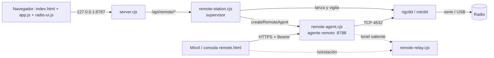
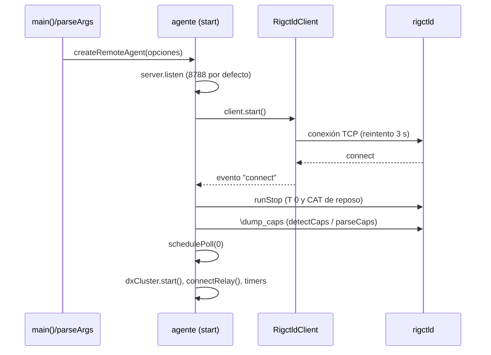
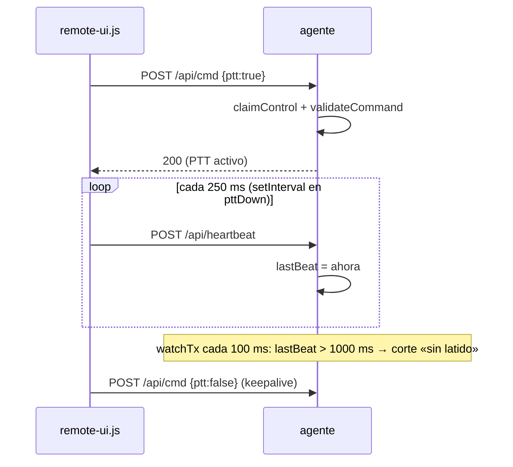
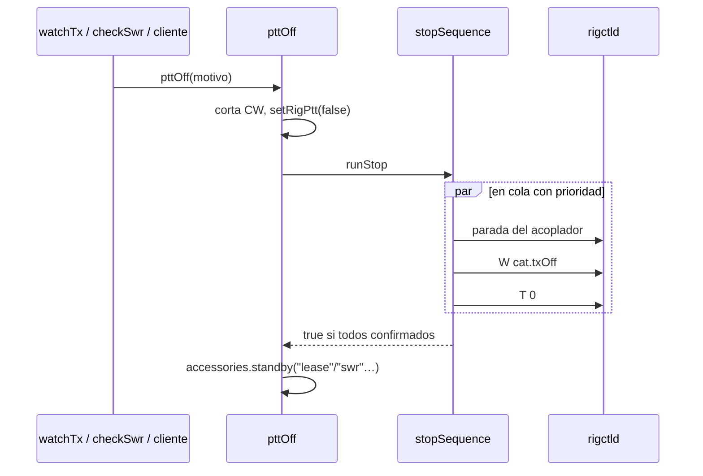
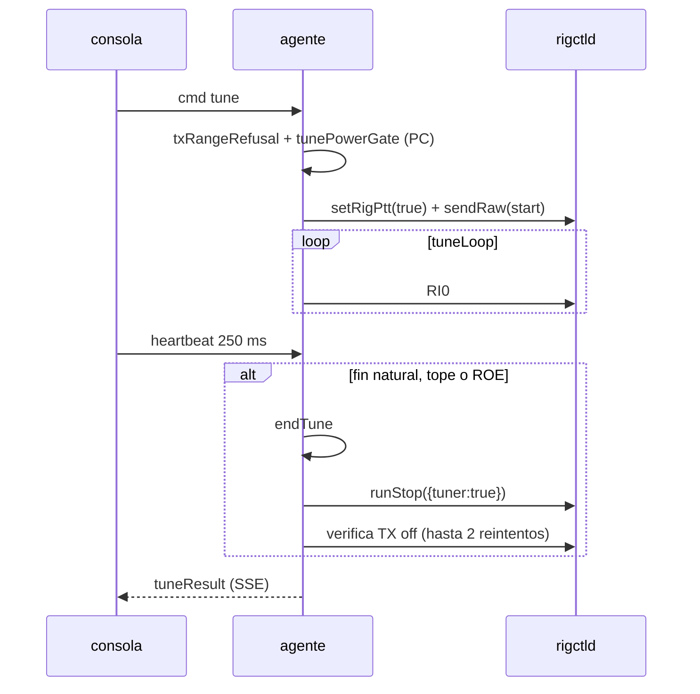
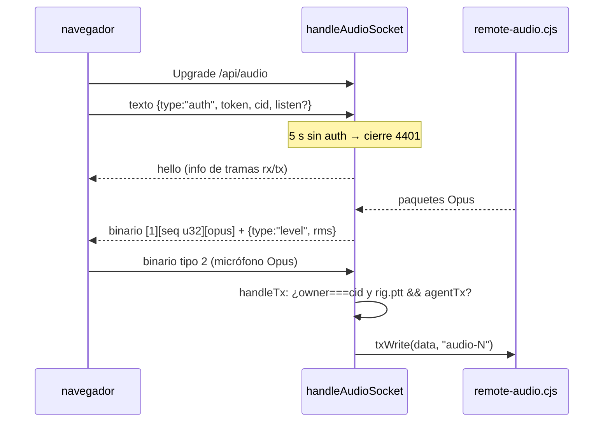

# Código Node: aplicación de escritorio/web, agente remoto y módulos de estación

Guía paso a paso del código Node/JavaScript de la raíz del repositorio. Describe qué hace cada archivo, sus funciones principales, el flujo de datos y las secuencias clave (arranque, PTT, seguridad de TX, audio, rotor, etc.). Todo lo descrito sale de leer el código; lo que no se ha podido comprobar se marca como **pendiente de verificar**. Los números (tiempos, límites) son constantes reales del código y se citan con su nombre.

> Solo documentación: este archivo no cambia comportamiento. Para la visión general (modo web frente a modo local) véase `docs/ARCHITECTURE.md`.

## 1. Mapa general

Dos programas distintos conviven:

| Programa | Archivo de entrada | Escucha | Función |
|---|---|---|---|
| Servidor de escritorio/web | `server.cjs` | `127.0.0.1:8787` | Sirve las herramientas, datos y el panel «remoto». |
| Agente remoto | `remote-agent.cjs` (`main`) | puerto 8788 por defecto | Único proceso que habla con `rigctld` y controla TX. |

El agente es la **única autoridad de seguridad**: el navegador pide, el agente decide. Las credenciales (token, usuario QRZ, etc.) viven solo en el archivo de configuración del agente.

## 2. Aplicación de escritorio/web

### 2.1 `server.cjs`

- **Propósito**: servidor HTTP local sin dependencias. Solo `127.0.0.1` (`PORT` o `--port` para pruebas).
- **Función principal**: `createServer(firmware, providers, studio, diagnostics, remote)`.
- **Defensas por petición**: cabeceras CSP, Permissions-Policy, `nosniff`, `no-referrer`, `no-store`; redirige `localhost` a `127.0.0.1` (307); rechaza cualquier otro `Host` (403) y cualquier `Origin` que no sea `http://<host>`.
- **Rutas**:
  - `POST /api/diagnostic-report` (límite 4 KB; requiere `diagnostics.status().remote_enabled`) y `POST /api/data/repeaterbook-config`.
  - `/api/remote/*` → `handleRemoteApi` de `remote-station.cjs` (el controlador se crea de forma perezosa con `remoteStation()`).
  - `GET /api/data/*` (status, contacts, talkgroups, repeaters, satellite, transmitters) con lista blanca de claves; `GET /api/firmware/{targets,catalog,file}`.
  - `/runtime.json` devuelve `{"mode":"local"}`.
  - `studio.html` se verifica contra `studio.lock.json` con `studio-pin.cjs` y lleva su propia CSP con hashes.
  - Cualquier otro archivo solo se sirve si está en `ALLOWED_FILES` (`BASE_FILES` + `ayuda-*.{en,de,it,fr}.html`).
- `DESKTOP_ONLY_FILES` (herramientas, remoto, `remote-sw`) se omiten en la compilación de GitHub Pages.
- **Arranque** (`require.main`): crea diagnóstico con las variables `BRICOHAM_DIAGNOSTICS_*`, parchea `console.warn/error` para registrar eventos y crea el controlador remoto. `SIGINT`/`SIGTERM` llaman a `remote.stop()` y salen.

### 2.2 `app.js`

- **Propósito**: portada y vistas de la aplicación (tarjetas de herramientas, detalle, vistas).
- Primera acción: guardia anti-clickjacking (si `window.top !== window.self` no inicia y muestra un aviso).
- Datos: objeto `tools` (nombre, subtítulo, acciones con selector y ayuda).
- Funciones: `readStorage`, `storedStation`, `card`, `lastRadio`, `taskList`, `radios`, `home`, `detail`, `tagOperations`, `mountNextPass`, `applyView`, `showView`, `setupViews`.

### 2.3 `radio-ui.js`

- **Propósito**: interfaz de edición de canales/memorias de radio (`mountRadioUI(page)`), basada en `window.RadioWorkspace`. Funciones destacadas: `startLive`, `renderSlots`, `renderQuansheng`, `renderChannels`, `copyFrom`/`pasteInto`, `insertItems`, `askPlacement`, `download`.
- Detalle del resto de sus 1873 líneas (flujo de lectura/escritura por radio): **pendiente de verificar**.

### 2.4 Estilos

`styles.css` (base), `tools.css`, `help-docs.css`, `antenna.css`, `ota.css`, `satellites.css`, `remote.css` (consola remota) y `remoto.css` (panel de estación de escritorio). Solo presentación.

### 2.5 `station-ui.js` y `remoto-ui.js`

- `station-ui.js`: `stationURL(value)` solo acepta URL HTTPS sin credenciales, ruta, query ni hash (devuelve el origen con `/`); `mountStationUI`.
- `remoto-ui.js`: panel de escritorio «remoto» que configura y arranca la estación a través de `/api/remote/*`. `createApi(getPin)` añade el PIN; `collect` lee el formulario; `saveConfig`, `startStation`, `stopStation`; `renderStatus`, `renderPorts`, `renderAudio`, `parityView`, `radioDefaults`.

## 3. Supervisor de la estación: `remote-station.cjs`

- **Propósito**: decide qué procesos lanzar (`rigctld`, opcional `rotctld`) y arranca el agente. `createStation` / `createController`.
- `validateConfig` valida `remote-station.json`: radio del catálogo, enlace usb/lan, patrones de puerto, relay https salvo loopback, audio, `tunerKind`, `agentPort` ≥ 1024 y distinto de 4532/4533.
- `buildPlan` genera `-m modelo -r puerto [-s baud] [--set-conf] -T 127.0.0.1 -t 4532` y, si procede, `rotctld` en 4533. Si `hamlibModel` es nulo lanza 409 «pendiente de fuente». Icom por LAN usa un endpoint externo compatible con rigctld (wfview).
- `createManaged`: supervisor de procesos con retroceso de 1 s a 30 s; `restart()` mata con SIGKILL y relanza; `stop()` fuerza SIGKILL a los 2 s.
- `emergencyStop` (enfriamiento de 30 s): reinicia `rigctld`, reconecta un cliente temporal y ejecuta `stopSequence`; al terminar avisa al agente. El agente lo recibe como `options.onRigctldHung`.
- Detección de puertos de solo lectura (Windows `Get-CimInstance Win32_PnPEntity`, Linux `/dev/serial/by-id` + sysfs): **nunca abre un puerto**.
- `handleRemoteApi`: `status`, `catalog`, `ports`, `devices`, `swr` (muestra de solo lectura), `config`, `start`, `stop`. Los POST exigen `Origin == protocolo://host`.
- Modo headless (Raspberry Pi): `runHeadless`, `parseHeadlessArgs`, `createSetupServer` (HTTPS, PIN de 8 dígitos de un solo uso con `pinAuthorizer`, 5 fallos bloquean 60 s, se cierra al arrancar, puerto 8073) y `printLinks`. El cuerpo de `runHeadless` línea a línea: **pendiente de verificar**.

## 4. Agente remoto: `remote-agent.cjs`

`createRemoteAgent` es un cierre grande que contiene todo el estado. Se divide en bloques.

### 4.1 Configuración y constantes

`loadConfig(dir)` lee `~/.radicodex/remote-agent.json` (permiso 0600). Si no hay token genera `crypto.randomBytes(32)` en base64url y lo guarda con `writeConfig`. Campos: indicativo, host/puerto de rigctld, `txLimitSeconds` (180 por defecto), `txRanges`, `swrLimit`, `swrRawLimit`, `tuneMaxSeconds`, `tunerKind`, `radioId`, `rigMaxPowerW`, `listenLive`, `updateCheck`, relay, accessories, devices, CW, qrz, lotw, dxCluster. Estas credenciales no se envían a los clientes.

| Constante | Valor | Uso |
|---|---|---|
| `HEARTBEAT_TIMEOUT_MS` | 1000 | latido máximo durante TX |
| `CONTROL_IDLE_MS` | 30000 | caducidad de la cesión de control |
| `CMD_RATE_LIMIT` | 20/s | límite de comandos |
| `SWR_TRIP_MS` | 1000 | tiempo sobre el límite de ROE |
| `TUNE_SWR_MS` / `TUNE_HI_SWR_MS` | 3000 / 2000 | tolerancia de ROE en sintonía |
| `HANG_MS` / `HANG_RETRY_MS` | 2000 / 500 | rigctld colgado |
| `AUDIO_AUTH_MS`, `AUDIO_MAX_CLIENTS`, `AUDIO_TX_RATE` | 5000, 8, 60/s | socket de audio |
| sondeo / medidores / watchdog | 250 / 400 / 100 ms | `pollOnce`, `pollTxMeters`, `watchTx` |

Tiempo máximo de sintonía (`TUNE_MAX_SECONDS`): ATAS 45 por defecto y tope 60; interno 20 y tope 30.

### 4.2 Validación de comandos

`validateCommand` es una lista blanca por comando con rangos (frecuencia 30 kHz–3 GHz, modos, niveles AF/RF/RFPOWER/PREAMP/ATT/AGC, funciones NB/NR/TUNER, `tune`, `cw`, `cwstop`, `ptt`, `amp` operate/standby, `vfo`, `split`, `step`). Todo lo demás se rechaza.

### 4.3 Rutas HTTP (`handleApi`)

`GET /api/radios`, `/api/me`, `/api/state`, `/api/config`, `/api/events` (SSE, push cada 250 ms, keep-alive 15 s); invitados; `txlog` (y `.csv`); `/api/power`; `/api/update`; rutas QSL (solo propietario); `/api/cw/memories`; `/api/dxcluster`; `/api/ftx`; `/api/rotor`; `/api/devices` y `/api/devices/cmd`; `/api/heartbeat`; `/api/cmd`; `/api/settings` (en vivo solo `yaesu-ftx-1` con cat); `/api/listen/state` (público y limitado). Archivos estáticos: lista blanca `STATIC_FILES` (`remote.html`, `remote-ui.js`, `remote-audio-core.js`, `remote-speech-proc.js`, `remote-vox.js`, `remote-digital.js`, `remote-rotor-ui.js`, `remote-tune-ui.js`, `remote-dxcluster-ui.js`, `remote-ftx-ui.js`, `spectrum-core.js`, `remote-audio-worklet.js`, `remote.css`, manifiesto, `sw.js`, `ui-i18n.js`, `ui-translations.js`, etc.).

### 4.4 Arranque y conexión Hamlib

Pasos (`start()`):
1. `server.listen` y, a continuación, `client.start()`, `dxCluster.start()`, `connectRelay()`.
2. Se activan los temporizadores: watchdog `watchTx`, medidores, SSE, keep-alive y, opcional, comprobación de actualización.
3. En el evento `connect` del cliente: `runStop({tuner: tuneWasActive, guarded:false})` (garantiza que la radio arranca sin TX), se limpian `unreadable`/`meterOff`, `detectCaps()` (`\dump_caps` con `parseCaps`) y `schedulePoll(0)`.
4. En `disconnect`: se para CW, se limpia sintonía/ejecución Hamlib, `setRigPtt(false)`, `accessories.standby("disconnect")` y se reinicia el estado.

`parseArgs` admite `--listen --port --rigctld-host --rigctld-port --config-dir --relay --station --station-secret --audio-input --audio-output --rotor-port --rotor-park --rotor-offset --smartsdr-host --smartsdr-port --tls/--no-tls --rotor-motion --smartsdr-allow-tx`. `main` imprime los enlaces de consola/Android/relay y la huella TLS.

### 4.5 Sondeo (polling)

`schedulePoll` → `pollOnce` cada 250 ms:
1. Lee frecuencia, modo y PTT. Las lecturas obsoletas se descartan con `pttEpoch`, `meterGen` y `stopping`.
2. Lee la intensidad de señal solo si no hay PTT.
3. Llama a `checkTxRange()` (inhibición fuera de banda).
4. Cada 4.º sondeo lee VFO/split; el 2.º de cada 4 lee controles (`pollControls`/`readControl`, con límite lento y conjunto `unreadable`).
5. Durante TX, `pollTxMeters` lee potencia/ROE/ALC y llama a `checkSwr`.

### 4.6 Cliente Hamlib: `rigctld-client.cjs`

- `RigctldClient` (EventEmitter): un único comando en vuelo, cola FIFO con `priority` (va al frente), temporizador de 5000 ms por comando, reconexión a 3000 ms y `holdPump`.
- Un tiempo agotado cierra la conexión, salvo lecturas crudas con `abandon`: se registra un «fantasma» durante 10 s y la respuesta tardía se descarta por prefijo.
- CAT crudo vía `W cmd; 0` (escribir) o `W cmd; ;` (leer). Debe cumplir `RAW_FORMAT` y estar en `rawAllow` (del catálogo `catAllowList`) o en `rawMatchers` (EX del FTX-1).
- `sendKeyer` (tramas KM/KY), `sendMorse` (comando `b` de Hamlib); nombres de nivel, función y VFO con lista blanca; `parseCaps` lee `\dump_caps`.
- Peculiaridades de Hamlib 4.7.2 gestionadas: bytes NUL sueltos y un espacio inicial en « RPRT 0».
- `stopSequence(client, {cat, tunerKind, tuner, stepMs, log})`: ver §4.8.

### 4.7 Cesión de control y latido

- `identify` acepta el token del propietario (`tokenMatches`: sha256 + `timingSafeEqual`) o un token de invitado. `/api/events` también acepta `?token=`.
- `clientIdOf` usa `X-Client-Id`/`cid`, o `ip:`+dirección (con `x-forwarded-for` si el socket viene de un túnel).
- `claimControl` entrega el control a un cliente; `ownerActive` caduca a los 30 s (`CONTROL_IDLE_MS`).
- `POST /api/heartbeat` solo refresca `lastBeat`/`ownerSeen` mientras el propietario tiene PTT, una sintonía Hamlib o CW; responde 409 si otro cliente tiene el control.
- Los comandos de liberación (`ptt false`, `amp standby`, `cwstop`) nunca se limitan ni se rechazan y usan `claimControl({acquire:false})`.

### 4.8 PTT on/off y secuencia de parada

**PTT on** (`applyCommand`, comando `ptt`):
1. Se rechaza (409) si hay sintonía en curso.
2. `txRangeRefusal()` (inhibición fuera de banda; §4.9).
3. Se detiene cualquier CW activo.
4. `client.setPtt(true)`; `swrTripped=false`; `setRigPtt(true)`; `agentTx=true`; `txStart = lastBeat = ahora`.

`setRigPtt(on)`: en cada flanco incrementa `pttEpoch` y `meterGen` y borra `extraMeters`. Al activar llama a `audio.txBegin()`, crea el registro `tx{po,swr,alc,…}`, `txLog.begin` y programa `pollTxMeters`. Al desactivar limpia `agentTx`/`tx`, `txLog.end()` y `audio.txRelease()`.

**PTT off** (`pttOff(reason)`, que **pre-empta todo**): corta CW; si hay una sintonía llama a `endTune(run, …)`; si no, `setRigPtt(false)` y `runStop({tuner:false})`.

**`runStop` → `stopSequence`** (`rigctld-client.cjs`):
1. Parada del acoplador (solo si hay sintonía activa o el acoplador es ATAS).
2. CAT crudo `cat.txOff`.
3. Hamlib `T 0`.

Todos los pasos se encolan a la vez con prioridad (`holdPump`) y cada uno tiene un plazo `stepMs` (1000 ms). Devuelve verdadero solo si todos se confirmaron. Si `rigctld` se cuelga (`checkHung`: comando pendiente > 2000 ms con TX activo) se activa `emergency`, `accessories.emergencyStop` y se reinicia `rigctld` (`options.onRigctldHung`) o se reintenta `runStop` cada 500 ms.

### 4.9 Seguridad de TX

`watchTx` se ejecuta cada 100 ms y aplica:
- libera el bloqueo de rotor si el propietario está inactivo; `checkHung`; `accessories.tick/poll`; para CW sin cesión;
- **Latido de sintonía Hamlib** (G TUNE);
- **TX huérfano** (`OrphanWatch.observe`, `remote-txsafety.cjs`): dos ticks seguidos con TX del agente y sin titular de cesión;
- **Sin latido**: `lastBeat` > 1000 ms;
- invitado revocado o caducado → corte «invitado revocado o caducado»;
- **Límite de TX** (`txLimitMs`, 180 s por defecto) → «limite de TX»;
- **Límite de sintonía** (`tuneMaxMs`);
- ROE alta de sintonía para acopladores no ATAS.

Cada corte llama a `pttOff` y a `accessories.standby("lease")`: el amplificador queda en STANDBY.

**Disparo por ROE** (`checkSwr`, llamado desde `pollTxMeters`): límite `swrRawLimit` (crudo 0–255, 100 por defecto) con radio cat, o `swrLimit` (3). Dispara tras más de 1000 ms por encima (3000 ms en sintonía, comparación `>=`). Un ATAS queda exento hasta ver el bit de ocupado del acoplador y que baje. Al disparar: `swrTripped=true`, `accessories.standby("swr")`, aviso y `pttOff("ROE alta")`.

**Inhibición fuera de banda** (`remote-txsafety.cjs`):
- `createTxInhibit({ranges})`; `evaluate` devuelve dentro / fuera / desconocido / no configurado a partir de `occupiedSpan(freq, mode, passband)`. Anchos por defecto: CW 200, AM 6000, FM 12000, resto 2700 Hz; USB sube desde la portadora, LSB baja.
- `parseTxRanges` lanza error ante una lista mal formada.
- `txRangeRefusal()` responde 409 con `tx-range-unknown` o `tx-out-of-band` para `ptt`, `tune` y `cw`.
- `checkTxRange()` (en `pollOnce`) corta un TX del agente que sale del rango («fuera de banda»); no actúa durante la sintonía y una lectura desconocida nunca corta.

El software nunca emite por sí solo: todo TX proviene de una orden explícita del operador. Los avisos de origen de las adaptaciones (RemoteRig MIT, ThetisLink GPL-2.0-or-later) están en la cabecera de `remote-txsafety.cjs`.

### 4.10 Sintonía ATAS / acoplador

**Radios cat con `cat.tuner`** (`startCatTune`):
1. `tunePowerGate` lee `PC` y rechaza (409 `tune-power-high` / `tune-power-unknown`) por encima de `TUNE_POWER_MAX_W` (de `data/remote-meter-model.json`, `tune.maxPowerW`). La potencia nunca se cambia automáticamente.
2. `newTuneRun` crea una máquina `TuneCheck` (`remote-meters.cjs`): requested → confirming → tuning → reading → stopping → verifying → done, con resultados success / fail / timeout / unverified.
3. `setRigPtt(true)`, `agentTx=true`, `sendRaw(tunerSpec.start)`.
4. `tuneKeyed` vigila 3000 ms (`tuneWatchMs`) que la radio emita; `tuneLoop` sondea RI0 (`readTuneInfo`/`parseRadioInfo`); fin natural cuando se vio la sintonía y `info.tx===0 && !info.tuning`.
5. `endTune` (se ejecuta una sola vez): ROE final de `run.lastSwr`, `setRigPtt(false)`, `runStop({tuner:true})`, verificación `readTxOff` con hasta 2 reintentos y `startStopRetry` si sigue en TX; guarda `tuneResult` y el aviso.

**Radios Hamlib**: `startHamlibTune` (`G TUNE`) y `hamlibTuneWatch` (tope `tuneMaxMs`; «sin confirmar» si no emitió dentro de `tuneWatchMs`).

**Puente de accesorios**: si `accessories.snapshot().tuner.supported`, la sintonía va por `accessories.startTune` (`station-accessories.cjs`): potencia = `ratedPowerW × rfpower` ≤ 10 W (`TUNE_POWER_MAX_W`), se rechaza con el amplificador en OPERATE y `tick` impone el tope. `tunerBridge.stop` llama a `pttOff("acoplador: parada")`.

Cliente: `remote-tune-ui.js` es un modelo de vista puro (`state.tune`, `state.tuneResult`); durante la sintonía `remote-ui.js` envía latidos cada 250 ms (`startTuneBeat`).

### 4.11 Cierre: `close()`

1. `closing=true`, se limpian temporizadores.
2. PTT off primero si hay TX/sintonía (`pttOff("cierre del agente")`).
3. `settleStopBeforeClose`: espera hasta `stepMs*5+500` ms a paradas en vuelo; si no, un último `runStop({tuner:true, guarded:false})`.
4. Detiene CW, `accessories.emergencyStop("close")`, cierra el controlador del amplificador y `stationDevices.safeAll()` (solo rotores se paran; las salidas de alimentación se dejan como están).
5. `client.stop`, `dxCluster.stop`, `ftx.close`, sockets de audio con código 1001, `audio.close`, `rotor.close`, fin de SSE, destrucción de sockets de relay y cierre de servidores.

`server.cjs` llama a `remote.stop()` en SIGINT/SIGTERM; el manejo de señales del `main` del agente standalone queda **pendiente de verificar**.

### 4.12 Invitados (`remote-ops.cjs`, `createGuestStore`)

- Token `g_<base64url>`; solo se guarda su sha256 en `remote-guests.json` (0600). Caducidad hasta 90 días; permisos por radio `{transmit, bands, maxPowerW}`.
- `guestCommandRefusal`: un invitado solo escucha y se limita a freq/mode/step/vfo/split/level/func, sin `RFPOWER` ni `TUNER`.
- `guestTxRefusal`: banda, tope de potencia (`rigMaxPowerW`); frecuencia o potencia desconocidas implican rechazo.
- Revocar o caducar corta TX; `POST /api/guests/revoke` llama a `pttOff`.
- Otras piezas de `remote-ops.cjs`: `createTxLog` (jsonl + CSV neutralizando fórmulas), `powerSupport` (solo `PS0` apagado del FTX-1, con fuente en `docs/FTX1-KNOWLEDGE.md`; encender = «pendiente de fuente»), `createListenGate` (escucha pública de solo lectura, desactivada por defecto, límite por IP), `createRadioRegistry` (cesión multi-radio; uso por el agente **pendiente de verificar**) y `checkForUpdate` (solo descarga una versión firmada, nunca instala).

### 4.13 Audio RX/TX con un único locutor

Socket WebSocket `/api/audio` (`handleAudioSocket`, `acceptUpgrade` de `remote-ws.cjs`, `maxPayload` 4096).

- **RX**: `remote-audio.cjs` `createAudio` usa solo ffmpeg: una captura da Opus en Ogg por stdout (`OggPacketParser`) y un filtro RMS por stderr. `subscribe` arranca la captura y la para tras `idleMs` (10 s) sin suscriptores; un suscriptor `onPcm` recibe un tap PCM a 12 kHz (lo usa FT8).
- **TX**: solo se acepta si existe audio TX, el cliente tiene permiso, `owner===cid` y `rig.ptt && agentTx`; si no, «tx_refused». Un paquete válido refresca `lastBeat`/`ownerSeen`. `OggOpusMuxer` → ffmpeg → ALSA (Linux) o `scripts/winaudio-out.ps1` (Windows); macOS TX no soportado.
- **Un solo locutor** (Doorman, adaptado de DH1TW remoteAudio, MIT): `TX_TALKER_HOLD_MS=200`: otra fuente se descarta hasta que la actual lleve 200 ms en silencio. `txBegin` reinicia y vacía la cola; `txRelease` conserva la cola `txStopMs` (2000 ms).
- Cerrar el socket del propietario llama antes a `pttOff("socket de audio cerrado")`. Ping cada 10 s; 3 silencios cierran el socket. Máximo 8 clientes.
- **Cliente**: `remote-audio-core.js` (`buildFrame`, `parseFrame`, `passbandHz`, `rmsToPercent`, `formatKhz`), `remote-audio-worklet.js` (`createJitterBuffer`, procesadores `radio-rx`/`radio-mic`), y en `remote-ui.js` `AudioDecoder`/`AudioEncoder`, `getUserMedia` y el WebSocket (`audioSocketUrl`).

### 4.14 VOX y procesador de voz (solo navegador)

- **VOX** (`remote-vox.js`, `createVox`): máquina de estados pura con reloj y adaptador PTT inyectados. Solo se arma por acción explícita del operador y solo si `allowed(ctx)` (sin invitado, `transmit`, enlace activo, sin pérdida de control, sin bloqueo y página visible). Pasa por el **mismo** `pttDown/pttUp` que el botón (petición, latido y cesión), así que todos los límites del agente se aplican igual. `processLevel`: nivel ≥ umbral → `key()`; por debajo durante más de `holdMs` → `ptt.up()`. `buttonPressed`, `agentCut` (tope, ROE, latido, fuera de banda) y `check(ctx)` lo desarman; un rechazo lo desarma («refused»). Nunca se persiste.
- **Procesador de voz** (`remote-speech-proc.js`, `createSpeechProcessor`): paso alto, pico de presencia, paso bajo, compresor de rodilla suave y limitador de pico con techo fijo `CEILING=0.891` (−1 dBFS). **Desactivado por defecto** (muestras intactas); rangos acotados en `RANGES`; ajustes en `localStorage` con la clave `bricohams.remote.speechproc` (sin credenciales). Adaptado de RemoteRig (MIT).
- `pttDown(viaVox)` en `remote-ui.js`: el botón PTT desarma VOX y consume esa pulsación.

### 4.15 Rotor: `remote-rotor.cjs` y `remote-rotor-ui.js`

- Protocolo ampliado de rotctld (`+p`, `+P`, `+S`; fuente `docs/control-rotores.md`).
- Concesión con hombre muerto de 3000 ms; tope de movimiento 30 s; mover exige `motionEnabled`; parar **siempre** se permite; un solo titular; `release(clientId)` al cerrar el SSE; cerrojo si la parada falla; desfases y límites (elevación 0/0 por defecto).
- En el agente: `/api/rotor`; `watchTx` libera el bloqueo si el propietario está inactivo.
- Cliente: `remote-rotor-ui.js` renueva la concesión cada segundo y reproduce un archivo de pase satelital `radicodex-pass-track` como objetivos AZ/EL por hora (sin Doppler).
- Rotores serie (`station-devices.cjs`, `createSerialRotor`): ver §4.16.

### 4.16 Accesorios, amplificadores y dispositivos

**`station-accessories.cjs`**
- El amplificador está en STANDBY por defecto. Motivos de STANDBY: `disconnect, swr, fault, lease, emergency, close, band_change, mismatch, operator`.
- OPERATE se rechaza por: driver no soportado, `operateAllowed` falso, TX activo, sintonía, disparo de ROE, fallo, `standby_pending` o banda desconocida. `followBand` baja a STANDBY al cambiar de banda. `readDriver` gestiona fallos y discordancias. `emergencyStop` ejecuta STANDBY y paradas de sintonía en paralelo.

**`station-amplifier-drivers.cjs`**
- Controladores KPA (Elecraft), Expert, ACOM y Gemini: `createAmplifierDriver(driverId, transport, options)`, `createTcpTransport`. Todos «implementados desde fuente, sin prueba en hardware».
- Contrato: un controlador nunca activa TX ni envía apagado; cada `setOperate(false)` se lee de vuelta y, si no se confirma STANDBY, lanza error para mantener OPERATE bloqueado. Transporte inyectado `{write, read(timeoutMs), flush?, close?}`.

**`station-devices.cjs`**
- Dispositivos de alimentación: `createPowerDevice` (Digital Loggers REST con digest, Waveshare Modbus TCP). Conmutación desactivada por defecto, rechazada durante TX para las salidas críticas (`radio`, `amp`), y apagar/ciclar exige `confirm`. `safeState()` no hace nada.
- Rotores serie: `createSerialRotor` (DCU-1, Rotor-EZ, RT-21, GS-232A/B, SPID Rot2Prog) con tope `MAX_MOTION_MS=30000`; `stop` siempre permitido.
- `buildSignalPath` (radio → amplificador → acoplador → conmutador → antena), `createListedDevice`, `PENDING_DEVICES` (listados, nunca controlados: «pendiente de fuente»), `devicesFromConfig` y `createStationDevices` (`status`, `command`, `safeAll`). Fuentes: `remote-station/docs/STATION-DEVICES-SOURCES.md`.

### 4.17 CW: `remote-cw.cjs`

- `planCwSend`: FTX-1 `KM<slot><texto>;` + `KY0<slot>;` y parada `KY00;` (`docs/FTX1-KNOWLEDGE.md`); IC-705 usa CI-V 0x17 (hasta 30 caracteres) con parada 0xFF (`data/third-party/IC-705_ENG_CI-V_6.txt`), aunque el agente lo convierte a una línea base de Hamlib; otras radios usan `b` de Hamlib; sin fuente → `CwError("unsourced")`.
- `createCwGuard`: apagado por defecto, un mensaje a la vez, tope de tiempo (60 s por defecto, 120 máximo), bloqueado por ROE, emergencia, sintonía, PTT y cierre. `createMemoryStore`: memorias F1–F8 por operador en `remote-cw-memories.json`. El agente aplica también `txRangeRefusal` en `startCw`.

### 4.18 FT8 y decodificadores digitales

- **FT8** (`remote-ftx.cjs`, `remote-ftx-ui.js`): solo recepción. El tap PCM a 12 kHz se corta en franjas UTC de 15 s y se decodifica en un `worker_thread` con `ftx-core.js` (`decodeFt8`); cola máxima 1, tope de decodificación 20 s, se guardan 100 decodificaciones. Sin camino de TX. El propietario lo activa con `POST /api/ftx` (requiere `audio.rx`); FT4 está desactivado.
- **BPSK31 y RTTY** (`remote-digital.js`): decodificadores solo de recepción, sin DOM ni red, que no tocan PTT ni audio de TX. Las tablas Varicode/ITA2 salen de `data/digital-code-tables.json`; velocidad, desplazamiento y bits de parada de RTTY son ajustes del operador (sin cita en el repositorio).

### 4.19 Medidores y catálogos

- `remote-meters.cjs`: `normalizeMeter`, `swrFromRaw`, `TuneCheck`, `tunePowerCheck`, `parsePowerFrame`, datos de `data/remote-meter-model.json`.
- `remote-catalog.cjs` valida `data/remote-station-catalog.json` (radios, rotores, amplificadores, `catAllowList`, `TUNER_KINDS`). `remote-hamlib-caps.cjs` deriva estados de `data/remote-hamlib-caps.json`; `remote-parity.cjs` valida `data/remote-feature-parity.json`.
- `remote-native-cat.cjs`: adaptadores nativos (Quansheng, Yaesu de cinco bytes, TH-D75, Xiegu CI-V) con transportes inyectados; `ptt(true)` lanza error salvo `allowTx`. Detalle de cada adaptador: **pendiente de verificar**.
- `radio-settings.cjs`: motor de escritura segura del menú EX del FTX-1.

### 4.20 DX cluster, QSL y registro

- `remote-dxcluster.cjs`: cliente telnet de solo lectura (solo escribe la línea de login con el indicativo). `parseSpot` (kHz → Hz, valida), `createDxCluster` (`start`, `stop`, `snapshot`, `feed`), máximo 200 spots con caducidad de 1 800 000 ms, retroceso hasta 60 s, tiempo de conexión 10 s; `markSpot` marca `new`/`worked`/`unknown` según el ADIF local. `remote-dxcluster-ui.js` solo llama al comando `freq` existente: no puede emitir.
- `remote-qsl.cjs`: `createQslService` (`list`, `add`, `importAdif`, `exportAdif`, `lookup` QRZ con 20 consultas/min, `uploadLotw` con `confirm:true` y TQSL del operador; código de salida 0 = enviado). QRZ y LoTW están desactivados salvo configuración explícita. `remote-log.cjs`: `parseAdif`, `exportAdif`, `band`, `progress`.

### 4.21 TLS y relay

- **TLS** (`remote-tls.cjs`): `ensure(dir)` reutiliza `remote-agent-tls.pem` si es válido, cubre las IPv4 actuales y le quedan más de 30 días; si no, `generate` crea un certificado autofirmado ECDSA P-256 y lo guarda con 0600. `fingerprint` (SHA-256) se pasa como `&fp=` en los enlaces. `useTls` es verdadero por defecto si el host no es loopback. Un `tunnelServer` plano atiende los sockets del relay.
- **Relay cliente** (en el agente): `connectRelay` abre una petición HTTPS saliente con `Upgrade: radicodex-tunnel/1` y `Bearer` secreto a `<relay>/tunnel/<estación>`. El canal de control intercambia `PING`/`PONG` y `OPEN <sesión>`; `openDataChannel` abre `/data/<sesión>` y entrega el socket marcado `radicodexTunnel` a `tunnelServer`. Reintento `scheduleRelayRetry` (1–30 s con jitter) y descarte tras 60 s inactivo. `relayLinks()` construye las URL con `#token=`.
- **Relay servidor** (`remote-relay.cjs`, `createRelay`): enruta `/tunnel/<id>` (autenticación Bearer comparada con hash, `AuthLimiter` por IP, comparación contra hash ficticio si la estación no existe) y `/s/<id>/…` (clientes). `acceptControl` mantiene el canal con `PING` periódico y `drop` si no hay `PONG`. `handleClient` pide la sesión con `OPEN <id>` y `pipeSockets` une cliente y canal de datos; `maxSessions`, `dataWaitMs` (504 si no abre a tiempo) y 503 si la estación no está conectada. `/healthz` responde `ok`. Solo reenvía bytes.
- **WebSocket** (`remote-ws.cjs`): `acceptUpgrade`, tramas con `maxPayload`. Detalle interno: **pendiente de verificar**.

## 5. Cliente de la consola remota (`remote.html`)

| Archivo | Papel |
|---|---|
| `remote-ui.js` | Consola principal: token en `sessionStorage` (`TOKEN_KEY`, id de cliente), `api()`, SSE, PTT (`pttDown`/`pttUp`/`pttSendOff`), latido de 250 ms, audio, bloqueo del operador (`LOCK_KEY`), latencia (`measureLatency` cada 3 s). Almacena en `localStorage` solo preferencias (banda, ganancia de micrófono, procesador de voz), nunca credenciales. |
| `remote-audio-core.js`, `remote-audio-worklet.js` | Trama de audio y búfer de fluctuación (§4.13). |
| `remote-vox.js`, `remote-speech-proc.js` | VOX y procesador de voz (§4.14). |
| `remote-digital.js`, `remote-ftx-ui.js` | Decodificadores digitales y lista FT8 (§4.18). |
| `remote-rotor-ui.js`, `remote-tune-ui.js`, `remote-dxcluster-ui.js` | Paneles de rotor, sintonía y DX cluster. |
| `remote-controls.js` | WebMIDI y atajos de teclado convertidos en acciones abstractas; las acciones de TX siguen la ruta protegida de la consola; las disposiciones concretas de dispositivos son «pendiente de fuente». |
| `remote-sw.js` | Service worker: solo cachea activos estáticos; nunca intercepta API, SSE, audio ni URL con token. |

## 6. Mapa de módulos del agente

| Archivo | Una línea |
|---|---|
| `remote-agent.cjs` | Agente: API, seguridad de TX, SSE, audio, relay. |
| `rigctld-client.cjs` | Cliente de texto Hamlib y `stopSequence`. |
| `remote-txsafety.cjs` | `OrphanWatch`, `occupiedSpan`, `createTxInhibit`. |
| `remote-station.cjs` | Supervisor de procesos y configuración. |
| `remote-ops.cjs` | Invitados, registro de TX, escucha pública, actualizaciones. |
| `remote-cw.cjs` / `remote-rotor.cjs` / `remote-ftx.cjs` | CW, rotor, FT8. |
| `remote-audio.cjs` / `remote-ws.cjs` | Audio con ffmpeg y WebSocket. |
| `remote-meters.cjs` / `remote-catalog.cjs` / `remote-hamlib-caps.cjs` / `remote-parity.cjs` | Medidores y catálogos de datos. |
| `remote-native-cat.cjs` / `radio-settings.cjs` | CAT nativo y menú EX seguro. |
| `remote-dxcluster.cjs` / `remote-qsl.cjs` / `remote-log.cjs` | Spots, libro de QSO y ADIF. |
| `remote-tls.cjs` / `remote-relay.cjs` | Certificado propio y relay. |
| `station-accessories.cjs` / `station-amplifier-drivers.cjs` / `station-devices.cjs` | Accesorios, amplificadores y dispositivos. |
| `smartsdr-core.cjs` | Cliente FlexRadio SmartSDR (§7). |

## 7. `smartsdr-core.cjs` (FlexRadio SmartSDR)

- Reproduce el protocolo documentado en `remote-station/docs/FLEX-SMARTSDR-API.md`; lo «pendiente de fuente» no se implementa. El analizador FFT está adaptado de POTACAT (Apache-2.0).
- `SmartSdrSession` (TCP 4992): `connect`, `command` con número de secuencia, `setup` (`client gui`, `interlockTimeout(txCapMs)`, lista de medidores, suscripción), `ingestMeterPacket`, `startScope` (panadapter solo de recepción, `PanFrameAssembler`).
- TX: `#requireTx` exige `allowTx` (desactivado por defecto), sin disparo de ROE y `tunePower` ≤ `tuneLimit` (20 por defecto). `tuneStart`, `atuStart`, `pttStart` arman un tope (`txCapMs`, 30 s por defecto) con `tick`. `unkey` (3 intentos) cuenta como TX apagado solo si las respuestas llevan código 0; si no, `txOffUnverified`. `amplifierOperate` exige `allowAmplifierOperate`. `emergencyStop` hace `unkey` y pone los amplificadores en STANDBY; `close` lo ejecuta siempre.
- `SmartSdrRigClient` presenta la misma interfaz que `RigctldClient` al agente (`getFreq`, `setPtt`, `tune`, `setLevel` solo `RFPOWER`, `dumpCaps`). VFO, split y funciones: «pendiente de fuente». El CAT crudo se rechaza. Reconecta cada 3000 ms.
- Discovery (UDP 4991/4992) con `createDiscovery`; PGXL (puerto 9008) con `parsePgxlStatus`. Cómo se integra con `--smartsdr-host` en `main`: **pendiente de verificar**.

## 8. Qué no hace este código

- El supervisor no abre puertos serie ni COM para detectarlos.
- No activa PTT, TX ni sintonía sin una orden explícita del operador.
- No guarda credenciales en el navegador, URL ni registros: el token viaja en la cabecera `Authorization` (o en `#token=` en los enlaces que genera el agente) y el navegador solo lo mantiene en `sessionStorage`.
