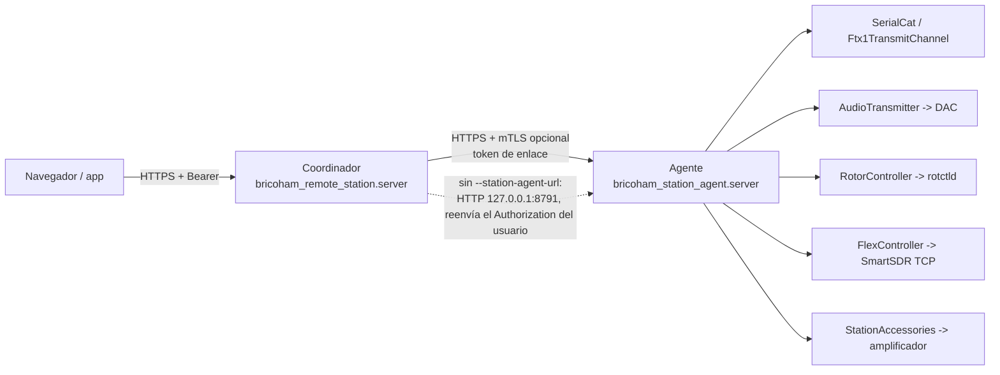
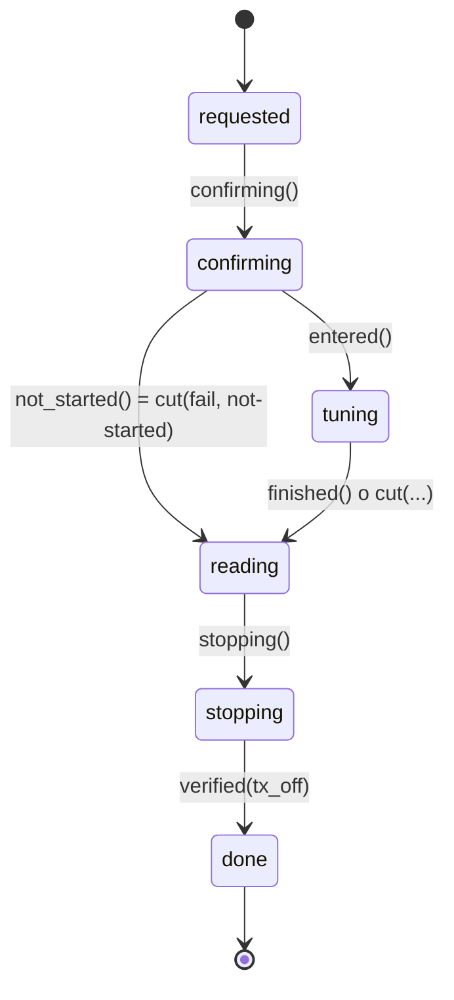
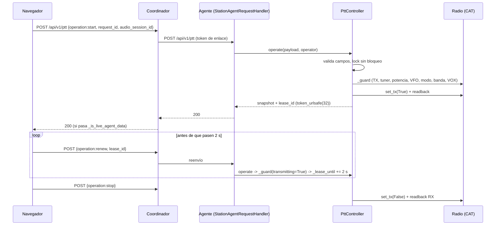

# Código Python de la estación remota, paso a paso

Guía de lectura del código Python bajo `remote-station/`. Describe lo que el
código hace hoy; no es una especificación. Cada afirmación cita archivo y
función reales. Lo que no se ha podido comprobar en el código se marca como
"pendiente de verificar". Ninguna función de este código se ha validado con
hardware real (los propios payloads llevan `hardware_validation_complete: false`).

## 1. Visión general

Dos procesos Python independientes:

| Proceso | Paquete | Puerto por defecto | Misión |
| --- | --- | --- | --- |
| Coordinador (estación-host) | `remote-station/bricoham_remote_station` | 8790 (`--port`) | Cara pública HTTP(S): autentica a los usuarios, comprueba el origen, sirve catálogos y logbook y hace de proxy hacia el agente. No toca ningún puerto serie. |
| Agente de estación | `remote-station/bricoham_station_agent` | 8791 (`_STATION_AGENT_PORT` en el coordinador) | Junto a la radio: CAT serie, PTT con arrendamiento (lease), audio TX, rotor, Flex, accesorios (amplificador/sintonizador), invitados. |



Regla de seguridad común (docstrings de `accessories.py`, `guests.py`,
`ptt.py`): el software nunca transmite por sí solo; solo una acción explícita
de un operador autenticado puede pasar a TX y cualquier fallo, caducidad o
cierre vuelve a RX / STANDBY.

## 2. Coordinador: `bricoham_remote_station`

### 2.1 `security.py` — roles y tokens

- `Role` (`StrEnum`): `ADMIN`, `OPERATOR`, `LISTENER`, `GUEST`, `DIAGNOSTIC_REPORTER`.
- `TokenAuthenticator` (dataclass congelada con `tokens: Mapping[Role, str]`):
  - `from_environment()` lee `BRICOHAM_ADMIN_TOKEN`, `BRICOHAM_OPERATOR_TOKEN`,
    `BRICOHAM_LISTENER_TOKEN`, `BRICOHAM_GUEST_TOKEN`,
    `BRICOHAM_DIAGNOSTIC_REPORTER_TOKEN`; el de admin es obligatorio.
  - `__post_init__` exige ≥ 32 caracteres ASCII, sin espacios externos y un
    token distinto por rol (`MIN_TOKEN_LENGTH = 32`).
  - `authenticate(authorization)` devuelve el `Role` o `None`. Exige esquema
    `Bearer`, candidato sin espacios y ASCII, y compara cada token con
    `hmac.compare_digest` (tiempo constante).

### 2.2 `transport_security.py` — TLS, mTLS y enlace al agente

- `server_tls_context(cert, key, client_ca=None)`: contexto servidor TLS ≥ 1.2.
  Con `client_ca` activa `CERT_REQUIRED` (mTLS). Cert y clave van juntos; mTLS
  sin cert de servidor es un error. Devuelve `None` si no hay TLS.
- `validate_listen(host, context)`: fuera de loopback exige TLS; "HTTP remoto
  está prohibido".
- `validate_client_origin(origin)`: solo `https://host[:puerto]` exacto o
  `capacitor://localhost`; sin ruta, credenciales ni `*`.
- `AgentLink(url, token, ca_file, client_cert, client_key)`: valida URL base
  HTTPS sin ruta ni credenciales, token dedicado (`[A-Za-z0-9._~-]{32,512}`) y
  que cert y clave de cliente vayan juntos. `context()` crea el contexto cliente
  (TLS ≥ 1.2, CA propia opcional, cert de cliente para mTLS). El `token` y la
  clave no aparecen en `repr` (`field(repr=False)`).

### 2.3 `secure_http.py` — base HTTP endurecida

- `SecureHTTPServer(ThreadingHTTPServer)`: envuelve el socket en TLS
  (`get_request`), con `settimeout(5)`; reparte conexiones en 28 normales
  (`NORMAL_CONNECTIONS`, máx. 8 por IP, `MAX_CONNECTIONS_PER_IP`) y 4
  reservadas (`RESERVED_CONNECTIONS`, una por IP, timeout de 2 s) mediante
  `_admit`/`_release`. Si no cabe, la conexión se cierra.
- `SecureRequestHandler`:
  - `parse_request`: una conexión reservada solo puede hacer `POST` a una de
    `reserved_paths`; ambos manejadores declaran `reserved_paths = (PTT_PATH,)`.
    Por eso un "stop" de PTT autenticado sigue pasando con el servidor saturado
    (el `stop` pre-empta todo).
  - `request_json()`: exige `Content-Type: application/json`, un único
    `Content-Length` de ≤ 6 dígitos y ≤ 4096 bytes, sin `Transfer-Encoding` ni
    query. Errores como `RequestJsonError(status, code)`: `json_required` (415),
    `invalid_body_length` (400), `body_too_large` (413), `body_read_timeout`
    (408), `invalid_json` (400).
  - `log_request` solo registra método, ruta y estado; `log_message` omite
    detalles para no filtrar secretos.

### 2.4 `server.py` — servidor coordinador

Clases: `CoordinatorHTTPServer` (estado y validaciones de arranque),
`CoordinatorRequestHandler` (`do_GET`, `do_POST`, `do_OPTIONS`, proxies).
Funciones relevantes: `_serve_station_agent_data`, `_proxy_tx_audio`,
`_serve_audio`, `_serve_scope`, `_serve_logbook`, `_accept_diagnostic_report`,
`_is_live_agent_data`, `main`.

Constructor de `CoordinatorHTTPServer`:

1. `validate_listen`: fuera de loopback, TLS obligatorio.
2. Si hay `agent_link`, su token debe ser **distinto** de todos los de usuario
   (`authenticator.authenticate(f"Bearer {agent_link.token}")` debe dar `None`).
3. `android_agent_token` (opcional): exige HTTPS, sin enlace HTTPS a agente,
   32..256 caracteres imprimibles y distinto de los de usuario; crea
   `AndroidReadonlyAgent` con un `TokenAuthenticator({Role.OPERATOR: token})`.
4. `client_origins` requiere host HTTPS. Si hay `--logbook-database`, se crea
   la tabla con `initialize_logbook`.
5. `_configure_own_origins`: los orígenes propios salen de la dirección de
   escucha, nunca de la cabecera `Host`. `origin_allowed` acepta orígenes de
   `client_origins` o el esquema/puerto propios; con bind comodín solo IP
   literales (evita DNS rebinding).

Rutas (prefijo `/api/v1`, `API_VERSION = "v1"` en `contracts.py`):

| Ruta | Roles permitidos | Origen |
| --- | --- | --- |
| `/healthz` | sin auth | local |
| `/status`, `/logbook`, `/logbook/adif` (GET) | `_READ_ROLES` = admin, operator, listener | simulador / SQLite |
| `/capabilities`, `/radios`, `/feature-parity`, `/protocols` | cualquier `Role` válido (`_CAPABILITY_ROLES`) | catálogos locales |
| `/audio`, `/audio/stream` | `_READ_ROLES` | proxy al agente |
| `/cat`, `/cat/scope`, `/devices`, `/digital`, `/rotor`, `/flex`, `/radio-settings`, `/ptt`, `/accessories` (GET) | `_DIAGNOSTIC_ROLES` = admin, operator | proxy al agente |
| `POST` a `/rotor`, `/flex`, `/radio-settings`, `/ptt`, `/digital`, `/accessories` | admin, operator, con comprobación de `Origin` | proxy al agente |
| `POST /logbook` | admin, operator, origen y cuerpo ≤ 4096 | SQLite |
| `GET /diagnostic-reports` | solo admin | `DiagnosticStore` |
| `POST /diagnostic-reports` | admin, operator, `diagnostic_reporter` | `DiagnosticStore`, máx. 60 por minuto |
| `GET /audio/tx` (WebSocket) | token en el primer mensaje, admin u operator | proxy WS |
| `/diagnostics` | admin, operator | JSON fijo (`tx_enabled: false`) |

Cualquier otro método (`PUT`, `PATCH`, `DELETE`) devuelve 405
`method_not_allowed`. Las rutas que no empiezan por `/api/` sirven la consola
web estática (`_serve_web_console`) con cabeceras CSP y `X-Frame-Options: DENY`.

#### Paso a paso: autenticación de una petición y roles

Ejemplo: `GET /api/v1/ptt` desde el navegador.

1. `SecureHTTPServer.get_request` completa el TLS (con mTLS exige cert de
   cliente si el servidor se configuró con `client_ca`).
2. `_admit` reserva un hueco de conexión (normal o reservado).
3. `do_GET` extrae la ruta; `/healthz` y las que no son `/api/` no necesitan token.
4. `authenticator.authenticate(Authorization)`. Sin token válido: 401
   `unauthorized`.
5. La ruta `/ptt` exige rol en `_DIAGNOSTIC_ROLES`; si no, 403 `forbidden`. Una
   query en `/ptt` o `/accessories` da 400 `ptt_invalid_query`.
6. `_serve_station_agent_data` hace el proxy (sección 2.5).

Para `POST` (`_operate_station_agent`): primero `close_connection = True`;
después 401/403 como arriba; si hay cabecera `Origin` debe pasar
`origin_allowed` (403 `origin_not_allowed`); luego `request_json()` y el cuerpo
se reserializa con `json.dumps(...).encode("ascii")` antes de reenviarlo. Las
peticiones sin `Origin` (clientes no navegador) se aceptan si el token es válido.

`do_OPTIONS` (preflight CORS) solo responde 200 si `Origin` está en
`client_origins`, la ruta empieza por `/api/v1/`, el método pedido es `GET` o
`POST` (este último solo en las rutas de operación) y las cabeceras pedidas
son `authorization`/`content-type`.

### 2.5 Proxy coordinador → agente y mapeo de errores (502/503)

`_serve_station_agent_data(path, method, body)`:

1. Si hay agente Android conectado, atiende `_serve_android_agent_data`.
2. Plazo de conexión: 4 s para rotor, flex, settings, ptt, accessories; 3 s
   para cat; 2 s para el resto. Solo `/cat` y `/rotor` reenvían la query.
3. Con `AgentLink`: `HTTPSConnection` al agente con `agent_tls_context` y
   cabecera `Authorization: Bearer <token de enlace>`; el token del usuario
   **no** viaja al agente. Qué rol concreto tiene el token de enlace en el
   agente (debe ser admin u operator para pasar `_INVENTORY_ROLES`) depende de
   cómo se configuren sus variables de entorno: pendiente de verificar. Sin
   enlace: `HTTPConnection` a `127.0.0.1:8791` reenviando el `Authorization`
   del usuario.
4. Se lee la respuesta con tope `_MAX_AGENT_RESPONSE_BYTES = 1_000_000`.

Tabla de errores generados por el coordinador:

| Situación | Estado | `error.code` |
| --- | --- | --- |
| Rechazo de conexión/reset antes del handshake, `OSError`, `TimeoutError` | 503 | `station_agent_unavailable` |
| `ConnectionError` tras `connect()` con enlace TLS (típico de mTLS rechazado en TLS 1.3) | 502 | `station_agent_tls_failed` |
| `ssl.SSLCertVerificationError` o `ssl.SSLError` | 502 | `station_agent_tls_failed` |
| `HTTPException` (respuesta HTTP inválida) | 502 | `station_agent_invalid_response` |
| Cuerpo > 1 MB | 502 | `station_agent_response_too_large` |
| JSON no válido o que no supera `_is_live_agent_data` / `_is_device_inventory` | 502 | `station_agent_invalid_response` |
| Estado ≠ 200 del agente con código no permitido | 403 si el agente dio 403, si no 502 | `station_agent_request_failed` |

Códigos del agente que el coordinador **sí** reenvía tal cual (estados 400,
403, 409 o 503, salvo en `/devices`): solo si `error.code` empieza por `cat_`,
`wsjtx_`, `rotor_`, `ptt_`, `accessories_` o `flex_`, tiene < 64 caracteres y es
alfanumérico con `_`. Así el navegador ve p. ej. 409 `ptt_busy` en vez de un 502
genérico. Los códigos de audio siguen la misma regla con prefijo `audio_`
(`_serve_audio`).

`_is_live_agent_data` es una defensa en profundidad: la respuesta debe llevar
`api_version == "v1"` y `data_is_simulated is False`, y en `/ptt` además
`model == "FTX-1"`, `status == "experimental"`, `lease_seconds == 2.0`, los
booleanos esperados y los límites en rango (por ejemplo
`1 <= max_transmit_seconds <= 30`, `5 <= power_max_watts <= 100`). Una
respuesta que no encaje no llega al navegador.

### 2.6 Audio RX y TX a través del coordinador

- `_serve_audio` (`/audio`, `/audio/stream`): proxy de lectura. El flujo
  `application/vnd.bricoham.pcm` se reexpone en chunked; si el agente no
  responde 200 solo se propagan 400/403/409/503 con código `audio_*`, si no 502
  `station_agent_request_failed`; fallos de transporte antes de empezar dan 502
  `station_agent_audio_failed`.
- `_proxy_tx_audio` (`/audio/tx`): ver el recorrido de la sección 3.5.

### 2.7 `websocket_transport.py`

Usa `wsproto`. `PROTOCOL = "bricoham.pcm-tx.v1"`, `TX_AUDIO_PATH =
"/api/v1/audio/tx"`, `MAX_MESSAGE = 4096`.

- `WebSocketPeer`: `send`, `send_json`, `receive(timeout)`, `close`, `pending`.
  Un mensaje > 4096 bytes lanza `WebSocketError("audio_tx_message_too_large")`.
- `accept_websocket(handler)`: valida ruta, HTTP/1.1, sin cuerpo y una sola
  cabecera `Host`, subprotocolo exacto; responde el upgrade.
- `connect_websocket(host, port, context=None, ...)`: cliente con plazo de 2 s.
- `read_auth_token(peer)`: el primer mensaje debe ser `{"token": "..."}` y
  nada más. **Las credenciales viajan solo en ese primer mensaje cifrado**
  (nunca en URL ni cabeceras).
- `bridge_audio(client, agent)`: reenvía tramas del cliente al agente (solo
  binarias de exactamente 1920 bytes = 960 muestras PCM16 mono) y respuestas de
  texto del agente al cliente. Corta con `audio_tx_message_timeout` si pasan
  0,3 s sin PCM del cliente o 2 s sin respuesta del agente.

### 2.8 `capabilities.py` y `contracts.py`

- `contracts.py`: `API_VERSION = "v1"`, `CapabilityStatus` (`verified`,
  `implemented_untested`, `experimental`, `unsupported`), `CapabilityRecord`
  (con `to_dict()`), `RadioProfile`, `StationSnapshot` y estados de
  transmisión/espectro/cascada.
- `capabilities.py`: `capability_catalog()` agrega los modelos FTX-1, (tr)uSDX
  y QMX+. `_capabilities(...)` convierte cada entrada en `CapabilityRecord` con
  estado `EXPERIMENTAL` solo para las funciones listadas en
  `experimental_functions`, y `UNSUPPORTED` para el resto; `hardware_used` y
  `validated_at` quedan en `None`; el catálogo termina con
  `hardware_validation_complete: False`. Cada registro cita su
  `source_document`.
- `radio_candidates.py` (`radio_candidate_catalog()`) y `feature_parity.py`
  (`feature_parity_catalog()`, lee los JSON de `data/`): catálogos de solo
  lectura para la consola; `feature_parity` lanza
  `OSError/ValueError/KeyError` si faltan datos y el coordinador lo traduce a
  503 `feature_parity_unavailable`.
- `simulator.py`: `DeterministicSimulator.snapshot()` sirve datos fijos de
  demostración para `/status`; nunca abre una radio ni emite CAT/PTT.

### 2.9 `drivers/` — codecs de protocolo con allowlist

Funciones puras que construyen peticiones y decodifican respuestas (no abren
puertos). Se enlazan desde `cat_diagnostics.read_profiles()` y desde el agente.

| Archivo | Contenido principal |
| --- | --- |
| `ftx1_cat.py` | `Ftx1ReadCommand`, `build_query`, `build_tx_set` (`TX1;`/`TX0;`), `parse_tx_reply`, `parse_main_information`, `parse_power_reply`, `build_meter_query` (`RM`). Referencias citadas en el código: `docs/FTX1-KNOWLEDGE.md` y manual CAT 2508-C. |
| `yaesu_cat.py`, `kenwood_cat.py`, `elecraft_k3s_cat.py`, `elecraft_k4_cat.py`, `qmx_cat.py`, `trusdx_cat.py` | Enumeraciones de comandos de lectura y decodificadores por familia/modelo. |
| `icom_civ.py`, `icom_scope.py` | CI-V (`IcomReadCommand`, `Ic7300Setting`, `Ic705Meter`) y `ScopeAssembler` para la forma de onda de scope `27 00`. |
| `smartsdr_protocol.py` | FlexRadio: `Cmd` (comandos), `SmartSdrSession` (TX con `allow_tx` apagado por defecto, tope de tiempo, `unkey`, `emergency_stop`, bloqueo por ROE), VITA-49/FFT (`parse_fft_packet`, `PanFrameAssembler`). Lleva aviso SPDX y atribución de POTACAT. |
| `hermes_lite_protocol.py`, `opengd77_usb.py`, `cat_codec.py` | Respuesta de descubrimiento Hermes Lite, identificación USB OpenGD77 de solo lectura, utilidades ASCII CAT. |

Cada comando de protocolo debe citar una fuente en el repositorio; si no la
hay, la funcionalidad queda como "pendiente de fuente".

### 2.10 Diagnósticos

- `cat_diagnostics.py`: `ReadQuery`, `ReadProfile`, `read_profiles()` (modelo →
  perfil con consultas permitidas), `diagnostic_catalog()` (lo que sirve
  `/protocols`, siempre `transport_enabled: False`), `inspect_query(model,
  command, frame)` (decodifica una trama sin abrir ningún puerto) y un `main`
  offline.
- `diagnostic_reports.py`: `validate_report` (esquema cerrado: componente,
  plataforma, hasta 16 eventos con `code`, `source`, `severity`, `error_type`,
  `line`; ≤ 4096 bytes), `DiagnosticStore` (SQLite, retención de 7 días, máx.
  500), `DiagnosticRuntime` (manejador de `logging` que **no** copia mensajes,
  argumentos ni rutas; solo clasifica el módulo y el tipo de error) y
  `add_diagnostic_arguments`/`configure_diagnostics` para activarlo en la CLI.
  El envío remoto es opt-in y exige HTTPS y un secreto de ≥ 32 caracteres.
- Entrada HTTP: `POST /api/v1/diagnostic-reports` (admin, operator o
  `diagnostic_reporter`), 202 `{"accepted": true}`; 429 `diagnostic_rate_limited`
  con más de 60 por minuto; 503 `diagnostics_not_configured` sin base de datos.

### 2.11 `logbook.py`

- `Qso(call, started_at, frequency_hz, mode)`; `MODES = CW, SSB, USB, LSB, AM,
  FM, RTTY, FT8, FT4`.
- `validate_qso`: indicativo ASCII (`[A-Z0-9]+(/…)*`, 1..32), modo permitido,
  frecuencia entera positiva, fecha ISO con zona horaria (se normaliza a UTC).
- `initialize_logbook`, `add_qso` (SQL parametrizado), `read_qsos` (abre en
  `mode=ro`), `export_adif` (ADIF 3.1.4; `USB/LSB` → `SSB`, `FT4` → `MFSK` +
  `SUBMODE`), `ExportLimitError` si se supera el límite.
- Servidor: `GET /logbook?offset=N` devuelve hasta 50 QSO y `has_more`;
  `GET /logbook/adif` exporta como máximo 5000 (413 `use_cli_export` si hay más);
  `POST /logbook` exige exactamente `{call, started_at, frequency_hz, mode}` y
  responde 201 con `qso_id`; 400 `invalid_qso` en validación; 500
  `logbook_storage_error` en errores SQLite.

### 2.12 `tune_check.py`

`TuneCheck` es solo la **máquina de estados** de una comprobación de sintonía,
espejo de `TuneCheck` en `remote-meters.cjs`. No hace E/S: quien la usa realiza
las lecturas CAT. En el código Python de producción no se usa todavía (solo la
cubre `tests/test_tune_check.py`); su integración es pendiente de verificar.

Estados (`STATES`): `requested → confirming → tuning → reading → stopping →
verifying → done`. Resultados (`OUTCOMES`): `success`, `fail`, `timeout`,
`unverified`.



Reglas relevantes:

- Los métodos devuelven `False` y nunca lanzan si se llaman fuera de orden.
- `cut(outcome, reason)`: el primer corte gana (un reinicio posterior no borra
  una alerta perdida); `unverified` no se puede forzar con `cut`.
- `verified(tx_off)`: si no había resultado, `swr >= swr_limit` → `fail` /
  `swr-high`; si la radio no mostró evidencia de sintonía (`evidence(False)`)
  → `unverified` / `no-tune-evidence`; si no → `success`. Si `tx_off` es falso y
  el resultado era `success`/`unverified`, pasa a `fail` / `tx-stuck`.
- `result()` devuelve estado, resultado, motivo, tipo, segundos, ROE y `txOff`.

## 3. Agente: `bricoham_station_agent`

### 3.1 `server.py`

Clases: `StationAgentHTTPServer` (integra todos los controladores y cierra
ordenadamente) y `StationAgentRequestHandler`. Helpers: `ptt_transmitting(ptt)`
(un lease activo cuenta como TX; si el estado no se puede leer, **falla
cerrado** y devuelve `True`) y `cat_frequency_reader(cat)`.

Reutiliza `Role`/`TokenAuthenticator` y `server_tls_context` del paquete
coordinador. `main()` carga solo los archivos de configuración local que se
pasan por línea de comandos (`--ptt-config`, `--tx-audio-config`,
`--rotor-config`, `--radio-settings-config`, `--flex-config`,
`--accessories-config`, `--power-config`, `--audio-config`) y se niega a
iniciar si hay un error de validación (código de salida 2). Con
`--tls-client-ca` exige mTLS en todas las conexiones y los roles Bearer siguen
siendo obligatorios.

Autenticación en el agente (`do_GET`/`do_POST`):

- Roles: `_INVENTORY_ROLES = {ADMIN, OPERATOR}` para casi todo; `LISTENER`
  además puede leer `/audio` y `/audio/stream`.
- Invitados: si el Bearer no es un rol, y la ruta está en `_GUEST_PATHS`
  (`/audio`, `/audio/stream`, `/ptt`), `_guest()` intenta
  `GuestStore.authenticate`. Sin permiso para esta radio: 403
  `guest_no_radio_permission`.
- Gestión de invitados y TX log (`/guests`, `/guests/revoke`, `/txlog`,
  `/txlog.csv`): solo `Role.ADMIN` (`_serve_station_ops`).
- `/power`: `_operate_power` no conmuta ninguna salida mientras
  `ptt_transmitting` es verdadero (409 `power_transmitting`) y, si la salida es
  de rol `amp`, pone antes el amplificador en STANDBY.

#### Mapeo de errores del agente (lo que luego traduce el coordinador)

| Ruta | Excepción | Estado |
| --- | --- | --- |
| cualquiera | JSON mal formado (`RequestJsonError`) | el del error (415/400/413/408) |
| `/ptt` | `ValueError` | 400 `ptt_invalid_operation` |
| `/ptt` | `PttError` `ptt_disabled`, `ptt_transaction_unconfirmed` | 503 |
| `/ptt` | resto de `PttError` | 409 |
| `/ptt` | invitado sin `transmit` y operación distinta de `stop` | 403 `ptt_guest_listen_only` |
| `/ptt` o `/accessories` sin configurar | — | 503 `*_not_configured` |
| `/cat` | `CatError` | 503 |
| `/radio-settings` | `CatError` `cat_busy`, `cat_settings_require_rx`, `cat_menu_*` (lista en `do_POST`) | 409; el resto 503 |
| `/rotor` | `RotorError` `rotor_busy`, `rotor_lease_expired`, `rotor_stop_unconfirmed`, `rotor_request_cancelled_or_repeated`, `rotor_park_not_configured` | 409; el resto 503 |
| `/flex` | `FlexError` `flex_unreachable`, `flex_closed` | 503; el resto 409 |

### 3.2 `ptt.py` — `PttController`

Constantes: `LEASE_SECONDS = 2.0`, `TRANSACTION_SECONDS = 0.7`,
`WATCHDOG_INTERVAL = 0.05`, `MAX_RETRY_DELAY = 1.0`,
`CRITICAL_LOG_INTERVAL = 5.0`.

- `PttConfig`: `enabled`, `frequency_min_hz`, `frequency_max_hz`,
  `power_max_watts`, `max_transmit_seconds`, `tx_ranges` opcional. Valida
  `30_000 <= min < max <= 470_000_000`, `5 <= power_max_watts <= 100`,
  `1 <= max_transmit_seconds <= 30`. `load(path)` exige exactamente los campos
  documentados.
- `PttOperator(label, guest_id, permission)`: quién pide la TX (para el TX log
  y para los límites de invitado).
- `PttController(cat, config, tx_audio=None, tx_log=None, radio_id, guest_active)`:
  solo FTX-1 (`ValueError` si no). Arranca el hilo `ptt-deadman`
  (`_watchdog`). Estado: `_lease`, `_lease_until`, `_maximum_until`,
  `_rx_confirmed`, `_stop_failed`, `_voice`, `_channel`, `_closed`,
  `_requests` (últimos 256 identificadores).
- Métodos: `snapshot` (no bloquea; `ptt_busy` si el lock está tomado),
  `_guard` (comprobaciones previas a cada start/renew), `tune_refusal`,
  `_stop`, `_expire`, `_owner_revoked`, `revoke_guest`, `operate`, `_watchdog`,
  `close`.

#### Paso a paso: `_guard` (se ejecuta en `start` y en cada `renew`)

Lee por CAT con el plazo `deadline` (un `Ftx1TransmitChannel`):

1. Estado TX esperado (`RX` antes de iniciar, `CAT_TX` al renovar) o
   `ptt_unexpected_tx_state`.
2. Sintonizador sin petición de sintonía (`ptt_tuner_busy`).
3. Potencia ajustada ≤ `power_max_watts` (`ptt_power_limit`).
4. Transmisor MAIN, sin split (`ptt_requires_main_simplex_vfo`); VFO, simplex y
   sin clarifier de TX en la información MAIN.
5. Modo LSB o USB (`ptt_requires_ssb`).
6. Frecuencia dentro de `[frequency_min_hz, frequency_max_hz]`
   (`ptt_frequency_limit`).
7. Fuera de banda (solo si hay `tx_ranges`): ver 3.3 (`ptt_out_of_band`).
8. Invitado: `guest_tx_refusal(permission, freq_hz, power_w)` contra la radio en
   vivo, en el inicio y en **cada renovación** (3.7).
9. Con audio TX: VOX apagado (`ptt_disable_vox_locally`) y sesión de audio
   sana (`ptt_audio_unavailable`).

#### Paso a paso: PTT start / renew / stop / expire



**Start** (`operate`, operación `start`):

1. Validación de forma: el payload debe ser un objeto con `operation` ∈
   {`start`, `renew`, `stop`} y exactamente los campos permitidos (`start`:
   `request_id` y, si hay `tx_audio`, `audio_session_id`; `renew`: `lease_id`;
   `stop`: nada, o `cancel_request_id`). `settings_request_identifier` exige
   16..64 caracteres ASCII alfanuméricos con `-`/`_`. `lease_id`: 32..128 ASCII.
   Un error es `ValueError` → 400.
2. Lock: `start` y `renew` con `acquire(blocking=False)` (si no, `ptt_busy`);
   `stop` espera hasta 1,5 s para pre-empatar.
3. `_closed` → `ptt_closed`; `_expire()` primero (limpia un lease caducado).
4. Condiciones: `config.enabled` (si no `ptt_disabled`), `_rx_confirmed` y no
   `_stop_failed` (`ptt_rx_confirmation_required`), sin lease activo
   (`ptt_busy`), `request_id` no repetido ni cancelado
   (`ptt_request_cancelled_or_repeated`). Nota: `_rx_confirmed` es `False` al
   construir el controlador y solo pasa a `True` tras un `_stop()` confirmado;
   qué cliente envía el primer `stop` es pendiente de verificar.
5. Reserva la sesión de audio (`tx_audio.claim(audio_session_id)`) y el canal CAT
   exclusivo (`cat.reserve_transmitter()`), y ejecuta `_guard(transmitting=False)`.
   Si algo falla, se silencia el audio, se libera el canal y se propaga el error.
6. Crea `_lease = secrets.token_urlsafe(32)`; `_maximum_until = ahora +
   max_transmit_seconds`; `_lease_until = min(ahora + 2 s, _maximum_until)`.
7. `set_tx(True, ...)` envía `TX1;`, verifica con una lectura de identificación
   y confirma `TX` = CAT_TX. Después abre la entrada del TX log (`tx_log.begin`)
   y `unmute()` del audio. Si falla cualquiera, `_stop()` y se relanza.
8. Devuelve `_snapshot()` con `lease_id`.

**Renew**: compara el lease con `secrets.compare_digest`; si no coincide o ya
caducó, `ptt_lease_expired`. Ejecuta `_guard(transmitting=True)` con un plazo
máximo de 0,7 s o lo que quede de lease; **si el guard falla, hace `_stop()`**
antes de relanzar. Si se superó el plazo del lease, `_stop()` +
`ptt_lease_expired`. Si todo va bien: `_lease_until = min(ahora + 2 s,
_maximum_until)`. El tope absoluto `max_transmit_seconds` nunca se extiende.

**Stop** (`_stop`): silencia y descarta la sesión de audio, borra el lease,
marca `_stop_failed = True`, reserva el canal si no lo tiene, `set_tx(False)`
con lectura de verificación, libera el canal y solo entonces `_rx_confirmed =
True`, `_stop_failed = False`, cierra el TX log y reinicia el propietario. Si
`set_tx(False)` falla, `_stop_failed` queda en `True`: ninguna nueva TX hasta
confirmar RX. Un `stop` con `cancel_request_id` además anota ese identificador
para que un `start` retrasado con el mismo `request_id` sea rechazado.

**Expiración** (`_expire`, llamada por cada operación y por el hilo
`ptt-deadman` cada 50 ms): ejecuta `_stop()` si `_stop_failed`, el invitado
propietario fue revocado, el reloj superó `min(_lease_until, _maximum_until)`, o
la sesión de audio dejó de estar sana. Si `_stop()` falla, `_watchdog` reintenta
con espera creciente (`next_retry_delay`, máx. 1 s) y registra `CRITICAL`
("PTT RX NOT confirmed… use local stop") como máximo cada 5 s: nunca deja de
intentar des-transmitir.

**Errores hacia el coordinador**: `PttError` → 503 (`ptt_disabled`,
`ptt_transaction_unconfirmed`) o 409; el coordinador los reenvía porque llevan
el prefijo `ptt_`. Otras excepciones internas (`CatError`, `ValueError`) se
envuelven como `ptt_transaction_unconfirmed`, y `AudioError` como
`ptt_audio_unavailable`.

### 3.3 `txsafety.py` — inhibición fuera de banda

Lógica pura, sin E/S ni reloj. Espejo de `remote-txsafety.cjs`; `occupied_span`
está adaptada de RemoteRig (MIT), con el aviso de copyright y licencia en la
cabecera del archivo.

- `occupied_span(carrier_hz, mode, passband_hz=None)`: devuelve el espectro
  ocupado `(bajo, alto)` en Hz o `None` si portadora o modo se desconocen.
  USB-like sube desde la portadora, LSB-like baja, el resto centrado. Ancho
  por defecto: 200 Hz CW, 6000 Hz AM, 12000 Hz FM, 2700 Hz el resto, salvo que
  la radio informe un ancho de banda positivo.
- `parse_tx_ranges(value)`: lista de `{start_hz, end_hz}` enteros con
  `0 <= start < end`, hasta `MAX_RANGES = 64`.
- `TxInhibit(ranges)`: `configured` es falso sin rangos (estado
  `not-configured`, **la inhibición no se activa sola**). `evaluate` da
  `inside` solo si el espectro completo cabe en algún rango; `outside` si no;
  `unknown` si no hay datos. `observe` actualiza el estado y solo registra los
  cruces. `snapshot()` es lo que aparece en `/ptt` bajo `tx_inhibit`.

#### Paso a paso: comprobación fuera de banda

1. Solo se aplica si `tx_inhibit.configured` (hay `tx_ranges` en la
   configuración PTT).
2. En `_guard`, con la frecuencia y el modo leídos de la radio (`info.mode.name`)
   se llama a `tx_inhibit.observe(...)`; cualquier resultado distinto de
   `inside` (incluido `unknown`) lanza `PttError("ptt_out_of_band")`.
3. Se hace en el arranque y en cada renovación; una desviación durante la TX
   corta la emisión por el camino `_stop()` de la renovación.

### 3.4 Rechazo de sintonía (tune refusal)

`PttController.tune_refusal()` se llama antes de iniciar un `tune` del
sintonizador externo (`StationAgentRequestHandler._operate_accessories`):

1. Si no hay `tx_ranges` configurados devuelve `None` (no impone nada).
2. Intenta el lock sin bloquear: `ptt_busy`. También `ptt_busy` si el
   controlador está cerrado, tiene lease o canal.
3. Reserva el canal CAT, lee la información MAIN (frecuencia y modo del
   operador; el modo temporal que la radio use durante la sintonía **no** se
   evalúa) y libera el canal. Si hay `CatError` o `ValueError`, devuelve
   `ptt_out_of_band_unknown` (falla cerrado).
4. `observe(...)` distinto de `inside` → `ptt_out_of_band`.
5. `_operate_accessories` convierte el código en HTTP 409 con
   `accessories_tx_<resto>`: `accessories_tx_out_of_band`,
   `accessories_tx_busy`, `accessories_tx_out_of_band_unknown`. El coordinador
   los reenvía por el prefijo `accessories_`.
6. Si no hay rechazo, `accessories.start_tune(tx=transmitting, power_w=...)`
   aplica sus propias barreras (3.6). Cuando ya hay un lease activo no se llama
   a `tune_refusal`, y `start_tune(tx=True)` responde `{"ok": False, "reason":
   "tx"}` (409 `accessories_tx`).

### 3.5 `audio_tx.py` y sesión de audio TX

Constantes: 48 000 Hz, bloques de 960 muestras (1920 bytes PCM16 mono),
`MAX_FRAME_AGE = 0.3` s.

- `TxAudioConfig(device, device_name, channels, channel)`: DAC explícito con
  nombre; 1 o 2 canales.
- `AudioTransmitter`: una sola sesión activa (`open` → `audio_tx_busy` si hay
  otra); `claim(identifier)` compara con `secrets.compare_digest`
  (`audio_tx_session_invalid`); `close()`.
- `TxAudioSession`: abre un `sounddevice.RawOutputStream` y comprueba que el
  nombre del dispositivo coincide (`audio_tx_device_changed`). `push(block)` valida
  longitud, aplica la cola (≤ 8 bloques mientras suena; antes de sonar conserva
  2) y mapea a estéreo si procede. `ready()`/`claim()`/`unmute()`/`mute()` y
  `_callback` (rellena con silencio; si se vacía la cola, error
  `audio_tx_underflow`). Está **silenciada** salvo entre `unmute()` y `mute()`,
  y solo el propietario del PTT las invoca.

#### Paso a paso: sesión de audio TX (extremo a extremo)

1. El navegador abre `wss://…/api/v1/audio/tx` con subprotocolo
   `bricoham.pcm-tx.v1` y una cabecera `Origin` única permitida. El coordinador
   (`_proxy_tx_audio`) comprueba `origin_allowed` (403 `origin_not_allowed`) y
   que el servidor no esté parándose (503 `audio_tx_stopped`).
2. `accept_websocket` + `read_auth_token`; el token debe ser de admin u operator
   (`audio_tx_unauthorized`).
3. Con `AgentLink`: `connect_websocket(host, puerto, context=agent_tls_context)` y se
   sustituye el token por el de enlace; sin enlace, `127.0.0.1:8791` en claro y
   se reenvía el token del usuario. El agente **rechaza cualquier petición con
   cabecera `Origin`** (`origin_not_allowed`): solo acepta al coordinador, no a
   un navegador.
4. El coordinador envía `{"token": ...}`. El agente (`_receive_tx_audio`) acepta
   roles admin/operator o un invitado con `permission["transmit"]`; comprueba
   que el PTT con `tx_audio` está configurado (`audio_tx_not_configured`) y que el
   VOX está apagado leyendo `VX` (`audio_tx_disable_vox_locally`).
5. `ptt.tx_audio.open()` crea la sesión y el agente contesta `{"event":
   "prepared", "audio_session_id": ...}`; el coordinador exige ese evento
   (`audio_tx_preparation_failed`) y lo reenvía; luego `bridge_audio`.
6. El navegador envía tramas binarias de 1920 bytes. El agente las pasa a
   `session.push` y emite `{"event": "ready"}` cuando hay ≥ 2 bloques, y
   `{"event": "alive"}` cada 0,8 s. Plazo de recepción de 0,3 s: sin tramas, la
   conexión cae.
7. El navegador envía `POST /ptt {operation:start, request_id,
   audio_session_id}`. `PttController.operate` hace `tx_audio.claim`; en
   `_guard` exige VOX apagado y sesión sana; tras confirmar `TX1;` llama a
   `unmute()`. **Hasta ese momento el DAC recibe silencio.**
8. Al parar (`_stop`), caducar el lease o fallar la sesión, se llama `mute()` y
   la sesión se descarta. Si el WebSocket se corta, `finally` cierra la sesión:
   `_expire` detecta `not healthy()` y des-transmite.
9. Errores: el agente envía `{"event": "error", "code": ...}` antes de cerrar;
   si falla el proxy y el cliente ya se conectó, el coordinador envía
   `audio_tx_link_failed`; si no, 400 `audio_tx_invalid_upgrade`.

Resumen de fallos del proxy WebSocket:

| Fallo | Dónde | Resultado |
| --- | --- | --- |
| Origen inválido | coordinador | 403 `origin_not_allowed` |
| Servidor parándose | coordinador | 503 `audio_tx_stopped` |
| Upgrade inválido | coordinador / agente | 400 `audio_tx_invalid_upgrade` |
| Token no autorizado | coordinador / agente | evento `error` con `audio_tx_unauthorized` |
| Agente inaccesible o TLS | coordinador | evento `error` `audio_tx_link_failed` (el WS ya estaba aceptado) |
| Trama que no sea 1920 bytes | coordinador y agente | `audio_tx_invalid_frame` |
| Sin PCM en 0,3 s o sin respuesta en 2 s | `bridge_audio` | `audio_tx_message_timeout` |

### 3.6 `accessories.py` y amplificadores

`StationAccessories` espeja `station-accessories.cjs` y lee
`data/station-accessories-catalog.json`. Solo los dispositivos con `driver` en
el catálogo tienen soporte; el resto se presenta como `PENDING = "pendiente de
fuente"`. **Nada aquí transmite**: el sintonizador solo se arranca con una
acción del operador.

- Estado inicial `standby`. `standby(reason)` fuerza `set_operate(False)`; si la
  escritura no se confirma, `_pending_standby = True` y `operate` queda
  bloqueado (`standby_pending`) hasta confirmar. Motivos válidos en
  `STANDBY_REASONS`: `disconnect`, `swr`, `fault`, `lease`, `emergency`,
  `close`, `band_change`, `mismatch`, `operator`.
- `operate(tx, tuning, swr_tripped)`: se rechaza con `unsupported`,
  `disabled` (`operate_allowed` debe ser `true` en la config), `tx`, `tuning`,
  `swr`, `fault`, `standby_pending` o `band_unknown`; si el driver falla, pasa a
  STANDBY con `fault`.
- `follow_band(frequency_hz, tx)`: cambia la banda; con TX activa lo rechaza; si
  estaba en OPERATE vuelve a STANDBY (`band_change`).
- `poll()`: lee el amplificador; una lectura que falla, un fallo declarado o
  ROE > `swr_limit` (3,0 por defecto) fuerzan STANDBY (y la ROE alta para el
  tune); una discrepancia (`mismatch`) también.
- `start_tune(tx, power_w)`: rechaza `unsupported`, `tx`, `busy`,
  `amp_operate`, `power_unknown`, `power_too_high` (> `TUNE_POWER_MAX_W = 10`).
  `tick()` corta por tiempo (`TUNE_MAX_SECONDS = 20`, tope duro 60) con
  `stop_tune("time_cap")`.
- `emergency_stop(reason)`: STANDBY + parar sintonía.
- `AccessorySupervisor(accessories, is_transmitting, read_frequency)`: hilo cada
  0,5 s (`step`): si el lease acaba, `standby("lease")`; si falla la lectura de
  frecuencia, `standby("disconnect")` y `stop_tune`; si no, `follow_band`;
  luego `poll()` y `tick()`. Cualquier excepción inesperada llama a
  `emergency_stop("fault")`.
- Respuesta de `_operate_accessories`: 503 cuando la razón es `unsupported` o
  `disabled`, si no 409, con el código `accessories_<razón>`.

`amplifier_drivers.py` (aviso SPDX; cada comando cita su fuente en el
docstring del archivo y en `docs/THIRD-PARTY-REUSE.md`):

- `KpaDriver` (Elecraft KPA), `ExpertDriver` (Expert/SPE), `AcomDriver` y
  `GeminiDriver`, creados por `create_amplifier_driver` y
  `driver_from_config(catalog, config)`.
- Contrato de transporte: `write`, `read(timeout)`, `flush`, `close`.
  `SerialTransport` (el baud no tiene valor por defecto) y `TcpTransport` abren
  **de forma perezosa**: construir un driver nunca toca un puerto.
- Garantías: los drivers nunca apagan el amplificador; STANDBY siempre se
  relee (`_confirm_standby`, `CONFIRM_READS = 3`) y, si no se confirma, lanza
  `AmplifierError("STANDBY not confirmed")` sin reenviar un toggle.
- Todos los modelos están implementados desde fuente pero sin pruebas de
  hardware (docstring del archivo).

### 3.7 `guests.py` — invitados y TX log

- `GuestStore(directory, clock, token_source, id_source)`: guarda en
  `remote-guests.json` (permisos `0o600`) solo el **SHA-256** del token
  (`g_…`); `invite` devuelve el token una sola vez. `authenticate`
  (`hmac.compare_digest`), `revoke`, `is_active_id`, `list`.
- Permisos por radio: `transmit` (bool), `bands` (nombres de `BAND_PLAN` o
  rangos explícitos) y `max_power_w`. Caducidad máxima `INVITE_MAX_HOURS = 24 *
  90`.
- `guest_tx_refusal(permission, freq_hz, power_w)`: `None` si puede transmitir;
  si no, `ptt_guest_no_radio_permission`, `ptt_guest_listen_only`,
  `ptt_guest_frequency_unknown`, `ptt_guest_band_limit`,
  `ptt_guest_power_unknown` o `ptt_guest_power_limit`. Una frecuencia o potencia
  desconocida bajo límite rechaza.
- `revoke` (admin) → `PttController.revoke_guest` hace `_stop()` de inmediato
  si ese invitado tiene el lease; además `_owner_revoked` lo detecta en el
  watchdog.
- `TxLog`: una entrada por transmisión (inicio, fin, duración, operador, radio,
  banda, frecuencia, potencia), en `remote-txlog.jsonl` (máx. 5000), exportable a
  CSV (`to_csv`) con neutralización de celdas que empiezan por `= + - @`. Un fallo
  al escribir el archivo nunca bloquea el des-keying.

### 3.8 `cat.py` — CAT serie

- `CatConfig(model, port, baudrate, stopbits, timeout)`: puerto explícito,
  300..115200 baud, plazo 0,1..2 s.
- `SerialCat`: usa `read_profiles()` (allowlist por modelo); en el constructor
  valida que `RadioSettingsConfig` sea coherente con el modelo (IC-7300, FTX-1,
  Yaesu). `catalog()` anuncia `tx_control_enabled: False`. `read(command)` toma
  el lock sin bloquear (`cat_busy`), abre perezosamente el puerto con RTS/DTR
  a falso y acceso exclusivo, ejecuta `_exchange` y decodifica con el decoder de
  la allowlist; cualquier error cierra el puerto (`cat_io_failed`,
  `cat_invalid_response`, `cat_timeout`, `cat_frame_too_large`,
  `cat_excessive_echo`).
- `settings_catalog()` / `operate_settings()` (con `_operate_ftx1_settings`,
  `_operate_yaesu_settings` y el servicio de menú de `menu_settings.py`):
  ajustes acotados con `request_id` no repetido.
- `scope_stream(...)`: transmisión de forma de onda CI-V con topes
  `SCOPE_MAX_SECONDS = 30`, `SCOPE_MAX_FPS = 10`.
- `reserve_transmitter()` → `Ftx1TransmitChannel`: reserva exclusiva del lock
  del CAT (`cat_busy` si está ocupado); `read(command, deadline)` y
  `set_tx(enabled, deadline)`. `set_tx` envía `ftx1.build_tx_set`, verifica con
  una lectura de identificación y con `TX` leyendo el estado esperado, o lanza
  `cat_transmitter_state_unconfirmed`. `release()` cierra el puerto y libera el
  lock. Se retiene hasta confirmar RX o cerrar.

### 3.9 `flex.py` — FlexRadio SmartSDR

`FlexController` envuelve `SmartSdrSession` (fuente:
`remote-station/docs/FLEX-SMARTSDR-API.md`). `FlexConfig`: `host`, `allow_tx`
(booleano explícito), `tune_limit` 0..100, `tx_cap_s` 1..60, `swr_limit`,
`allow_amplifier_operate` y `udp_port`.

- TX apagada por defecto; solo vía acciones del operador (`tune_start`,
  `atu_start`, `ptt_start`) con límite de potencia de sintonía, tope de tiempo
  y verificación de TX apagada (`unkey`).
- `start_watchdog()` llama a `pump_once` cada 50 ms (procesa mensajes y aplica
  el tope de tiempo).
- Acciones de parada (`emergency_stop`, `tune_stop`, `ptt_stop`) siempre se
  aceptan. `reset_swr` limpia el bloqueo por ROE.
- Códigos de error (`_code`): `flex_tx_disabled`, `flex_swr_tripped`,
  `flex_tune_limit`, `flex_amplifier_standby`, `flex_command_failed`,
  `flex_unreachable`. Los valores `vox_level`, `vox_delay`, `hwalc_enabled`,
  `waterfall_tiles` y `keepalive` figuran como pendientes de fuente
  (`PENDING`).
- `close()` ejecuta `SmartSdrSession.close()`, que hace `emergency_stop()` antes
  de cerrar el transporte.

### 3.10 `rotor.py`

`RotorController` (hacia `rotctld` TCP o un backend serie opcional). Mismo
patrón de lease que el PTT: `LEASE_SECONDS = 3.0`, `MAX_MOTION_SECONDS = 30.0`.

- `RotorConfig`: puerto TCP explícito, etiqueta, límites de azimut y elevación,
  `motion_enabled` booleano explícito, parking y calibración opcionales.
- `operate`: `move`/`park` (requieren `request_id` único), `renew`, `stop`
  (también con `cancel_request_id`). El movimiento fuera de límites es
  `ValueError`; sin `motion_enabled`, `rotor_motion_disabled`.
- Hilo `rotor-deadman`: si vence el lease o el tope de 30 s, envía `+S`
  (parada). Un fallo de parada deja `_stop_failed = True` y bloquea movimientos
  (`rotor_stop_unconfirmed`).
- `close()` detiene el movimiento si había lease.

### 3.11 `radio_settings.py`

- `settings_request_identifier(value)`: 16..64 caracteres ASCII alfanuméricos
  con `-`/`_`; se reutiliza en PTT, Flex y CAT para evitar repeticiones.
- `RadioSettingsConfig`: booleanos explícitos (`power_adjustment_enabled`,
  `tuner_switching_enabled`, `frequency_adjustment_enabled`,
  `mode_adjustment_enabled`, `menu_write_enabled`) y `power_level_max` 0..255.
  `metadata(model)` publica `power_unit` (`cat_position_0_255` para IC-7300,
  `watts_setpoint` para el resto) y siempre `tune_enabled: False`.

### 3.12 Otros módulos del agente (referencia breve)

`audio.py` (captura RX), `inventory.py` (inventario de puertos), `wsjtx.py`
(UDP desde WSJT-X; comandos opt-in), `station_devices.py` (alimentación,
backends de rotor serie) y `menu_settings.py`. Su descripción detallada queda
pendiente de verificar en esta guía.

## 4. Recorridos paso a paso adicionales

### 4.1 Apagado (shutdown)

**Agente** (`main`, `_install_shutdown_handlers`, `StationAgentHTTPServer`):

1. `SIGTERM` o `SIGHUP` (si existen en la plataforma): el manejador lanza
   `server.shutdown` en un hilo aparte (el `shutdown()` bloquea hasta que
   `serve_forever` sale). `KeyboardInterrupt` también sale del bucle.
2. `finally` del `main`: restaura los manejadores, detiene
   `AccessorySupervisor`, y llama a `ptt.close()` ("siempre des-transmitir y
   liberar la radio").
3. `PttController.close()`: marca `_shutdown`, toma el lock, `_closed = True`, y
   si hay canal, lease o `_stop_failed`, ejecuta `_stop()` (silencia audio,
   `TX0;`, verifica RX). Si no se confirma RX, registra `CRITICAL` "use local
   stop". Espera al hilo (2 s) y cierra `tx_audio`.
4. Al salir del `with server`, `server_close()` cierra el socket y llama a
   `_close_integrations()` en este orden: `accessories.emergency_stop("close")`
   (amplificador a STANDBY y sintonía parada **antes** de soltar la radio) →
   `ptt.close()` → `flex.close()` → `audio.close()` → `cat.close()` →
   `wsjtx.close()` → `rotor.close()`. Cada paso va en `try/finally` para que
   un fallo no impida los siguientes.
5. Si el constructor falla (puerto ocupado, TLS), `StationAgentHTTPServer`
   llama también a `_close_integrations()`.

**Coordinador** (`main`, `CoordinatorHTTPServer.server_close`): el `main` solo
captura `KeyboardInterrupt` (no instala manejadores de señal; el comportamiento
ante `SIGTERM` es pendiente de verificar). `server_close()` cierra el agente
Android, marca `_audio_stopping = True` y hace `shutdown(SHUT_RDWR)` de los
sockets de audio (cliente y agente) para que `_proxy_tx_audio`/`_serve_audio`
terminen, y luego llama al `server_close` base. El coordinador no controla la
radio: el des-keying lo garantiza el agente (watchdog del lease).

### 4.2 Pérdida del coordinador o del navegador durante TX

El agente no depende de que alguien pare la TX: si el navegador deja de
llamar a `renew`, el lease vence en ≤ 2 s (`LEASE_SECONDS`) y el watchdog
(`ptt-deadman`) ejecuta `_stop()`; además `max_transmit_seconds` limita la TX
aunque se renueve. El corte de la sesión de audio también provoca la parada
(`_voice.healthy()` falso).

### 4.3 Tope de conexiones y PTT stop

Con el servidor saturado, `SecureHTTPServer._admit` usa los 4 huecos
reservados; `SecureRequestHandler.parse_request` solo deja pasar `POST` a
`/api/v1/ptt` por esos huecos y responde 503 al resto. Esto cubre tanto el
coordinador como el agente.

## 5. Cómo comprobar

```text
npm test
```

Las pruebas Python de `remote-station/tests/` (por ejemplo `test_ptt.py`,
`test_tune_check.py`) ejecutan estos módulos con reloj y transportes
simulados. Este documento no modifica código ni datos.
