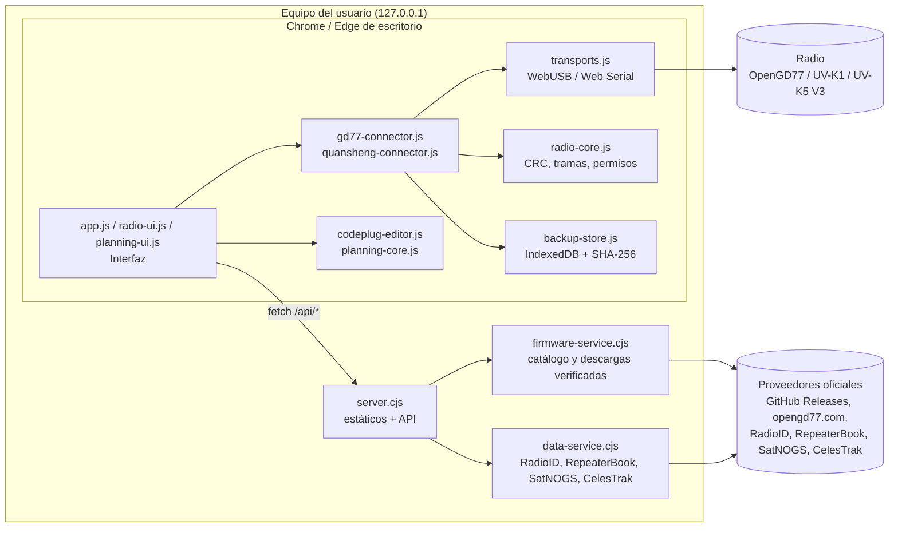
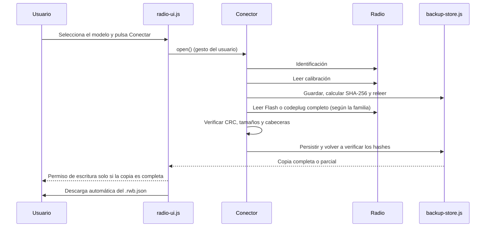

# Architektur von Bricohams Radio Workspace

Bricohams Radio Workspace ist eine **lokale** Webanwendung. Ein kleiner Node.js-Server stellt eine feste Positivliste statischer Dateien und einige schreibgeschützte APIs bereit. Die gesamte Kommunikation mit dem Funkgerät erfolgt im Browser über WebUSB oder Web Serial.

## Betriebsarten

Beim Start fordert `runtime-mode.js` die Datei `runtime.json` an (relativer Pfad, ohne Cache). Nur `{"mode":"local"}` aktiviert den lokalen Modus; fehlt die Datei, liefert sie 404, enthält sie kein JSON oder wird die Seite über `file://` geöffnet, startet die Anwendung fehlerfrei im **Webmodus**. `server.cjs` liefert sie als `{"mode":"local"}`, und `scripts/build-pages.cjs` erzeugt `{"mode":"web"}` in `dist/`. Das Kennzeichen oben zeigt „Web · GitHub Pages“ oder „Lokal · installiert“.

| Aspekt | Web (Pages) | Lokal |
| --- | --- | --- |
| Server | Keiner, nur statische Dateien | `server.cjs` auf `127.0.0.1:8787` |
| Firmware F4HWN / ARDF K1-K5 V3 | Stabile Versionshistorie von Armel und reald über `api.github.com`; der Benutzer lädt die Datei, Größe und veröffentlichter SHA-256 werden geprüft | Vom Server verifizierter Download; ARDF, Versionen vor v6 und SA818 nur zum Download |
| Firmware OpenGD77 | Manuelles Laden der ZIP-Datei (Name und ZIP-Signatur; kein Hash des Herausgebers) | Download über den Server |
| RadioID | Laden von `user.csv` (100 MiB, gefiltert, 5.000 angezeigte Zeilen) und optionales Profil in `localStorage` | API über den Server |
| RepeaterBook | Nicht verfügbar | Genehmigtes Token, nur auf dem Server |
| Satelliten | Tägliche `data/satellites.json` (`scripts/fetch-satellites.cjs`) | Aktuelle TLEs |

Client-Pfade sind immer relativ. Die CSP jeder HTML-Datei steht in `<meta>`; da `<meta>` kein `frame-ancestors` unterstützt, bricht `app.js` ab, wenn die Seite in einem Frame läuft. Die Webversion hat einen eigenen Origin (siehe ADR-013).

## Komponentenübersicht

## Module

| Datei | Seite | Aufgabe |
| --- | --- | --- |
| `index.html`, `opengd77.html`, `quansheng.html`, `ayuda.html` | Browser | Seitengerüste mit `body[data-page]`, ohne Inline-Skripte. |
| `app.js` | Browser | Gemeinsame Oberfläche (Marke, Navigation, Fußzeile), Anleitungen und Hilfeseite mit Suche. |
| `radio-ui.js` | Browser | Verbindungsbereich, automatische Sicherungen, Verlauf, Export und geschützte Aktionen. |
| `transports.js` | Browser | `USBTransport` (CDC über WebUSB, `1FC9:0094`) und `SerialTransport` (Web Serial), mit exaktem Lesen und Zeitlimit. |
| `radio-core.js` | Browser / Node | CRC-16/CRC-32, Binärhilfsfunktionen, Schreibberechtigungen und SHA-256. |
| `gd77-connector.js` | Browser | OpenGD77-CPS-Protokoll (`C`/`R`/`W`/`X`) und Speicherzuordnungen MK22, STM32 und SERIAL. |
| `quansheng-connector.js` | Browser | F4HWN-UART-Protokoll (XOR-Verschleierung, CRC), Lesen von Kalibrierung und Flash, Multiboot-Slots. |
| `backup-store.js` | Browser | Speicherung in IndexedDB, verifiziertes Rücklesen und `.rwb.json`-Export. |
| `codeplug-editor.js` | Browser / Node | Binäres Lesen und Schreiben des OpenGD77-Codeplugs: Kanäle, Kontakte und SAT-Block Typ 3. |
| `planning-core.js` | Browser / Node | Filter, Deduplizierung, CSV, TLE-Validierung und SGP4-Überflüge mit `satellite.js`. |
| `planning-ui.js` | Browser | Bereich „Codeplug: Kontakte, Relais und SAT“. |
| `firmware-catalog.js` | Browser / Node | Zugelassene Modelle und Firmwarequellen. |
| `server.cjs` | Node | HTTP-Server auf `127.0.0.1:8787`, Dateipositivliste, Sicherheitsheader und Routing für `/api/*`. |
| `firmware-service.cjs` | Node | Abfragen von GitHub Releases und opengd77.com mit kontrollierten Weiterleitungen, Größenlimits und Cache. |
| `runtime-mode.js` | Browser | Erkennt den Modus (`runtime.json`; Webmodus bei fehlender Datei). |
| `radioid-csv.js` | Browser / Node | Gefiltertes Lesen von `user.csv` und optionales lokales Profil. |
| `scripts/build-pages.cjs`, `scripts/fetch-satellites.cjs` | Node | Erzeugen `dist/` und `data/satellites.json` für Pages. |
| `data-service.cjs` | Node | Schreibgeschützter Proxy für RadioID, RepeaterBook (Zugangsdaten nur auf dem Server), SatNOGS und CelesTrak. |

## Verbindungsablauf und automatische Sicherung

Vor jedem Schreibvorgang wird die Sicherung erneut gelesen und mit den Hashes der Berechtigung verglichen. Das Trennen oder Austauschen des Funkgeräts sowie das Löschen der Sicherung widerrufen die Berechtigung.

## Sicherheitsebenen

1. **Netzwerk:** der Server lauscht nur auf `127.0.0.1`, verlangt `Host: 127.0.0.1:<puerto>` und stellt eine feste Dateiliste bereit.
2. **Browser:** CSP `default-src 'self'; script-src 'self'; style-src 'self'`, `Permissions-Policy`, `nosniff`, `no-referrer` und `no-store`. Kein `eval` und kein aus Funkgerätedaten erzeugtes HTML.
3. **Gerät:** Schreibvorgänge benötigen eine an eine verifizierte Sicherung gebundene *Fail-closed*-Berechtigung. Main ist niemals ein Ziel. Löschen oder Zurücksetzen erfordert eine eingetippte Bestätigung.
4. **Externe Quellen:** nur offizielle Anbieter, Weiterleitungen auf zugelassene Hosts, Größenlimits und sichtbarer SHA-256. RepeaterBook-Zugangsdaten werden nie an den Browser gesendet.
5. **Daten:** keine Telemetrie und keine Uploads. Sicherungen verbleiben in der IndexedDB des lokalen Profils und werden in Benutzerdateien exportiert.

## Bekannte Einschränkungen

- **OpenGD77:** hier existiert kein verifiziertes Protokoll zum Auslesen der vollständigen MCU-Firmware. Die Sicherung wird als **unvollständig** markiert; Schreiben auf das Funkgerät bleibt gesperrt.
- **Quansheng:** eine vollständige physische Flash-Sicherung erfordert die Lese- und CRC-Funktionen von F4HWN Labs v6.1+. Die Webanwendung implementiert Beta-Schreibzugriff auf Konfiguration/Kanäle mit Sicherung und Rücklesen; Bricohams-SAT-Images enthalten experimentelles CAT RX. Das belegt weder dauerhaftes Schreiben noch CAT-Betrieb auf einem bestimmten Funkgerät; siehe [Validierungsmatrix](VALIDACION-INTEGRAL-V3-ANDROID.md).
- **RepeaterBook:** erfordert ein von RepeaterBook genehmigtes Token und ist nur lokal verfügbar.
- **Web:** Satellitendaten können bis zu einen Tag alt sein (Warnung ab 7 Tagen); Firmware/RadioID werden manuell geladen.
- **Hardware:** frühere Lesevorgänge an einem Quansheng-Gerät sind vorhanden, zertifizieren aber weder Schreibvorgänge noch den eigenständigen Resident oder die aktuelle Kombination aus APK, SAT-Slot und Telefon. Physische Tests dieser Revision stehen aus.
