# Technischer Atlas des Quansheng UV-K5 V3 und UV-K1

Revision: 26-10-2026. Wissensbasis zu Hardware, Kommunikation, Flashen und
Entwicklung für UV-K5 V3 und seinen Zwilling UV-K1. Pins, Speicher und
Protokolle stammen aus dem heute auf diesen Funkgeräten laufenden offenen
Quellcode ([F4HWN V3](https://github.com/armel/uv-k1-k5v3-firmware-custom), Apache-2.0)
und dem [Teardown von armel](https://github.com/armel/k1-teardown), nicht aus
Vermutungen. Für die schrittweise Einrichtung des Funkgeräts verwende den
[Start von 0 bis 100 %](AYUDA-QUANSHENG.md#puesta-en-marcha-de-0-a-100).

| Block | Komponente |
| --- | --- |
| MCU | Puya PY32F071 (PY32F071C1BT6), Cortex-M0+ mit 72 MHz, 128 KB Flash, 16 KB SRAM |
| Transceiver | Beken BK4829 |
| UKW-Radio | Beken BK1080 |
| Datenspeicher | PUYA PY25Q16HB SPI-Flash, 2 MB |
| Display | ST7565, 128x64 monochrom |
| Audio | LM4898/LN4898-Verstärker |
| USB-C | Laden und Programmierung (CDC-Virtual-Seriell-Port) |

## Versionen und ihre Identifikation

Die Firmware einer Version funktioniert nicht mit einer anderen: Der
Mikrocontroller ist verschieden und das Image startet nicht oder lässt das
Funkgerät ohne Anzeige zurück.

| Version | MCU | Datenspeicher | USB-C | Offene Referenz-Firmware |
| --- | --- | --- | --- | --- |
| V1 (UV-K5, K5(8), K6, 5R Plus) | DP32G030, 48 MHz, 64 KB | 8-KB-I2C-EEPROM (erweiterbar) | Nur Laden | [armel/uv-k5-firmware-custom](https://github.com/armel/uv-k5-firmware-custom) |
| V2 | PY32F030 / PY32G030 | I2C-EEPROM | Nur Laden | [muzkr/uv-k5-firmware-custom](https://github.com/muzkr/uv-k5-firmware-custom) |
| **V3 und UV-K1** | **PY32F071**, 72 MHz, 128 KB | **2-MB-PY25Q16-SPI-Flash** | **Laden und Programmierung** | [armel/uv-k1-k5v3-firmware-custom](https://github.com/armel/uv-k1-k5v3-firmware-custom) |

- **Aufkleber unter dem Akku:** „V2“ oder „V3“. Ohne Markierung ist es meist
  V1, doch das ARDF-Handbuch weist auf V3-Etiketten an V2-Hardware hin: kein
  eindeutiger Beweis.
- **USB-C erscheint beim Verbinden mit dem PC als serieller Port:** V3/K1.
- **Bootloader-Version** (mit gedrückter PTT einschalten): UV-K5 V3 meldet
  `7.00.07`; UV-K1 `7.02.02` oder `7.03.0x`. In Gruppen tauchen UV-K5(8) V3
  mit `7.0.11` auf: Prüfe eine andere Zahl, bevor du flashst.
- K1 und K5 V3 teilen Platine (`K1-V5.0` aufgedruckt) und Firmware. Im
  Werks-Flash unterscheidet sich nur die zweite Zeile der Startmeldung (`0x007030`).
- Eine V3-`.bin` beginnt mit ihrer Vektortabelle: Wort 0 = Stack im SRAM
  (`0x2000xxxx`), Wort 1 = Reset bei `0x0800xxxx` mit gesetztem Bit 0. Bei
  einem V1-Binärprogramm liegt der Reset nahe `0x000000xx`.

## Architektur

Der PY32F071 steuert alles: Er programmiert die BK4829-Register bei jedem
Wechsel von Frequenz, Modus, Filter oder Leistung, liest den S-Meter aus und
verwaltet Audio, Display, Tastatur und Speicher.

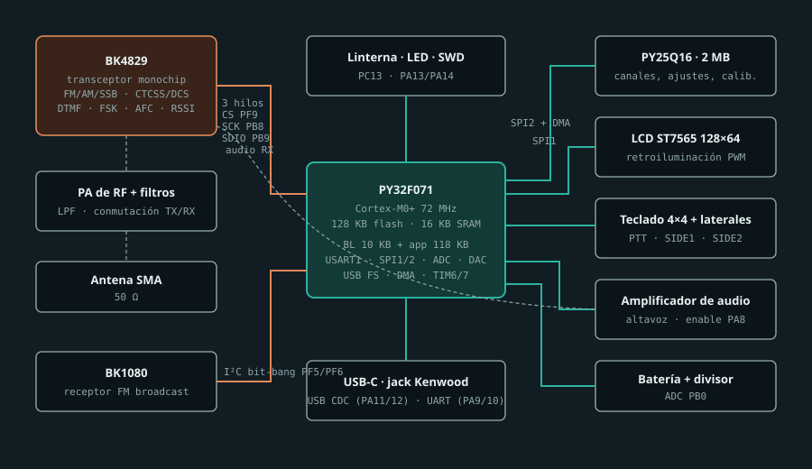

## Pinbelegung des PY32F071

Von F4HWN für V3/K1 verwendete Belegung (`App/board.c`, `App/driver/*.c`).
Die physische Pinnummer steht im [Datenblatt des PY32F071](https://github.com/armel/k1-teardown/blob/main/datasheet/PY32F071_Datasheet_Rev0.7_EN.pdf).

| Pin | Funktion | Konfiguration | Treiber |
| --- | --- | --- | --- |
| PA0 | Flash SPI2 SCK | AF8 SPI2 | `py25q16.c` |
| PA1, PA2 | Flash SPI2 MISO/MOSI | AF9 SPI2, Prescaler /2, DMA1 | `py25q16.c` |
| PA3 | Flash SPI CS | Ausgang | `py25q16.c` |
| PA4 | Sprach-DAC / RX-Audioaufnahme | Analog, TIM6 + DMA | `voice.c` |
| PA5 | LCD SPI1 SCK | AF0 SPI1, Prescaler /64 | `st7565.c` |
| PA6 | LCD A0 (Daten/Befehl) | Ausgang | `st7565.c` |
| PA7 | LCD SPI1 MOSI | AF0 SPI1 | `st7565.c` |
| PA8 | Audioverstärker aktivieren | Ausgang | `gpio.h` |
| PA9, PA10 | USART1 TX/RX (Kenwood-Buchse) | AF1, 38400 Baud | `uart.c` |
| PA11, PA12 | USB FS D-/D+ (CDC) | USB | `vcp.c` |
| PA13, PA14 | SWDIO / SWCLK | SWD, wenn `ENABLE_SWD` kompiliert wird | `board.c` |
| PB0 | Akkuspannung | ADC1 Kanal 8, 12 Bit | `board.c` |
| PB1 | Reservierter analoger Pin | Analogmodus | `board.c` |
| PB2 | LCD CS | Ausgang | `st7565.c` |
| PB3-PB6 | Tastatur, Spalten | Ausgänge | `keyboard.c` |
| PB8 | BK4829 SCK | Ausgang, Bit-Banging | `bk4829.c` |
| PB9 | BK4829 SDIO bidirektional | Ausgang/Eingang, Bit-Banging | `bk4829.c` |
| PB10 | PTT | Pull-up-Eingang, aktiv low | `gpio.h` |
| PB12-PB15 | Tastatur, Zeilen | Pull-up-Eingänge | `keyboard.c` |
| PC13 | Taschenlampe | Ausgang | `board.c` |
| PF5, PF6 | BK1080 SCL/SDA | I2C-Bit-Banging | `i2c.c` |
| PF8 | LCD-Hintergrundbeleuchtung | PWM über TIM7 + DMA | `backlight.c` |
| PF9 | BK4829 CS | Ausgang | `bk4829.c` |

### Tastaturmatrix

Die Firmware zieht eine Spalte auf Low und liest die vier Zeilen aus. „Spalte
0“ bedeutet, dass keine Spalte aktiv ist; dabei werden die Seitentasten
abgefragt. PTT liegt separat auf PB10.

| Zeile | Spalte 0 | PB6 | PB5 | PB4 | PB3 |
| --- | --- | --- | --- | --- | --- |
| PB15 | SIDE1 | MENU | UP | DOWN | EXIT |
| PB14 | SIDE2 | 1 | 2 | 3 | * |
| PB13 | - | 4 | 5 | 6 | 0 |
| PB12 | - | 7 | 8 | 9 | F |

## Busse und Peripheriegeräte

| Peripheriegerät | Bus | Hinweise |
| --- | --- | --- |
| BK4829 | 3-Draht-Bit-Banging: CS PF9, SCK PB8, SDIO PB9 | 8-Bit-Register + 16-Bit-Wert. Der Treiber verwendet dieselbe API wie der BK4819 von V1 (`bk4819.h`) |
| PY25Q16-Flash | SPI2 + DMA1, CS PA3 | 4-KB-Sektoren; über eine Übersetzungstabelle als „EEPROM“ abgebildet |
| ST7565-LCD | SPI1, A0 PA6, CS PB2 | 8 Seiten mit je 128 Spalten, niederwertigstes Bit oben |
| BK1080 | I2C-Bit-Banging PF5/PF6 | Nur mit `ENABLE_FMRADIO` |
| Kenwood-Buchse | USART1 PA9/PA10 | 38400 8N1 |
| USB-C | USB FS PA11/PA12, CDC | Dasselbe Protokoll wie die Buchse |
| Sprache und Audio | DAC PA4, Enable PA8 | Labs-Apps verwenden PA4 als ADC für APRS/AFSK |

## Interner Speicher

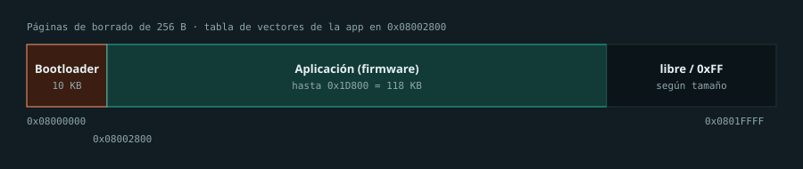

- Bootloader `0x08000000-0x080027FF` (10 KB), wird durch DFU nie überschrieben.
- Anwendung ab `0x08002800`, maximal `0x1D800` Byte (`Core/py32f071xb.ld`).
- Löschseiten zu 256 Byte; SRAM 16 KB.

## Externer 2-MB-Flash

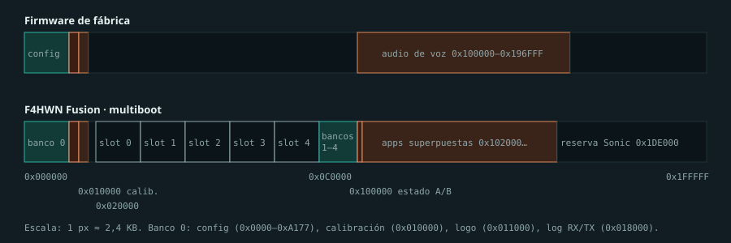

| Bereich | Inhalt (F4HWN-Multiboot) |
| --- | --- |
| `0x000000-0x00BFFF` | Konfigurationsbank 0: Kanäle, Namen, VFO, Einstellungen |
| `0x010000-0x010FFF` | **Kalibrierung** (512 Byte nutzbar), für jedes Funkgerät individuell |
| `0x011000-0x011FFF` | Startlogo: 8-Byte-Header + 1024-Byte-Bitmap (Werks-Signatur `0x9ABC5A5A`) |
| `0x018000-0x01FFFF` | RX/TX-Protokoll, 8 Sektoren |
| `0x020000 + n*0x20000` | Slots 0-4 zu je 128 KB: `FMB1`-Header mit 64 Byte (Größe, CRC-32, Name, Version) und Image bei +0x1000. Slot 0 = geschützte Kopie des Hauptimages |
| `0x0C0000-0x0FFFFF` | Konfigurationsbanken 1-4 (64 KB) |
| `0x100000` / `0x101000` | Redundanter Multiboot-Status `FMP3` |
| `0x102000-` | Überlagerte Apps `FAP1`, 8-KB-Slots |
| `0x1DE000-0x1FFFFF` | Interoperabilitätsreserve für Sonic |

Werks-Firmware speichert Sprache in `0x100000-0x196FFF`, derselben Zone wie
F4HWN. Um zur Werks-Firmware zurückzukehren, verwende die geführte
Wiederherstellung von [UV Studio](https://armel.github.io/uvstudio/); sie baut
diese Zone wieder auf, ohne die Kalibrierung zu berühren.

## Logische EEPROM-Map

`eeprom_compat.c` übersetzt 16-Bit-EEPROM-Adressen in SPI-Flash, um V1-Code
und CHIRP-Treiber wiederzuverwenden. Außerhalb der Tabelle wird `0xFF` gelesen.

| Logische Adresse | Physischer Flash | Inhalt |
| --- | --- | --- |
| `0x0000-0x3FFF` | `0x000000` | Frequenzen von 1024 Speicherplätzen x 16 Byte |
| `0x4000-0x7FFF` | `0x004000` | Namen von 1024 Speicherplätzen x 16 Byte |
| `0x8000-0x886D` | `0x008000` | Attribute und Listennamen |
| `0x9000-0x90E8` | `0x009000` | 14 VFO und Fox Hunt/Beacon |
| `0xA000-0xA177` | `0x00A000` | Einstellungen, FM, Listen, AES, Spektrum, F4HWN, Version |
| `0xB000-0xB1FF` | `0x010000` | Kalibrierung |
| `0xC000-0xCFFF` | `0x011000` | Startlogo |

Dies ist die F4HWN-Map. Werksfirmware, Karina, IJV oder Matoz verwenden eine
andere: Ein CHIRP-Treiber funktioniert nur mit der Firmware, für die ergeschrieben wurde.

## Kalibrierung

- Jedes Funkgerät hat seine Kalibrierung bei `0x010000`. Sie ist nicht
  austauschbar: „Karina-Kalibrierungen“ oder Kalibrierungen eines anderen
  Geräts wurden für eine andere Einheit berechnet.
- Sichere sie vor dem Flashen mit UV Studio („dump calib“) oder mit dem
  Auslesen dieser Website; [K5Tool-bin](https://github.com/Gulihg/K5Tool-bin)
  extrahiert Werte aus einem Dump. Beispiele mit 512 Byte unter
  [k1-teardown/openocd](https://github.com/armel/k1-teardown/tree/main/openocd).
- F4HWN-Befehle lehnen das Schreiben dieses Sektors ab.

## Serielles Programmierprotokoll

Über Kenwood-Buchse wie über USB-C gleich: 38400 Baud 8N1, von V1 übernommen.

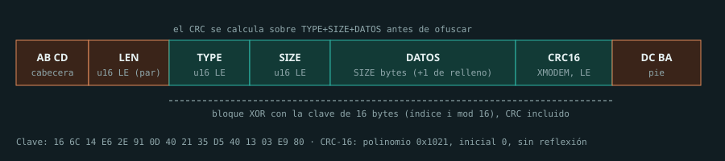

XOR-Verschlüsselungsschlüssel (Index i mod 16): `16 6C 14 E6 2E 91 0D 40 21 35 D5 40 13 03 E9 80`.
CRC-16 XMODEM: Polynom `0x1021`, Startwert 0, über Typ, Größe und Daten
vor der Verschlüsselung. Beim Antworten füllt das Funkgerät die CRC mit
`clave[n] ^ 0xFF`. Ein robuster Leser verlangt stimmigen Header, Trailer und
Länge und protokolliert nur nicht passende CRCs.

| Anfrage | Antwort | Verwendung | Daten |
| --- | --- | --- | --- |
| `0x0514` | `0x0515` | Begrüßung und Identifikation | u32-Zeitstempel |
| `0x051B` | `0x051C` | EEPROM lesen | u16-Offset, u8-Größe, u8-Padding, u32-Zeitstempel |
| `0x051D` | `0x051E` | EEPROM schreiben | u16-Offset, u8-Größe, bool allowPassword, u32-Zeitstempel, Daten |
| `0x0527` | `0x0528` | RSSI | - |
| `0x0529` | - | Akkuspannung und -strom | - |
| `0x052F` | - | Begrüßungsvariante | u32-Zeitstempel |
| `0x05DD` | - | Neustart | - |
| `0x0601` / `0x0602` | - | BK4829-Register (nur `ENABLE_UART_RW_BK_REGS`) | Register, Wert |

F4HWN-Fusion-Erweiterungen: `0x0720-0x0729` Slots und Bänke, `0x0730-0x0737`
überlagerte Apps, `0x0738` physischer Flash-Lesezugriff, `0x073A`/`0x073C`
Sektorlöschen und -programmierung (Kalibrierung abgewiesen), `0x073E` CRC-32
eines Bereichs. Slot 0 kann weder gelöscht noch überschrieben werden.
K5Viewer injiziert Tasten mit `AA 55 03|04 <tecla>`; PTT ist gesperrt.

## Bootloader und Flashen

Funkgerät ausgeschaltet lassen, PTT gedrückt halten und einschalten: LED an,
Display aus. Der Werks-Bootloader wartet über USB-C und Buchse auf dieselben Frames.

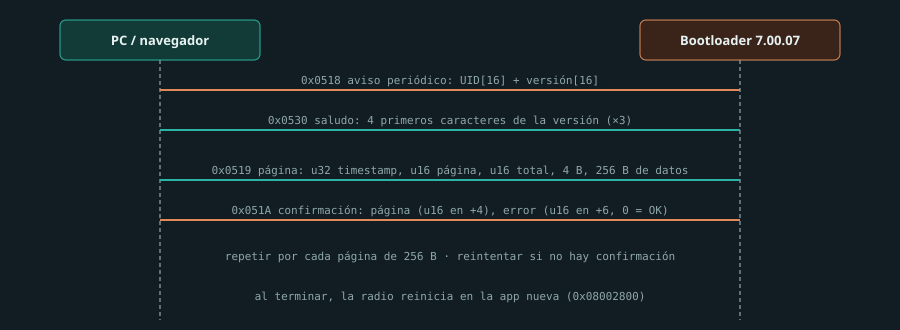

Bricohams Studio und UV Studio akzeptieren nur Bootloader `7.00.07` für
UV-K5 V3 und `7.02.02`/`7.03.0x` für UV-K1 und prüfen die Vektoren der `.bin`,
bevor sie den Port öffnen. Ein V1-Image wird zwar „geflasht“, startet aber nicht.

| Werkzeug | Verwendung |
| --- | --- |
| [UV Studio](https://armel.github.io/uvstudio/) | Flashen, Multiboot, Kalibrierungsdump, Werkswiederherstellung |
| [Bricohams Studio](https://brico-hams.github.io/Bricohams-Studio/) | Kanäle, Einstellungen, Slots und Hauptfirmware |
| [Multi-UVTools](https://spm81.github.io/Multi-UVTools/) | Web-Flasher für mehrere Modelle |
| [Moto](https://github.com/muzkr/moto) | Alternativer UF2-Bootloader: USB-Laufwerk „MOTO“ und `.uf2` darauf ziehen. Riskant, ohne serielle Befehle |

`*.packed.bin` sind für den offiziellen Updater; flache `.bin`-Dateien für
offene Tools.

## SWD und Wiederherstellung

Wenn der Bootloader beschädigt ist, bleibt nur SWD (PA13 SWDIO, PA14 SWCLK)
mit einem ST-Link. Der PY32 wird wie STM32F0 behandelt, jedoch mit anderer TAP-ID:

```text
openocd -f interface/stlink.cfg -c "set CPUTAPID 0x0bc11477" -f target/stm32f0x.cfg -c "adapter speed 1000" -c "init; reset halt; dump_image K1_PY32F071.bin 0x08000000 0x00020000; shutdown"
```

Schreibe mit einem Programmer kein vollständiges externes Flash-Image:
Dadurch würdest du die Kalibrierung löschen. Die Images „Factory_Reconstructed“
aus k1-teardown sind für die geführte Wiederherstellung mit UV Studio bestimmt.

## Firmware kompilieren

Empfohlene Basis: [armel/uv-k1-k5v3-firmware-custom](https://github.com/armel/uv-k1-k5v3-firmware-custom),
die PY32-Start, Puya-HAL, SPI-Flash, BK4829, USB und Protokoll bereits abdeckt.

```text
git clone --depth 1 https://github.com/armel/uv-k1-k5v3-firmware-custom
cd uv-k1-k5v3-firmware-custom
./compile-firmware.sh Fusion
./compile-firmware.sh Fusion -DENABLE_VOX=OFF
./compile-firmware.sh All
```

Der Container verwendet ARM GNU Toolchain 13.3.rel1, CMake und Ninja.
Presets: Custom, Fusion, FieldOps, Transfer, Labs und Max. Ausgabe in
`build/<Preset>`.

| Pfad | Inhalt |
| --- | --- |
| `App/driver/` | `bk4829.c`, `py25q16.c`, `st7565.c`, `keyboard.c`, `uart.c`, `vcp.c`, `eeprom_compat.c`, `mb_flash.c` |
| `App/app/` | `spectrum.c`, `scanner.c`, `menu.c`, `uart.c`, `fm.c`, `aircopy.c`, `foxhunt.c` |
| `Core/py32f071xb.ld` | Link-Adresse `0x08002800`, 118 KB |
| `CMakePresets.json` | `ENABLE_*`-Flags je Edition |

Der reproduzierbare Bricohams-Build wird unter [Bricohams V3](BRICOHAMS-FIRMWARE.md)
beschrieben, jede Option unter [F4HWN-Optionen](AYUDA-OPCIONES-F4HWN.md).
Prüfe vor dem Flashen eines eigenen Builds die Vektoren und dass die Größe
`0x1D800` Byte nicht überschreitet.

## Hardwaremods

Die [integrierte Validierungsmatrix](VALIDACION-INTEGRAL-V3-ANDROID.md)
erweitert die Kriterien zu Kompatibilität, Tests, Grenzen und ausstehenden
Nachweisen. Es gibt keine allgemeine Zertifizierung von V1-Mods für V3. Das
[Android/CAT/Speicher-Diagramm](../../atlas/android-cat-validacion.svg) ist funktional,
kein gemessener Schaltplan oder Lötleitfaden.

| Modifikation | V3/K1 | Hinweise |
| --- | --- | --- |
| EEPROM erweitern (M24M02, 24C512) | Nicht direkt anwendbar | V3 verwendet 2-MB-SPI-Flash, kein austauschbares I2C-EEPROM. V1-Referenz: [losehu](https://github.com/losehu/uv-k5-bootloader-custom/wiki) |
| SI4732-HF-Empfänger (Platinen v5/v6.8) | Für V3 nicht verifiziert | Die hier katalogisierten Referenzen sind V1 (CEC HF, Reborn, losehu, Robzyl 512K); sie belegen keine PY32-Unterstützung |
| SMA-Antenne (17 cm, 38 cm) | Bedingt Zubehör | Anschluss, mechanische Belastung, Band und SWR prüfen; Länge oder bessere RX-Empfangsleistung zertifizieren TX nicht |
| Satellitenmod (Spulen, LNA) | Unbestätigt | Kein Schaltplan oder Messungen einer Anpassung an diese V3-Revision verfügbar |
| TX-Tiefpassfilter | Prüfen | [Nannk/quansheng-lpf-mod](https://codeberg.org/Nannk/quansheng-lpf-mod); gemessene Platine überprüfen |
| 27-MHz-Mod | V1-Referenz, V3 nicht validiert | [Wiki](https://github.com/ludwich66/Quansheng_UV-K5_Wiki/wiki/Hardware_Mods_27Mhz); erfordert eigenes HF-Netzwerk und Messungen, keine Werte übertragen |
| Programmierkabel | Direktes USB-C | Auch Kenwood-USB-Seriell-Kabel (USART1) funktioniert |
| Coprozessor oder ESP32 | Für V1 entwickelt | [ESPRI](https://github.com/kamilsss655/ESPRI), [UVK5-Coprocessor](https://github.com/wabulutian/UVK5-Coprocessor), [UVE5](https://github.com/losehu/UVE5) |

Firmware, die die Ausgangsleistung über 5 W erhöht, kann die Endstufe
beschädigen. Außerhalb der Lizenzbänder zu senden ist illegal, auch wenn die
Firmware es erlaubt.
## Schaltpläne und Bilder

In den Quellen dieser Revision wurde kein vollständiger, verifizierter
Schaltplan für V3/K1 identifiziert. Das beweist nicht, dass es keinen anderen
gibt. Verfügbare Referenzen:

- [K1-Teardown von armel](https://github.com/armel/k1-teardown) (Apache-2.0): hochauflösende Fotos, Dumps, kommentierte Firmware und Datenblätter.
- [Fotos der UV-K1-Platine](https://github.com/ludwich66/Quansheng_UV-K5_Wiki/wiki/UV%E2%80%90K1-PCB) im Wiki.
- [V1-Schaltplan in KiCad aus Reverse Engineering](https://github.com/ludwich66/Quansheng_UV-K5_Wiki/tree/main/hardware/KiCad/UVK5_reversing_06-02-2024): CPU, RX, TX, Audio, Ladegerät und BK1080. Blätter [RX](https://github.com/ludwich66/Quansheng_UV-K5_Wiki/wiki/Schematic_RX), [TX](https://github.com/ludwich66/Quansheng_UV-K5_Wiki/wiki/Schematic_TX) und [interaktive BOM](https://htmlpreview.github.io/?https://github.com/ludwich66/Quansheng_UV-K5_Wiki/blob/main/hardware/ibom.html). Keine Lizenz angegeben: nur verlinkt.
- Datenblätter: [BK4829](https://github.com/armel/k1-teardown/blob/main/datasheet/BK4829-BEKEN.pdf), [PY32F071](https://github.com/armel/k1-teardown/blob/main/datasheet/PY32F071_Datasheet_Rev0.7_EN.pdf), [PY25Q16HB](https://github.com/armel/k1-teardown/blob/main/datasheet/PY25Q16HB_Datasheet_V1.2.pdf), [BK1080](https://github.com/armel/k1-teardown/blob/main/datasheet/BK1080-BEKEN.pdf), [BK4819-Register](https://github.com/ludwich66/Quansheng_UV-K5_Wiki/blob/main/hardware/BK4819V3Registers_List_20201218.pdf).

Fotos aus dem UV-K1-Teardown (dieselbe Platine wie K5 V3). Autor: F4HWN (armel),
[armel/k1-teardown](https://github.com/armel/k1-teardown), Lizenz Apache-2.0;
auf 1600 px verkleinert.

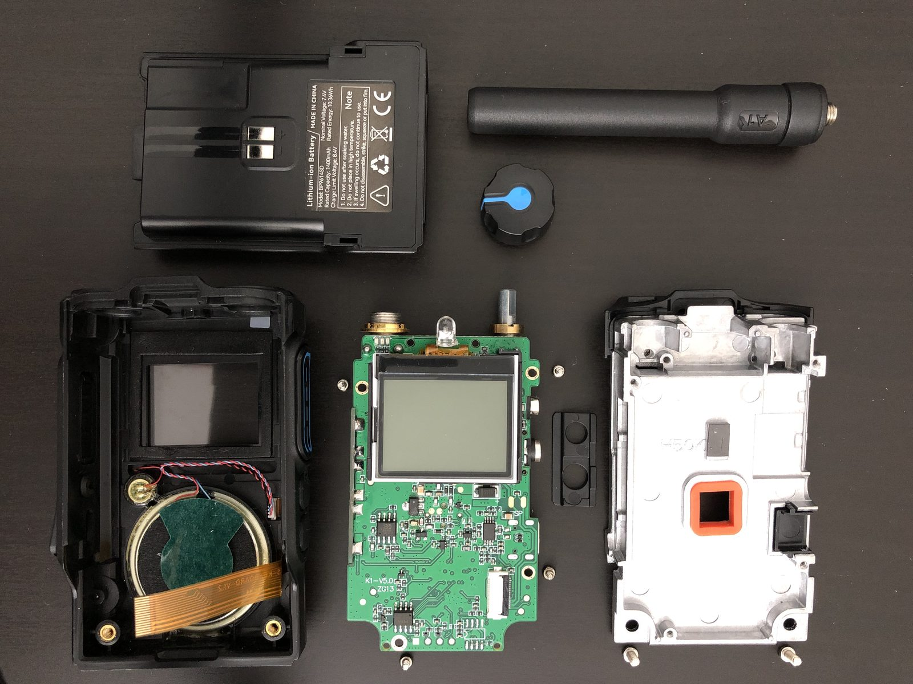

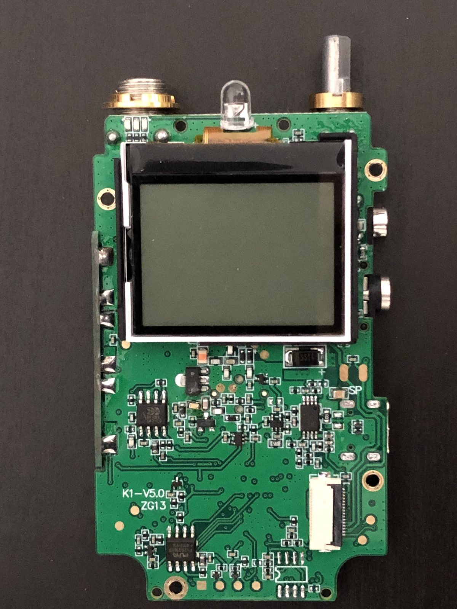

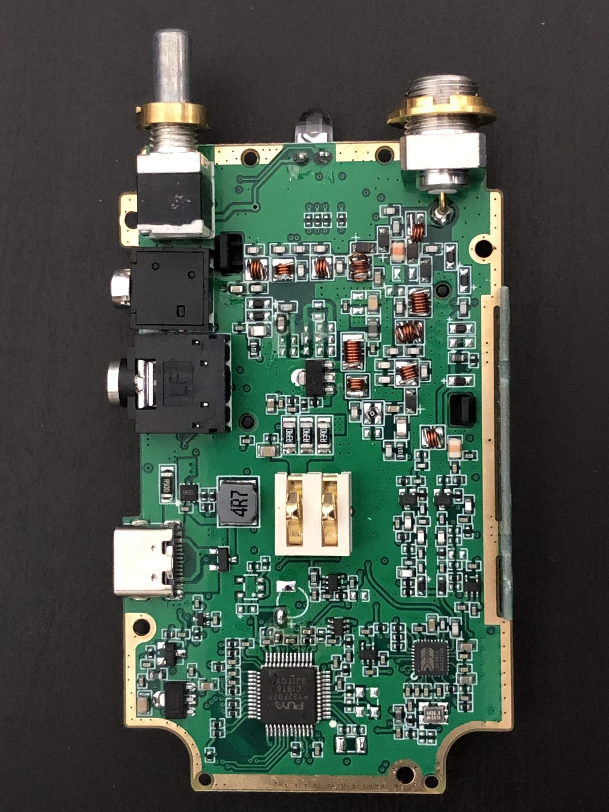

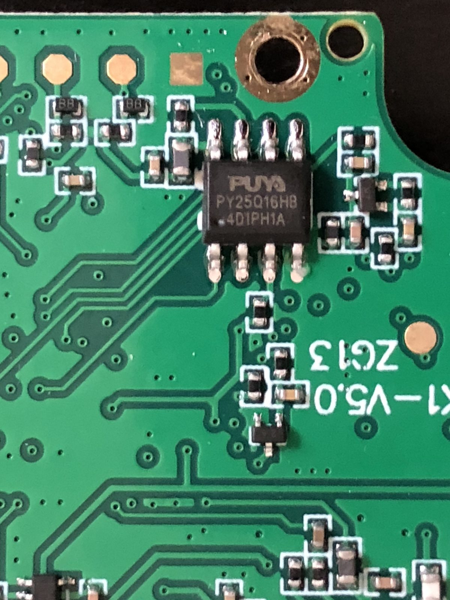

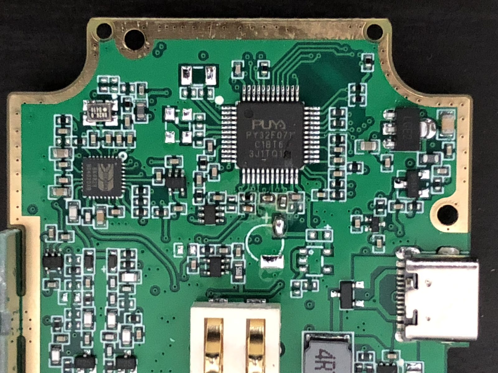

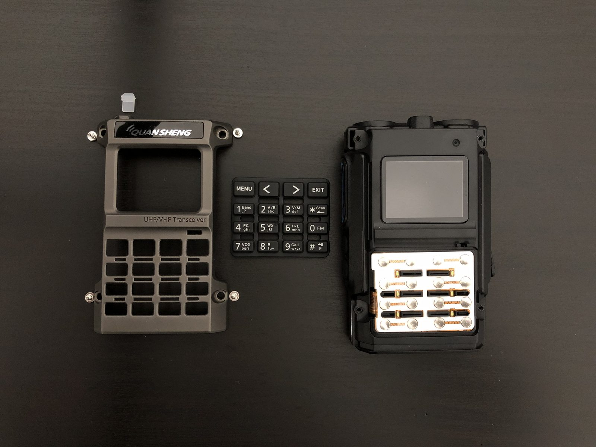

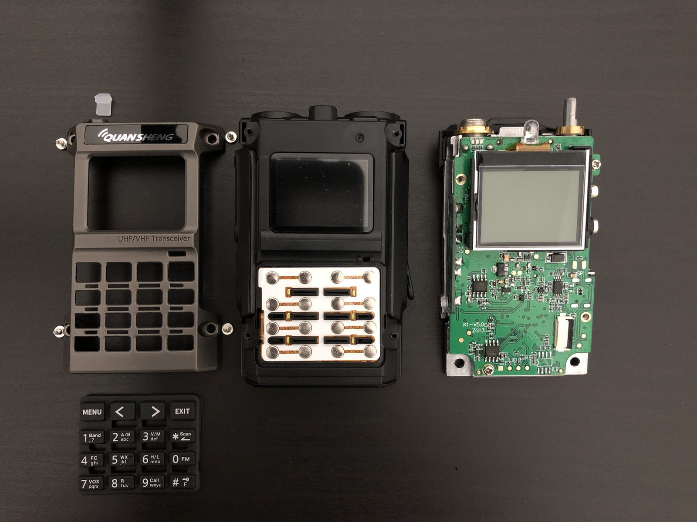

## Firmware und Repositories für V3/K1

Über die GitHub-API am 26-10-2026 geprüft; „V3/K1“ = der Baum enthält PY32-Code.

| Repository | Lizenz | Letzter Push | Beschreibung |
| --- | --- | --- | --- |
| [armel/uv-k1-k5v3-firmware-custom](https://github.com/armel/uv-k1-k5v3-firmware-custom) | Apache-2.0 | 2026-10-25 | F4HWN Fusion PY32, Referenzbasis |
| [Robby69400/Sonic](https://github.com/Robby69400/Sonic) | Apache-2.0 | 2026-10-25 | Nachfolger von Robzyl, F4HWN-Fork mit Multiboot |
| [Gogu-Qs/GOGUFW-UV-K1-Messenger](https://github.com/Gogu-Qs/GOGUFW-UV-K1-Messenger) | Apache-2.0 | 2026-10-24 | Nachrichten, ACK, Reichweite |
| [N7SIX/UV-K1Series_ApeX-Edition_v7.6.0](https://github.com/N7SIX/UV-K1Series_ApeX-Edition_v7.6.0) | Apache-2.0 | 2026-10-11 | ApeX-Edition |
| [reald/uv-k1-k5v3-firmware-custom](https://github.com/reald/uv-k1-k5v3-firmware-custom) | Apache-2.0 | 2026-10-19 | ARDF, siehe [ARDF-Anleitung](AYUDA-ARDF.md) |
| [fagci/k1-fw](https://github.com/fagci/k1-fw) | Keine Lizenz | 2026-07-19 | Firmware von fagci für K1/K5 V3 |
| [muzkr/moto](https://github.com/muzkr/moto) | Apache-2.0 | 2025-12-31 | UF2-Bootloader |
| [armel/k1-teardown](https://github.com/armel/k1-teardown) | Apache-2.0 | 2026-09-28 | Fotos, Dumps und Datenblätter |
| [EthanYan6/uv-k1-k5v3-firmware-custom-3ch](https://github.com/EthanYan6/uv-k1-k5v3-firmware-custom-3ch) | Apache-2.0 | 2026-08-10 | Empfang von 3 Kanälen |
| [qbs524/uv-k1-k5v3-firmware-custom-main-chn](https://github.com/qbs524/uv-k1-k5v3-firmware-custom-main-chn) | Apache-2.0 | 2025-12-24 | F4HWN auf Chinesisch |
| [qrp73/K5TOOL](https://github.com/qrp73/K5TOOL) | GPL-3.0 | 2025-12-18 | EEPROM und Flashen über Kommandozeile |
| [knoinok/quansheng_toolkit](https://github.com/knoinok/quansheng_toolkit) | - | 2026-05-08 | Desktop-Toolkit für K1/K5 V3 |
| [Dim0s/quansheng-UV-K5v3-K1-firmware-pack](https://github.com/Dim0s/quansheng-UV-K5v3-K1-firmware-pack) | - | 2026-10-25 | Sammlung von V3/K1-Binärdateien, siehe [Dim0s-Pack](AYUDA-PACK-DIM0S.md) |

Nicht erreichbare Links und aktuelle Fundstellen:

- `Robby69400/Robzyl*`: gelöscht; Kopien unter [K5Quan/Robzyl_K1_](https://github.com/K5Quan/Robzyl_K1_), [K5Quan/Robzyl_512K](https://github.com/K5Quan/Robzyl_512K) und [simoncottingham/Robzyl_K5](https://github.com/simoncottingham/Robzyl_K5); der Autor arbeitet weiter an Sonic.
- `joaquimorg/uv-k5` und `new_ui`: umbenannt in [UV-KX](https://github.com/joaquimorg/UV-KX), [UV-KX-firmware](https://github.com/joaquimorg/UV-KX-firmware) und [uv-kx-tools](https://github.com/joaquimorg/uv-kx-tools) (V1).
- `armel/uvtools2`: jetzt [Robby69400/uvtools2](https://github.com/Robby69400/uvtools2); die Website bleibt unter <https://armel.github.io/uvtools2/>.
- `bg6ud/uv-k1-k5v3-firmware-custom`: gelöscht; siehe F4HWN-V3-Forks.

Auf GitFlic, GitVerse, GitLab und Gitee wurde nichts zu Quansheng gefunden;
die russische Community veröffentlicht Binärdateien auf 4PDA und Telegram.

## Karina und geschlossener Quellcode

Karina ist Closed Source (siehe [Karina](KARINA.md)). Russischen Gruppen
zufolge ist sie die Fortsetzung von [fagci-mod v1.2.1](https://github.com/fagci/uv-k5-firmware-fagci-mod)
(Apache-2.0, erlaubt geschlossene Derivate). Für eine saubere Nachbildung
seiner Funktionen: anhand von Handbuch und Changelog beschreiben, von F4HWN V3,
dem Spektrumcode aus fagci-mod und [PUNKTRACKER 2.5](https://github.com/Alexuresp/PUNKTRACKER_2.5)
(Apache-2.0, V1) ausgehen. `fagci/s0v4`, `hawk5` und `k1-fw` haben keine
Lizenz: Sie können gelesen, aber nicht kopiert werden. Das Karina-Binärprogramm
nicht dekompilieren, um seinen Quellcode nachzubilden.

## Quellen

- Code: [F4HWN V3](https://github.com/armel/uv-k1-k5v3-firmware-custom) (`App/board.c`, `App/driver/*`, `App/app/uart.c`, `mb_flash.h`, `eeprom_compat.c`), [moto](https://github.com/muzkr/moto), Bricohams Studio (`bkFlashMain`).
- Hardware: [k1-teardown](https://github.com/armel/k1-teardown), [Quansheng UV-K5 Wiki](https://github.com/ludwich66/Quansheng_UV-K5_Wiki/wiki).
- Community: gezielte Suche in spanisch- und russischsprachigen Telegram-Gruppen, ohne Autoren oder persönliche Daten; [Dim0s-Pack](https://github.com/Dim0s/quansheng-UV-K5v3-K1-firmware-pack).
- V1-Referenzen: [amnemonic](https://github.com/amnemonic/Quansheng_UV-K5_Firmware), [losehu](https://github.com/losehu/uv-k5-bootloader-custom/wiki), [egzumer-Wiki](https://github.com/egzumer/uv-k5-firmware-custom/wiki).