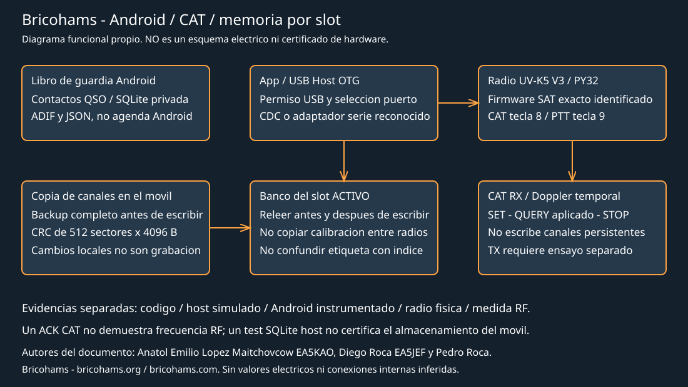

# Integrierte Validierung UV-K5 V3, Android und Bricohams-Firmware

Autoren: Anatol Emilio Lopez Maitchovcow EA5KAO, Diego Roca EA5JEF und Pedro
Roca, Gründer und Vorstandsmitglieder von Bricohams.
Informationen: <https://bricohams.org> und <https://bricohams.com>.

Erste Revision: 26-10-2026. **Audit läuft; dies ist weder eine
Funktionsbescheinigung noch ein bereits abgeschlossenes umfassendes Review.**
Hinweise und Zuschreibungen zu Code, Fotos und Dokumenten Dritter bleiben erhalten.

## Identifikation der Veröffentlichung

Dass zwei APKs `0.8.1-beta` anzeigen, reicht nicht: Commit, SHA-256 der APK,
Signatur und Quell-Hashes müssen genau die getestete Veröffentlichung identifizieren.

| Veröffentlichung | Identität | Nachweis |
| --- | --- | --- |
| Ursprünglicher Arbeitsbaum | Basis `42fa5e014b270b929b58f7fd2fee2a28f482d1c0`, lokale Änderungen | Android-Host, lint und APK während dieser Revision geprüft |
| Abgefragtes veröffentlichtes Main | `01c58563e6507d17bd2bec612ef669840abfeddb` | Isolierte Revision ohne Ersetzen lokaler Änderungen; enthält General/POTA/SOTA und neue Überflugliste |
| Auf dem Mobiltelefon installierte APK | Nicht identifiziert | Kein Telefon in ADB sichtbar; nicht geprüft |
| Aktuelle SAT-Slot-Firmware | Nutzer gibt Slot 3 an | Kein Radio-Port erkennbar; Index, Bank, CRC und Version noch offen |

Ergebnisse der isoliert geprüften veröffentlichten Revision: **93 erfolgreiche
Android-Host-Tests, null Fehler/Ausnahmen**, lint ohne Fehler und 13 Warnungen,
Debug-APK kompiliert. SHA-256 dieses Neubuilds:
`b739992a1b4cba67fdd87e97efdf5408e84f549068b51043d854da094ed1152d`.
Dies ist weder der Hash einer von der Website heruntergeladenen noch einer auf
einem Mobiltelefon installierten APK. Die lokale CRC-Korrektur ist nicht in
diesem Main-Neubuild enthalten.

Die 13 lint-Warnungen beider Revisionen betreffen zwei Testabhängigkeiten mit
neueren Versionen, fünf Hinweise des englischen Wörterbuchs zu „satelite“,
einen möglichen Plural, drei typografische Bindestriche, eine Ellipse und die
Symbolform. Abhängigkeiten oder Marke werden nicht geändert, um sie zu verbergen.

Die veröffentlichte Website entspricht nicht unbedingt dem lokalen Arbeitsbaum.
Auch kann der Inhalt einer herunterladbaren APK nicht aus dem Text einer
Anleitung abgeleitet werden. Tests der lokalen Basis dürfen weder der
veröffentlichten Revision noch einer nicht identifizierten APK zugeschrieben werden.

Diese Zeichnung ist eine eigene Funktionsdarstellung, kein Schaltplan. Sie
enthält keine abgeleiteten internen Verbindungen, Bauteilwerte oder
Spannungspegel. Pin- und Speicherpläne stehen im
[Atlas](ATLAS-UV-K5-V3.md).

## Nachweisstufen

1. Geprüfter Quellcode: belegt die vorgesehene Implementierung, nicht deren Ausführung.
2. Host-/JVM-/Robolectric-Test: prüft die konkreten simulierten Szenarien.
3. Android-Instrumentierung: erfordert ein identifiziertes Gerät/einen Emulator.
4. Reales Funkgerät: erfordert identifizierte Version, Slot, Bank und Konfiguration.
5. Externe HF-/Elektromessung: erfordert Messgerät, Anschluss und Verfahren.

Ein Schreib-ACK ersetzt weder erneutes Einlesen noch Persistenz nach Neustart
oder HF-Messung. Ein SQLite-Desktoptest zertifiziert nicht den Speicher des
Mobiltelefons. Der Endstatus jedes Szenarios muss Stufe und Beleg angeben;
„nicht ausgeführt“ darf nicht zu „korrekt“ werden.

## Behobener Befund: CRC der Android-Sicherung

`QuanshengMemory.verifyFlash` forderte `0x073E` einmalig für 2097152 Byte an.
Der Referenzbefehl begrenzt jede Abfrage auf 4096 Byte. Der Mock ließ den
unmöglichen Bereich zu und verbarg den Fehler. Das Web prüfte bereits je
Sektor; Android benötigte dieselbe Korrektur.

Die lokale Korrektur fragt die 512 Sektoren mit geprüfter Adresse/Länge/Status
ab und vergleicht die CRC jedes Sektors mit den gelesenen Bytes. Die lokale
Gesamt-CRC wird erst nach Prüfung aller Sektoren zurückgegeben. Ein Fehler,
einschließlich des letzten Sektors `0x1ff000`, verhindert die Sicherung und
gibt das Schreiben nicht frei. Bestehende Sicherungen werden nicht entfernt,
das Funkgerät nicht kalibriert und kein Sektor beschrieben.

Der Mock erzwingt nun 4096 Byte und prüft, dass alle Sektoren angefordert
werden. Ein Test für einen beschädigten letzten Sektor und die Ablehnung eines
unvollständigen Bereichs vor dem Senden von Befehlen wurden ergänzt. Host-Tests
der lokalen Basis: 92 erfolgreich nach Erweiterung der Grenz-, Abbruch- und
Kanalbildschirmtests, null Fehler/Ausnahmen; lint ohne Fehler und 13 Warnungen.
Die Debug-APK wird kompiliert, aber diese Korrektur ist weder veröffentlicht
noch auf einem Mobiltelefon installiert.

SHA-256 der lokal nach diesen Korrekturen neu erstellten APK:
`cd9d3bfd3bfe0405be23995dd906aae63614ec9d38de1a1ff8cea1997156ab25`.
Dieser Hash ersetzt den vorherigen lokalen Neubuild, nicht die veröffentlichte
oder installierte APK.

Auch das von `build-android.ps1` erzeugte Manifest wird korrigiert: Es führt
CAT PTT, SSTV TX und Kanalprogrammierung, die experimentell implementiert
sind, nicht mehr als nicht vorhanden auf. Damit werden diese Funktionen nicht zertifiziert.

## Abbruch und Grenzen des Android-Editors

Bei der Untersuchung des Lebenszyklus wurde ein weiteres Problem gefunden:
Beim Schließen des Bildschirms wurde das Schließen des Transports hinter der
aktiven Aufgabe eingereiht. Daher konnte eine lange Sicherung oder ein
Schreibvorgang weiterhin Blöcke senden, obwohl die Oberfläche die Sitzung
bereits als beendet bezeichnete.

Die Verbindung verwaltet jetzt eine Sitzungsgeneration und prüft vor jedem
Austausch, ob sie noch aktiv und im Vordergrund ist. Auch eingereihte Aufgaben
prüfen ihre Generation vor dem Start. Das Schließen bleibt im Worker, damit
der Transport geordnet freigegeben wird, ermöglicht aber keine neuen Befehle
eines abgebrochenen Vorgangs. Die Antwort eines bereits gesendeten Befehls
kann noch ausstehen oder der Befehl bereits angewendet worden sein: Ein
Rollback wird nicht zugesichert. Timeout oder Abbruch erfordert eine neue
Verbindung und eine neue Sicherung. Bei Fehlern wird der Transport ebenfalls
geschlossen und die Speicherreferenz entfernt; nicht nur die Sicherungs-
Berechtigung: Durch erneutes Tippen auf Sicherung wird keine ungültige
Verbindung wiederverwendet. Ein Bildschirmtest injiziert einen Transportfehler,
prüft das Schließen und bestätigt, dass ein zweiter Versuch keine weiteren
Befehle sendet.

Die Tests simulieren den Abbruch nach dem Ausblenden des ersten Kanals: Der
nächste Block wird nicht gesendet und ein unvollständiger Datensatz nicht
wieder eingeblendet. Auch wird die Sicherung nach ihrem ersten Flash-Block
abgebrochen; der nächste Block wird nicht abgefragt und keine CRC als geprüft
ausgewiesen. Das physische Flash-Lesen verlangt Identifikation und validiert
Bereiche mittels Subtraktion, um einen Überlauf von `address + length` zu
vermeiden. Der letzte gültige Block wird geprüft. CRC-Fälle lehnen kurze/lange
Antworten sowie falsche Adresse, Sektorgröße oder Status vor dem nächsten
Sektor ab.
## Kontakte: Umfang und Kriterien

Kontakte sind QSOs im Logbuch, keine DMR-Kontakte des Funkgeräts und nicht
das Android-Telefonbuch. Das UV-K5-V3-Funkgerät dieses Projekts ist kein
DMR-Endgerät. Es gibt keine Integration mit ContactsProvider.

| Fall | Erforderliche Prüfung |
| --- | --- |
| Neuaufnahme | Rufzeichen, UTC, Frequenz, Modus, Reports und Notizen speichern; ID und alle Felder prüfen |
| Persistenz | Vollständig schließen, erneut öffnen und Telefon neu starten; Anzeige auf dem Bildschirm genügt nicht |
| Bearbeiten | Dieselbe ID, ein Datensatz, nicht bearbeitete Felder unverändert |
| Löschen | Abbrechen der Bestätigung erhält Datensatz; Bestätigen löscht nur den ausgewählten |
| Suche | Groß-/Kleinschreibung, Unicode, keine Treffer, mehr als 50 Datensätze; Export nicht abgeschnitten |
| General/POTA/SOTA | Logbuchauswahl und Persistenz; Stations-/Referenzfelder; Trennung der Logbücher |
| Duplikate | Hinweis innerhalb des Logbuchs, ausdrückliche Bestätigung; QSOs verschiedener Aktivitäten nicht zusammenführen |
| ADIF | Vorschau, Abbruch ohne Schreiben, Längen, nicht übernommene Felder, UTC, Deduplizierung |
| JSON | UTF-8-Roundtrip, IDs, Konflikte und Rollback; Wiederherstellung löscht keine vorhandenen Datensätze |
| Fehler | Speicher voll, abgebrochene/nicht beschreibbare URI, Schließen/Rotation und unvollständiger Import |
| Datenschutz | Private Sicherungen; keine realen Rufzeichen, Standorte oder Datenbanken ins Repository übernehmen |

Die vorhandenen Host-Tests prüfen SQLite und erneutes Öffnen, Unicode, CRUD,
atomaren Import und Wiederherstellung. Tests am Telefon stehen noch aus. Der
LoTW-Export bestätigt weder Signatur noch Upload oder TQSL-Annahme.

Die instrumentierten Tests `RadioStoreTest` öffnen oder löschen nicht mehr
`bricohams.db` des Nutzers. Jeder Test leitet diesen Namen auf eine private
Datenbank `instrumentation-<UUID>.db` um und entfernt beim Abschluss nur die
eigene Datenbank. Die Tests umfassen erneutes Öffnen nach Bearbeiten/Löschen/
JSON-Wiederherstellung, wiederholte Wiederherstellung ohne Duplikate und
ungültigen Import ohne Persistenz partieller Datensätze. Die Test-APK und lint
wurden erfolgreich kompiliert. **Diese Tests wurden nicht auf einem Telefon
oder Emulator ausgeführt**; Kompilieren beweist nicht, dass die Assertions bestanden wurden.

## Kanäle und Trennung je Slot

Der aktuelle Android-Editor bearbeitet **vorhandene FM-Kanäle**: Er entspricht
nicht dem vollständigen CRUD im Web und erlaubt keine Ableitung von
Hinzufügen/Löschen/Kopieren zwischen Slots. Verwende ihn nicht, um die
Verwaltung von DMR-Kontakten zu versprechen.

Vor jedem physischen Test:

1. V3/PY32-Hardware und genaue Firmware identifizieren, nicht nur den Profilnamen.
2. Multiboot-Inventar, Bezeichnung und CRC lesen; internen Index und sichtbare
   Bezeichnung getrennt notieren. Nicht schreiben, weil angenommen wird,
   „Slot 3“ entspreche Index 3.
3. Aktive Bank bestätigen und eine vollständige, auf Datenträger geprüfte Sicherung erstellen.
4. Einen Testkanal der aktiven Bank wählen, ohne Nutzerdaten zu ersetzen.
5. Name/RX/TX/CTCSS/DCS/Leistung/Bandbreite/TX-Sperre prüfen; physisches TX vermeiden.
6. Alle Bytes erneut lesen und geschützte Bereiche sowie Kalibrierung vergleichen.
7. Neustarten und Persistenz prüfen; Slot wechseln und Hashes der übrigen Bänke
   kontrollieren. Wiederherstellen und Originalzustand prüfen.
8. Trennung, Timeout und abgelehnter Block müssen Sitzung schließen und
   erneutes Lesen/Sichern erfordern; ein Abbruch darf nicht als atomare
   Transaktion dargestellt werden.

Der Schreibbefehl muss betroffene Attribute ausblenden, Datensätze/Namen
schreiben und Attribute vor dem erneuten Lesen wiederherstellen. Der
Kalibrierungsbereich wird nicht verändert und es werden keine Daten eines
anderen Funkgeräts wiederhergestellt.

## CAT in SAT RX und Android

CAT RX ist temporär und von Kanäle schreiben getrennt. F4HWN v6.1 allein
garantiert nicht, dass das Bricohams-CAT-Modul vorhanden ist. Eine gültige
QUERY und erwartete Fähigkeiten sind erforderlich; die SAT-RX-App muss offen
und CAT über Taste 8 aktiviert sein. Der erste Test benötigt kein PTT.

| Fall | Erwartetes Ergebnis und Nachweis |
| --- | --- |
| Identifizieren | Korrekte Version und Foto/Bildschirm des aktiven Slots, nicht aus dem Namen abgeleitet |
| QUERY | Aktive Sitzung, stimmige Fähigkeiten und Frequenz |
| SET RX VHF/UHF | Ausstehendes ACK gefolgt von angewendetem QUERY; Bildschirm und externe Frequenz vergleichen |
| Außerhalb des Bands | Explizite Ablehnung ohne Änderung der Abstimmung |
| Rauschen/CRC/Sequenz | Begrenzte Ablehnung oder Timeout; keinen späteren Befehl unbeabsichtigt ausführen |
| STOP | Fernsteuerung deaktiviert und Wiederherstellung bestätigt; auch beim Verlassen des Bildschirms prüfen |
| OTG getrennt | Sitzung geschlossen, explizite Meldung und keine verzögerte Abstimmung |
| Rotation/Hintergrund | Kein doppelter Worker und kein SET nach Verlassen |
| SGP4-/Doppler-Überflug | Beobachter/TLE/Zeit identifiziert; Vorhersage und RX-Aktualisierungen vergleichen |
| Dauerhafte Trennung | Kanäle und Kalibrierung vor/nach CAT identisch |
| PTT-Lease | Separater Test mit Genehmigung und geeigneter Last/Messausrüstung, standardmäßig keine unverbundene Antenne |

Für PTT sind lokale Aktivierung über Taste 9, Ablehnung bei Sperre/Band/Status,
Freigabe durch STOP/Trennung, Lease-Ablauf und 120-s-Grenze zu prüfen. TX wird
nicht automatisch getestet; Leistung, Oberwellen oder Frequenz werden ohne
Messgeräte nicht zertifiziert. Allein eine CAT-Verbindung stellt keine
Lautsprecher-/Mikrofonverbindung zwischen Mobiltelefon und Funkgerät her.

## Hardwaremods: Kompatibilität und Grenzen

Die Kompatibilität eines V1-Mods lässt sich nicht auf V3 übertragen, nur weil
das Gehäuse ähnlich ist. MCU, Speicher und HF sind unterschiedlich. Das
herangezogene K1-Teardown bestätigt PY32F071, 128 KB Flash, 16 KB SRAM und
2 MB SPI-Speicher; es belegt keinen konkreten Mod für alle V3-Platinenrevisionen.

| Familie | Einstufung für dieses Audit | Vor einer Empfehlung fehlender Nachweis |
| --- | --- | --- |
| Externe Antenne/Adapter | Zubehör, keine Platinenänderung | Exakter Anschluss, mechanische Belastung, SWR und Band; RX-Verstärkung garantiert kein sicheres TX |
| USB-C/OTG/Daten | Vorhandene Schnittstelle | Datenkabel, Host/Berechtigung, Stromversorgung und reale Enumeration |
| Kenwood-USB-Seriell-Kabel | Abhängig von Adapter und Pinbelegung | Pegel und geeignetes Kabel; RS-232 nicht direkt anschließen |
| Erweitertes V1-EEPROM | Nicht direkt anwendbar | V3 verwendet SPI-Flash; kein EEPROM per Analogie einsetzen |
| SI4732/SSB/HF von V1 | Für V3 nicht verifiziert | Platine, Versorgung, Bus, Platz, PY32-Firmware und RX-Tests |
| LNA/Satellitenfilter | Nicht verifiziert | Schaltplan dieser Revision, Impedanzen, Selektivität, Sättigung, TX-Isolation |
| TX-Tiefpassfilter | Nicht verifiziert | Frequenz, Leistung, Verluste, SWR und Oberwellenmessung an Last |
| Spulenänderung/27 MHz | Nicht von V1 übertragbar | Schaltplan, gemessene Werte, Stabilität und Konformität; keine erfundenen Werte veröffentlichen |
| SPI-Flash erweitern | Von aktuellen Maps nicht unterstützt | JEDEC, Spannung, Pinbelegung, Befehle, Sektoren, Bootloader und alle Lese-/Schreibkomponenten |
| ESP32/Coprozessor | Anpassungsprojekt, kein Plug-and-play | Busse und Arbitration, Pegel, Versorgung und eigener V3-Treiber |
| SWD/Debugging | Abhängig von Platine und Firmware | Bestätigte Pads, Pegel, Sicherung und Wiederherstellung ohne Löschen der Kalibrierung |
| Audio/Diskriminator | Nicht verifiziert | Analogschaltplan, Isolation, Last und Test ohne Spannungseinspeisung in ADC/DAC |
| Akku/Laden/Leistung | Nicht Teil der aktuellen Validierung | Zellen/Schutzschaltungen nicht ändern und Leistung nicht mit ungeprüften Anweisungen erhöhen |

Das Funkgerät wurde bei diesem Audit weder geöffnet noch verändert. Es gibt
keinen Nachweis zur Zertifizierung aller möglichen Mods. Vollständige interne
Anschlusspläne erfordern Fotos beider Seiten der exakten Platine,
Durchgangsverfolgung ohne Stromversorgung sowie von qualifiziertem Personal
identifizierte Werte/Bauformen; sie lassen sich nicht aus einem Blockdiagramm
ableiten. Akku-, HF- und Kalibrierungsschutz werden nicht umgangen.
## Dokumentation und Firmware-Generierung

Wichtige Quellen:

- [Hardwareatlas und V3-Maps](ATLAS-UV-K5-V3.md).
- [Builds, BHA1/BHT1-Formate und unabhängiger Resident](BRICOHAMS-FIRMWARE.md).
- [Android: Speicherung, CAT, Kanäle, Berechtigungen und Einschränkungen](ANDROID.md).
- [Konfiguration und Banksicherheit](AYUDA-CONFIGURACION.md).
- [Quansheng-Anleitung](AYUDA-QUANSHENG.md).
- [Auslieferungsstatus](ESTADO-ENTREGA.md).

Das vollständige Review muss alle Dokumente und generierten HTML-Seiten mit
Code und Manifesten abgleichen, nicht nur die Hauptseite korrigieren.
Historische Veröffentlichungen behalten ihre damaligen Ergebnisse; sie werden
nicht umgeschrieben, um ihnen neue Validierungen zuzuschreiben.

Für jeden Build dokumentieren: Commit/dirty, Toolchain und Flags, Lizenzen,
Flash-RAM-Stack-Map/-Größe, Hashes von Quellen/BIN/APK, Format und Ladeadresse,
Testmatrix, bekannte Fehler und Wiederherstellungsverfahren. Bereits
festgestellte Probleme umfassen CRC außerhalb der Firmwaregrenze, zu
nachsichtigen Mock, veraltetes Android-Manifest, Unterschiede zwischen
veröffentlichtem/lokalem main, Zeitbasis des Residents und fehlenden physischen
Treiber für App-Übertragung. Die Resident-Anleitung dokumentiert die
Korrekturen und setzt reproduzierbaren Build nicht mit validierter Ausführung gleich.

### Regression dieser Revision

Nach Integration der Anleitung in Hilfe, lokalen Server und Installer-Liste:
283 Webtests erfolgreich, null Fehler und `npm run check` erfolgreich. Dieser
Nachweis gilt für den geänderten lokalen Arbeitsbaum, nicht für veröffentlichtes
main. Auch die Kompilierung der Android-Instrumentierung und `lintDebug` werden
erfolgreich abgeschlossen; es wurde keine APK installiert und kein Befehl an
das Funkgerät gesendet.

Bei der Geräteprüfung wird nur COM3 Intel AMT SOL angezeigt, die ADB-Liste ist
leer. COM3 wird nicht als Ersatz für den Quansheng-Port verwendet. Vor den
beschriebenen physischen Tests müssen das Funkgerät enumeriert und das Telefon
für ADB autorisiert werden.

### Durchgeführter Dokumentenabgleich

| Dokument oder Gruppe | Abgleich und Korrektur dieser Revision | Grenze |
| --- | --- | --- |
| Architektur | Behauptung, es gebe kein Schreiben von Quansheng-Kanälen, entfernt; frühere Lesevorgänge von ausstehenden Tests unterschieden | Zertifiziert keine Protokolle anderer Geräte |
| Auslieferungsstatus | Historische Matrix erhalten und Identifikation lokaler Basis gegenüber veröffentlichtem main ergänzt | Alte Ergebnisse werden nicht umgeschrieben |
| Android | Sektor-CRC, Abbruch, Schließen nach Fehler und isolierte Instrumentierungsdatenbank | Lokales Handbuch beschreibt nicht automatisch die neueste veröffentlichte APK |
| V3-Atlas | Mod-Matrix ohne Übertragung von V1, Quellen und Hinweis auf fehlenden, im geprüften Material bestätigten vollständigen Schaltplan | Keine elektrischen Messungen oder Durchgangsprüfungen dieses Geräts |
| Firmwarebibliothek | AnyTone-/Android-/Audit-Links und Trennung von F4HWN-Derivaten und BHA1-Plattform | Katalogisieren bedeutet weder Installieren noch Validieren |
| Quansheng-Anleitung | Viewer-, Katalog-, Slot- und DFU-Abschnitte geprüft; Umfang und CRC früherer Tests erhalten | SAT-Start und Kanalschreiben stehen noch aus |
| Konfiguration, OpenGD77 und AnyTone | Abgleich von Sicherungen, lokaler Bearbeitung und Schreibgrenzen je Familie | Ein Quansheng validiert keine DMR-Hardware und wandelt JSON/CSV nicht in RDT um |
| Beispiele und ARDF | Herkunft, Lizenzen und Unterscheidung zwischen offiziellem ARDF und Bricohams-Modul | Fremde Binärdateien oder HF-Mods werden nicht zertifiziert |
| Bricohams | Identität der abgeleiteten Linie korrigiert; unabhängiger Resident und Formate getrennt dokumentiert | Physisches USB/Flash und RAM-Budget der Integration fehlen |
| Karina, Dim0s und Drittanbieterindex | Historischer Aufzeichnungsstatus korrigiert; gleichnamige ZIPs mit 2296162 und 2161962 Byte und unterschiedlichen Hashes unterschieden | Keine verifizierte Karina-Quelle und keine Gleichwertigkeit der ZIPs |
| Deployment, ADR und Marke | Empfehlung für dedizierten Ursprung von tatsächlich gemeinsam genutzten Pages getrennt; historische URLs mit Hinweis erhalten; orangefarbenes Android-Theme anhand Ressourcen abgeglichen | Keine automatische Datenmigration oder visuelle Validierung am Gerät |
| Community und Lizenzen | Negative Suchergebnisse mit Umfang statt als Nichtexistenzbeweis beschrieben; fehlender verifizierter Weiterverteilungsnachweis nicht als allgemeines Urteil dargestellt | Nicht alle Remote-Lizenzen erneut geprüft |
| HTML und Paketierung | Anleitungen neu generiert und anhand von Link-, Server-, Pages-/Exporteur- und Installer-Tests geprüft | Keine neue Version veröffentlicht |

Diese Tabelle dokumentiert den abgedeckten Umfang und erklärt nicht, dass die
gesamte Dokumentation oder alle externen Repositories Zeile für Zeile geprüft
wurden. Die übrigen Abschnitte und Quellen müssen vor dem angeforderten
umfassenden Abschluss abgeglichen werden. Das Fehlen beobachteter Probleme
wird nicht als Bescheinigung aller Komponenten dargestellt.

Auf der portablen Plattform wurde der Scratch des Speichers gemäß der
kombinierten BHA1-Grenze von 5184 auf 4160 Byte reduziert; 1024 Byte gespart,
ohne gültige Pakete einzuschränken. Neun CTest-Tests bestehen, einschließlich
JS/C-Übertragung und Laden des Maximums mit 3072 Byte Code plus 1024 Byte
Daten. Dies ist noch keine RAM-/Stack-Messung des Residents mit integrierten
USB-/Flash-Komponenten.

### Lokale erneute Validierung am 27-10-2026

Im aktuellen Arbeitsbaum endet `npm test` mit 285 bestandenen Tests und
null Fehlern; auch `npm run check` wird erfolgreich abgeschlossen. Die
Android-Tests konnten nicht wiederholt werden: Gradle fand Java 8, während
Android Gradle Plugin 8.7.3 Java 11 oder neuer benötigt; ein weiteres
installiertes JDK wurde nicht gefunden. Auch die CTest-Suiten konnten
nicht neu gebaut werden: CMake fand weder NMake noch einen verfügbaren
C-Compiler. Diese Blockaden betreffen die Validierungsumgebung und sind
keine Testergebnisse des Codes. Es wurden keine Instrumentierungs-,
USB-, Funkgeräte- oder HF-Tests ausgeführt.

## Abschluss und ausstehende Zertifizierung

Es wird kein Zertifikat ausgestellt, bevor installierte APK, Telefon/Android,
Firmware und Slot/Bank identifiziert, physische Fälle ohne Verluste ausgeführt,
private Nachweise aufbewahrt und Fehler/Reparaturen mit erneutem Test
protokolliert wurden. Ein erfolgreiches Softwareaudit zertifiziert weder
HF-Zulassung, elektrische Sicherheit noch alle Drittanbieter-Mods.