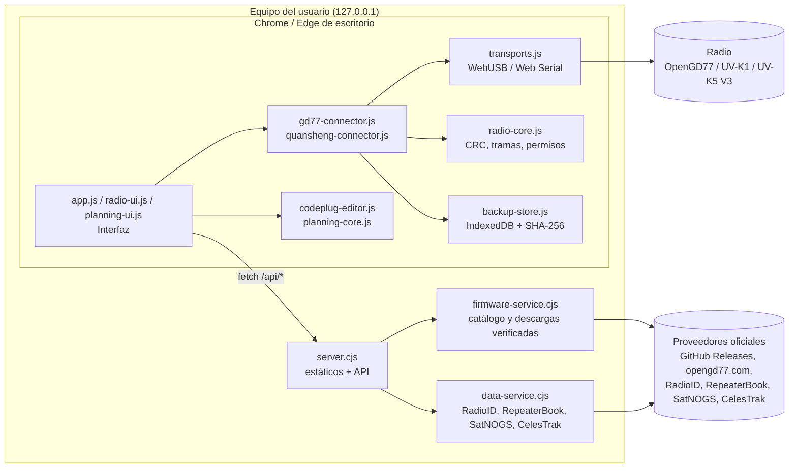
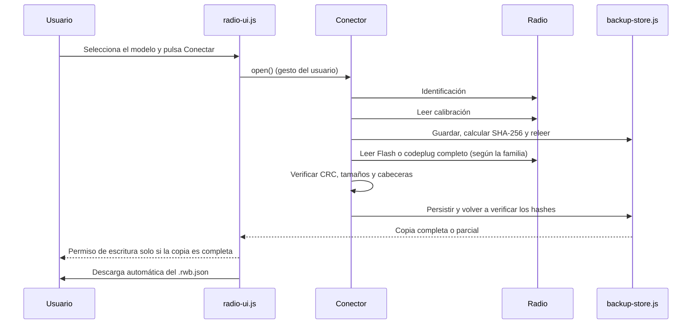

# Bricohams Radio Workspace architecture

Bricohams Radio Workspace is a **local** web application. A small Node.js server serves a fixed allowlist of static files and a few read-only APIs. All communication with the radio takes place in the browser through WebUSB or Web Serial.

## Runtime modes

On startup, `runtime-mode.js` requests `runtime.json` (a relative path, without caching). Only `{"mode":"local"}` enables local mode; if the file is missing, returns 404, is not JSON, or the page is opened through `file://`, the application starts in **web mode** without errors. `server.cjs` serves it as `{"mode":"local"}`, and `scripts/build-pages.cjs` generates `{"mode":"web"}` in `dist/`. The top badge shows “Web · GitHub Pages” or “Local · installed”.

| Aspect | Web (Pages) | Local |
| --- | --- | --- |
| Server | None, static files only | `server.cjs` at `127.0.0.1:8787` |
| F4HWN / ARDF K1-K5 V3 firmware | Stable release history from Armel and reald through `api.github.com`; the user loads the file and its size and published SHA-256 are checked | Server-verified download; ARDF, versions before v6, and SA818 are download-only |
| OpenGD77 firmware | Manual ZIP upload (filename and ZIP signature; no publisher hash) | Download through the server |
| RadioID | Load `user.csv` (100 MiB, filtered, 5,000 rows displayed) and an optional profile in `localStorage` | API through the server |
| RepeaterBook | Unavailable | Approved token, server-side only |
| Satellites | Daily `data/satellites.json` (`scripts/fetch-satellites.cjs`) | Live TLEs |

Client paths are always relative. Each HTML file declares its CSP in `<meta>`; because `<meta>` does not support `frame-ancestors`, `app.js` stops if the page is framed. The web version has its own origin (see ADR-013).

## Component view

## Modules

| File | Side | Responsibility |
| --- | --- | --- |
| `index.html`, `opengd77.html`, `quansheng.html`, `ayuda.html` | Browser | Page skeletons with `body[data-page]`, without inline scripts. |
| `app.js` | Browser | Shared interface (branding, navigation, footer), guides, and searchable help page. |
| `radio-ui.js` | Browser | Connection panel, automatic backups, history, export, and protected actions. |
| `transports.js` | Browser | `USBTransport` (CDC over WebUSB, `1FC9:0094`) and `SerialTransport` (Web Serial), with exact reads and timeouts. |
| `radio-core.js` | Browser / Node | CRC-16/CRC-32, binary utilities, write permissions, and SHA-256. |
| `gd77-connector.js` | Browser | OpenGD77 CPS protocol (`C`/`R`/`W`/`X`) and MK22, STM32, and SERIAL maps. |
| `quansheng-connector.js` | Browser | F4HWN UART protocol (XOR obfuscation, CRC), calibration and Flash reads, Multiboot slots. |
| `backup-store.js` | Browser | IndexedDB persistence, verified readback, and `.rwb.json` export. |
| `codeplug-editor.js` | Browser / Node | Binary OpenGD77 codeplug reading and writing: channels, contacts, and type 3 SAT block. |
| `planning-core.js` | Browser / Node | Filters, deduplication, CSV, TLE validation, and SGP4 passes with `satellite.js`. |
| `planning-ui.js` | Browser | “Codeplug: contacts, repeaters, and SAT” panel. |
| `firmware-catalog.js` | Browser / Node | Allowed models and firmware sources. |
| `server.cjs` | Node | HTTP server at `127.0.0.1:8787`, file allowlist, security headers, and `/api/*` routing. |
| `firmware-service.cjs` | Node | Queries GitHub Releases and opengd77.com with controlled redirects, size limits, and caching. |
| `runtime-mode.js` | Browser | Detects the mode (`runtime.json`; web if missing). |
| `radioid-csv.js` | Browser / Node | Filtered `user.csv` reading and optional local profile. |
| `scripts/build-pages.cjs`, `scripts/fetch-satellites.cjs` | Node | Generate `dist/` and `data/satellites.json` for Pages. |
| `data-service.cjs` | Node | Read-only proxy to RadioID, RepeaterBook (server-side credentials only), SatNOGS, and CelesTrak. |

## Connection and automatic backup flow

Before any write, the backup is reread and compared with the hashes in the permission. Disconnecting the radio, swapping it for another, or deleting the backup revokes the permission.

## Security layers

1. **Network:** the server listens only on `127.0.0.1`, requires `Host: 127.0.0.1:<puerto>`, and serves a fixed file allowlist.
2. **Browser:** CSP `default-src 'self'; script-src 'self'; style-src 'self'`, `Permissions-Policy`, `nosniff`, `no-referrer`, and `no-store`. No `eval` is used and no HTML is built from radio data.
3. **Equipment:** writes require a *fail-closed* permission tied to a verified backup. Main is never a target. Erasing or resetting requires typed confirmation.
4. **External sources:** official providers only, redirects to allowed hosts, size limits, and visible SHA-256. RepeaterBook credentials are never sent to the browser.
5. **Data:** no telemetry or uploads. Backups stay in the local profile's IndexedDB and are exported to user files.

## Known limitations

- **OpenGD77:** no verified protocol is available here for extracting the MCU's complete firmware. The backup is marked **partial**, and writing to the radio remains blocked.
- **Quansheng:** a complete physical Flash backup requires the read and CRC capabilities of F4HWN Labs v6.1+. The web application implements Beta configuration/channel writing with backup and readback, and Bricohams SAT images include experimental CAT RX. This does not demonstrate persistent writes or CAT operation on a specific radio; see the [validation matrix](VALIDACION-INTEGRAL-V3-ANDROID.md).
- **RepeaterBook:** requires a token approved by RepeaterBook and is available only in the local version.
- **Web:** satellite data may be up to one day old (a warning appears after 7 days), and firmware/RadioID files are loaded manually.
- **Hardware:** earlier reads from one Quansheng unit exist, but they do not certify writes, the independent resident, or the current combination of APK, SAT slot, and phone. Physical tests for this revision are pending.
