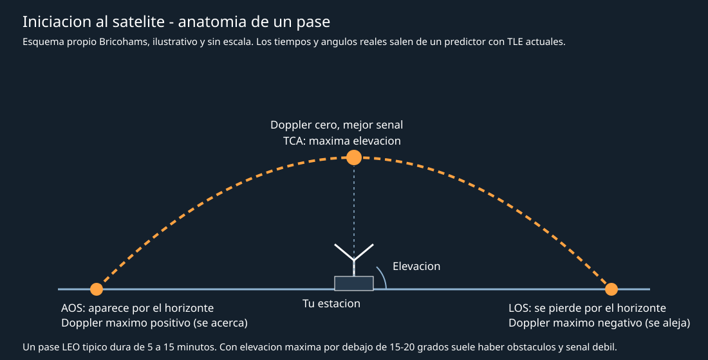
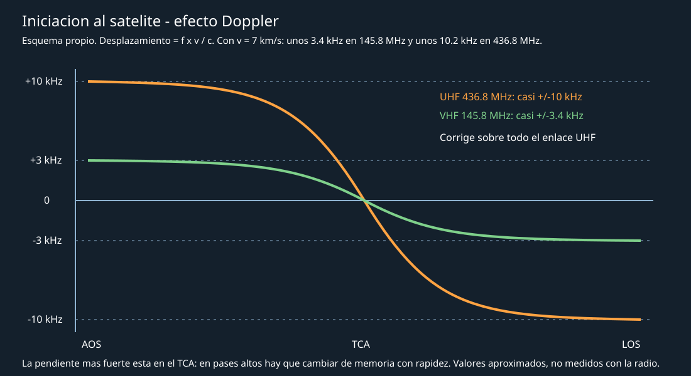
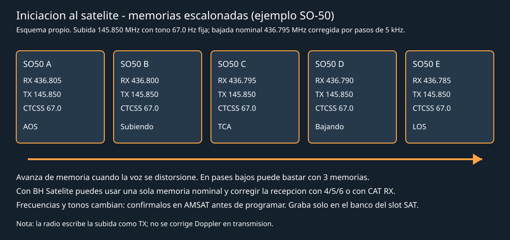
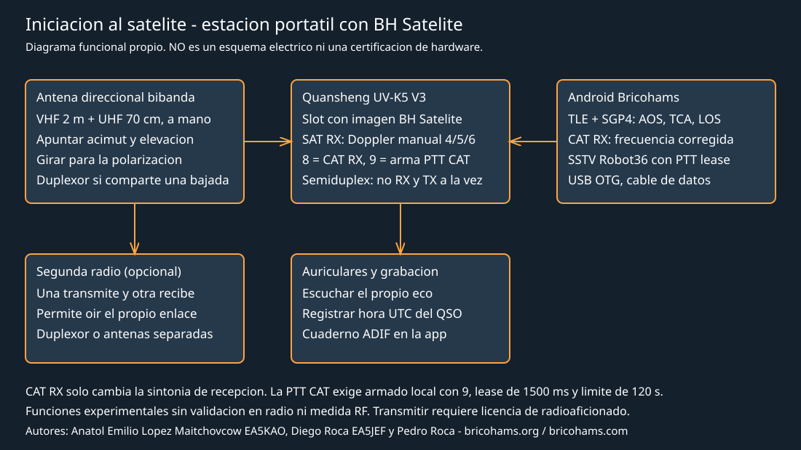

# Satellite Basics

Authors: Anatol Emilio Lopez Maitchovcow EA5KAO, Diego Roca EA5JEF, and Pedro
Roca, Bricohams founders and board members.
Information: <https://bricohams.org> and <https://bricohams.com>.

Spanish-language introductory guide associated with the **BH Satélite**
(Bricohams Satellites) firmware image for Quansheng UV-K5 V3/K1. The antenna
section has its own page: [Satellite antennas](ANTENAS-SATELITE.md).

## Origin and credits

This guide grew out of reading *Radioamadores no Espaço — Guia básico para
operar satélites*, by Carlos Vicente PT2VM, version 1.1 dated 04/09/2025, in
Portuguese. Its author permits free distribution for non-commercial purposes,
but does not explicitly authorize translations or derivative works. It also
includes antenna designs by PY4ZBZ and PY5LO, whose permission was granted to
PT2VM.

Therefore this document **is not a literal translation and does not reproduce
its images**. It follows a similar thematic path, with original text, diagrams,
and antennas by Bricohams, adapted to Spain and the UV-K5 with BH Satélite. We
recommend reading the original by PT2VM.

If its author authorizes a translation, we will publish it separately with
attribution.

## Contents

1. [What is an amateur radio satellite](#what-is-an-amateur-radio-satellite)
2. [Who can listen and who can transmit](#who-can-listen-and-who-can-transmit)
3. [Pass concepts](#pass-concepts)
4. [UTC time, grid locator, and coordinates](#utc-time-grid-locator-and-coordinates)
5. [Predicting passes and checking satellite activity](#predicting-passes-and-checking-satellite-activity)
6. [Doppler effect](#doppler-effect)
7. [FM satellites for beginners](#fm-satellites-for-beginners)
8. [Station equipment](#station-equipment)
9. [Operating BH Satélite on the UV-K5](#operating-bh-satélite-on-the-uv-k5)
10. [Making a satellite QSO](#making-a-satellite-qso)
11. [Logging and confirming contacts](#logging-and-confirming-contacts)
12. [SSTV and APRS from the ISS](#sstv-and-aprs-from-the-iss)
13. [Pass checklist](#pass-checklist)
14. [Glossary](#glossary)
15. [References](#references)

## What is an amateur radio satellite

An amateur radio satellite is a radio station in orbit that receives on one
frequency, the **uplink**, and retransmits on another, the **downlink**. Many
identify as OSCAR, an acronym for *Orbiting Satellite Carrying Amateur Radio*,
followed by a serial number such as SO-50 or AO-7.

There are three main types, based on what they do:

- **FM repeaters.** They work like a mountaintop repeater, but hundreds of
  kilometers above Earth. Only one QSO fits at a time, and they are the best
  starting point with a handheld radio.
- **Linear transponders.** They retransmit an entire band segment, tens of kHz
  wide, and support many simultaneous QSOs in SSB or CW. They usually require
  full-duplex equipment and SSB transmission.
- **Digital satellites and beacons.** These include APRS, telemetry, and SSTV.
  Many can be received with simple equipment.

Almost all satellites we will use are in **low Earth orbit (LEO)**, between
400 and 1000 km. They orbit Earth in about 90-100 minutes, and each pass over
our station lasts 5 to 15 minutes. The International Space Station (ISS), at
about 400 km, is the best-known crewed satellite for radio amateurs.

## Who can listen and who can transmit

- **Listening** to amateur radio satellites is open to anyone with a suitable
  receiver.
- **Transmitting** requires a current amateur radio authorization. Operate
  within the bands, modes, and power allowed by the current regulations
  published in the BOE.
- The satellite segments in IARU Region 1 are **145,800-146,000 MHz** and
  **435,000-438,000 MHz**. Do not have terrestrial conversations there.
- **Military UHF satellites**, such as FleetSatCom or UHF Follow-On, are not
  amateur radio satellites. Using them is illegal and prosecuted. The UV-K5
  must not be used for this purpose.

## Pass concepts



| Term | Meaning |
| --- | --- |
| AOS | *Acquisition of Signal*: the satellite appears above the horizon |
| TCA | *Time of Closest Approach*: maximum elevation and minimum distance |
| LOS | *Loss of Signal*: the satellite disappears below the horizon |
| Azimuth | Horizontal direction in degrees: 0 north, 90 east, 180 south, 270 west |
| Elevation | Angle above the horizon, from 0 to 90 degrees |
| Footprint | Area of Earth visible to the satellite at a given moment |
| TLE / Keps | Orbital parameters programs use to calculate passes |

Two stations can communicate if both are inside the footprint at the same
time. With a LEO satellite, the typical range reaches about 4000-5000 km. From
Spain, you can contact much of Europe and North Africa.

Passes with a maximum elevation below 15-20 degrees are short and weak, and
buildings or hills block them. To start, choose passes above 30 degrees.

## UTC time, grid locator, and coordinates

- **UTC.** Predictions, activity announcements, and logs use UTC. In mainland
  Spain, UTC is local time minus 1 h in winter and minus 2 h in summer.
- **Maidenhead grid locator.** This is a four-character code, such as IM97 in
  the Murcia area, that identifies your grid square. Satellite QSOs exchange
  callsigns and grid squares; many awards count grid squares.
- **Coordinates.** Set latitude, longitude, and altitude accurately in the
  predictor. An error of a few kilometers can shift a pass by tens of seconds.

## Predicting passes and checking satellite activity

Prediction programs use TLEs, which are published and updated continuously.
Always use TLEs from the last few days.

| Tool | Platform | Notes |
| --- | --- | --- |
| Bricohams Android app | Android | Custom SGP4 and CAT RX to BH Satélite; see [Android](ANDROID.md) |
| Gpredict | Windows, Linux, and macOS | Free, with rotor and radio control |
| Orbitron | Windows | Classic freeware with prediction and Doppler |
| ISS Detector | Android | Simple; amateur radio satellites require an extension |
| Heavens-Above / N2YO | Web | Visible passes and ISS |
| AMSAT Pass Predictions | Web | Amateur radio satellite passes |

A satellite being in orbit does not mean its transponder is working. Before
the pass:

- Check the AMSAT status page, where operators report what they hear.
- Review satellite announcements: some are activated only on a schedule or
over certain regions.
- Check recent recordings from automated stations on SatNOGS.

## Doppler effect



A LEO satellite moves at about 7.5 km/s. As it approaches, we hear its signal
above the nominal frequency; as it moves away, below it. The shift is
approximately:

```text
desplazamiento = frecuencia x velocidad radial / velocidad de la luz
```

| Band | Frequency | Approximate maximum Doppler at 7 km/s |
| --- | --- | --- |
| 2 m | 145,8 MHz | ± 3,4 kHz |
| 70 cm | 436,8 MHz | ± 10,2 kHz |

Practical consequences:

- On FM, the 70 cm downlink moves outside the filter unless corrected. The
  2 m downlink is usually tolerated without correction.
- Correct the higher frequency in particular. For FM satellites, the UHF
  downlink is usually adjusted in 5 kHz steps.
- The change is fastest around TCA, especially on high passes.
- With stepped memories, switch from the highest to the lowest as the pass
  progresses. With BH Satélite, you can also correct reception manually or
  over CAT; see below.

## FM satellites for beginners

> Satellite frequencies and status change. Check AMSAT before programming,
> and do not transmit to an inactive satellite or one in test mode.

| Satellite | Uplink (TX) | Downlink (RX) | Tone | Notes |
| --- | --- | --- | --- | --- |
| SO-50 | 145,850 MHz | 436,795 MHz | 67,0 Hz | 74,4 Hz arms its timer; very busy |
| ISS, cross-band repeater | 145,990 MHz | 437,800 MHz | 67,0 Hz | Intermittently active |
| ISS, ARISS voice in Region 1 | 145,200 MHz | 145,800 MHz | — | School contacts: listen only |
| ISS, APRS | 145,825 MHz | 145,825 MHz | — | 1200 bps packet digipeater |
| PO-101 | 437,500 MHz | 145,900 MHz | 141,3 Hz | Scheduled activations |



## Station equipment



- **Radio.** The UV-K5 is semi-duplex: it does not receive while transmitting,
  so you cannot hear your own echo from the satellite. With two radios, one to
  transmit and one to receive, you can hear your own signal in real time. This
  is the best way to know whether you are getting through.
- **Antenna.** This is the most important part. See [Satellite antennas](ANTENAS-SATELITE.md):
  a handheld dual-band Yagi with a dimensioned drawing and printable STL parts,
  plus a fixed V dipole for listening to the ISS.
- **Polarization.** The satellite signal rotates during a pass. If it fades,
  rotate the handheld Yagi around its axis to recover it.
- **Headphones and recording.** Ambient noise masks weak signals. Recording
  the pass lets you review callsigns afterward.
- **Power.** With a Yagi, 2-5 W is enough for FM satellites. More power does
  not make up for a poorly aimed antenna and harms other users.

## Operating BH Satélite on the UV-K5

BH Satélite is the Beta image of Bricohams firmware with the Satellites
profile. Technical details, limits, and protocol:
[Bricohams firmware](BRICOHAMS-FIRMWARE.md).

> **Experimental.** Doppler, CAT RX, and CAT TX features have software tests
> with simulated RF primitives. **They have not yet been validated on the
> radio or with RF measurements.** Test reception first.

1. **Correct slot.** On multiboot radios, each slot has its own channel bank.
   Program satellite memories **only in the BH Satélite slot**. First make a
   full backup with [Quansheng](AYUDA-QUANSHENG.md).
2. **Memories.** Create a memory with RX equal to the nominal downlink and TX
   equal to the uplink, with its tone. You can also use the 5-memory stepped
   plan.
3. **SAT RX.** Select the memory and enter Fox Hunt/SAT mode. The display shows
   `SAT RX` and uses the channel's RX and TX as nominal frequencies.
4. **Manual Doppler.** Keys 4 and 6 subtract or add 500 m/s of radial velocity,
   and key 5 returns to zero. At the start of a pass, the satellite is
   approaching, so use negative velocities to receive higher.
5. **CAT RX from Android.** Press 8 on the radio to show `CAT READY RX`. The
   Bricohams app calculates the pass with SGP4 and sends the corrected RX
   frequency. Each command expires after 3 s unless renewed. Keys 4, 5, and 6
   return control to manual mode.
6. **Transmit.** The uplink uses the channel's nominal TX: BH Satélite **does
   not correct Doppler on transmit**. CAT PTT for SSTV requires local arming
   with key 9, a 1500 ms lease, and a 120 s limit.
7. **Exit.** EXIT restores the VFO's RF configuration.

The UV-K5 can also **listen** to linear transponders in SSB with F4HWN
firmware. Transmitting through them requires TX SSB and full duplex, which the
UV-K5 does not provide. On compatible radios, OpenGD77 has its own satellite
mode: [OpenGD77](AYUDA-OPENGD77.md).

## Making a satellite QSO

1. **Listen first.** Listen to one or two complete passes before transmitting
to learn the rhythm and usual callsigns.
2. **Short and clear.** A typical QSO exchanges callsigns and grid squares,
   for example: “EA5XXX, IM97.” Confirm the other station with “QSL, 73.”
3. **One transmission at a time.** On an FM repeater, if two stations
   transmit at once, neither is heard. Wait for an opening and do not call
   continuously.
4. **Do not monopolize.** A pass lasts a few minutes and is shared by many
   stations. One contact per pass is a good rule on busy satellites.
5. **Check whether you are getting through.** With two radios, listen to your
   own downlink. If you cannot hear yourself, check antenna aim, Doppler memory,
   and tone before calling again.

Common codes and expressions:

| Expression | Meaning |
| --- | --- |
| QRZ | Who is calling me? |
| QSL | Received or confirmed |
| QTH / grid | Location or grid square |
| 73 | Best regards |
| QRT | I am stopping transmission |
| Rover | A station traveling to activate rare grids |

## Logging and confirming contacts

- Record the date and time in **UTC**, callsign, other station's grid square,
  satellite, and mode.
- In ADIF, use `PROP_MODE` = `SAT` and `SAT_NAME`, for example `SO-50`.
  The Android app's logbook exports ADIF.
- Upload your contacts to LoTW or eQSL to confirm them. The ARRL VUCC
  Satellite award requires 100 confirmed grid squares.

## SSTV and APRS from the ISS

- **SSTV.** During events announced by ARISS, the ISS transmits images in FM
  on 145,800 MHz, usually in PD120 or Robot36. A V dipole or Yagi and a
  decoder are enough. The Bricohams app decodes Robot36 from WAV.
- **APRS.** The ISS digipeater on 145,825 MHz retransmits packet frames.
  Sending frames requires a license and a TNC or compatible app.
- **Voice listening.** During ARISS school contacts, listen only to the
  downlink on 145,800 MHz. Do not transmit on the uplink.

## Pass checklist

1. Update TLEs and check the pass's UTC time, maximum elevation, and AOS/LOS
   directions.
2. Confirm on AMSAT that the satellite is active.
3. Check that the radio starts in the BH Satélite slot and the memory has the
   correct RX, TX, and tone.
4. Check the antenna, coax, diplexer, headphones, and recorder.
5. Before AOS, aim toward the horizon where the satellite will appear.
6. During the pass, track the satellite, rotate the antenna for polarization,
   and correct Doppler.
7. After the pass, log contacts in UTC and review the recording.

## Glossary

| Term | Definition |
| --- | --- |
| Uplink | Frequency we transmit to the satellite on |
| Downlink | Frequency the satellite retransmits on |
| Transponder | Satellite equipment that converts the uplink into a downlink |
| Semi-duplex | Cannot receive while transmitting |
| Full duplex | Receives and transmits at the same time; allows hearing your own echo |
| CTCSS | Subaudible tone that opens the satellite repeater |
| SGP4 | Orbital propagation model used with TLEs |
| CAT | Radio control from a computer or mobile device |

## References

- Carlos Vicente PT2VM, *Radioamadores no Espaço — Guia básico para operar
  satélites*, v1.1, 04/09/2025. Inspired the thematic structure; not reproduced.
- AMSAT: <https://www.amsat.org>. Satellite status, frequencies, and
  predictions.
- ARISS: <https://www.ariss.org>. Amateur radio operators aboard the ISS.
- CelesTrak: <https://celestrak.org>. TLE orbital parameters.
- SatNOGS: <https://satnogs.org>. Open network of ground stations.
- Bricohams: [Satellite antennas](ANTENAS-SATELITE.md),
  [Bricohams firmware](BRICOHAMS-FIRMWARE.md), [Android](ANDROID.md), and
  [Quansheng](AYUDA-QUANSHENG.md).