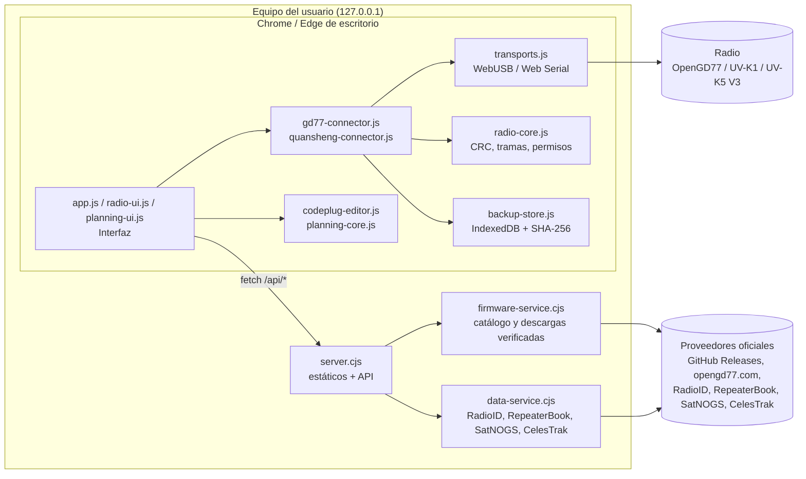
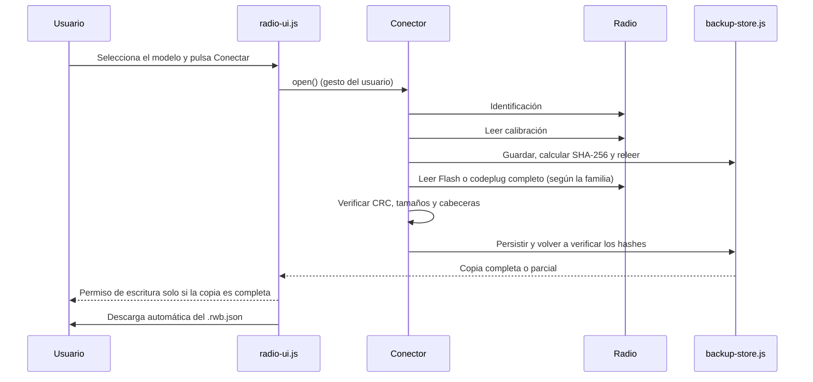
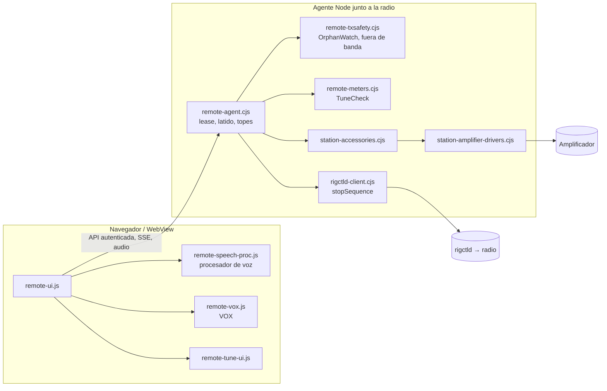

# Architecture de Bricohams Radio Workspace

Bricohams Radio Workspace est une application web **locale**. Un petit serveur Node.js fournit une liste fermée de fichiers statiques et quelques API en lecture seule. La communication avec la radio pour les connecteurs de firmware, de codeplug et de sauvegarde passe par le navigateur, via WebUSB ou Web Serial. Le contrôle distant par CAT est un composant à part (voir [Station distante](#station-distante-et-sécurité-tx)) : un agent à côté de la radio et une console qui s'y connecte.

## Modes d'exécution

Au démarrage, `runtime-mode.js` demande `runtime.json` (chemin relatif, sans cache). Seul `{"mode":"local"}` active le mode local ; si le fichier manque, renvoie 404, n'est pas du JSON ou si la page est ouverte en `file://`, l'application démarre en **mode web** sans erreur. `server.cjs` le fournit avec `{"mode":"local"}` et `scripts/build-pages.cjs` génère `{"mode":"web"}` dans `dist/`. Le badge supérieur indique « Web · GitHub Pages » ou « Local · installé ».

| Aspect | Web (Pages) | Local |
| --- | --- | --- |
| Serveur | Aucun, fichiers statiques uniquement | `server.cjs` sur `127.0.0.1:8787` |
| Firmware F4HWN / ARDF K1-K5 V3 | Historique stable d'Armel et reald via `api.github.com` ; l'utilisateur charge le fichier, dont la taille et le SHA-256 publié sont vérifiés | Téléchargement vérifié par le serveur ; ARDF, versions antérieures à v6 et SA818 en téléchargement uniquement |
| Firmware OpenGD77 | Chargement manuel du ZIP (nom et signature ZIP ; sans empreinte de l'éditeur) | Téléchargement par le serveur |
| RadioID | Chargement de `user.csv` (100 MiB, filtrage, 5 000 lignes affichées) et profil facultatif dans `localStorage` | API via le serveur |
| RepeaterBook | Indisponible | Jeton approuvé, côté serveur uniquement |
| Satellites | `data/satellites.json` quotidien (`scripts/fetch-satellites.cjs`) | TLE en direct |

Les chemins du client sont toujours relatifs. La CSP de chaque HTML est déclarée dans `<meta>` ; comme `<meta>` ne prend pas en charge `frame-ancestors`, `app.js` s'arrête si la page est encadrée. La version web possède sa propre origine (voir ADR-013).

## Vue des composants

## Modules

| Fichier | Côté | Responsabilité |
| --- | --- | --- |
| `index.html`, `opengd77.html`, `quansheng.html`, `ayuda.html` | Navigateur | Squelettes de pages avec `body[data-page]`, sans scripts en ligne. |
| `app.js` | Navigateur | Interface commune (marque, navigation, pied de page), guides et aide avec moteur de recherche. |
| `radio-ui.js` | Navigateur | Panneau de connexion, sauvegardes automatiques, historique, export et actions protégées. |
| `transports.js` | Navigateur | `USBTransport` (CDC sur WebUSB, `1FC9:0094`) et `SerialTransport` (Web Serial), avec lecture exacte et délai maximal. |
| `radio-core.js` | Navigateur / Node | CRC-16/CRC-32, utilitaires binaires, autorisations d'écriture et SHA-256. |
| `gd77-connector.js` | Navigateur | Protocole OpenGD77 CPS (`C`/`R`/`W`/`X`) et cartographies MK22, STM32 et SERIAL. |
| `quansheng-connector.js` | Navigateur | Protocole UART F4HWN (obfuscation XOR, CRC), lecture de la calibration et de la Flash, slots Multiboot. |
| `backup-store.js` | Navigateur | Persistance dans IndexedDB, relecture vérifiée et export `.rwb.json`. |
| `codeplug-editor.js` | Navigateur / Node | Lecture et écriture binaires du codeplug OpenGD77 : canaux, contacts et bloc SAT de type 3. |
| `planning-core.js` | Navigateur / Node | Filtres, dédoublonnage, CSV, validation des TLE et passages SGP4 avec `satellite.js`. |
| `planning-ui.js` | Navigateur | Panneau « Codeplug : contacts, relais et SAT ». |
| `firmware-catalog.js` | Navigateur / Node | Modèles et sources de firmware autorisés. |
| `server.cjs` | Node | Serveur HTTP sur `127.0.0.1:8787`, liste de fichiers autorisés, en-têtes de sécurité et routage de `/api/*`. |
| `firmware-service.cjs` | Node | Consultation de GitHub Releases et opengd77.com avec redirections contrôlées, limites de taille et cache. |
| `runtime-mode.js` | Navigateur | Détecte le mode (`runtime.json` ; web si absent). |
| `radioid-csv.js` | Navigateur / Node | Lecture filtrée de `user.csv` et profil local facultatif. |
| `scripts/build-pages.cjs`, `scripts/fetch-satellites.cjs` | Node | Génèrent `dist/` et `data/satellites.json` pour Pages. |
| `data-service.cjs` | Node | Proxy en lecture seule vers RadioID, RepeaterBook (identifiants uniquement côté serveur), SatNOGS et CelesTrak. |
| `remote-station.cjs`, `remote-agent.cjs` | Node | Superviseur de `rigctld`/`rotctld` (utilisé par `server.cjs` pour `/api/remote/*` et le mode headless) et agent du Remote shack. Voir la section suivante. |
| `remote-txsafety.cjs`, `remote-meters.cjs`, `station-amplifier-drivers.cjs` | Node | Gardes TX (`OrphanWatch`, blocage hors bande), `TuneCheck` et pilotes d'amplificateur. |
| `remote-speech-proc.js`, `remote-vox.js` | Navigateur / Node | Processeur de voix et VOX du chemin TX distant (scripts classiques qui exportent aussi en CommonJS). |
## Connexion et sauvegarde automatique

Avant toute écriture, la sauvegarde est relue et comparée aux empreintes de l'autorisation. Déconnecter la radio, la remplacer ou supprimer la sauvegarde révoque l'autorisation.

## Station distante et sécurité TX

Le **Remote shack** (`remote-agent.cjs`, console `remote.html` / `remoto.html`) pilote une radio via Hamlib `rigctld` et est indépendant de la station Python de `remote-station/` (voir [REMOTE_STATION.md](REMOTE_STATION.md)). `server.cjs` ne change pas : il écoute toujours uniquement sur `127.0.0.1` et délègue `/api/remote/*` à `remote-station.cjs`. La carte complète des modules se trouve dans la [carte technique](../../MAPA-TECNICO-PROYECTO.md#mapa-de-módulos-diagrama-de-dependencias).

La console React de la station Python réutilise les mêmes `remote-speech-proc.js` et `remote-vox.js` via `remote-station/apps/web-console/src/txProcessing.ts` ; l'agent Python a son propre blocage hors bande dans `remote-station/bricoham_station_agent/txsafety.py`.

### Garanties TX

Le logiciel n'émet jamais de lui-même : toute mise en TX est un ordre explicite de l'opérateur. Les gardes de l'agent, vérifiées dans `remote-agent.cjs` :

| Garde | Comportement |
| --- | --- |
| PTT off | `pttOff()` est prioritaire sur tout : il termine un accord en cours, arrête le CW et exécute `stopSequence` (arrêt du coupleur, `txOff` brut et `T 0` de Hamlib, avec priorité dans la file). |
| Heartbeat | Sans heartbeat pendant `HEARTBEAT_TIMEOUT_MS` (1000 ms), l'agent relâche le PTT et met l'amplificateur en STANDBY. |
| Limites de durée | Limite de TX (`txLimitSeconds`, 180 s par défaut) et d'accord (`TUNE_MAX_SECONDS` : interne 20 s par défaut et 30 s maximum ; ATAS 45 s et 60 s). |
| ROS | Déclenchement sur ROS soutenu au-dessus de `swrLimit` (3 par défaut) ou de la limite brute du profil CAT ; pendant l'accord, `TUNE_SWR_MS` s'applique. |
| Amplificateur | `accessories.standby("lease")` à chaque perte de lease ou de heartbeat ; il démarre en STANDBY et ne passe pas en OPERATE sans conditions sûres. |
| Hors bande | `remote-txsafety.cjs` : uniquement avec des `txRanges` configurés ; une fréquence ou un mode inconnu bloque aussi une nouvelle mise en TX. Un échec de lecture isolé ne coupe pas une émission en cours. |
| TX orphelin | `OrphanWatch` : une émission de l'agent sans titulaire du lease est relâchée après deux observations consécutives. |
| Verrou opérateur | Un seul opérateur à la fois (lease) ; dans la console, `view.locked` bloque les actions et désarme le VOX. |

Le VOX (`remote-vox.js`) n'ajoute aucun chemin de TX : il utilise les mêmes `pttDown`/`pttUp` que le bouton, n'est jamais persisté et se désarme en cas de refus, de coupure de l'agent, de perte de contrôle ou de liaison, de verrou et de page masquée. Le processeur de voix (`remote-speech-proc.js`) est désactivé par défaut et limite la sortie à un plafond fixe de −1 dBFS.

### Vérification d'accord et arrêt à la fermeture

- `TuneCheck` (`remote-meters.cjs` ; miroir Python dans `remote-station/bricoham_remote_station/tune_check.py`) parcourt `requested → confirming → tuning → reading → stopping → verifying → done` avec les résultats `success`, `fail`, `timeout` et **`unverified`**. Lors d'un accord ATAS, si `evidence(false)` indique que la radio n'a pas montré que le coupleur travaillait et que le ROS n'est pas élevé, le résultat est `unverified` avec la raison `no-tune-evidence` (dans la console : « Accord non vérifié ») ; si TX0 n'est pas confirmé par lecture, il devient `fail` (`tx-stuck`). Un `cut()` ne produit jamais `unverified`.
- `close()` de l'agent coupe d'abord le PTT et appelle `settleStopBeforeClose` : il attend (plafonné à `stopStepMs * 5 + 500` ms) la fin d'un arrêt en cours et, s'il n'est pas confirmé, répète `stopSequence` une fois avant de libérer le client `rigctld`. Il arrête ensuite le CW, exécute `accessories.emergencyStop("close")`, ferme le pilote d'amplificateur et met en sécurité les appareils de la station.

Les tests déterministes (horloges et transports simulés) se trouvent dans `tests/remote-txsafety.test.cjs`, `tests/remote-txaudio.test.cjs`, `tests/remote-amplifier-drivers.test.cjs`, `tests/remote-meters.test.cjs`, `tests/remote-agent.test.cjs` et, en Python, `remote-station/tests/test_tx_inhibit.py` et `test_tune_check.py`. Les pilotes d'amplificateur sont « implémentés à partir de sources, non testés sur matériel » : aucune capture d'un amplificateur réel n'existe dans le dépôt.

## Couches de sécurité

1. **Réseau :** le serveur écoute uniquement sur `127.0.0.1`, exige `Host: 127.0.0.1:<puerto>` et fournit une liste fixe de fichiers.
2. **Navigateur :** CSP `default-src 'self'; script-src 'self'; style-src 'self'`, `Permissions-Policy`, `nosniff`, `no-referrer` et `no-store`. Aucun `eval` ni HTML construit à partir des données radio.
3. **Équipement :** les écritures utilisent une autorisation à blocage par défaut (*fail-closed*) liée à une sauvegarde vérifiée. Main n'est jamais une destination. L'effacement ou la réinitialisation exige une confirmation saisie.
4. **Sources externes :** fournisseurs officiels uniquement, redirections vers des hôtes autorisés, limites de taille et SHA-256 visible. Les identifiants RepeaterBook ne sont jamais envoyés au navigateur.
5. **Données :** aucune télémétrie ni aucun envoi. Les sauvegardes restent dans l'IndexedDB du profil local et sont exportées dans des fichiers de l'utilisateur.
6. **Transmission distante :** TX désactivé par défaut, uniquement sur ordre explicite de l'opérateur, avec les gardes de [Garanties TX](#garanties-tx). Les identifiants du relais restent dans l'agent (`~/.radicodex/remote-agent.json`, 0600) et ne sont pas affichés ; le jeton d'accès ne circule que dans le fragment de l'URL et la console le retire de la barre d'adresse. Les gardes logicielles ne remplacent pas des verrouillages physiques.

## Documentation du code

La documentation détaillée du code et des tests est conservée dans des fichiers séparés :

- [Node : agent et bureau][codigo-node] : serveur local, agent Remote shack et consoles de la racine.
- [Python : station distante][codigo-python] : hôte coordinateur et agent de `remote-station/`.
- [Android et console web][codigo-android] : applications natives et console React/Capacitor.
- [Tests et résultats][pruebas] : ce que couvre chaque suite et les résultats enregistrés.

Ces quatre documents sont rédigés en parallèle ; si un lien ne se résout pas dans une copie donnée du dépôt, le document n'a pas encore été intégré à cette branche.

[codigo-node]: ../../codigo/NODE-AGENTE-Y-ESCRITORIO.md
[codigo-python]: ../../codigo/PYTHON-ESTACION-REMOTA.md
[codigo-android]: ../../codigo/ANDROID-Y-CONSOLA-WEB.md
[pruebas]: ../../PRUEBAS-Y-RESULTADOS.md
## Limites connues

- **OpenGD77 :** aucun protocole vérifié n'est disponible ici pour extraire l'intégralité du firmware du MCU. La sauvegarde est marquée **partielle** et l'écriture sur la radio reste bloquée.
- **Quansheng :** une sauvegarde physique complète de la Flash exige les fonctions de lecture et CRC de F4HWN Labs v6.1+. Le web implémente l'écriture Beta de configuration/canaux avec sauvegarde et relecture ; les images Bricohams SAT intègrent CAT RX expérimental. Cela ne démontre ni écriture persistante ni fonctionnement CAT sur une radio précise ; consulter la [matrice de validation](VALIDACION-INTEGRAL-V3-ANDROID.md).
- **RepeaterBook :** nécessite un jeton approuvé par RepeaterBook et n'existe que dans la version locale.
- **Web :** les données satellites peuvent dater d'un jour (avertissement à partir de 7 jours) ; firmware/RadioID sont chargés manuellement.
- **Matériel :** des lectures antérieures d'une unité Quansheng existent, mais ne certifient ni les écritures, ni le résident indépendant, ni la combinaison actuelle APK, slot SAT et téléphone. Les essais physiques de cette révision restent à faire.

## Revue de sécurité (SonarQube 2026-11-13)

### Corrigé

**xml:S6358 – Android application backup should be disabled or restricted** (MEDIUM) — `android/app/src/fdroid/AndroidManifest.xml:6`.
- *Pourquoi c'était un défaut :* avec la sauvegarde activée, les données locales (préférences, fichiers, bases de données) peuvent être exportées vers Google Cloud ou via `adb backup`, ou restaurées depuis une copie altérée (CWE-922, OWASP M9/A1). L'overlay `<application>` du flavor F-Droid ne déclarait pas l'attribut, donc l'analyse le considérait implicite (par défaut `true`).
- *Modification :* ajout de `android:allowBackup="false"` à l'overlay.
- *Aucune perte de fonctionnalité :* le manifeste principal déclare déjà `allowBackup="false"`, `fullBackupContent="false"` et `dataExtractionRules` ; la valeur fusionnée ne change pas. Vérification : le `manifest merger report` du flavor fdroid (`processFdroidReleaseMainManifest`) indique `allowBackup=false`.

**xml:S5332 – Clear-text protocols should not be used** (LOW) — même fichier, ligne 6.
- *Pourquoi c'était un défaut :* sous Android < 9, `usesCleartextTraffic` vaut implicitement `true`, ce qui autorise le http non chiffré (interception et altération, CWE-319, CWE-200).
- *Modification :* ajout de `android:usesCleartextTraffic="false"` à l'overlay.
- *Aucune perte de fonctionnalité :* le manifeste principal le fixe déjà à `false` et définit `networkSecurityConfig` ; le résultat fusionné est identique. Vérification : même rapport de fusion ; le comportement du rotor et des radios ne change pas.

**kotlin:S2245 – Pseudorandom number generators (PRNGs) should not be used in security contexts** (MEDIUM) — `android/app/src/main/java/org/bricohams/radio/Rt950Protocol.kt:156`.
- *Pourquoi c'était un défaut :* `Random()` n'est pas un générateur cryptographiquement sûr ; un attaquant qui connaît ou devine son état interne peut prédire les valeurs suivantes (CWE-338, CWE-330, OWASP A2 Cryptographic Failures). La valeur par défaut de `Rt950Session.random` utilisait `Random()`.
- *Modification :* la valeur par défaut devient `SecureRandom()` (`java.security.SecureRandom`, sous-classe de `java.util.Random`). Le type du paramètre reste `Random`, les tests peuvent donc injecter une instance avec graine.
- *Aucune perte de fonctionnalité :* `buildKeyFrame` utilise toujours les mêmes plages (`nextInt(2)+1`, `nextInt(5)`, `nextInt(KEYS.size)`), donc les octets du protocole RT-950 gardent leur format. Vérification : (`Rt950ProtocolTest` : `headersAndKeySelection`, `readAllSkipsUnknownRegions`).

**kotlin:S2245 (MEDIUM)** — `android/app/src/test/java/org/bricohams/radio/Rt950ProtocolTest.kt:93` (et lignes 67, 175, 309). Non modifié.
- *Pourquoi Sonar le signale :* même raison que ci-dessus (PRNG non cryptographique, CWE-338/CWE-330).
- *Décision :* c'est un test unitaire qui utilise `Random(it.toLong())` avec une graine fixe pour produire des trames de clé reproductibles ; ce n'est pas un contexte de sécurité (aucun secret généré) et `SecureRandom` rendrait le test non déterministe. Laissé tel quel.
- *Aucune perte de fonctionnalité :* rien n'est modifié. Vérification : `Rt950ProtocolTest` passe toujours ; la classe de production accepte tout `Random` injecté.

### Non modifié - décision requise

- **Sonar javascript S4036 (LOW, CWE-426/427)** — `scripts/build-platform-app.cjs:16,20,27,30`, `scripts/build-platform-resident.cjs:55,73,82,85,87,89`, `scripts/export-project.cjs:48,94,177,178,181,230`. Les scripts appellent `arm-none-eabi-*`, `git` et `zip` par leur nom. Il n'existe pas de chemin absolu fixe valable sur toutes les machines (la toolchain ARM et git s'installent à des emplacements différents) ; en inventer un ou exiger une nouvelle variable d'environnement changerait l'usage. Décision : accepter le risque (outils de développement lancés par le développeur) ou définir une variable d'environnement pour le chemin de la toolchain. (L'appel à `tar.exe` ligne 228 utilise déjà un chemin absolu.)
- **kotlin:S1313 (LOW)** — `android/app/src/main/java/org/bricohams/radio/RotorProtocol.kt:14`. `AP_HOST = "192.168.4.1"` est l'adresse d'usine du point d'accès du rotor ESP32 ; la déplacer dans la configuration casserait la connexion par défaut.
- **kotlin:S2245 (MEDIUM)** — `android/app/src/test/java/org/bricohams/radio/FtxEnhancedDecoderTest.kt:59`. C'est un test unitaire avec une graine fixe `Random(7)` pour reproduire le motif d'erreurs ; ce n'est pas un contexte de sécurité et `SecureRandom` rendrait le test non déterministe.
- **kotlin:S7204 (HIGH)** — `android/app/build.gradle.kts:52`. Activer `isMinifyEnabled` exige des règles ProGuard/R8 (il n'existe aucun `proguard-rules.pro`) et de vérifier sur un appareil que réflexion/JSON/BLE fonctionnent toujours ; impossible à garantir sans essais physiques. Décision : créer les règles keep et tester un APK release minifié.

### Corrigé (SonarQube 2026-11-14)

- **kotlin:S1143 :** le `throw` dans `finally` est supprimé dans `RigActivity` et `SstvTransmit`.
- **kotlin:S899 :** le résultat de `delete` est désormais vérifié dans `OtaPlatform` et `SatelliteCatalog`.
- **java:S3034 / java:S2184 :** arithmétique `byte`/`long` corrigée (conversions explicites et masques avant l'opération) dans `Osd174`, `FtxFrames`, `FtxReceiver`, `Unpack77` et `Ldpc174`.
- **JS S2871 :** les comparateurs de `sort` sont désormais explicites.
- **JS S9383 :** les promesses flottantes sont attendues ou gérées.
- **JS S6324 :** les caractères de contrôle sont retirés des expressions régulières.
- **JS S6544 :** le mauvais usage des promesses est corrigé.
- **JS S1143 :** le `throw` dans `finally` est supprimé dans `quansheng-factory`.
- **JS S7727 :** les callbacks de `map` sont corrigés.
- **xml:S6358 / xml:S5332 :** le manifeste du flavor fdroid déclare `android:allowBackup="false"` et `android:usesCleartextTraffic="false"`.
- **JS S4036 :** le `PATH` de compilation est de confiance ; marqué `NOSONAR`.
- **kotlin:S2245 :** le RNG à graine fixe des tests est déterministe volontairement ; marqué `NOSONAR`.
- **kotlin:S7204 :** R8 reste en `TODO` (règles keep et essais sur appareil à faire).