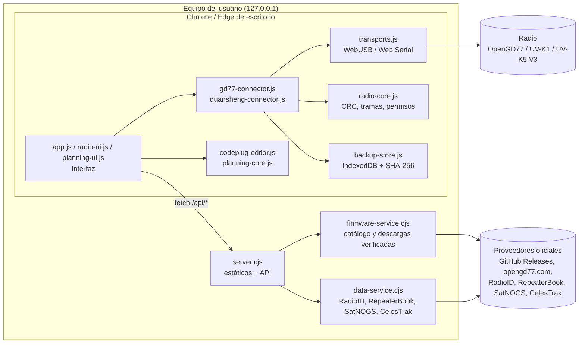
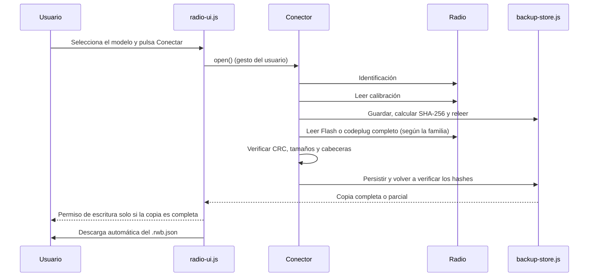

# Architecture de Bricohams Radio Workspace

Bricohams Radio Workspace est une application web **locale**. Un petit serveur Node.js fournit une liste fermée de fichiers statiques et quelques API en lecture seule. Toutes les communications avec la radio passent par le navigateur, via WebUSB ou Web Serial.

## Modes d'exécution

Au démarrage, `runtime-mode.js` demande `runtime.json` (chemin relatif, sans cache). Seul `{"mode":"local"}` active le mode local ; si le fichier manque, renvoie 404, n'est pas du JSON ou si la page est ouverte en `file://`, l'application démarre en **mode web** sans erreur. `server.cjs` le fournit avec `{"mode":"local"}` et `scripts/build-pages.cjs` génère `{"mode":"web"}` dans `dist/`. Le badge supérieur indique « Web · GitHub Pages » ou « Local · installé ».

| Aspect | Web (Pages) | Local |
| --- | --- | --- |
| Serveur | Aucun, fichiers statiques uniquement | `server.cjs` sur `127.0.0.1:8787` |
| Firmware F4HWN / ARDF K1-K5 V3 | Historique stable d'Armel et reald via `api.github.com` ; l'utilisateur charge le fichier, dont la taille et le SHA-256 publié sont vérifiés | Téléchargement vérifié par le serveur ; ARDF, versions antérieures à v6 et SA818 en téléchargement uniquement |
| Firmware OpenGD77 | Chargement manuel du ZIP (nom et signature ZIP ; sans empreinte de l'éditeur) | Téléchargement par le serveur |
| RadioID | Chargement de `user.csv` (100 MiB, filtrage, 5 000 lignes affichées) et profil facultatif dans `localStorage` | API via le serveur |
| RepeaterBook | Indisponible | Jeton approuvé, côté serveur uniquement |
| Satellites | `data/satellites.json` quotidien (`scripts/fetch-satellites.cjs`) | TLE en direct |

Les chemins du client sont toujours relatifs. La CSP de chaque HTML est déclarée dans `<meta>` ; comme `<meta>` ne prend pas en charge `frame-ancestors`, `app.js` s'arrête si la page est encadrée. La version web possède sa propre origine (voir ADR-013).

## Vue des composants

## Modules

| Fichier | Côté | Responsabilité |
| --- | --- | --- |
| `index.html`, `opengd77.html`, `quansheng.html`, `ayuda.html` | Navigateur | Squelettes de pages avec `body[data-page]`, sans scripts en ligne. |
| `app.js` | Navigateur | Interface commune (marque, navigation, pied de page), guides et aide avec moteur de recherche. |
| `radio-ui.js` | Navigateur | Panneau de connexion, sauvegardes automatiques, historique, export et actions protégées. |
| `transports.js` | Navigateur | `USBTransport` (CDC sur WebUSB, `1FC9:0094`) et `SerialTransport` (Web Serial), avec lecture exacte et délai maximal. |
| `radio-core.js` | Navigateur / Node | CRC-16/CRC-32, utilitaires binaires, autorisations d'écriture et SHA-256. |
| `gd77-connector.js` | Navigateur | Protocole OpenGD77 CPS (`C`/`R`/`W`/`X`) et cartographies MK22, STM32 et SERIAL. |
| `quansheng-connector.js` | Navigateur | Protocole UART F4HWN (obfuscation XOR, CRC), lecture de la calibration et de la Flash, slots Multiboot. |
| `backup-store.js` | Navigateur | Persistance dans IndexedDB, relecture vérifiée et export `.rwb.json`. |
| `codeplug-editor.js` | Navigateur / Node | Lecture et écriture binaires du codeplug OpenGD77 : canaux, contacts et bloc SAT de type 3. |
| `planning-core.js` | Navigateur / Node | Filtres, dédoublonnage, CSV, validation des TLE et passages SGP4 avec `satellite.js`. |
| `planning-ui.js` | Navigateur | Panneau « Codeplug : contacts, relais et SAT ». |
| `firmware-catalog.js` | Navigateur / Node | Modèles et sources de firmware autorisés. |
| `server.cjs` | Node | Serveur HTTP sur `127.0.0.1:8787`, liste de fichiers autorisés, en-têtes de sécurité et routage de `/api/*`. |
| `firmware-service.cjs` | Node | Consultation de GitHub Releases et opengd77.com avec redirections contrôlées, limites de taille et cache. |
| `runtime-mode.js` | Navigateur | Détecte le mode (`runtime.json` ; web si absent). |
| `radioid-csv.js` | Navigateur / Node | Lecture filtrée de `user.csv` et profil local facultatif. |
| `scripts/build-pages.cjs`, `scripts/fetch-satellites.cjs` | Node | Génèrent `dist/` et `data/satellites.json` pour Pages. |
| `data-service.cjs` | Node | Proxy en lecture seule vers RadioID, RepeaterBook (identifiants uniquement côté serveur), SatNOGS et CelesTrak. |

## Connexion et sauvegarde automatique

Avant toute écriture, la sauvegarde est relue et comparée aux empreintes de l'autorisation. Déconnecter la radio, la remplacer ou supprimer la sauvegarde révoque l'autorisation.

## Couches de sécurité

1. **Réseau :** le serveur écoute uniquement sur `127.0.0.1`, exige `Host: 127.0.0.1:<puerto>` et fournit une liste fixe de fichiers.
2. **Navigateur :** CSP `default-src 'self'; script-src 'self'; style-src 'self'`, `Permissions-Policy`, `nosniff`, `no-referrer` et `no-store`. Aucun `eval` ni HTML construit à partir des données radio.
3. **Équipement :** les écritures utilisent une autorisation à blocage par défaut (*fail-closed*) liée à une sauvegarde vérifiée. Main n'est jamais une destination. L'effacement ou la réinitialisation exige une confirmation saisie.
4. **Sources externes :** fournisseurs officiels uniquement, redirections vers des hôtes autorisés, limites de taille et SHA-256 visible. Les identifiants RepeaterBook ne sont jamais envoyés au navigateur.
5. **Données :** aucune télémétrie ni aucun envoi. Les sauvegardes restent dans l'IndexedDB du profil local et sont exportées dans des fichiers de l'utilisateur.

## Limites connues

- **OpenGD77 :** aucun protocole vérifié n'est disponible ici pour extraire l'intégralité du firmware du MCU. La sauvegarde est marquée **partielle** et l'écriture sur la radio reste bloquée.
- **Quansheng :** une sauvegarde physique complète de la Flash exige les fonctions de lecture et CRC de F4HWN Labs v6.1+. Le web implémente l'écriture Beta de configuration/canaux avec sauvegarde et relecture ; les images Bricohams SAT intègrent CAT RX expérimental. Cela ne démontre ni écriture persistante ni fonctionnement CAT sur une radio précise ; consulter la [matrice de validation](VALIDACION-INTEGRAL-V3-ANDROID.md).
- **RepeaterBook :** nécessite un jeton approuvé par RepeaterBook et n'existe que dans la version locale.
- **Web :** les données satellites peuvent dater d'un jour (avertissement à partir de 7 jours) ; firmware/RadioID sont chargés manuellement.
- **Matériel :** des lectures antérieures d'une unité Quansheng existent, mais ne certifient ni les écritures, ni le résident indépendant, ni la combinaison actuelle APK, slot SAT et téléphone. Les essais physiques de cette révision restent à faire.
