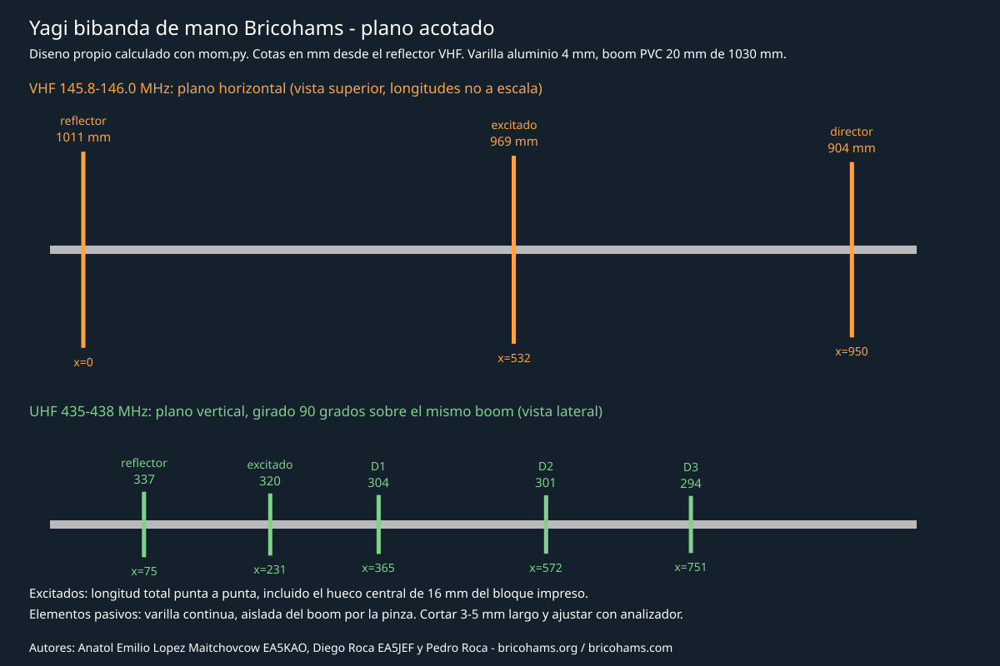
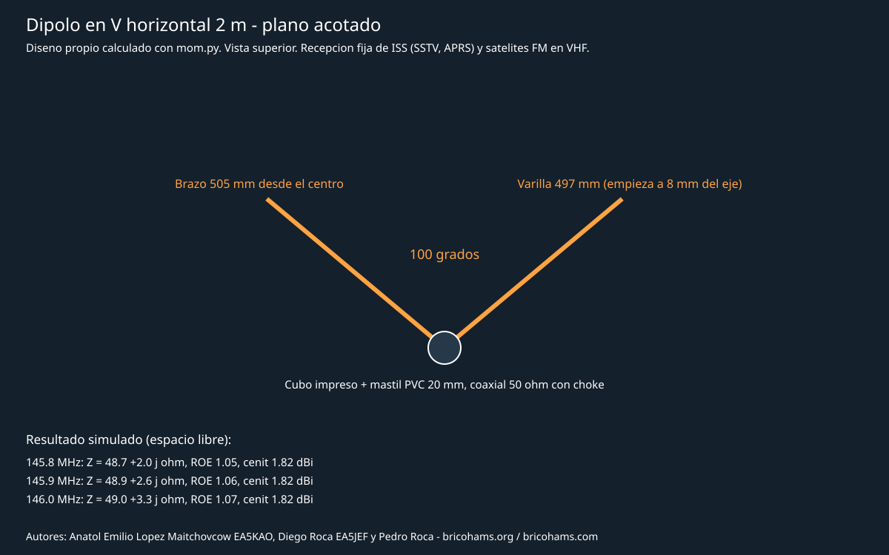
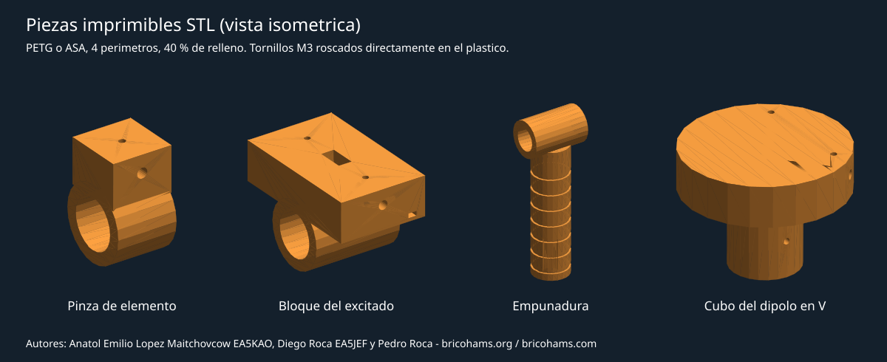

# Antenne satellitari: progetti Bricohams e componenti stampabili

Autori: Anatol Emilio Lopez Maitchovcow EA5KAO, Diego Roca EA5JEF e Pedro
Roca, fondatori e membri del consiglio di Bricohams.
Informazioni: <https://bricohams.org> e <https://bricohams.com>.

Sezione antenne della guida [Introduzione ai satelliti](INICIACION-SATELITE.md).
I progetti e i componenti sono **originali Bricohams**: dimensioni calcolate
con un risolutore del metodo dei momenti scritto per questo progetto e parti
modellate tramite codice. Non riproducono i progetti d'antenna di PY4ZBZ né di
PY5LO inclusi nella guida di PT2VM, il cui permesso fu concesso a quell'autore.

> **Stato: progetto simulato, non costruito né misurato.** I valori provengono
dalla simulazione in spazio libero. Nessuna antenna è stata ancora fabbricata
o misurata con analizzatore. Tagliare le aste 3-5 mm più lunghe e regolarle con
un analizzatore d'antenna (NanoVNA o simile) prima di trasmettere.

## Quale antenna scegliere

| Antenna | Uso | Guadagno simulato | Difficoltà |
| --- | --- | --- | --- |
| [Yagi bibanda portatile](#yagi-bibanda-de-mano) | Satelliti FM con uplink e downlink su bande diverse (SO-50, ripetitore ISS, PO-101) | 8,4 dBi VHF / 11,4 dBi UHF | Media |
| [Dipolo a V orizzontale 2 m](#dipolo-en-v-horizontal-2-m) | Ascolto fisso senza inseguimento: SSTV e APRS della ISS, downlink VHF | 1,8 dBi allo zenit | Bassa |
| Antenna originale della radio | Primi ascolti della ISS nei passaggi alti | Molto inferiore alle precedenti | Nessuna |

Con l'antenna originale si può ricevere la ISS nei passaggi alti, ma per
lavorare satelliti FM a bassa potenza si usa di solito un'antenna direzionale
orientata a mano. Una lunga antenna a stilo o un contrappeso aiutano un po', ma
non sostituiscono la direzionale.

## Yagi bibanda portatile



Due Yagi condividono un boom non conduttivo: 3 elementi per 2 m sul piano
orizzontale e 5 elementi per 70 cm sul piano verticale, ruotati di 90 gradi.
Nei piani ortogonali e centrati, la simulazione non mostra un accoppiamento
apprezzabile tra bande: ogni Yagi rende allo stesso modo con o senza l'altra.
Un disallineamento reale degli elementi introduce invece un certo accoppiamento.

### Dimensioni

Quote in mm, misurate dal riflettore VHF (x = 0). Le lunghezze sono da punta
a punta; per gli elementi attivi includono lo spazio centrale di 16 mm del
blocco stampato, quindi ogni metà misura (lunghezza − 16) / 2.

| Banda | Elemento | Lunghezza (mm) | Posizione x (mm) | Ogni metà (mm) |
| --- | --- | ---: | ---: | ---: |
| VHF | Riflettore | 1011 | 0 | — |
| VHF | Attivo | 969 | 532 | 476,5 |
| VHF | Direttore | 904 | 950 | — |
| UHF | Riflettore | 337 | 75 | — |
| UHF | Attivo | 320 | 231 | 152 |
| UHF | Direttore 1 | 304 | 365 | — |
| UHF | Direttore 2 | 301 | 572 | — |
| UHF | Direttore 3 | 294 | 751 | — |

Boom in tubo PVC da 20 mm, come il tubo elettrico rigido, lungo circa 1030 mm.
I pezzi VHF e UHF distano almeno 35 mm lungo il boom; lo script di progetto lo verifica.

### Prestazioni simulate

| MHz | Z (Ω) | ROS 50 Ω | Guadagno (dBi) | Rapporto avanti/indietro (dB) |
| --- | --- | ---: | ---: | ---: |
| 145,8 | 38,0 + j2,6 | 1,32 | 8,43 | 15,0 |
| 145,9 | 37,9 + j3,3 | 1,33 | 8,44 | 15,0 |
| 146,0 | 37,9 + j4,1 | 1,34 | 8,45 | 14,9 |
| 435,0 | 39,1 − j0,7 | 1,28 | 11,32 | 15,2 |
| 436,5 | 38,6 − j0,3 | 1,30 | 11,37 | 15,6 |
| 438,0 | 37,1 + j0,0 | 1,35 | 11,42 | 16,2 |

Il progetto privilegia guadagno e rapporto avanti/indietro con ROS inferiore
a 1,4 nell'intero segmento satellitare, alimentando l'elemento attivo
raccordandolo direttamente con coassiale da 50 Ω e senza rete di adattamento.
Una ROS di 1,3-1,35 riflette circa il 2 % della potenza; è accettabile per una
radio portatile.

### Materiali

- Tubo PVC da 20 mm, 1030 mm.
- Asta di alluminio da 4 mm, circa 5,5 m in totale. Va bene anche l'ottone;
  per un metro a nastro occorre un blocco diverso.
- Componenti stampati: 6 morsetti per elementi, 2 blocchi attivi e
  1 impugnatura; vedi [componenti STL](#piezas-imprimibles-stl).
- Viti M3 x 8 per fissare aste e componenti e M3 x 10 con terminale ad anello
  per gli elementi attivi.
- Due tratti di coassiale sottile da 50 Ω, come RG-316 o RG-58, con choke di
  modo comune su ciascuno: alcune perline di ferrite vicino al blocco o 4-5
  spire di coassiale di circa 3 cm di diametro. Verificare il choke con l'analizzatore.
- Un diplexer VHF/UHF per unire entrambi gli elementi attivi a un unico
  downlink se si usa una sola radio, ad esempio UV-K5. Con due radio, ciascun
  coassiale si collega alla propria radio.

### Montaggio

1. Tagliare le aste 3-5 mm più lunghe della tabella e limarne le estremità.
   Applicare protezioni alle punte: guaina termorestringente o tappi. Girando
   un'antenna portatile è facile avvicinare una punta al viso.
2. Segnare le posizioni x sul boom con nastro. I morsetti VHF tengono l'asta
   orizzontale e quelli UHF la ruotano di 90 gradi sul boom.
3. Centrare l'asta in ciascun morsetto e stringerla con la vite M3 superiore.
   Fissare il morsetto al boom con la vite M3 inferiore.
4. Nei blocchi attivi, inserire ciascuna metà fino in fondo al foro. La vite
   superiore la fissa e funge da morsetto: calza da un lato e centrale
   dall'altro, con terminale ad anello. Sigillare i collegamenti contro l'umidità.
5. Instradare i coassiali sul boom verso il riflettore con fascette attraverso
   il perno del blocco e il choke vicino all'alimentazione.
6. Montare l'impugnatura tra l'elemento attivo UHF (231) e il direttore 1 UHF
   (365), verso x ≈ 300. Spostarla finché l'antenna non è bilanciata.

### Regolazione con analizzatore

- Misurare la ROS di ciascuna banda separatamente, con l'altro coassiale
  terminato a 50 Ω o collegato al diplexer.
- Se il minimo è sotto il segmento, accorciare l'elemento attivo in misura
  uguale su entrambi i lati, a passi di 1-2 mm. Se è sopra, l'attivo è corto:
  sostituirlo.
- Non inseguire una ROS di 1,0: l'attivo diretto è circa 38 Ω per progetto.
  L'importante è che il minimo sia centrato su 145,9 e 436,5 MHz.
- Durante la misura allontanarsi da tavoli metallici e persone. Puntare
  l'antenna verso il cielo.

## Dipolo a V orizzontale 2 m



Antenna fissa senza inseguimento per ascoltare la ISS, ad esempio SSTV a
145,800 MHz e APRS a 145,825 MHz, e downlink VHF. I bracci a V di 100 gradi
riempiono parzialmente i nulli del dipolo rettilineo e avvicinano l'impedenza a 50 Ω.

| Parametro | Valore |
| --- | --- |
| Angolo tra i bracci | 100 gradi |
| Braccio dal centro | 505 mm |
| Asta per braccio | 497 mm: inizia a 8 mm dall'asse, all'interno del cubo stampato |
| Z simulata 145,8 / 145,9 / 146,0 MHz | 48,7 + j2,0 / 48,9 + j2,6 / 49,0 + j3,3 Ω |
| ROS 50 Ω | 1,05-1,07 |
| Guadagno allo zenit | 1,82 dBi |
| Oscillazione in azimut a 30 gradi di elevazione | 5,5 dB |

Montarlo orizzontalmente su un palo in PVC da 20 mm, con il cubo stampato e
choke di modo comune sul coassiale, circa 0,5-1 m sopra il tetto o il terreno.
L'altezza dal suolo modifica il diagramma reale: la simulazione è in spazio
libero. Per trasmettere durante passaggi bassi è preferibile la Yagi.

## Componenti stampabili STL



| Componente | File | Quantità | Funzione |
| --- | --- | ---: | --- |
| Morsetto per elemento | [pinza-elemento.stl](../../../hardware/antenas/stl/pinza-elemento.stl) | 6 | Fissa un elemento passivo da 4 mm al boom da 20 mm |
| Blocco dell'elemento attivo | [bloque-excitado.stl](../../../hardware/antenas/stl/bloque-excitado.stl) | 2 | Due metà isolate con spazio da 16 mm, morsetti M3 e passaggio coassiale |
| Impugnatura | [empunadura.stl](../../../hardware/antenas/stl/empunadura.stl) | 1 | Manico da 32 mm, cavo e rigato, fissato al boom |
| Cubo del dipolo a V | [cubo-dipolo-v.stl](../../../hardware/antenas/stl/cubo-dipolo-v.stl) | 1 | Bracci a 100 gradi, morsetti M3 e sede per palo da 20 mm |

Impostazioni di stampa consigliate:

- Materiale: PETG o ASA. Il PLA si deforma al sole.
- Pareti e riempimento: 4 pareti e riempimento al 40 %.
- Altezza layer: 0,2 mm.
- Orientamento: anello del boom orizzontale, appoggiato sulla faccia piana
  della sporgenza. Stampare il cubo con la sede rivolta verso il basso.

Fori con gioco:

- Boom: 20,4 mm.
- Asta: 4,3 mm.
- Filettatura diretta M3: 2,8 mm.

Se la stampante chiude i fori, modificare le costanti `BOOM`, `ROD` e `M3_TAP`
di `generar_stl.py` e rigenerare i componenti.

Lo script verifica che ogni STL sia un solido chiuso e composto da un solo pezzo.
I dati di volume e dimensioni sono in [piezas.json](../../../hardware/antenas/piezas.json).

## Metodo di calcolo e verifica

File in [hardware/antenas](../../../hardware/antenas/README.md):

| Script | Funzione |
| --- | --- |
| `mom.py` | Risolutore proprietario di fili sottili con metodo dei momenti (Harrington): correnti nei nodi, carichi per segmento, nucleo ridotto e termine statico integrato analiticamente |
| `disenar.py` | Ottimizza le dimensioni con Nelder-Mead per il massimo guadagno con ROS ≤ 1,3-1,35 e rapporto avanti/indietro ≥ 15 dB; verifica la combinazione bibanda e la distanza tra componenti e scrive `resultados.json` |
| `generar_stl.py` | Modella i componenti con manifold3d e scrive gli STL e `piezas.json` |
| `vistas.py` | Disegna i piani quotati e le viste dei componenti in `docs/atlas` |

Convalida del risolutore sul dipolo λ/2 di riferimento:

- Con raggio 10⁻⁵ λ restituisce Z ≈ 78 + j43 Ω, rispetto al valore classico
di 73 + j42,5 Ω. La differenza deriva dall'alimentazione delta-gap.
- Con raggio 10⁻³ λ, il dipolo da 0,475 λ risuona a 71 − j3,5 Ω.
- La direttività è 2,15 dBi. Il guadagno calcolato dalla potenza in ingresso
coincide con l'integrale del diagramma, quindi la potenza si conserva.

Errore previsto nella frequenza di risonanza: qualche punto percentuale. Per
questo gli elementi si tagliano lunghi e poi si regolano.

Limiti del modello:

- Spazio libero, senza terreno né corpo dell'operatore.
- Conduttori perfetti.
- Non modella la plastica dei morsetti, che abbassa leggermente la risonanza,
il boom, il coassiale né il diplexer.
- Non è una misura né una certificazione delle prestazioni.

Per rigenerare dalla cartella `hardware/antenas`:

```text
python -m venv .venv
.venv\Scripts\python -m pip install -r requirements.txt
.venv\Scripts\python disenar.py
.venv\Scripts\python generar_stl.py
.venv\Scripts\python vistas.py
```

## Sicurezza e legalità

- Per trasmettere è necessaria l'autorizzazione di radioamatore. Per ascoltare no.
- Con 5 W e una Yagi da 11 dBi, non puntare verso persone vicine e tenere gli
elementi lontani dal viso durante la trasmissione.
- Non usare queste antenne su bande o satelliti non autorizzati, ad esempio
satelliti militari UHF.