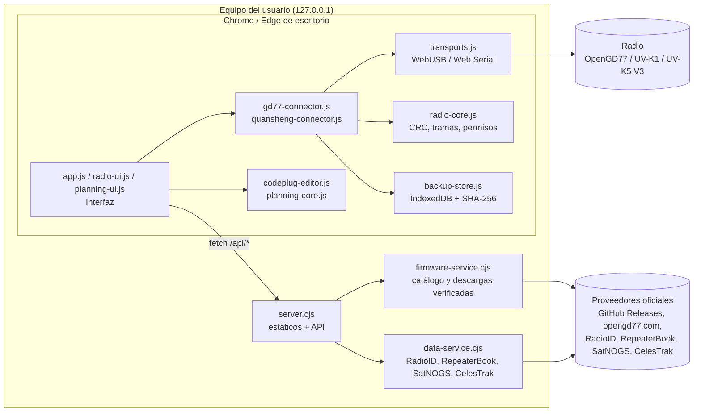
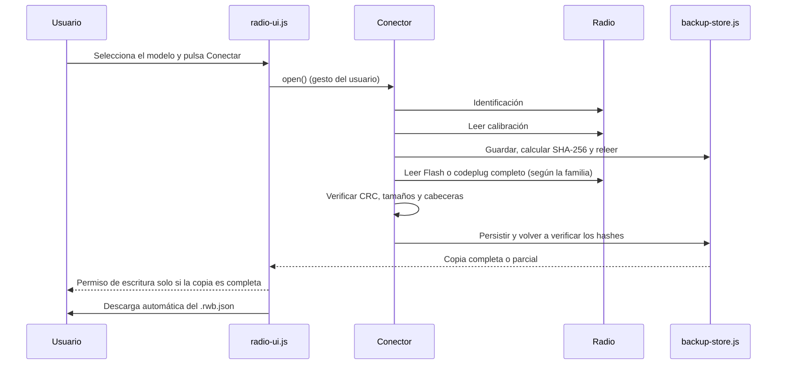

# Architettura di Bricohams Radio Workspace

Bricohams Radio Workspace è un'applicazione web **locale**. Un piccolo server Node.js serve un elenco chiuso di file statici e poche API di sola lettura. Tutta la comunicazione con la radio avviene nel browser tramite WebUSB o Web Serial.

## Modalità di esecuzione

All'avvio, `runtime-mode.js` richiede `runtime.json` (percorso relativo, senza cache). Solo `{"mode":"local"}` attiva la modalità locale; se manca, restituisce 404, non è JSON o la pagina viene aperta come `file://`, l'applicazione parte in **modalità web** senza errori. `server.cjs` lo serve come `{"mode":"local"}` e `scripts/build-pages.cjs` genera `{"mode":"web"}` in `dist/`. Il badge superiore indica «Web · GitHub Pages» o «Locale · installato».

| Aspetto | Web (Pages) | Locale |
| --- | --- | --- |
| Server | Nessuno, solo file statici | `server.cjs` su `127.0.0.1:8787` |
| Firmware F4HWN / ARDF K1-K5 V3 | Cronologia stabile da Armel e reald tramite `api.github.com`; l'utente carica il file e vengono verificati dimensione e SHA-256 pubblicato | Download verificato dal server; ARDF, versioni precedenti alla v6 e SA818 solo per il download |
| Firmware OpenGD77 | Caricamento manuale dello ZIP (nome e firma ZIP; senza hash dell'editore) | Download tramite il server |
| RadioID | Caricamento di `user.csv` (100 MiB, filtrato, 5.000 righe mostrate) e profilo facoltativo in `localStorage` | API tramite server |
| RepeaterBook | Non disponibile | Token approvato, solo sul server |
| Satelliti | `data/satellites.json` giornaliero (`scripts/fetch-satellites.cjs`) | TLE in tempo reale |

I percorsi del client sono sempre relativi. La CSP di ogni HTML è dichiarata in `<meta>` e, poiché `<meta>` non supporta `frame-ancestors`, `app.js` si arresta se la pagina è in un frame. Il sito web ha un'origine propria (vedi ADR-013).

## Vista dei componenti

## Moduli

| File | Lato | Responsabilità |
| --- | --- | --- |
| `index.html`, `opengd77.html`, `quansheng.html`, `ayuda.html` | Browser | Scheletri delle pagine con `body[data-page]`, senza script inline. |
| `app.js` | Browser | Interfaccia comune (marchio, navigazione, piè di pagina), guide e pagina di aiuto con ricerca. |
| `radio-ui.js` | Browser | Pannello di connessione, backup automatici, cronologia, esportazione e azioni protette. |
| `transports.js` | Browser | `USBTransport` (CDC su WebUSB, `1FC9:0094`) e `SerialTransport` (Web Serial), con lettura esatta e timeout. |
| `radio-core.js` | Browser / Node | CRC-16/CRC-32, utilità binarie, permessi di scrittura e SHA-256. |
| `gd77-connector.js` | Browser | Protocollo OpenGD77 CPS (`C`/`R`/`W`/`X`) e mappe MK22, STM32 e SERIAL. |
| `quansheng-connector.js` | Browser | Protocollo UART F4HWN (offuscamento XOR, CRC), lettura di calibrazione e Flash, slot Multiboot. |
| `backup-store.js` | Browser | Persistenza in IndexedDB, rilettura verificata ed esportazione `.rwb.json`. |
| `codeplug-editor.js` | Browser / Node | Lettura e scrittura binaria del codeplug OpenGD77: canali, contatti e blocco SAT tipo 3. |
| `planning-core.js` | Browser / Node | Filtri, deduplicazione, CSV, validazione TLE e passaggi SGP4 con `satellite.js`. |
| `planning-ui.js` | Browser | Pannello «Codeplug: contatti, ripetitori e SAT». |
| `firmware-catalog.js` | Browser / Node | Modelli e fonti firmware consentiti. |
| `server.cjs` | Node | Server HTTP su `127.0.0.1:8787`, elenco di file consentiti, intestazioni di sicurezza e routing di `/api/*`. |
| `firmware-service.cjs` | Node | Consultazione di GitHub Releases e opengd77.com con reindirizzamenti controllati, limiti di dimensione e cache. |
| `runtime-mode.js` | Browser | Rileva la modalità (`runtime.json`; web se manca). |
| `radioid-csv.js` | Browser / Node | Lettura filtrata di `user.csv` e profilo locale facoltativo. |
| `scripts/build-pages.cjs`, `scripts/fetch-satellites.cjs` | Node | Generano `dist/` e `data/satellites.json` per Pages. |
| `data-service.cjs` | Node | Proxy di sola lettura verso RadioID, RepeaterBook (credenziali solo sul server), SatNOGS e CelesTrak. |

## Flusso di connessione e backup automatico

Prima di ogni scrittura, il backup viene riletto e confrontato con gli hash del permesso. Scollegare la radio, sostituirla o eliminare il backup revoca il permesso.

## Livelli di sicurezza

1. **Rete:** il server ascolta solo su `127.0.0.1`, richiede `Host: 127.0.0.1:<puerto>` e serve un elenco fisso di file.
2. **Browser:** CSP `default-src 'self'; script-src 'self'; style-src 'self'`, `Permissions-Policy`, `nosniff`, `no-referrer` e `no-store`. Non si usa `eval` né si costruisce HTML con dati della radio.
3. **Apparato:** le scritture usano un permesso *fail-closed* legato a un backup verificato. Main non è mai una destinazione. Cancellazione o ripristino richiedono una conferma digitata.
4. **Fonti esterne:** solo fornitori ufficiali, reindirizzamenti a host consentiti, limiti di dimensione e SHA-256 visibile. Le credenziali RepeaterBook non vengono mai inviate al browser.
5. **Dati:** niente telemetria né caricamenti verso server. I backup rimangono nell'IndexedDB del profilo locale e vengono esportati in file dell'utente.

## Limitazioni note

- **OpenGD77:** qui non esiste un protocollo verificato per estrarre l'intero firmware del MCU. Il backup è contrassegnato come **parziale** e la scrittura sulla radio rimane bloccata.
- **Quansheng:** il backup fisico completo della Flash richiede le capacità di lettura e CRC di F4HWN Labs v6.1+. Il web implementa la scrittura Beta di configurazione/canali con backup e rilettura, e le immagini Bricohams SAT incorporano CAT RX sperimentale. Ciò non dimostra scrittura persistente né funzionamento CAT su una radio specifica; consulta la [matrice di validazione](VALIDACION-INTEGRAL-V3-ANDROID.md).
- **RepeaterBook:** richiede un token approvato da RepeaterBook ed è presente solo nella versione locale.
- **Web:** i dati satellitari possono risalire a un giorno prima (avviso dopo 7 giorni) e firmware/RadioID vengono caricati manualmente.
- **Hardware:** esistono letture precedenti di un'unità Quansheng, ma non certificano scritture, residente indipendente o combinazione attuale di APK, slot SAT e telefono. Le prove fisiche di questa revisione sono in sospeso.
