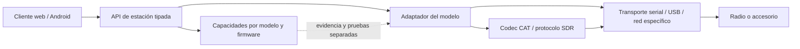

# Investigación de CAT y control de radios en GitHub

**Corte de investigación:** 20-11-2026.
**Alcance:** repositorios públicos consultados en GitHub sobre control CAT,
protocolos de red de radios, y controladores para los 49 modelos candidatos
registrados por BricoHams.

## Revisión adicional: Elecraft y Kenwood

La referencia primaria Elecraft G5 conjunta K3S/K3/KX3/KX2 permite añadir
K3/KX3/KX2 con consultas FA/FB, MD/MD$ y BW/BW$.
La [ficha de evidencia](hardware/elecraft-k3s.md) registra páginas y límites:
FM excluido en KX2 y respuestas `$` en KX dual-watch sin independencia de
receptor/filtro. No se heredaron ID/OM/DT ni setters del perfil K3S.

Se intentó recuperar documentación oficial adicional TS-480/TS-2000:
el servidor del fabricante respondió HTTP 403. No se eludió esa restricción
ni se incorporaron perfiles a partir de una emulación o de comandos supuestos.
Quedan pendientes de una referencia primaria accesible.

## Conclusiones principales

1. **CAT no es un protocolo universal.** Hay familias de protocolo distintas,
   varios transportes por marca y excepciones/modelos/firmware. La detección por
   marca o por el primer puerto disponible no es una base segura para operar.
2. **Hamlib es la referencia multi-fabricante más útil encontrada.** Su API
   abstrae radios mediante backends por modelo y ofrece `rigctld`; el propio
   proyecto advierte que el soporte y la disponibilidad de funciones varían por
   backend. La rama `master` anuncia cambios incompatibles previstos para
   Hamlib 5, así que cualquier integración futura deberá fijar y probar una
   versión concreta.
3. **Hay más de una prueba de software comunitario específico para FTX-1**:
   backend Hamlib, perfil de wfview y un driver en un fork de flrig. Eso no es
   prueba de BricoHams ni sustituye el manual Yaesu o la prueba física.
4. **No se ha encontrado evidencia verificada de exportación del scope nativo
   FTX-1.** El perfil FTX-1 de wfview declara `HasSpectrum=false`; Hamlib describe
   `SS` como control de ajustes, no como extracción de muestras. El espectro
   AF calculado desde audio por otra aplicación no es el scope nativo.
5. **No se ha copiado código.** Se consultaron documentos, índices de modelos,
   perfiles y código público para identificar hechos, diferencias y riesgos.
   Ninguna compatibilidad BricoHams se eleva por la existencia de un driver de
   terceros.

## Método y límites de la evidencia

- Se revisaron repositorios upstream relevantes (`Hamlib`, `wfview`, `flrig`)
  y proyectos especializados de Icom, Yaesu, Kenwood, FlexRadio, Elecraft,
  Hermes-Lite 2, QMX y (tr)uSDX, incluyendo AetherSDR, RigPlane, Icom Web
  Control y Yaesu Web Control.
- Las fuentes de código de terceros son evidencia de que alguien implementó o
  declaró una función; no acreditan por sí solas el cumplimiento con el manual,
  revisión de hardware, firmware, estado de mantenimiento ni pruebas de
  interoperabilidad independientes.
- Los enlaces a archivos concretos fijan el commit consultado cuando fue
  posible. Una búsqueda de GitHub no demuestra que no existan otros repositorios
  o forks; este informe es una investigación amplia de fuentes relevantes, no
  una certificación exhaustiva de todo GitHub.
- La matriz de 49 radios permanece como inventario de candidatos. Los modelos y
  las funciones deben validarse individualmente, junto con transporte,
  firmware, configuración de radio y señales eléctricas.

## Familias de protocolo para los 49 candidatos

| Grupo de candidatos | Cantidad | Familia y transportes encontrados | Consecuencia |
|---|---:|---|---|
| Icom | 17 | CI-V por serie/USB; algunos equipos ofrecen un transporte de red Icom separado | Mantener codec CI-V, transporte serial y transporte LAN como componentes distintos. Dirección CI-V, funciones y capacidades de scope/audio dependen del modelo. |
| FlexRadio | 13 | SmartSDR TCP/UDP y flujos DAX/VITA en las bibliotecas consultadas; no equivale a CAT serie | Driver de protocolo de red separado. No extrapolar un cliente Flex 6000 a AURORA-510/520 sin evidencia por modelo. |
| Kenwood | 4 | CAT ASCII sobre serie/USB; algunos modelos tienen servicios de red propios (p. ej., KNS) | Consultas, parámetros y servicio de red se verifican modelo por modelo. |
| Yaesu | 7 | CAT ASCII, normalmente por USB/serie; comandos y anchos de respuesta específicos de modelo | No compartir parser por marca sin validar el manual de cada modelo. FTX-1 requiere su perfil propio. |
| Elecraft | 5 | K3S/K3/KX3/KX2 tienen referencia conjunta G5; K4 documenta USB/RS-232/Ethernet y streams dB/bin Ethernet | Perfiles y subconjuntos por modelo; no inferir hardware ni streams K4 en otros equipos. |
| Hermes Lite 2 | 1 | Protocolo SDR/OpenHPSDR sobre Ethernet, no CAT de transceptor convencional | Tratar como backend SDR separado. |
| TRuSDX y QMX+ | 2 | Interfaces CAT particulares; TRuSDX emula un subconjunto Kenwood y QMX+ tiene manual CAT propio | No tratarlos como radios Kenwood ni inferir capacidades por similitud sintáctica. |

El inventario exacto de modelos sigue en
[radios candidatas](radios-candidatas.md) y
[conexiones candidatas](radio-conexiones-candidatas.md).

## Repositorios revisados

| Proyecto / evidencia | Lo observado en GitHub | Licencia declarada | Uso permitido como referencia y límites |
|---|---|---|---|
| [Hamlib](https://github.com/Hamlib/Hamlib) — [README](https://github.com/Hamlib/Hamlib/blob/af198ace7697c84f5d8ce084271208e383012792/README.md), [lista de modelos Icom](https://github.com/Hamlib/Hamlib/blob/af198ace7697c84f5d8ce084271208e383012792/rigs/icom/ICOM.md), [archivos Icom](https://github.com/Hamlib/Hamlib/blob/af198ace7697c84f5d8ce084271208e383012792/rigs/icom/Makefile.am), [archivos Kenwood](https://github.com/Hamlib/Hamlib/blob/af198ace7697c84f5d8ce084271208e383012792/rigs/kenwood/Makefile.am), [FTX-1](https://github.com/Hamlib/Hamlib/tree/af198ace7697c84f5d8ce084271208e383012792/rigs/yaesu/ftx1), [(tr)uSDX](https://github.com/Hamlib/Hamlib/blob/af198ace7697c84f5d8ce084271208e383012792/rigs/kenwood/trusdx.c) | API común con backends por modelo, `rigctld`, CI-V y CAT; backend FTX-1 modelo 1051, descriptor de red Icom por modelo y backend propio para (tr)uSDX | LGPL-2.1-or-later para la biblioteca; revisar cada componente | Fuente prioritaria para descubrir modelos, comandos y límites. No se integra ni copia código; fijar release/API y revisar licencia antes de una integración. La presencia de un backend no acredita hardware BricoHams. |
| [wfview](https://github.com/wf-group/wfview/tree/d6d6829bdfee38431ea11e7a340b0ab80d5a1d39) — [README](https://github.com/wf-group/wfview/blob/d6d6829bdfee38431ea11e7a340b0ab80d5a1d39/README.md), [perfil FTX-1](https://github.com/wf-group/wfview/blob/d6d6829bdfee38431ea11e7a340b0ab80d5a1d39/rigs/FTX-1.rig) | Aplicación C++ multi-radio y multiplataforma. El perfil FTX-1 declara `HasSpectrum=false`, `HasLAN=false`, `HasEthernet=false`, `HasWiFi=false`; es perfil de software, no especificación del fabricante. | GPL-3.0; README declara que incluye partes del protocolo rigctl de Hamlib | Útil para comparar perfiles/transportes. La licencia y procedencia impiden copiar fragmentos sin revisión. El perfil no prueba que el FTX-1 no tenga datos de scope por cualquier otro medio; sí refuerza que CAT/ajustes no bastan para afirmar exportación nativa. |
| [flrig upstream](https://github.com/w1hkj/flrig/tree/915d98c5781fc8a39b37699a23d63bea4a235451) — [código de modelos Yaesu](https://github.com/w1hkj/flrig/tree/915d98c5781fc8a39b37699a23d63bea4a235451/src/rigs/yaesu), [Kenwood](https://github.com/w1hkj/flrig/tree/915d98c5781fc8a39b37699a23d63bea4a235451/src/rigs/kenwood), [Elecraft](https://github.com/w1hkj/flrig/tree/915d98c5781fc8a39b37699a23d63bea4a235451/src/rigs/elecraft), [Icom](https://github.com/w1hkj/flrig/tree/915d98c5781fc8a39b37699a23d63bea4a235451/src/rigs/icom) | Clases y ficheros de driver separados por modelo; en la revisión consultada aparecen, entre otros, FT-710, FT-991A, FTDX10, FTDX101D, FTDX3000, TS-590S/SG, TS-890S, TS-990S y K3/K4 | GPL-3.0 | Demuestra por qué el comportamiento por modelo importa; la presencia de un fichero no significa compatibilidad BricoHams ni prueba de hardware independiente. |
| [AetherSDR](https://github.com/aethersdr/AetherSDR/tree/ae99396124081e304c6d7bcea9a7605f5a921f32) — [radios soportadas/declaradas](https://github.com/aethersdr/AetherSDR/blob/ae99396124081e304c6d7bcea9a7605f5a921f32/docs/user/docs/supported-radios.md), [Icom en red](https://github.com/aethersdr/AetherSDR/blob/ae99396124081e304c6d7bcea9a7605f5a921f32/docs/user/docs/networked-icom.md), [CAT](https://github.com/aethersdr/AetherSDR/blob/ae99396124081e304c6d7bcea9a7605f5a921f32/docs/user/docs/cat-control.md) | Cliente SmartSDR para FLEX-6000/8000 y AURORA (AU-510/520); documenta además Hermes-Lite 2 e Icom en red con estados distintos | GPL-3.0 | La guía declara FLEX-8600 firmware 4.2.18 como objetivo de prueba activo; los modelos listados no tienen evidencia BricoHams. La guía advierte que los puertos CAT escuchan en todas las interfaces sin contraseña ([issue #5296](https://github.com/aethersdr/AetherSDR/issues/5296)); no copiar esa exposición insegura. |
| [RigPlane](https://github.com/rigplane/rigplane-core/tree/fbfc970a6d675467e918ba5e337bfa522dfbeb70) — [README y radios](https://github.com/rigplane/rigplane-core/blob/fbfc970a6d675467e918ba5e337bfa522dfbeb70/README.md) | Biblioteca y UI web MIT con providers Icom LAN/USB y Yaesu FTX-1; lista IC-705/7300/7300MK2/7610/9700/905, FT-991A y perfiles adicionales | MIT | El README marca FT-991A como no verificado, IC-905 como perfil documentado y FTX-1 con panadapter derivado de audio, no scope nativo. Son estados declarados por el proyecto. |
| [Icom Web Control](https://github.com/mm5agm/Icom_Web_Control/tree/75cf014ad6c55e6e0d61a9c80a92aae5feb118f2) — [README](https://github.com/mm5agm/Icom_Web_Control/blob/75cf014ad6c55e6e0d61a9c80a92aae5feb118f2/README.md) | UI web para IC-7300 y IC-7300MK2; el proyecto declara leer el scope nativo CI-V y describe una prueba de desarrollo en MkII más una confirmación de usuario en IC-7300 original; IC-9700 está en pre-release | GPL-3.0 | Declaraciones de un proyecto y de sus usuarios, no prueba independiente. El README advierte configurar USB SEND/Keying en OFF para sus builds de prueba antes de abrir el puerto. |
| [Yaesu Web Control](https://github.com/mm5agm/Yaesu_Web_Control/tree/40faef31a385ad909051ce23246af0f6e631bcbc) — [README](https://github.com/mm5agm/Yaesu_Web_Control/blob/40faef31a385ad909051ce23246af0f6e631bcbc/README.md) | Lista FT-710, FT-991A, FTDX10, FTDX101D/MP y FTDX3000; también FTDX5000 fuera del catálogo candidato | GPL-3.0 | Distingue el scope FT-710 por USB (experimental), FTDX101 por accesorio ESP32/ACC y espectro SDR/IF en otros modelos. FTX-1 aparece solo como uso HF con perfil FTdx10 por parte de un usuario; perfil específico pendiente. |
| [libhl2sdrk](https://github.com/nrolabs/libhl2sdrk/tree/f9aac8e2fd284eefbf00955d8b20610b72d28b2c) — [README](https://github.com/nrolabs/libhl2sdrk/blob/f9aac8e2fd284eefbf00955d8b20610b72d28b2c/README.md) | Codec Kotlin/JVM y cliente Android para Hermes-Lite 2 sobre openHPSDR Protocol 1/UDP; declara RX, control, PTT y streaming TX | GPL-2.0-or-later | Es protocolo SDR de red, no CAT de transceptor. Incluye rutas TX y no está integrado; cualquier reutilización requiere revisión de licencia. |
| [flrig_newer, fork `support_ftx1`](https://github.com/PhotoNomad0/flrig_newer/tree/83ff519bc389f017bb616aa705e2b89f08ab967b/src/rigs) — [driver FTX1](https://github.com/PhotoNomad0/flrig_newer/blob/83ff519bc389f017bb616aa705e2b89f08ab967b/src/rigs/yaesu/FTX1.cxx) | Añade FTX-1 y QMX a un fork, no al upstream consultado. El FTX-1 contiene códigos de modo y consultas, pero habilita `serial_rtscts=true` y `serial_catptt=true`. | Hereda GPL-3.0 de flrig | Evidencia secundaria útil para contrastar formatos. No adoptar su configuración de señales: activar RTS/CTS o CAT PTT sería incompatible con el estado seguro de BricoHams hasta validar el hardware y el manual. |
| [TeleRig](https://github.com/Dreikor17/TeleRig/tree/a359369c8f2c0c4323fd74b4a20c4e0a471f0f3b) — [README](https://github.com/Dreikor17/TeleRig/blob/a359369c8f2c0c4323fd74b4a20c4e0a471f0f3b/README.md), [CI-V](https://github.com/Dreikor17/TeleRig/blob/a359369c8f2c0c4323fd74b4a20c4e0a471f0f3b/backend/civ.py), [perfiles](https://github.com/Dreikor17/TeleRig/blob/a359369c8f2c0c4323fd74b4a20c4e0a471f0f3b/backend/profiles.py) | Aplicación web para IC-9700, IC-7300MK2, IC-728, FT-991A y FT-891; afirma leer scope CI-V Icom `27 00` y crear espectro AF desde audio para Yaesu | AGPL-3.0-only | Solo esos perfiles están enumerados; no demuestra soporte FTX-1 ni scope Yaesu nativo. TX/menús de escritura están fuera del alcance actual de BricoHams. No reutilizar código. |
| [qmx-cat](https://github.com/toddfoster/qmx-cat/tree/86b7ec66a7dd3e7e27cc0d0930c70792358c4d8b) — [README](https://github.com/toddfoster/qmx-cat/blob/86b7ec66a7dd3e7e27cc0d0930c70792358c4d8b/README.md), [implementación](https://github.com/toddfoster/qmx-cat/blob/86b7ec66a7dd3e7e27cc0d0930c70792358c4d8b/qmx-cat) | Herramienta para QMX con comandos CAT arbitrarios y operaciones de lectura/escritura de menús; el propio README la califica con pocas protecciones y advierte sobre cambios de configuración | MIT | Referencia para observar interfaz/uso del CAT QMX; no usar su CAT libre ni sus operaciones de escritura como diseño de seguridad. QMX no prueba automáticamente QMX+. |
| [(tr)uSDX Linux Driver](https://github.com/miltonics/truSDX-Linux/tree/346a3a12835823204335a71b68d240695c09ab9b) — [README](https://github.com/miltonics/truSDX-Linux/blob/346a3a12835823204335a71b68d240695c09ab9b/README.md) | Driver que declara emular TS-480, exponer puerto virtual para WSJT-X y transportar audio mediante extensiones CAT; declara control TX/PTT | MIT, según el repositorio | Proyecto específico Linux y afirmaciones de sus autores. No asumir que una emulación TS-480 convierte el (tr)uSDX en Kenwood ni adoptar sus comandos TX/audio. |
| [trusdx Linux Audio/CAT Driver](https://github.com/ilikehamradio/trusdx_Linux_Audio_Cat_Driver/tree/b38b373227ca8bd7a534fa738d300dd115c8c368) — [README](https://github.com/ilikehamradio/trusdx_Linux_Audio_Cat_Driver/blob/b38b373227ca8bd7a534fa738d300dd115c8c368/README.md) | Driver Rust con bridge de audio y servidor rigctl loopback; README declara Linux y serie 115200 8N2 | README indica MIT; confirmar el fichero de licencia antes de cualquier integración | La configuración serie difiere de otras fuentes comunitarias que describen 8N1. Mantener el baud/paridad como pendiente de evidencia primaria y unidad/firmware concretos. |
| [qmx-hl2](https://github.com/rampa069/qmx-hl2/tree/26d22c3ba59e236f041a742417ebbc20e6febda0) — [README](https://github.com/rampa069/qmx-hl2/blob/26d22c3ba59e236f041a742417ebbc20e6febda0/README.md) | Bridge QMX/QMX+ a Hermes-Lite 2 mediante openHPSDR Protocol 1; declara RX I/Q de 48 kHz, visualización en clientes SDR y una ruta TX activable | GPL-2.0-or-later | Proyecto reciente y no afiliado al fabricante. El waterfall es del flujo I/Q del bridge, no un scope nativo del QMX+. No está integrado ni validado por BricoHams; no usar su ruta TX. |
| [M0LTE.Flex](https://github.com/M0LTE/M0LTE.Flex/tree/44f6feebf2e9cd8c8fe5270100136375ae7e8e3d) — [README](https://github.com/M0LTE/M0LTE.Flex/blob/44f6feebf2e9cd8c8fe5270100136375ae7e8e3d/README.md), [provenance](https://github.com/M0LTE/M0LTE.Flex/blob/44f6feebf2e9cd8c8fe5270100136375ae7e8e3d/PROVENANCE.md) | Cliente SmartSDR para Flex 6000: TCP/UDP, audio DAX/VITA-49, IQ y PTT | AGPL-3.0-or-later; declara ports con procedencia MIT | Evidencia de que Flex usa un stack de red distinto a CAT serial. El alcance declarado es 6000-series; no extrapolar a AURORA. Tiene rutas de transmisión que BricoHams no habilita. |
| [QK4](https://github.com/mikeg-dal/QK4/tree/5191c8b1932148511381bd8574e7365e279463e7) — [README](https://github.com/mikeg-dal/QK4/blob/5191c8b1932148511381bd8574e7365e279463e7/README.md) | Control remoto Elecraft K4 con conexión TCP, audio, espectro, CAT server y TCI; declara Windows/macOS/Linux/Raspberry Pi | GPL-3.0-or-later | Es K4-específico; no acredita K3S. Revisar la licencia antes de integrar código; no forma parte de BricoHams. |
| [TS-890 Pro](https://github.com/w9fyi/ts-890-pro/tree/1676e526169553ebad8cd0a3446cfadee7faa493) | App macOS para TS-890S con CAT USB, KNS de red/audio y waterfall | El README no aclara una licencia OSI; tratar como no reutilizable | Útil para descubrir separación CAT/KNS en el TS-890S, no es evidencia de soporte BricoHams ni de compatibilidad con los demás Kenwood. |

## Hallazgos CAT de prioridad alta

### Presencia de fuentes por candidato

La revisión fijada de Hamlib contiene archivos específicos para los modelos
Icom, Yaesu y Kenwood indicados abajo. Es presencia de código fuente, no una
medición uniforme de funciones, transporte, firmware ni compatibilidad:

| Grupo candidato | Archivos/perfiles encontrados en Hamlib | Límite importante |
|---|---|---|
| Icom (17) | `ic705.c`, `ic7100.c`, `ic7200.c`, `ic7300.c`, `ic7410.c`, `ic7600.c`, `ic7610.c`, `ic7700.c`, `ic7760.c`, `ic7800.c`, `ic785x.c`, `ic905.c`, `ic9100.c`, `ic9700.c`, `icr8600.c`; red: `ic705net.c`, `ic7610net.c`, `ic7760net.c`, `ic905net.c`, `ic9700net.c`, `ic7300mk2net.c` | IC-7300MK2 aparece como backend de red, no como archivo CI-V serie en el Makefile consultado. El documento Icom etiqueta las redes IC-7610/9700/705 como beta probadas en hardware y IC-905/7760/7300MK2 como no probadas en red. |
| Yaesu (7) | `ft710.c`, `ft991.c`, `ftdx10.c`, `ftdx101.c`, `ftdx101mp.c`, `ft3000.c` y directorio `ftx1/` | La existencia de un archivo no demuestra que todos los comandos ni todas las revisiones de firmware funcionen. |
| Kenwood (4) | `ts590.c`, `ts890s.c`, `ts990s.c` | TS-590S/SG comparten backend en Hamlib; no se infieren capacidades idénticas sin cotejar perfiles/manuales. |
| FlexRadio (13) | `smartsdr.c` implementa perfiles `SmartSDR Slice A-H` sobre TCP | Este archivo Hamlib representa slices, no una matriz de 13 modelos. Las declaraciones de AetherSDR para modelos específicos se detallan más abajo y son evidencia independiente de terceros. |
| Elecraft (2) | Hamlib usa `k3.c` para descriptores K3/K3S/K4 y helpers compartidos en `elecraft.c`; flrig upstream contiene `K3.cxx` y `K4.cxx` | La presencia de una ruta común no garantiza igualdad de modos/opciones ni compatibilidad BricoHams; no inferir transporte K4 para K3S. |
| Hermes Lite 2 (1) | Clientes SDR/proyectos openHPSDR, incluido el bridge experimental `qmx-hl2` | `qmx-hl2` convierte un QMX/QMX+ en un endpoint emulado; no es evidencia de soporte BricoHams para el hardware Hermes Lite 2. |
| (tr)uSDX | Backend individual `trusdx.c` incluido en el grupo de fuentes Kenwood | El archivo implementa un subconjunto deliberado y declara límites por firmware; no convierte el equipo en Kenwood. |
| QMX+ | `qmx-cat` se describe para QMX; `qmx-hl2` declara QMX/QMX+ | No se extrapola `qmx-cat` de QMX a QMX+. El bridge QMX+ es otra aplicación, con audio/IQ y TX fuera del alcance BricoHams. |

Las listas de fuentes están fijadas al commit de Hamlib enlazado arriba. Para
otros proyectos se revisaron archivos y perfiles concretos, no todas las ramas,
forks o el historial completo de cada repositorio.

### Evidencia adicional por las familias restantes

- **FlexRadio (13 candidatas):** AetherSDR enumera FLEX-6400/6400M,
  6600/6600M, 6700, 8400/8400M, 8600/8600M y AU-510/510M/520/520M como
  modelos utilizables mediante SmartSDR. La propia guía solo identifica
  FLEX-8600 con firmware 4.2.18 como objetivo activo de pruebas. Es un stack
  SmartSDR de red, no CAT serial; AURORA-510/520 y AU-510/520 son nombres que
  deben cotejarse por modelo exacto.
- **Icom (17 candidatas):** además de los archivos Hamlib, Icom Web Control
  declara soporte para IC-7300/MkII y scope CI-V; su README describe solo dos
  radios probadas por sus autores/usuarios. AetherSDR marca IC-7300MK2 como
  soportada, IC-705/9700 como tempranas, e IC-7610/7760/7851 como
  experimentales. RigPlane mantiene perfiles para otros modelos, pero distingue
  modelos con backend de perfiles solo documentales. No convertir esas etiquetas
  de terceros en estado de BricoHams.
- **Yaesu (7 candidatas):** Yaesu Web Control lista seis modelos candidatos
  excepto FTX-1. Su descripción separa scope USB experimental del FT-710,
  captura desde ACC con un accesorio en FTDX101D/MP y SDR/IF en otros equipos.
  Para FTX-1 solo recoge un uso HF mediante perfil FTdx10 y deja pendiente un
  perfil dedicado. RigPlane afirma FTX-1 CAT y genera un panadapter desde audio,
  pero declara que no es el scope de hardware.
- **Kenwood (4 candidatas):** Hamlib y flrig contienen fuentes TS-590S/SG,
  TS-890S y TS-990S; eso sirve para identificar comandos/perfiles por modelo,
  no valida su operación con las unidades ni las revisiones de firmware de
  BricoHams.
- **Elecraft (K3S/K4):** flrig incluye K3 y K4; QK4 es una aplicación específica
  para K4. No encontramos una declaración que permita asumir que un perfil K3
  es idéntico a K3S.
- **Hermes-Lite 2:** AetherSDR documenta board ID 6 y gateware 74 como la
  combinación soportada en su aplicación, con pruebas declaradas en macOS/Linux
  y certificación Windows pendiente. El cliente Kotlin separado habla
  openHPSDR Protocol 1/UDP y Android, con controles de transmisión; no es CAT.

### Yaesu FTX-1 / SPA-1

- Hamlib incluye backend FTX-1 modelo 1051, referencia el manual CAT
  `2508-C` y publica una tabla de comandos de lectura/escritura. Su README
  declara 90/90 comandos implementados y firmware probado en noviembre de 2025;
  son declaraciones del proyecto, no una prueba BricoHams.
- `FA`, `FB`, `MD` e `ID` aparecen como consultas de lectura. El backend
  enumera los modos `1..9`, `A..F`, `H` e `I`; siguen siendo evidencia de
  implementación secundaria hasta cotejar el manual.
- Hay una inconsistencia que no se debe ocultar: `ftx1_freq.c` etiqueta el campo
  de nueve dígitos como Hz pero muestra `FA000014074;`; el fork de flrig usa
  frecuencia inicial `14070000` Hz y nueve dígitos. El formato debe cotejarse
  con el manual original y una radio antes de convertir el campo. El codec local
  conserva los nueve caracteres sin interpretarlos.
- Hamlib describe una detección Field que intenta programar 8 W y restaurar el
  valor. Aunque sea un sondeo reversible según el README, modifica una salida
  RF; BricoHams no debe ejecutarlo para descubrir el cabezal.
- El perfil FTX-1 de wfview declara `HasSpectrum=false`. `SS` de Hamlib solo
  prueba control de ajustes del scope. No hay evidencia verificada aquí de
  muestras FFT ni waterfall nativo exportadas por CAT/USB.
- El fork flrig consultado establece `serial_rtscts=true` y `serial_catptt=true`.
  No copiar esas opciones ni inferir que sean necesarias/seguras para FTX-1.

### Icom CI-V

- Hamlib documenta CI-V compartido sobre transporte serial, USB-serial y una
  capa de red Icom; el CI-V no elimina las diferencias de dirección, capacidades
  y formatos por modelo.
- Su documento `ICOM.md` describe el transporte de red como CI-V encapsulado en
  el protocolo UDP LAN de Icom, con control y flujos de audio/IQ. Enumera
  IC-7610, IC-9700 e IC-705 como beta probadas en hardware, y IC-905, IC-7760 e
  IC-7300MK2 como aún no probadas sobre red en ese snapshot. No es simplemente
  “TCP CAT por IP”.
- TeleRig afirma leer 475 puntos del scope CI-V `27 00` en ciertos perfiles.
  Es evidencia de un cliente y una combinación modelo/firmware; no permite
  extrapolar scope a todos los Icom ni a FTX-1.

### Elecraft K4 y K3S

- La Programmer's Reference oficial K4 rev. D12 (4 de mayo de 2026) define
  comandos GET ASCII terminados en `;`. `FA`/`FB` devuelven 11 dígitos de Hz;
  `MD`/`MD$` leen el modo del VFO principal/subreceptor. El codec BricoHams
  implementa solo esas consultas y sus códigos de modo documentados.
- El mismo manual documenta un stream Ethernet dB/bin para reproducir el
  panadapter y audio digital; el IQ aparece como pendiente. Los protocolos de
  datos se ofrecen bajo solicitud, así que los streams y el scope siguen
  `unsupported` en BricoHams.
- La referencia oficial K3S rev. G5 se cotejó para FA/FB, MD/MD$, BW/BW$, DT,
  ID y OM. Un codec propio valida campos, unidades y posiciones de módulos.
  ID017 es legacy compartido; el indicador R de OM distingue la placa RF K3S.
  DT solo es válido con DATA/DATA-REV observado y describe el VFO A. No se
  extiende el codec K4 al K3S ni se modifican meta-modos K2/K3.
- Hamlib fija K3/K3S/K4 en `k3.c`, reutiliza el helper de frecuencia y aporta
  lógica adicional de modo y submodo. Es evidencia de implementación de terceros,
  no validación de nuestras unidades. Ver
  [ficha de hardware K4](hardware/elecraft-k4.md) y
  [ficha CAT K3S](hardware/elecraft-k3s.md).

### Kenwood, TRuSDX y QMX+

- `flrig` upstream mantiene drivers específicos TS-590S, TS-590SG, TS-890S y
  TS-990S. La app TS-890 Pro separa CAT USB de KNS de red/audio.
- En el commit fijado de Hamlib, `kenwood_get_freq` selecciona `FA`/`FB` para
  leer los VFO y parsea 11 caracteres de frecuencia tras el prefijo. La lectura
  de modo no es uniforme: el helper usa `MD` en la ruta común, `SF0/SF1` para
  TS-890S y `OM0/OM1` para TS-990S. BricoHams implementa frecuencia y consultas
  de modo específicas, preservando el código ASCII crudo sin inferir su
  semántica. En TS-590S/SG usa solo MD; el backend upstream intenta SF y tiene
  fallback a MD. No habilita transporte ni declara soporte. Ver
  [evidencia CAT Kenwood](hardware/kenwood-ts-590-890-990.md).
- Hamlib incluye `trusdx.c`: valida `ID020`, limita el VFO a A y contempla
  frecuencia/modo; sus comentarios indican que `IF` solo documenta esos dos
  campos. Declara 38400–115200 baud, 8N1 y sin handshake. Su descriptor sí
  conecta un callback PTT, por lo que no se debe importar como una solución
  automáticamente segura.
- Los repositorios de (tr)uSDX declaran un subconjunto del CAT TS-480, extensiones
  de audio y emulación para aplicaciones de radio. Un README comunitario indica
  115200 8N2 mientras Hamlib y la documentación de proyecto describen 8N1. El
  backend Hamlib especifica además que el baudrate depende del firmware y que
  filtros/medidores no se anuncian sin formato documentado.
- `qmx-cat` permite enviar cualquier comando CAT y cambiar menús. Su autor
  advierte que tiene pocas protecciones. El codec BricoHams debe seguir siendo
  allowlist de consultas de lectura; el manual oficial QMX+ y su versión de
  firmware son la fuente de verdad.
- `qmx-hl2` declara funcionamiento QMX/QMX+ con firmware 1.02.004 o posterior,
  convirtiendo USB audio/IQ y CAT en una radio de red openHPSDR Protocol 1. Su
  README atribuye el waterfall a un flujo I/Q de 48 kHz y documenta transmisión
  opcional. Eso no es un scope nativo ni una ruta validada por BricoHams.

## Arquitectura recomendada para BricoHams

Se han integrado los codecs originales de lectura de
[14 Icom CI-V](hardware/icom-civ.md) y
[seis Yaesu adicionales](hardware/yaesu-cat.md). Las fichas registran fuentes
oficiales, selección por modelo y exclusiones: IC-7100, IC-7200 e IC-7800 no
tienen perfil implementado. El IC-R8600 figura con el nombre de catálogo
`IC-R8600 (receiver)`. Esta cobertura solo acredita generación/decodificación
offline de las consultas descritas, no todas las funciones CAT ni hardware.

Las primitivas de red originales y sus limitaciones por modelo están en
[SmartSDR y Hermes-Lite](hardware/network-radio-protocols.md). El
[diagnóstico offline](diagnostico-cat.md) integra los codecs al catálogo y a
la API de solo lectura sin abrir transporte. Tener sintaxis de protocolo no
equivale a controlar todas las funciones del producto de referencia.

- Separar fabricante, modelo, firmware, codec, transporte y capacidades; no
  convertir el nombre de una familia en una promesa.
- Empezar cada perfil con consultas allowlist y parsers puros. Mantener el
  transporte desactivado hasta resolver apertura/flujo/control de señales,
  timeout, fragmentación, eco, reconexión y cierre.
- Registrar cada capacidad con fuente, revisión, implementación, pruebas
  sintéticas y hardware real separados.
- Mantener `scope_settings`, `scope_samples` y `waterfall_stream` como funciones
  diferentes; no sustituir un scope nativo por AF/SDR sin consentimiento y
  etiqueta explícita.
- No habilitar comandos de escritura, memoria, menus, PTT o transmisión al
  descubrir una librería con esas funciones.

## Próximos pasos derivados

1. Mantener la lista CAT actual en solo lectura y sin puerto serie.
2. Completar fichas de evidencia por cada modelo del catálogo antes de crear
   perfiles genéricos de marca.
3. Obtener y cotejar el manual oficial FTX-1 `2508-C`; resolver frecuencia,
   `MD`/`IF`, configuración de puerto y señales sin sondeo que altere potencia.
4. Registrar pruebas de hardware/firmware por sistema operativo; GitHub CI o un
   perfil de terceros no sustituye esa validación.
5. Elegir cualquier integración de Hamlib solo tras fijar release, backend,
   licencia, mantenimiento y política de transporte/PTT.
