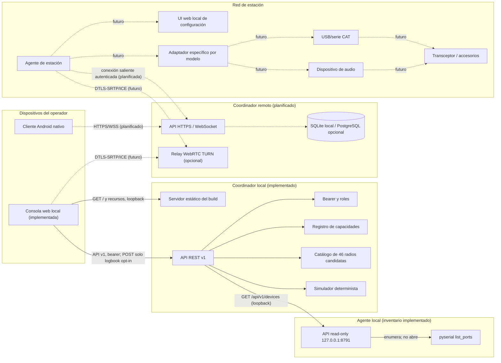
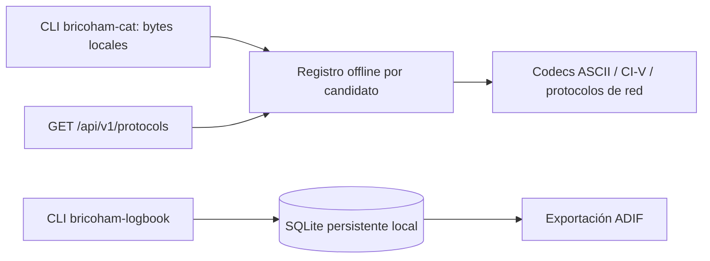
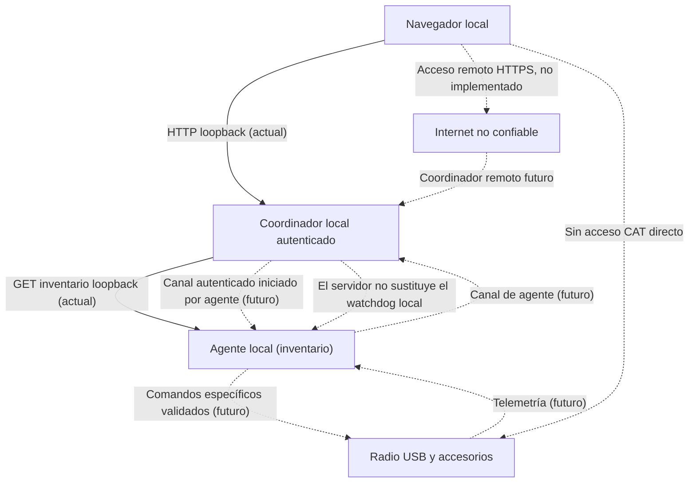
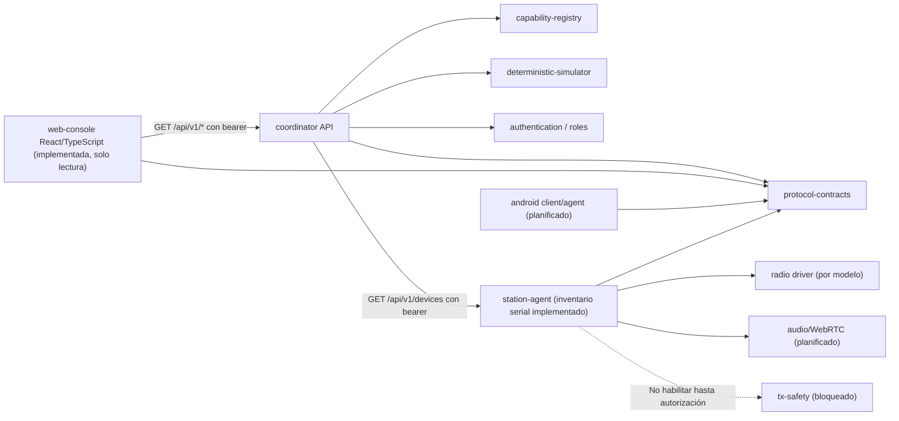
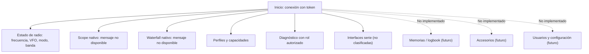

# Mapas de módulos, flujo y navegación

“Mapa neural” no describe una función implementada: el proyecto no contiene una
red neuronal ni un asistente de IA. Estos diagramas son mapas propios de
componentes, flujo y navegación; las partes futuras están etiquetadas como
planificadas.

## Arquitectura actual y objetivo

En la implementación actual funcionan la consola web, el coordinador de
loopback, el catálogo, el simulador y el inventario serie de solo lectura. El
agente no clasifica puertos ni accede a CAT. Hay codecs CAT puros para QMX+,
(tr)uSDX y FTX-1, pero no están conectados al agente ni tienen transporte.
Los codecs de otras familias y las primitivas de red se documentan en la
[investigación CAT](investigacion-cat-github.md); la CLI offline y
`GET /api/v1/protocols` los hacen inspeccionables sin transporte. El
[logbook](logbook.md) comparte SQLite entre CLI y consola web con permisos
por rol; su escritura no afecta al canal de control de radio.
Android, la nube, los transportes de radio, el relay y los medios siguen planificados.
El catálogo de 46 candidatos conserva las referencias y afirmaciones de terceros
separadas del estado de soporte BricoHams.

## Límites de confianza

Este flujo no llega a una radio ni a un socket de estación.

Los canales remotos aún no existen. En la primera versión, el coordinador solo
enlaza a `127.0.0.1`; no representa el diagrama futuro como una garantía de
seguridad actual.

## Mapa de módulos

## Navegación actual y futuras

La conexión, actualización, desconexión y expansión de perfiles son acciones de
interfaz implementadas. Los datos del simulador se etiquetan explícitamente. No
hay paneles operativos de audio, TX/PTT, memorias o accesorios.
