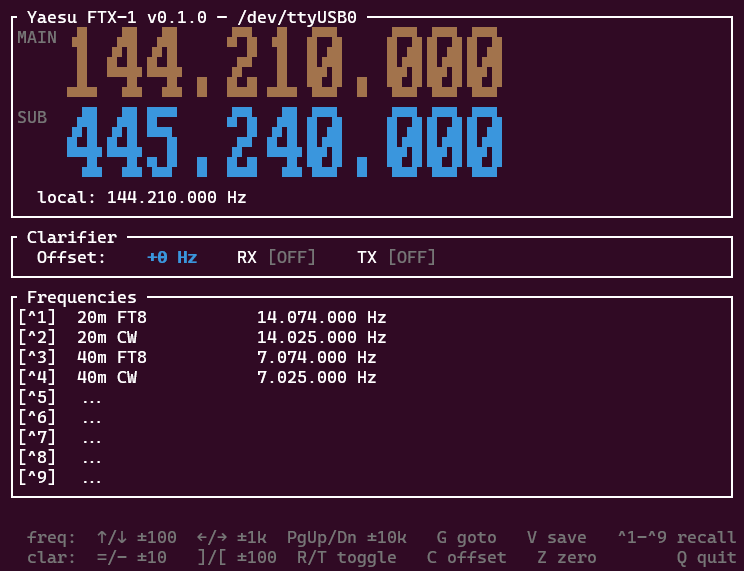

# Yaesu FTX-1 Control

A small terminal UI and Rust library for controlling a Yaesu FTX-1 transceiver
over its CAT serial interface. Tune the main VFO, recall named frequency
memories, and operate the clarifier — all from the keyboard, with the live
radio state polled and displayed in big text.



## Layout

The workspace contains two crates:

- **`ftx1/`** — a minimal CAT-protocol library. Speaks the subset of commands
  this project needs: `ID` (radio validation), `FA` (set VFO-A frequency),
  `IF` and `OI` (status reads for main and sub VFO), and `CF` (clarifier
  on/off and offset). Includes a `Mock` variant for hardware-free
  development.
- **`ftx1-ctl/`** — a `ratatui`-based TUI that wraps the library.

## Build

```sh
cargo build --release
```

Requires Rust 1.85+.

## Run

```sh
./target/release/ftx1-ctl                  # uses default config path
./target/release/ftx1-ctl --config my.toml # override config path
./target/release/ftx1-ctl --mock           # no radio, all writes are no-ops
./target/release/ftx1-ctl --version
./target/release/ftx1-ctl --help
```

On first launch with no config file, a starter config is written next to the
expected location (see below) and the radio's currently-tuned frequency is
adopted as the local state on the first poll.

## Configuration

The default config path is platform-specific (via the `dirs` crate):

| OS      | Path                                           |
| ------- | ---------------------------------------------- |
| Linux   | `~/.config/ftx1-ctl/config.toml`               |
| macOS   | `~/Library/Application Support/ftx1-ctl/config.toml` |
| Windows | `%APPDATA%\ftx1-ctl\config.toml`               |

A starter file is created automatically on first run; you can also start from
`config.example.toml` in the repo:

```toml
port    = "/dev/ttyUSB0"
baud    = 38_400
base_hz = 14_074_000

[[freq_memory]]
label = "20m FT8"
hz    = 14_074_000

[[freq_memory]]
label = "40m FT8"
hz    = 7_074_000
```

Frequency memory slots map to `Ctrl+1` … `Ctrl+9`. Saving a memory from the
TUI (`V`) edits this file in place, preserving comments and surrounding
formatting.

## Keys

### Frequency

| Key             | Action                                |
| --------------- | ------------------------------------- |
| `↑` / `↓`       | ±100 Hz                               |
| `←` / `→`       | ±1 kHz                                |
| `PgUp` / `PgDn` | ±10 kHz                               |
| `G`             | Goto — prompt for an exact frequency  |
| `V`             | Save current VFO to a memory slot     |
| `Ctrl+1`…`Ctrl+9` | Recall memory slot                  |

### Clarifier

| Key       | Action                       |
| --------- | ---------------------------- |
| `=` / `-` | ±10 Hz                       |
| `]` / `[` | ±100 Hz                      |
| `C`       | Enter an exact offset value  |
| `Z`       | Zero the clarifier offset    |
| `R`       | Toggle RX clarifier on/off   |
| `T`       | Toggle TX clarifier on/off   |

### Global

| Key            | Action |
| -------------- | ------ |
| `Q` / `Ctrl+C` | Quit   |

## Display

The status block shows two frequencies in big-text:

- **MAIN** — main-side VFO (polled via `IF;`).
- **SUB** — sub-side VFO (polled via `OI;`).

A small `local: …` line below tracks the optimistic frequency you've typed
locally; if it doesn't match what the radio reports yet, a `(Δ N Hz)` badge
appears until the next poll reconciles. Width-adaptive layout: side-by-side
above 100 columns, stacked below.

## Mock mode

`--mock` substitutes an in-memory radio so the TUI is usable without
hardware. Every command "succeeds" against a synthetic state, and a yellow
`[MOCK]` badge in the title bar makes it impossible to confuse with a real
session.
