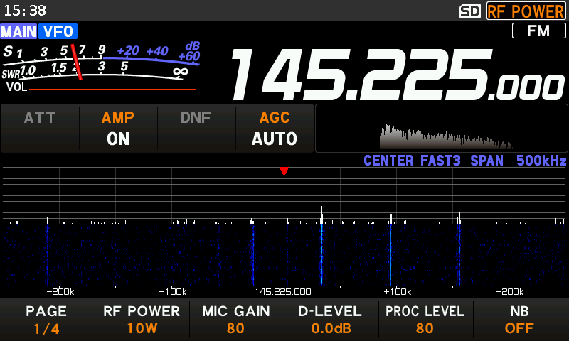
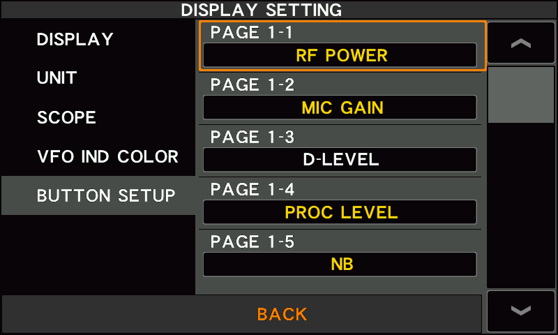
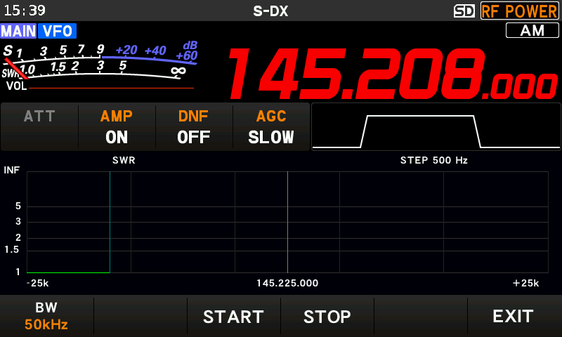

# FTX-1

[Polski](READMEPL.md)

## 1. Warnings and backup

Unofficial modification, not approved by Yaesu. You modify and install firmware at your own risk, with no warranty or manufacturer support. An error or interrupted update may cause loss of settings, malfunction or render the radio inoperable.

Before installing the modification, back up your radio settings and memories. Also keep the original, unmodified firmware files. Follow the Yaesu FTX-1 firmware update instructions when installing.

## 2. What the modification does

Four pages of 5 configurable bottom-row buttons. Configure them in DISPLAY SETTINGS → BUTTON SETUP → PAGE1-1 … PAGE4-5. Choose from 70 functions; duplicate assignments are allowed and one layout is shared across all modes. Each slot has its own default.

The fixed PAGE button switches between four pages, displays the page number and beeps. The other 20 buttons are configurable. Adjustment shortcuts assign a function to the FUNC knob; buttons display values or states, and unavailable functions are grayed out.

### Default page layout (after PAGE)

- RF POWER | MIC GAIN | AMC LEVEL | PROC LEVEL | NB
- DNR | D-LEVEL | TUNER | ANT TUNE | ANT
- APRS | APRS S.LIST | APRS M.LIST | APRS BEACON | APRS BCN-TX
- D-MODE | MULTI | SCOPE | SPAN | SPEED

### New features and operation

- Clock at the left of the top status bar, in H:MM or HH:MM format, without a leading zero for the hour.
- Functions unrelated to the spectrum remain available with the spectrum hidden. Original spectrum controls are available for assignment.
- APRS cycles MODEM SELECT through OFF / AUTO / MAIN / SUB. Shortcuts open station/message lists and APRS beacon controls.
- 3DSS toggles OFF/ON. TUNER displays ON/OFF; ANT switches antennas 1/2 and displays the number.
- FIL WIDTH, FIL SHIFT and NTCH FREQ activate the original VOLUME/DSP adjustment for the active VFO and display Hz. NTCH FREQ also enables NOTCH. NOTCH and CONTOUR toggle OFF/ON; NTCH WIDTH, NB REJECT, NB WIDTH and AMC REL cycle through available values.
- SCAN starts and stops native scanning on the selected receiver, starting towards higher frequencies.
- SWR SCAN measures antenna matching across a range around the VFO frequency. Instructions and limits follow below.
- BAND/MAG: short press — band list, long press — next band. MODE/N/W: short press — mode list, long press — NARROW/WIDE. FUNC on the main screen: short press — menu, long press — original short-press action. FUNC retains native menu and popup navigation.

### Two fixes for bugs in the original firmware

- BEEP LEVEL = 0: silent interface beeps are skipped, avoiding unnecessary activation of the audio path.
- RADIO SETTINGS → MODE SSB: AGC SLOW DELY corrected to AGC SLOW DELAY.

### Assignable functions

`D-LEVEL`, `D-PEAK`, `D-MARKER`, `D-COLOR`, `D-CONTRAST`, `DIMMER`, `MOX`, `ATT`, `AMP`, `DNF`, `AGC`, `MIC EQ`, `PROC LEVEL`, `ANT TUNE`, `TUNER`, `NB`, `DNR`, `ANT`, `TXW`, `RF POWER`, `MIC GAIN`, `AMC LEVEL`, `VOX`, `VOX GAIN`, `VOX DELAY`, `MONI LEVEL`, `KEYER`, `BK-IN`, `CW SPEED`, `CW PITCH`, `BK-DELAY`, `ZIN`, `CW SPOT`, `MESSAGE`, `PLAY`, `RECORD`, `DTMF`, `T-CALL`, `RPT SHIFT`, `REV`, `DG-ID TX`, `DG-ID RX`, `HRI MODE`, `APRS S.LIST`, `APRS M.LIST`, `APRS BEACON`, `APRS BCN-TX`, `CH STEP`, `SQL TYPE`, `TONE FREQ`, `DCS`, `HOME`, `APRS`, `D-MODE`, `MULTI`, `SCOPE`, `SPAN`, `SPEED`, `3DSS`, `FIL WIDTH`, `FIL SHIFT`, `NOTCH`, `NTCH FREQ`, `NTCH WIDTH`, `CONTOUR`, `NB REJECT`, `NB WIDTH`, `AMC REL`, `SCAN`, `SWR SCAN`.







## 3. SWR SCAN — instructions and limits

**READ CAREFULLY**

Measurement transmits RF. Connect an antenna or suitable load to the active antenna output before START. The scanner works with FTX-1 Field and SPA-1, using the factory SWR measurement source; it is not an independently calibrated meter. Monitor the radio TX state during measurement.

### Before opening and START

- Assign SWR SCAN in DISPLAY SETTINGS → BUTTON SETUP and press the assigned button. Opening the window alone does not transmit.
- Required: single-VFO DISP view, VFO mode and TUNER OFF. MEMORY, MT and QMB are unsupported. The radio must be in RX with no other TX request, scan or antenna tuning. The scanner does not switch MEMORY to VFO or turn off the tuner automatically.
- Before START, disable SPLIT, RIT, XIT and TX frequency offsets. RX and TX must use the same VFO. The entire sweep must stay within frequencies the radio permits for transmission; the range is not automatically clipped at band edges.

### Range and controls

| BW (full range) | Relative to center | Step |
| --- | --- | --- |
| 50 kHz | −25 … +25 kHz | 500 Hz |
| 100 kHz | −50 … +50 kHz | 1 kHz |
| 500 kHz | −250 … +250 kHz | 5 kHz |
| 1 MHz | −500 … +500 kHz | 10 kHz |

- Bottom row: [BW] [empty] [START] [STOP] [empty] [EXIT]. BW selects the full range; each sweep has 101 points with a BW/100 step.
- While stopped, set the center with the VFO dial and choose BW. Changing center or BW clears the curve. START runs one left-to-right sweep; it does not repeat automatically.
- During measurement: AM and a power setting of 1 W for Field or 5 W with SPA-1. Power is not increased when a measurement is invalid. The scanner holds its own TX request throughout the sweep rather than cycling TX/RX at every point.
- Starting again over the same range gradually replaces the previous curve. Old points to the right of the marker remain visible until replaced.
- STOP interrupts the sweep and keeps the graph. EXIT and physical BACK stop and close the window. CAT TX0 also stops scanning. On completion or stop, the radio withdraws the scanner TX request and restores center frequency, mode and power only after RX is confirmed. A timeout alone does not confirm TX is off.

### Known limitations and safeguards

- Do not turn the VFO dial during an active sweep: this can interrupt measurement and cause an error. BW cannot be changed during a sweep.
- TUNER OFF is required both when opening and starting. Scanning with the tuner ON is unsupported. The scanner neither tunes the tuner nor changes the antenna.
- SPA-1 filter relay switching may interrupt a sweep. This check is retained for safety; use separate narrower sweeps if needed.
- Sweep duration is not fixed. The graph follows the factory meter’s nonlinear scale and does not improve its accuracy. No separate high-SWR shutdown threshold is added; factory transmitter protections remain active.
- After a frequency change, Field waits for 16 new updates; SPA-1 waits for at least 3 new replies and at least 80 ms. An invalid power measurement is never presented as a valid SWR=1.
- Timeouts: point progress 500 ms, display acknowledgement 500 ms, return to RX 500 ms, entire session at most 60 s. The factory 60 s TOT also applies during scanning without changing the user’s stored setting.
- Lost communication, stale display acknowledgement, PTT conflicts or changes in TX or Field/SPA-1 conditions stop the sweep. Cutoff monitoring also runs in an interrupt. Scanning never resumes automatically after a fault or reboot.
- While SWR SCAN is open, band/mode selection, menus, DISP and unnecessary panel, touchscreen and microphone actions (P1–P4, UP/DOWN) are blocked. Scanner controls, BACK, volume, SQL/RF GAIN, VFO while stopped and long S-DX screenshots remain available when saving is possible.
- CAT supports status, frequency and meter reads and TX0; setting changes and starting TX through CAT are blocked. Sweep frequencies and temporary settings are not saved as normal user settings.
- Software safeguards cannot guarantee protection against every failure. If the radio continues transmitting despite STOP, switch it off.

### Error messages

- ERR2 — required operating/TX conditions changed or TX requests conflict.
- ERR3 — no valid power/SWR measurement or invalid meter data.
- ERR6 — disallowed range or startup conditions, including power.
- ERRH — display not ready. ERRP — fresh measurement timed out. ERRA — display point acknowledgement timed out.
- ERRX — return to RX and settings restoration did not finish in time. ERRS — session timeout.
- After an error, check TX, record the full code and check conditions before another START. An error never automatically restarts TX.

## 4. Restoring original firmware

1. Back up the radio settings and memories you want to restore later.
2. Install the original, unmodified MAIN and DISPLAY firmware in the radio, following the Yaesu FTX-1 instructions.
3. After installing the original firmware, reset the radio to factory settings following the radio manual. The reset erases user settings.

Installing the original firmware does not replace the factory reset. This tool prepares files; it does not program or repair the radio.

## 5. Patch firmware files

Download the original FTX-1 firmware from the manufacturer’s Yaesu website: MAIN 01-13 and DISPLAY 01-10. These exact versions and the hashes below are required. Other versions are unsupported.

Your files are never uploaded to a server. SHA-256 verification and patching run entirely on your computer, in your browser. No analytics or external libraries.

MAIN V40 + DISPLAY V35. Yaesu base: MAIN 01-13 / DISPLAY 01-10. V40 and V35 are modification versions; SFL filenames retain the factory version numbers. This release does not include the CW audio fix from MAIN V41.

### MAIN V40 — `FTX-1_MAIN_V0113.SFL`

| SHA-256 | Hash |
| --- | --- |
| Expected original SHA-256 | `de02ce415b37ca6621ed0bac2f8e7bd63d45f3022a62868598950502ed033f5c` |
| Expected patched SHA-256 | `a66308b8efefb868899bf015d685ceedc46767e2866baee404ec85a3e5edb2f8` |

### DISPLAY V35 — `FTX-1_DISPLAY_V0110.SFL`

| SHA-256 | Hash |
| --- | --- |
| Expected original SHA-256 | `962fda27ae2f0a0deedb039b868a545ef0f6736b686c266e19f231dbe3973bba` |
| Expected patched SHA-256 | `82bee0eb41937819ec03be5a7528c595365850dad9cdf0582c9df7473849be7c` |

Choose MAIN and DISPLAY in separate fields. Hashes are checked on selection; a mismatch blocks patching. Expected and actual SHA-256 values are displayed before and after patching. Downloads are enabled only for a verified result.

## Python and local page

Python 3.9+, no third-party libraries. The output directory must be new. Python reads shared patch data from `site/patch-data.js`; it does not execute JavaScript. Keep these files together.

```sh
python3 patch.py /path/FTX-1_MAIN_V0113.SFL /path/FTX-1_DISPLAY_V0110.SFL --out ./modified
python3 -m http.server 8001 --bind 127.0.0.1 --directory site
```

Open <http://localhost:8001>. Polish is the default, with a PL/EN switch in the header. For static hosting, publish all of `site/` over HTTPS. Original and pre-patched SFL files are not included. The tool decodes the SFL payload, checks original bytes, applies differences, re-encodes SFL and verifies CRC and known hashes. It is not a compiler or general-purpose firmware editor.

The distribution archive contains the patcher and patch data, without original or pre-patched SFL files. File checksums are listed in `SHA256SUMS.txt`.

SQ9PD :)
