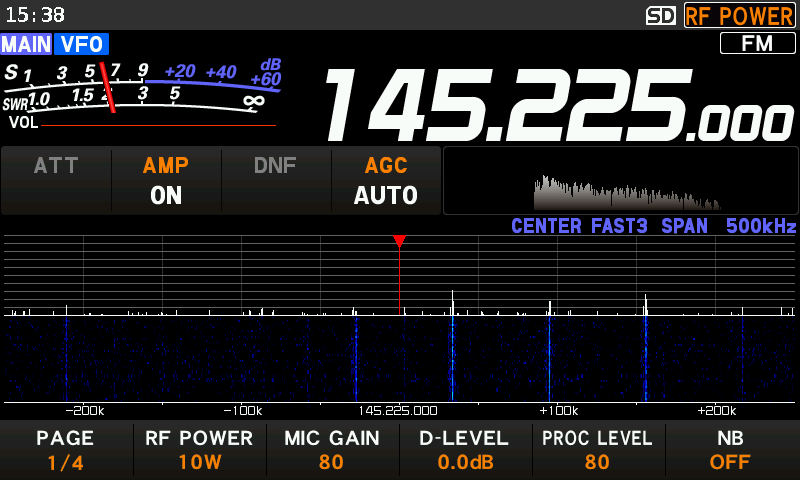
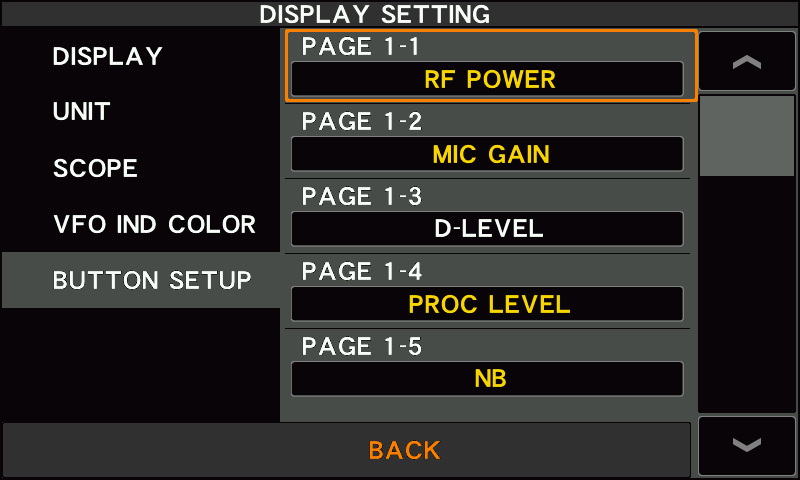
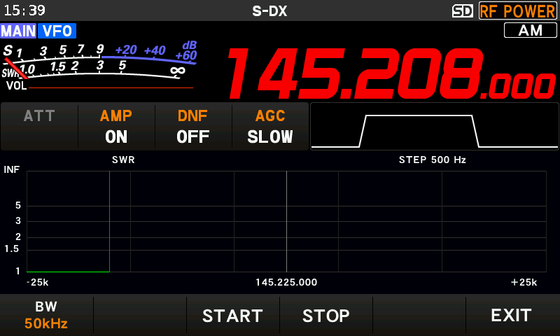

# FTX-1

[English](README.md)

## 1. Ostrzeżenia i kopia zapasowa

Nieoficjalna modyfikacja, niezatwierdzona przez Yaesu. Modyfikujesz i instalujesz firmware na własną odpowiedzialność, bez gwarancji działania ani wsparcia producenta. Błąd lub przerwanie aktualizacji może spowodować utratę ustawień, nieprawidłowe działanie albo unieruchomienie radia.

Przed wgraniem modyfikacji zrób kopię ustawień radia i pamięci. Zachowaj również oryginalne, niezmodyfikowane pliki firmware. Instalację wykonuj zgodnie z instrukcją aktualizacji Yaesu dla FTX-1.

## 2. Co zawiera modyfikacja

Cztery strony po 5 konfigurowalnych dolnych przycisków. Konfiguracja: DISPLAY SETTINGS → BUTTON SETUP → PAGE1-1 … PAGE4-5. Dostępnych jest 70 funkcji; powtórzenia są dozwolone, a jeden układ obowiązuje we wszystkich emisjach. Każda pozycja ma własne ustawienie domyślne.

Stały przycisk PAGE przełącza cztery strony, pokazuje numer strony i wydaje beep. Pozostałe 20 przycisków można konfigurować. Skróty regulacji przypisują funkcję do pokrętła FUNC; przyciski pokazują wartości lub stany, a funkcje niedostępne w danym kontekście są wyszarzane.

### Domyślny układ stron (po PAGE)

- RF POWER | MIC GAIN | AMC LEVEL | PROC LEVEL | NB
- DNR | D-LEVEL | TUNER | ANT TUNE | ANT
- APRS | APRS S.LIST | APRS M.LIST | APRS BEACON | APRS BCN-TX
- D-MODE | MULTI | SCOPE | SPAN | SPEED

### Nowe funkcje i obsługa

- Zegar po lewej stronie górnego paska, w formacie H:MM lub HH:MM, bez zera wiodącego godziny.
- Funkcje niezwiązane ze spectrum działają także przy ukrytym spectrum. Fabryczne funkcje spectrum pozostają dostępne do przypisania.
- APRS przełącza MODEM SELECT: OFF / AUTO / MAIN / SUB. Dostępne są skróty list stacji, wiadomości i obsługi beacona APRS.
- 3DSS przełącza OFF/ON. TUNER pokazuje ON/OFF, a ANT przełącza antenę 1/2 i pokazuje numer.
- FIL WIDTH, FIL SHIFT i NTCH FREQ uruchamiają fabryczną regulację VOLUME/DSP aktywnego VFO i pokazują Hz. NTCH FREQ włącza NOTCH. NOTCH i CONTOUR przełączają OFF/ON; NTCH WIDTH, NB REJECT, NB WIDTH i AMC REL przełączają dostępne wartości.
- SCAN włącza i wyłącza fabryczne skanowanie na wybranym odbiorniku, rozpoczynając w kierunku wyższych częstotliwości.
- SWR SCAN mierzy dopasowanie anteny w zakresie wokół częstotliwości VFO. Instrukcja i ograniczenia poniżej.
- BAND/MAG: krótko — lista pasm, długo — następne pasmo. MODE/N/W: krótko — lista emisji, długo — NARROW/WIDE. FUNC na głównym ekranie: krótko — menu, długo — fabryczna akcja krótkiego naciśnięcia. W menu i popupach FUNC zachowuje fabryczną obsługę.

### Dwie poprawki błędów oryginalnego firmware

- BEEP LEVEL = 0: pomijanie niemych beepów interfejsu, bez zbędnego wybudzania toru audio.
- RADIO SETTINGS → MODE SSB: poprawiono AGC SLOW DELY na AGC SLOW DELAY.

### Funkcje do przypisania

`D-LEVEL`, `D-PEAK`, `D-MARKER`, `D-COLOR`, `D-CONTRAST`, `DIMMER`, `MOX`, `ATT`, `AMP`, `DNF`, `AGC`, `MIC EQ`, `PROC LEVEL`, `ANT TUNE`, `TUNER`, `NB`, `DNR`, `ANT`, `TXW`, `RF POWER`, `MIC GAIN`, `AMC LEVEL`, `VOX`, `VOX GAIN`, `VOX DELAY`, `MONI LEVEL`, `KEYER`, `BK-IN`, `CW SPEED`, `CW PITCH`, `BK-DELAY`, `ZIN`, `CW SPOT`, `MESSAGE`, `PLAY`, `RECORD`, `DTMF`, `T-CALL`, `RPT SHIFT`, `REV`, `DG-ID TX`, `DG-ID RX`, `HRI MODE`, `APRS S.LIST`, `APRS M.LIST`, `APRS BEACON`, `APRS BCN-TX`, `CH STEP`, `SQL TYPE`, `TONE FREQ`, `DCS`, `HOME`, `APRS`, `D-MODE`, `MULTI`, `SCOPE`, `SPAN`, `SPEED`, `3DSS`, `FIL WIDTH`, `FIL SHIFT`, `NOTCH`, `NTCH FREQ`, `NTCH WIDTH`, `CONTOUR`, `NB REJECT`, `NB WIDTH`, `AMC REL`, `SCAN`, `SWR SCAN`.







## 3. SWR SCAN — instrukcja i ograniczenia

**PRZECZYTAJ UWAŻNIE**

Pomiar odbywa się podczas nadawania. Przed START podłącz antenę lub odpowiednie obciążenie do używanego wyjścia. Skaner działa z FTX-1 Field oraz SPA-1 i korzysta z fabrycznego źródła pomiaru SWR — nie jest niezależnie kalibrowanym miernikiem. Podczas pomiaru kontroluj stan TX radia.

### Przed otwarciem i START

- Przypisz SWR SCAN w DISPLAY SETTINGS → BUTTON SETUP i naciśnij przypisany przycisk. Samo otwarcie okna nie uruchamia TX.
- Wymagane: pojedynczy widok DISP, tryb VFO i TUNER OFF. MEMORY, MT i QMB nie są obsługiwane. Radio musi być w RX, bez innego żądania TX, skanowania lub strojenia anteny. Skaner nie przełącza automatycznie MEMORY na VFO ani nie wyłącza tunera.
- Przed START wyłącz SPLIT, RIT, XIT i przesunięcia częstotliwości TX. Odbiór i nadawanie muszą korzystać z tego samego VFO. Cały zakres musi mieścić się w częstotliwościach dopuszczonych do nadawania przez radio; zakres nie jest automatycznie skracany na granicy pasma.

### Zakres i sterowanie

| BW (cały zakres) | Względem środka | Krok |
| --- | --- | --- |
| 50 kHz | −25 … +25 kHz | 500 Hz |
| 100 kHz | −50 … +50 kHz | 1 kHz |
| 500 kHz | −250 … +250 kHz | 5 kHz |
| 1 MHz | −500 … +500 kHz | 10 kHz |

- Pasek: [BW] [puste] [START] [STOP] [puste] [EXIT]. BW przełącza cały zakres; każdy przebieg obejmuje 101 punktów, a krok wynosi BW/100.
- Gdy skan nie trwa, ustaw środek gałką VFO i wybierz BW. Zmiana środka lub BW kasuje krzywą. Naciśnij START, aby wykonać pojedynczy przebieg od lewej do prawej; skan nie powtarza się automatycznie.
- Na czas pomiaru: AM i nastawa 1 W dla Field albo 5 W z SPA-1. Skaner nie zwiększa mocy, jeśli pomiar jest niepoprawny. Podczas przebiegu utrzymuje własne żądanie TX, bez przełączania TX/RX dla każdego punktu.
- Kolejny START dla tego samego zakresu stopniowo zastępuje poprzednią krzywą. Stare punkty po prawej stronie znacznika pozostają widoczne do zastąpienia nowymi.
- STOP przerywa pomiar i zostawia wykres. EXIT i fizyczny BACK przerywają i zamykają okno. CAT TX0 również przerywa skan. Po końcu lub zatrzymaniu radio wycofuje żądanie TX i dopiero po potwierdzeniu RX przywraca środek, emisję i moc sprzed START. Sam timeout nie potwierdza wyłączenia TX.

### Znane ograniczenia i zabezpieczenia

- Nie obracaj gałki VFO podczas aktywnego skanowania — może to przerwać pomiar i wywołać błąd. Podczas przebiegu nie można zmieniać BW.
- TUNER OFF jest wymagany przy otwarciu i START. Skanowanie z tunerem ON jest nieobsługiwane. Skaner nie stroi tunera ani nie zmienia anteny.
- Przełączanie przekaźników filtrów SPA-1 może przerwać skan. Zachowano tę kontrolę dla bezpieczeństwa; w razie potrzeby wykonuj osobne pomiary w węższych zakresach.
- Brak stałego czasu przebiegu. Wykres odpowiada nieliniowej skali fabrycznego miernika i nie zwiększa jego dokładności. Nie dodano osobnego progu wyłączenia przy wysokim SWR; fabryczne zabezpieczenia nadajnika pozostają aktywne.
- Po zmianie częstotliwości: Field czeka na 16 nowych aktualizacji; SPA-1 na co najmniej 3 nowe odpowiedzi i co najmniej 80 ms. Brak ważnego pomiaru mocy nie jest pokazywany jako poprawny SWR=1.
- Limity: postęp punktu 500 ms, potwierdzenie ekranu 500 ms, powrót do RX 500 ms, cała sesja maksymalnie 60 s. Na czas skanu obowiązuje także fabryczny TOT 60 s, bez zmiany zapisanego ustawienia użytkownika.
- Zanik komunikacji, nieaktualne potwierdzenie ekranu, konflikt PTT, zmiana warunków TX lub Field/SPA-1 przerywają pomiar. Kontrola odcięcia działa również w przerwaniu. Po błędzie ani po restarcie skan nie wznawia się sam.
- Przy otwartym SWR SCAN zablokowane są zmiany pasma, emisji, menu, DISP oraz zbędne akcje panelu, ekranu i mikrofonu (P1–P4, UP/DOWN). Pozostają przyciski skanera, BACK, głośność, SQL/RF GAIN, VFO przy zatrzymanym skanie i długi S-DX do zrzutu, jeśli zapis jest możliwy.
- CAT obsługuje odczyty stanu, częstotliwości i mierników oraz TX0; zmiany ustawień i uruchamianie TX z CAT są zablokowane. Częstotliwości punktów i nastawy pomiarowe nie są zapisywane jako zwykłe ustawienia.
- Zabezpieczenia programowe nie gwarantują ochrony przed każdą awarią. Jeżeli mimo STOP radio nadal nadaje, wyłącz je.

### Komunikaty błędów

- ERR2 — zmiana wymaganych warunków pracy, stanu TX lub konflikt żądań TX.
- ERR3 — brak ważnego pomiaru mocy/SWR lub niepoprawne dane miernika.
- ERR6 — niedopuszczalny zakres lub warunki uruchomienia, w tym moc.
- ERRH — brak gotowości ekranu. ERRP — brak świeżego pomiaru w terminie. ERRA — brak potwierdzenia punktu przez ekran.
- ERRX — niezakończony powrót do RX i odtwarzanie ustawień. ERRS — przekroczony czas sesji.
- Po błędzie sprawdź TX, zanotuj pełny kod i sprawdź warunki przed kolejnym START. Błąd nie powoduje automatycznego wznowienia TX.

## 4. Powrót do oryginalnego firmware

1. Zrób kopię ustawień radia i pamięci, które chcesz później odtworzyć.
2. Wgraj do radia oryginalne, niezmodyfikowane firmware MAIN i DISPLAY zgodnie z instrukcją Yaesu dla FTX-1.
3. Po wgraniu oryginałów wykonaj reset do ustawień fabrycznych zgodnie z instrukcją radia. Reset usuwa ustawienia użytkownika.

Samo wgranie oryginalnego firmware nie zastępuje resetu. Narzędzie przygotowuje pliki; nie programuje ani nie naprawia radia.

## 5. Patchowanie plików

Pobierz oryginalne firmware FTX-1 ze strony producenta Yaesu: MAIN 01-13 i DISPLAY 01-10. Wymagane są dokładnie te wersje i podane poniżej hashe. Inne wersje nie są obsługiwane.

Pliki nie są wysyłane na serwer. Weryfikacja SHA-256 i nakładanie patcha odbywają się wyłącznie na Twoim komputerze, w przeglądarce. Bez analityki i zewnętrznych bibliotek.

MAIN V40 + DISPLAY V35. Baza Yaesu: MAIN 01-13 / DISPLAY 01-10. V40 i V35 to wersje modyfikacji; nazwy SFL zachowują numery fabryczne. Ta wersja nie zawiera poprawki audio CW z MAIN V41.

### MAIN V40 — `FTX-1_MAIN_V0113.SFL`

| SHA-256 | Hash |
| --- | --- |
| Oczekiwany SHA-256 oryginału | `de02ce415b37ca6621ed0bac2f8e7bd63d45f3022a62868598950502ed033f5c` |
| Oczekiwany SHA-256 po patchu | `a66308b8efefb868899bf015d685ceedc46767e2866baee404ec85a3e5edb2f8` |

### DISPLAY V35 — `FTX-1_DISPLAY_V0110.SFL`

| SHA-256 | Hash |
| --- | --- |
| Oczekiwany SHA-256 oryginału | `962fda27ae2f0a0deedb039b868a545ef0f6736b686c266e19f231dbe3973bba` |
| Oczekiwany SHA-256 po patchu | `82bee0eb41937819ec03be5a7528c595365850dad9cdf0582c9df7473849be7c` |

Wybierz MAIN i DISPLAY w osobnych polach. Hash sprawdzany jest po wyborze; niezgodność blokuje patch. Przed i po patchowaniu widoczne są oczekiwane i rzeczywiste SHA-256. Pobranie jest dostępne tylko dla zgodnego wyniku.

## Python i lokalna strona

Python 3.9+, bez dodatkowych bibliotek. Katalog wynikowy musi być nowy. Python odczytuje wspólne dane patcha z `site/patch-data.js`; nie uruchamia JavaScriptu. Nie rozdzielaj tych plików.

```sh
python3 patch.py /path/FTX-1_MAIN_V0113.SFL /path/FTX-1_DISPLAY_V0110.SFL --out ./modified
python3 -m http.server 8001 --bind 127.0.0.1 --directory site
```

Strona: <http://localhost:8001>. Domyślnie PL; przełącznik PL/EN w nagłówku. Do hostingu statycznego opublikuj całą zawartość `site/` przez HTTPS. Oryginalne ani gotowe zmodyfikowane SFL nie są dołączone. Narzędzie odkodowuje payload SFL, sprawdza stare bajty, nakłada różnice, koduje SFL i sprawdza CRC oraz znane hashe. Nie jest kompilatorem ani uniwersalnym edytorem firmware.

Archiwum dystrybucyjne zawiera patcher i dane patcha, bez oryginalnych ani gotowych zmodyfikowanych SFL. Sumy kontrolne plików znajdują się w `SHA256SUMS.txt`.

SQ9PD :)
